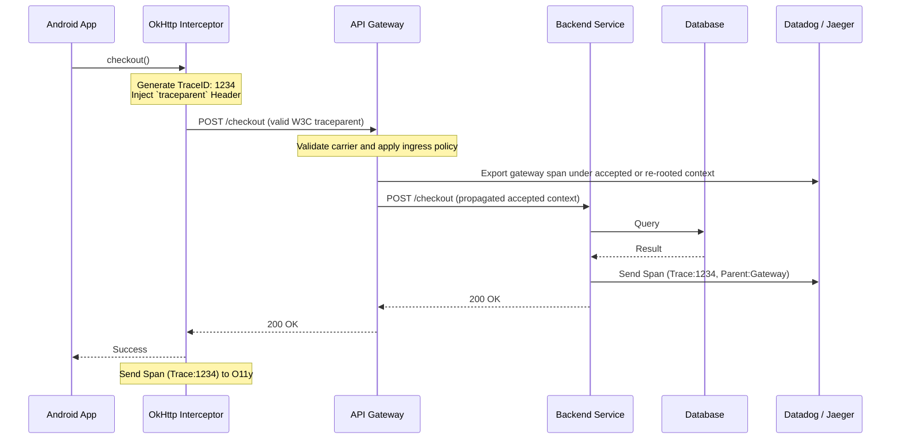

# Distributed Tracing

> **Application boundary:** canonical trace/span/context and sampling mechanics live in [`tracing.md`](tracing.md). This chapter owns propagation across process/network boundaries: W3C carriers, public-ingress trust, clock/privacy constraints, and cross-system correlation. [`../distributed-systems/distributed-tracing.md`](../distributed-systems/distributed-tracing.md) remains a bridge to this application.

## Overview

Distributed tracing extends local [Tracing](tracing.md) across process and network boundaries. When each participating component propagates compatible context and exports correlated spans, one request can be inspected from a mobile interaction through gateways, services, and data stores.

## Why It Matters

When a user complains, "The app is slow when I checkout," the mobile team looks at their metrics: "Network call takes 8 seconds. It's the backend's fault." The backend team looks at their metrics: "Checkout Service takes 50ms. It's the mobile team's fault."

Separate metrics cannot show whether the missing time was in client work, the network path, a gateway, or an uninstrumented dependency. A sufficiently complete trace narrows that uncertainty; it remains evidence to validate against clock quality, sampling, instrumentation gaps, and service metrics rather than an infallible verdict.

## Historical Context

Systems such as Google's Dapper and Twitter's Zipkin demonstrated trace correlation across distributed services. W3C Trace Context now specifies an interoperable HTTP carrier, while OpenTelemetry supplies vendor-neutral APIs, SDKs, semantic conventions, and collector components. Mobile can participate as a public-client hop when instrumentation, sampling, privacy, and ingress trust are designed explicitly.

## First Principles

1.  **Local mechanics first:** Trace IDs, span IDs, parentage, and sampling are defined in [Tracing](tracing.md); distributed tracing carries that context across a boundary.
2.  **Carrier propagation:** Instrumented clients inject supported context into an outbound carrier and instrumented receivers extract it before creating server spans.
3.  **Trust at ingress:** A public client can propose context, but the edge validates its format and policy. It may continue it, ignore untrusted flags, or start a new root linked to a privacy-safe correlation ID.
4.  **Interoperable format:** W3C `traceparent` and optional `tracestate` let heterogeneous components exchange context without requiring one instrumentation vendor.

## Mental Model

Think of a package shipped internationally.
- **Local Tracing:** You know the package left your house and arrived at the local post office.
- **Distributed Tracing:** The package has a global barcode. It is scanned at your local post office, scanned at the airport, scanned at customs in Germany, and scanned at the destination. No matter who handles the package (USPS, DHL, German Post), they all read the exact same barcode. You can look up that barcode and see the entire global journey.

## Internal Mechanics

The implementation requires tight coordination between the Mobile networking layer and the Backend infrastructure.

### The W3C Trace Context Header

When an instrumented Android request has a current client span, its propagator can format that context into an HTTP header:

`traceparent: 00-4bf92f3577b34da6a3ce929d0e0e4736-00f067aa0ba902b7-01`

- `00`: Version
- `4bf9...`: The global **Trace ID**.
- `00f0...`: The Mobile App's **Span ID** (The parent).
- `01`: Sampled flag (Should the backend record this?).

### Android-to-edge handoff

Prefer supported OpenTelemetry/HTTP-client instrumentation over a hand-written carrier. The instrumentation creates or retrieves the current client span, injects configured propagators, records the exchange, and closes the span under cancellation and failure. The receiving edge extracts and validates the carrier before choosing whether to continue it. That decision is not delegated to an untrusted device.

## Architecture

The diagram's key boundary is ingress: the gateway validates client-supplied context and propagates only the accepted or re-rooted server context.

## Production Example

**Localizing a checkout latency report**

1. A user complains checkout takes 10 seconds.
2. The Staff Mobile Engineer searches Datadog for `Trace ID` matching that user's session.
3. The Gantt chart appears:
   - **[Mobile]** UI Button Clicked (Total time: 10s)
     - **[Mobile]** OkHttp Request (Total time: 9.8s)
       - **[API Gateway]** Route Request (Total time: 9.7s)
         - **[Checkout Service]** Process (Total time: 50ms)
         - **[Fraud Service]** Check (Total time: 9.6s)

This trace makes the fraud-service span the leading hypothesis. The owning team checks its internal spans and metrics, while the mobile and gateway teams verify clock correction and uninstrumented gaps before concluding that the client is healthy.

## Tradeoffs

**Advantages**
- **Cross-boundary visibility:** Gives teams a shared request identifier and timeline when instrumentation is complete enough.
- **Faster hypothesis narrowing:** Can reduce diagnosis time by showing which measured hop deserves deeper investigation.

**Disadvantages**
- **Clock skew:** Device and server clocks can differ, distorting cross-host span placement. Use monotonic duration within a process where supported and understand the backend's clock-correction limits.
- **Security:** A public client can send arbitrary syntactically valid trace context. The edge needs validation, resource controls, attribute filtering, and an explicit continue/re-root/link policy.
- **Data Volume:** Large mobile fleets can create material device, network, storage, privacy, and ingestion cost without a bounded sampling/retention policy.

## Failure Modes

- **The Dropped Header:** The Mobile app injects the header, but an intermediary strips it before the backend. Client and server may each have spans, but they appear under separate roots unless another approved correlation field links them.
- **The Backend Trust Boundary:** The edge may ignore the client's sampling flag or re-root the request. Without a documented policy, the client and server produce fragmented or differently sampled evidence. *(Fix: align ingress trust, sampling, and link/correlation behavior explicitly.)*
- **Broken Coroutine Context:** As covered in [Tracing](tracing.md), if the OkHttp call happens inside a coroutine that lost its context, the Interceptor won't know the overarching parent Span ID, breaking the local portion of the trace.

## Staff Engineer Thinking

When pushing for Distributed Tracing, a Staff engineer focuses on organizational alignment:

1.  **Do we share a standard?** Prefer W3C Trace Context at HTTP boundaries and compatible OpenTelemetry semantics/export paths so independently owned components can interoperate. Document exceptions rather than assuming one vendor SDK everywhere.
2.  **How are we handling clock skew?** Document the SDK's timestamp source and the backend's correction behavior; test traces from devices with deliberately skewed wall clocks.
3.  **Is this solving a measured problem?** A correlation ID plus structured logs may be sufficient for a short, well-understood path. Adopt distributed spans when cross-boundary latency, fan-out, or dependency diagnosis justifies the device and backend cost.

## Common Misconceptions

- **"We need to log the Trace ID in every message."** While helpful for fallback (Structured Logging), the primary power of Distributed Tracing is the visual Spans sent directly to the backend, completely bypassing the text-logging pipeline.
- **"Mobile is just another microservice."** False. A public client has variable clocks and networks, constrained resources, process death, offline periods, and an untrusted security boundary. Treat its context and attributes accordingly.

## Probing Questions

1.  Explain the purpose of the `traceparent` HTTP Header in W3C Trace Context.
2.  Which service-topology and diagnostic problems make distributed tracing more valuable than correlation IDs and logs alone?
3.  Describe the "Clock Skew" problem and how it impacts the visualization of a Distributed Trace originating from a mobile device.
4.  Why might an API Gateway deliberately strip or ignore a Trace ID generated by an Android application?
5.  How can a distributed trace narrow a Mobile-vs-Backend latency disagreement, and what evidence still needs validation?
6.  Explain the relationship between Local Tracing (e.g., measuring a Room DB query) and Distributed Tracing (e.g., an OkHttp call). How do they connect?
7.  What interoperability roles do W3C Trace Context and OpenTelemetry play?
8.  If Mobile and Backend use different SDKs or vendors, which propagation and export contracts must align for one trace to remain correlatable?
9.  When can recording every trace be reasonable, and why do large mobile fleets usually sample?
10. Describe the visual difference in a Gantt chart between a "broken" trace (where the header was dropped) and a "successful" trace.

## Mobile Implementation (Android)

The W3C Trace Context handoff from device to BFF belongs in centrally configured, version-appropriate HTTP instrumentation. The wire spec uses `traceparent` and optional `tracestate`; the edge still validates the incoming carrier and sampling flag. Prefer the OpenTelemetry Android/OkHttp instrumentation supported by the project's selected release instead of copying a hand-written interceptor: it must handle context storage, cancellation, redirects, retries, semantic attributes, exceptions, and span closure together.

At ingress, record whether the edge continued, re-rooted, or linked the client context. Propagate only the accepted server context downstream. A trace backend can then correlate the Android client span with gateway and service spans when export, sampling, identity, and trust policy align.

Mobile-distinct concerns:

1. **Sampling on the device.** Configure the SDK's sampler centrally and propagate its decision according to the [canonical sampling contract](tracing.md#sampling-contract). Head sampling cannot know that a later span will fail; error-biased retention normally requires tail sampling or a separate bounded diagnostic signal.
2. **Offline traces.** Use supported exporter buffering with explicit size, age, privacy, and network constraints. Do not assume every trace should survive an unbounded offline period or build an ad hoc Room exporter without those policies.
3. **Process death.** A relaunched process normally starts new spans. Link or correlate them through a durable privacy-safe business operation/session identifier when continuity matters rather than extending an indefinitely open trace through `SavedStateHandle`.
4. **Carrier overhead.** Trace headers add bytes to each instrumented request. Include them in measured high-frequency or constrained-link budgets rather than relying on one fixed total once `tracestate` or baggage is present.
5. **Cross-device debugging.** Separate devices generate distinct traces. Correlate only through an approved pseudonymous account/operation attribute with documented access, retention, and deletion policy.

## Answer Key

1. **Explain the purpose of the `traceparent` HTTP Header in W3C Trace Context.**
   It standardizes the format for propagating the global Trace ID and parent Span ID across network boundaries to connect client and server execution paths.
2. **Which service-topology and diagnostic problems make distributed tracing more valuable than correlation IDs and logs alone?**
   Fan-out, asynchronous boundaries, retries, queues, and several independently operated services make parentage and timing difficult to reconstruct from logs alone. A trace is most valuable when that structure affects diagnosis; a smaller path may be served by structured logs and a correlation ID.
3. **Describe the "Clock Skew" problem and how it impacts the visualization of a Distributed Trace originating from a mobile device.**
   Inaccurate device clocks cause mobile spans to have incorrect timestamps, leading visualizations to show impossibilities like a backend responding before the mobile app made the request.
4. **Why might an API Gateway deliberately strip or ignore a Trace ID generated by an Android application?**
   For security reasons, to prevent malicious actors from injecting manipulated Trace IDs or exhausting tracing resources on the backend.
5. **How can a distributed trace narrow a Mobile-vs-Backend latency disagreement, and what evidence still needs validation?**
   It places measured client, gateway, and service spans under correlated context so the largest recorded interval becomes a concrete hypothesis. Teams still validate clock correction, sampling, missing spans, retries, and component metrics before assigning cause.
6. **Explain the relationship between Local Tracing (e.g., measuring a Room DB query) and Distributed Tracing (e.g., an OkHttp call). How do they connect?**
   Local traces act as child spans within the broader distributed trace, linking on-device operations with network operations under the same Trace ID.
7. **What interoperability roles do W3C Trace Context and OpenTelemetry play?**
   W3C Trace Context specifies a common carrier format at HTTP boundaries. OpenTelemetry supplies vendor-neutral APIs, SDKs, semantic conventions, instrumentation, and collectors; actual interoperability still depends on compatible versions, configuration, sampling, trust, and export paths.
8. **If Mobile and Backend use different SDKs or vendors, which propagation and export contracts must align for one trace to remain correlatable?**
   They need compatible trace/span identity and parentage, W3C carrier handling at the boundary, an agreed ingress trust/sampling policy, and a collector/backend path that can query or correlate both span sets. The SDK vendors do not have to be identical.
9. **When can recording every trace be reasonable, and why do large mobile fleets usually sample?**
   Full capture can be reasonable for a bounded test, low-volume operation, or short privacy-approved diagnostic window. Large fleets usually sample because instrumentation, device/network work, privacy exposure, storage, retention, and query cost scale with trace volume.
10. **Describe the visual difference in a Gantt chart between a "broken" trace (where the header was dropped) and a "successful" trace.**
    A dropped carrier commonly produces separate client and server trace roots or missing sampled segments. A successfully accepted carrier produces the intended parent/child relationship, subject to each component's sampling and export policy.

## Further Reading

- [`tracing.md`](tracing.md) — The foundation of creating local Spans before they cross the network boundary.
- [`structured-logging.md`](structured-logging.md) — How to embed the Trace ID into logs as a fallback mechanism.
- [W3C Trace Context Specification](https://www.w3.org/TR/trace-context/) — the wire format.
- [OpenTelemetry Android SDK](https://github.com/open-telemetry/opentelemetry-android) — exporters, sampling, instrumentation.
- [OkHttp Interceptor API](https://github.com/square/okhttp/blob/master/okhttp/src/commonJvmAndroid/kotlin/okhttp3/Interceptor.kt) — where to inject `traceparent`.
