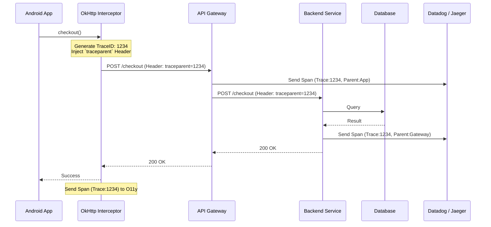

# Distributed Tracing

## Overview

Distributed Tracing is the holy grail of modern observability. It extends the concept of local [Tracing](tracing.md) beyond the boundaries of the mobile device. It tracks a single user request from the moment the user taps a button on their phone, across the internet, through the API Gateway, into the microservices, down to the database, and back to the phone. 

It unifies the entire engineering organization (Mobile, Web, Backend, DB Admins) under a single visual timeline.

## Why It Matters

When a user complains, "The app is slow when I checkout," the mobile team looks at their metrics: "Network call takes 8 seconds. It's the backend's fault." The backend team looks at their metrics: "Checkout Service takes 50ms. It's the mobile team's fault."

Without Distributed Tracing, this finger-pointing can last for weeks. The issue might be a routing misconfiguration in an API Gateway, or a massive payload being serialized slowly on the device. Distributed Tracing ends the argument immediately by showing exactly where the 8 seconds were spent in a single, undeniable Gantt chart.

## Historical Context

Distributed Tracing was pioneered by Google (Dapper paper, 2010) and Twitter (Zipkin) to solve the observability nightmare of microservice architectures. As backends fractured into hundreds of tiny services, logs became impossible to correlate. In recent years, standards like OpenTelemetry (W3C Trace Context) have emerged, allowing the Mobile Client to be officially integrated as the "first hop" in the distributed trace, rather than being treated as a black box.

## First Principles

1.  **The Trace Context:** A combination of the `Trace ID` (the overarching journey) and the `Span ID` (the specific parent step).
2.  **Header Propagation:** The Mobile App must inject the Trace Context into the HTTP Headers of every network request. This is the bridge between the client and the server.
3.  **The W3C Standard:** You must use a standardized format (like W3C `traceparent`) so that an Android app, a Go load balancer, and a Java backend all understand the same ID.

## Mental Model

Think of a package shipped internationally.
- **Local Tracing:** You know the package left your house and arrived at the local post office.
- **Distributed Tracing:** The package has a global barcode. It is scanned at your local post office, scanned at the airport, scanned at customs in Germany, and scanned at the destination. No matter who handles the package (USPS, DHL, German Post), they all read the exact same barcode. You can look up that barcode and see the entire global journey.

## Internal Mechanics

The implementation requires tight coordination between the Mobile networking layer and the Backend infrastructure.

### The W3C Trace Context Header

When an Android app makes a request, it generates a `Trace ID` and a `Span ID`, and formats them into an HTTP Header:

`traceparent: 00-4bf92f3577b34da6a3ce929d0e0e4736-00f067aa0ba902b7-01`

- `00`: Version
- `4bf9...`: The global **Trace ID**.
- `00f0...`: The Mobile App's **Span ID** (The parent).
- `01`: Sampled flag (Should the backend record this?).

### The Android Implementation (OkHttp)

You do not write this manually. You use an OkHttp Interceptor provided by an OpenTelemetry SDK.

```kotlin
// 1. Initialize OpenTelemetry (Usually injected via Hilt/Dagger)
val openTelemetry = OpenTelemetrySdk.builder().build()

// 2. Add the Interceptor to OkHttp
val client = OkHttpClient.Builder()
    .addInterceptor(OpenTelemetryInterceptor(openTelemetry))
    .build()

// 3. Make the call. The Interceptor automatically generates the Trace ID 
// and injects the `traceparent` HTTP header.
val request = Request.Builder().url("https://api.example.com/checkout").build()
client.newCall(request).execute()
```

When the Backend receives this request, it reads the `traceparent` header. It says, "Ah, I am part of Trace `4bf9...` and my parent is Span `00f0...`". The Backend creates its own Spans and sends them to Datadog/Splunk with those exact IDs.

## Architecture



## Production Example

**Fixing the "Mobile is Slow" Argument**

1. A user complains checkout takes 10 seconds.
2. The Staff Mobile Engineer searches Datadog for `Trace ID` matching that user's session.
3. The Gantt chart appears:
   - **[Mobile]** UI Button Clicked (Total time: 10s)
     - **[Mobile]** OkHttp Request (Total time: 9.8s)
       - **[API Gateway]** Route Request (Total time: 9.7s)
         - **[Checkout Service]** Process (Total time: 50ms)
         - **[Fraud Service]** Check (Total time: 9.6s)

The argument is over. The Mobile app is fine. The Checkout Service is fine. The Fraud Service is taking 9.6 seconds. The Backend team investigates the Fraud service.

## Tradeoffs

**Advantages**
- **End-to-End Visibility:** Eliminates silos between mobile and backend teams.
- **Root Cause Analysis:** Reduces Time-To-Resolution (TTR) for complex performance bugs from weeks to minutes.

**Disadvantages**
- **Clock Skew:** A major headache. Mobile device clocks are notoriously inaccurate (sometimes off by hours or years). If the Backend span uses accurate NTP time, and the Mobile span uses local device time, the UI visualization will show the backend responding before the mobile app even made the request! (Modern tools attempt to heuristically fix this, but it is never perfect).
- **Security:** If the API Gateway is not configured to trust the `traceparent` header from mobile clients, hackers can inject malicious Trace IDs. Many backends drop client-provided headers and generate their own at the edge, severing the link to the mobile app.
- **Data Volume:** Sending traces from 10 million mobile devices will instantly bankrupt an observability budget.

## Failure Modes

- **The Dropped Header:** The Mobile app injects the header, but a CDN (like Cloudflare) or a Load Balancer strips unknown headers before passing the request to the Backend. The Trace is broken.
- **The Backend Trust Boundary:** To prevent abuse, the Backend ignores the Mobile app's `Sampled` flag. The Mobile app sends the Span, but the Backend doesn't. The visualization shows a request leaving the phone and vanishing into a black hole. *(Fix: Mobile and Backend teams must explicitly align on sampling strategies and header trust).*
- **Broken Coroutine Context:** As covered in [Tracing](tracing.md), if the OkHttp call happens inside a coroutine that lost its context, the Interceptor won't know the overarching parent Span ID, breaking the local portion of the trace.

## Staff Engineer Thinking

When pushing for Distributed Tracing, a Staff engineer focuses on organizational alignment:

1.  **Do we share a standard?** I will not implement a proprietary Android tracing SDK if the backend uses something else. I will mandate W3C Trace Context and OpenTelemetry across the entire company.
2.  **How are we handling Clock Skew?** If the tracing UI is confusing because mobile clocks are wrong, developers will stop using it. I will work with the Observability vendor to ensure they have clock-skew adjustment enabled for mobile spans.
3.  **Is this solving a real problem?** If the backend is a single, monolithic Ruby on Rails app, distributed tracing is massive overkill. A simple UUID passed in the header and logged on the server is enough. Distributed tracing is for *distributed* systems (microservices).

## Common Misconceptions

- **"We need to log the Trace ID in every message."** While helpful for fallback (Structured Logging), the primary power of Distributed Tracing is the visual Spans sent directly to the backend, completely bypassing the text-logging pipeline.
- **"Mobile is just another microservice."** False. Mobile is uniquely hostile. Microservices have reliable clocks, endless bandwidth, and secure boundaries. Mobile has broken clocks, 3G networks, and malicious actors trying to exploit your headers.

## Probing Questions

1.  Explain the purpose of the `traceparent` HTTP Header in W3C Trace Context.
2.  Why did the rise of Microservices make Distributed Tracing a necessity rather than a luxury?
3.  Describe the "Clock Skew" problem and how it impacts the visualization of a Distributed Trace originating from a mobile device.
4.  Why might an API Gateway deliberately strip or ignore a Trace ID generated by an Android application?
5.  How does Distributed Tracing resolve conflicts between Mobile and Backend teams regarding performance bottlenecks?
6.  Explain the relationship between Local Tracing (e.g., measuring a Room DB query) and Distributed Tracing (e.g., an OkHttp call). How do they connect?
7.  What is OpenTelemetry, and why is it important for the future of mobile observability?
8.  If you are implementing Distributed Tracing, why is it critical that the Mobile team and Backend team use the exact same observability vendor (e.g., both use Datadog, or both use Jaeger)?
9.  Why is 100% trace sampling impossible for a mobile application with millions of Daily Active Users (DAU)?
10. Describe the visual difference in a Gantt chart between a "broken" trace (where the header was dropped) and a "successful" trace.

## Mobile Implementation (Android)

The W3C Trace Context handoff from device to BFF is a one-line OkHttp interceptor. The wire spec uses two headers: `traceparent` (mandatory) and optional `tracestate`.

```kotlin
class TracePropagationInterceptor(
    private val tracer: Tracer,
) : Interceptor {
    override fun intercept(chain: Interceptor.Chain): Response {
        val span = tracer.spanBuilder("http.${chain.request().method}")
            .setSpanKind(SpanKind.CLIENT)
            .setAttribute("http.url", chain.request().url.toString().scrub())
            .startSpan()

        return try {
            val requestWithTrace = chain.request().newBuilder().apply {
                // Inject W3C traceparent
                val ctx = Context.current().with(span)
                W3CTraceContextPropagator.getInstance().inject(ctx, this) { builder, key, value ->
                    builder.header(key, value)
                }
            }.build()

            val response = chain.proceed(requestWithTrace)
            span.setAttribute("http.status_code", response.code.toLong())
            response
        } catch (t: Throwable) {
            span.setStatus(StatusCode.ERROR)
            span.recordException(t)
            throw t
        } finally {
            span.end()
        }
    }
}

private fun String.scrub(): String =
    this.replace(Regex("(token|secret|api_key)=[^&]*"), "$1=REDACTED")
```

The BFF reads `traceparent`, continues the trace, propagates downstream. Your Tempo/Jaeger/Honeycomb dashboard now shows: `client.startSpan` (Android) → `bff.handle_request` (server) → `db.query` (server) — one waterfall, one trace ID.

Mobile-distinct concerns:

1. **Sampling on the device.** Decide on-device whether to sample at the `spanBuilder.setSampler` step; transmitting full traces for every request is bandwidth- and battery-prohibitive. Head-based sampling (e.g., 10% of sessions full-trace, 90% sample only errors).
2. **Offline traces.** A trace started while offline persists locally and ships when network returns. Implement the SDK to back the span exporter with a Room queue, drained by `WorkManager`.
3. **Trace ID survives process death.** Persist the active session's trace ID to `SavedStateHandle` so a relaunched user's first request resumes the same trace.
4. **Cellular header overhead.** `traceparent` adds ~60 bytes per request. Negligible per call; relevant if you're polling at high frequency.
5. **Cross-device debugging.** The same user on phone + tablet generates distinct traces. Link via shared `user_id` attribute in the BFF span.

## Further Reading

- [`tracing.md`](tracing.md) — The foundation of creating local Spans before they cross the network boundary.
- [`structured-logging.md`](structured-logging.md) — How to embed the Trace ID into logs as a fallback mechanism.
- [W3C Trace Context Specification](https://www.w3.org/TR/trace-context/) — the wire format.
- [OpenTelemetry Android SDK](https://github.com/open-telemetry/opentelemetry-android) — exporters, sampling, instrumentation.
- [OkHttp Interceptor API](https://github.com/square/okhttp/blob/master/okhttp/src/commonJvmAndroid/kotlin/okhttp3/Interceptor.kt) — where to inject `traceparent`.
