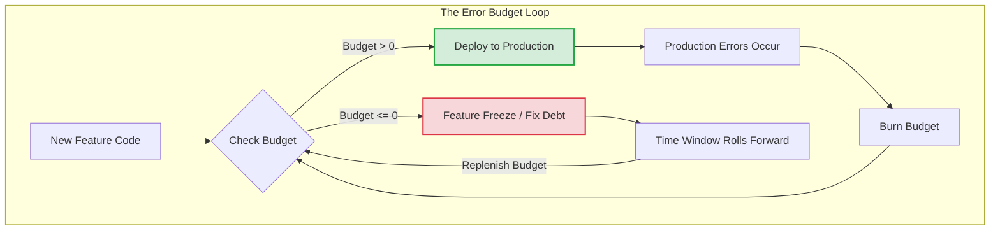

# Error Budgets

## Overview

An Error Budget is the mathematical inverse of a Service Level Objective ([SLO](slos.md)). If your SLO is a 99.9% crash-free rate, your Error Budget is 0.1%. It is the exact, quantified amount of unreliability your system is *allowed* to have over a given time window without angering your users.

Error Budgets are the ultimate currency in Site Reliability Engineering (SRE). They transform the abstract concept of "reliability" into a tangible bank account that engineering teams can spend to increase velocity.

## Why It Matters

Without an Error Budget, the relationship between Product Managers (who want to ship features fast) and Engineers (who want the app to be stable) is an endless, subjective argument.

The Error Budget creates an objective, mathematical contract:
1. As long as there is money in the budget (the app is highly stable), the engineering team can merge code rapidly, ship new features daily, and take calculated risks.
2. If the budget hits zero (the app is crashing), all feature development immediately stops. 100% of engineering effort shifts to fixing bugs until the rolling time window passes and the budget is replenished.

There is no arguing. The math decides when you ship.

## Historical Context

Google invented Error Budgets to solve the fundamental tension between their Software Engineers (SWEs) and their Site Reliability Engineers (SREs). SWEs were evaluated on shipping features; SREs were evaluated on uptime. This created a toxic culture where SREs rejected all code changes to protect uptime. The Error Budget was created to force both groups to share a single mathematical goal, aligning incentives.

## First Principles

1.  **$100\% - \text{SLO} = \text{Error Budget}$**: It is a simple mathematical derivative.
2.  **Budget as a Currency:** You *should* spend your budget. If you have a 99% SLO, and your app is currently at 99.99%, you are moving too slowly. You are leaving money on the table. You should merge faster, test less exhaustively, or do riskier infrastructure migrations.
3.  **Consequences are Mandatory:** An Error Budget without an enforcement mechanism is just a dashboard. If the budget depletes, feature freezes must be automatically enforced by leadership.

## Mental Model

Think of a monthly allowance for buying coffee.
- **The SLO:** "I will save 95% of my paycheck."
- **The Error Budget:** "I have a 5% budget to spend on coffee."
- **The Enforcement:** If it's the 15th of the month and you've spent the entire 5%, you don't get to buy coffee for the rest of the month. You drink tap water. If you haven't spent any of it by the 28th, you buy the most expensive espresso you can find because the budget resets next month anyway.

## Internal Mechanics

Calculating an Error Budget requires knowing your total user volume and your time window.

### The Calculation

Assume an Android App has 10,000,000 active sessions per 30-day rolling window.
- **SLI:** $\frac{\text{Crash-Free Sessions}}{\text{Total Sessions}}$
- **SLO:** 99.9%
- **Error Budget:** 0.1%

**The Absolute Number:**
$10,000,000 \times 0.001 = 10,000 \text{ allowed crashes}$

The team has a budget of 10,000 crashes to "spend" over the next 30 days.

### Spending the Budget

1.  **Normal Operations:** The baseline crash rate of the app naturally "burns" 3,000 crashes a month.
2.  **A Bad Release:** The team ships v2.0. It contains a bug that causes 5,000 crashes in one day before it is hotfixed.
3.  **The Result:** The team has burned 8,000 / 10,000 crashes. The budget is nearly depleted.
4.  **The Policy Action:** Because the budget is almost gone, the team cancels the deployment of v2.1 (which was scheduled for tomorrow) because it introduces too much risk. They spend the next week writing unit tests and fixing memory leaks until the 30-day window rolls forward and the 5,000-crash day falls out of the window.

## Architecture



## Production Example

**Burn Rate Alerting**

If you have a budget of 10,000 crashes for 30 days, you don't want an alert when you hit 9,999 (it's too late). You want an alert if you are *burning* the budget too fast.

- **1x Burn Rate:** You are burning the budget at exactly the rate required to hit 0 on day 30. (No alert needed).
- **10x Burn Rate:** A new bug was deployed. At this rate, the entire 30-day budget will be gone in 3 days. (Page the on-call engineer during business hours).
- **100x Burn Rate:** A catastrophic outage. The entire 30-day budget will be gone in 7 hours. (Wake the on-call engineer up at 3:00 AM).

*(This is covered in depth in [Alerting](alerting.md)).*

## Tradeoffs

**Advantages**
- **Objective Alignment:** Ends arguments between Product and Engineering.
- **Maximum Velocity:** Engineers know exactly how fast they can push without endangering the user experience.
- **Focus:** Prevents the team from wasting time fixing low-priority bugs if the budget is completely full.

**Disadvantages**
- **Cultural Friction:** Implementing Feature Freezes requires massive buy-in from upper management. If the CEO overrides the Error Budget to push a new feature for a marketing deadline, the system immediately collapses.
- **Statistical Nuance:** In mobile, app adoption is a curve. You release an update on Monday, but it takes 7 days for 80% of users to download it. If a bug is in the new release, the Burn Rate will accelerate exponentially as days pass, making it very difficult to calculate accurately on Day 1.

## Failure Modes

- **The Toothless Budget:** The dashboard shows the Error Budget has been deeply negative for 6 months, but the team continues to ship new features every week. The budget is meaningless. It is just a sad graph.
- **The Punitive Budget:** If the budget is blown, management yells at the engineers or impacts their performance reviews. *Error Budgets are a tool for managing system risk, not human performance.* Punishing engineers will simply cause them to hide errors or manipulate the SLI math.
- **Ignoring the Unspent Budget:** A team has a 99.9% SLO but achieves 99.999%. They pat themselves on the back. This is a failure. They are testing too much and releasing too slowly. They should speed up their CI/CD pipeline or take riskier bets until they drop back down to 99.9%.

## Staff Engineer Thinking

When reviewing SRE policies, a Staff engineer asks:

1.  **Do we have executive buy-in?** Before I spend a week building Datadog dashboards for Error Budgets, I sit down with the VP of Engineering and the Head of Product. I ask, "If this dashboard goes red on the week of a major product launch, do we delay the launch?" If they say no, I don't build the dashboard.
2.  **Is our Burn Rate alerting actionable?** If an engineer gets paged for a "2x Burn Rate" at 2:00 AM, that is a failure of the alerting system. A 2x burn rate means the budget will last 15 days. That can be addressed tomorrow morning. I strictly enforce that PagerDuty is only tied to catastrophic (10x+) burn rates.
3.  **Are we using our budget to experiment?** If our budget is full, I will advocate for ripping out a massive legacy library and replacing it. If it fails, we burn some budget and roll back. If it succeeds, we've improved the architecture. The budget *is* our safety net.

## Common Misconceptions

- **"If the budget is blown, the app is broken."** Not necessarily. If the budget is blown, it just means you broke the mathematical promise you made to the business. The app might still be functioning perfectly fine for 99.8% of users.
- **"We need to fix every bug to keep the budget full."** The entire point of the budget is that you *don't* have to fix every bug. You only fix bugs if they threaten the budget.

## Probing Questions

1.  What is the mathematical formula for calculating an Error Budget from an SLO?
2.  Explain the concept of an Error Budget as a "currency" that an engineering team should actively spend.
3.  Why is it an anti-pattern to consistently achieve a reliability score significantly higher than your SLO target?
4.  What is the mandatory policy action that must occur when an Error Budget hits zero?
5.  Why does implementing Error Budgets require buy-in from Product Management and Executive leadership?
6.  Explain the concept of "Burn Rate" and why it is a better metric for alerting than the absolute number of errors.
7.  How do the delayed rollout curves of Mobile App updates complicate Error Budget calculations compared to Backend web deployments?
8.  Describe a scenario where a Staff Engineer intentionally uses a full Error Budget to execute a high-risk architectural refactor.
9.  Why is punishing an engineering team for blowing an Error Budget considered a toxic management practice?
10. If an Error Budget is completely depleted on Day 5 of a 30-day window, what must the engineering team do for the remaining 25 days?

## Mobile Implementation (Android)

On mobile the error budget translates directly into rollout cadence and kill-switch authority:

```
SLO: 99.5% crash-free users on production version v2.0.0
Budget: 0.5% = 5,000 crashing users per 1M DAU per 30 days
```

If you've burned 80% of that in week one, the release-train tightens:
- **No new feature merges into the train.** Only fixes.
- **Kill switches flip on for risky launches.** Conserve the budget.
- **Staged rollout pauses.** No further fraction increases.
- **Post-mortem is mandatory.** Even without an outage.

```kotlin
// Budget tracking: how much of the SLO have we burned?
data class BudgetState(
    val sloTargetCrashFree: Double = 0.995,
    val periodDays: Int = 30,
    val totalUsers: Long,
    val crashingUsers: Long,
) {
    val errorBudget: Double = (1.0 - sloTargetCrashFree) * totalUsers   // allowed crashes
    val burned: Double = crashingUsers.toDouble()
    val burnedFraction: Double = burned / errorBudget
    val remainingDays: Double = (1.0 - burnedFraction) * periodDays
}

fun decideOnReleaseAction(state: BudgetState): ReleaseAction = when {
    state.burnedFraction >= 1.0 -> ReleaseAction.FreezeNewWork
    state.burnedFraction >= 0.80 -> ReleaseAction.PauseRiskyLaunches
    state.burnedFraction >= 0.50 -> ReleaseAction.IncreaseScrutiny
    else -> ReleaseAction.NormalOperation
}
```

Mobile-distinct:

1. **The budget covers all live versions.** Every install on `v1.9.x` still emitting crashes burns the budget for the org's reliability target.
2. **Hotfixes don't reset the budget.** A user who hit a crash before the hotfix shipped is still a "crashing user" for the period.
3. **Old API floors are budget drains.** Supporting Android 8 means more vendor-specific crashes; consider whether the budget allows.
4. **Background work errors can be silent budget burns.** A failing WorkManager flush rarely surfaces to the user, but if it corrupts state, the next crash counts. Track WorkManager retry-exhaustion rates.
5. **Wipe-and-reinstall users.** A user uninstalling because of crashes ≠ a user who stayed and complained. The latter shows in Vitals; the former shows in Play Console "uninstalls following crash" — also part of your budget.

## Further Reading

- [`slos.md`](slos.md) — The target that defines the size of the budget.
- [`alerting.md`](alerting.md) — How to notify the team when the budget is burning too fast.
- [Google SRE: Embracing Risk](https://sre.google/sre-book/embracing-risk/)
