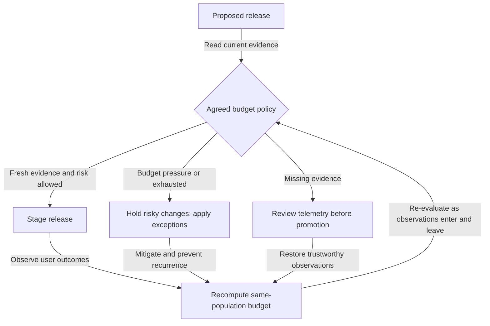

# Error Budgets

## Overview

An Error Budget is the complement of a Service Level Objective ([SLO](slos.md)). If your SLO is a 99.9% crash-free rate, your Error Budget is 0.1%. It is the exact, quantified amount of unreliability your system is *allowed* to have over a given time window without angering your users.

Error Budgets are the ultimate currency in Site Reliability Engineering (SRE). They transform the abstract concept of "reliability" into a tangible bank account that engineering teams can spend to increase velocity.

## Why It Matters

Without an Error Budget, the relationship between Product Managers (who want to ship features fast) and Engineers (who want the app to be stable) is an endless, subjective argument.

The Error Budget creates an objective, mathematical contract:
1. As long as there is money in the budget (the app is highly stable), the engineering team can merge code rapidly, ship new features daily, and take calculated risks.
2. If the budget is exhausted, apply the agreed policy: for example, hold risky releases and prioritise reliability, with explicit exceptions for urgent security fixes and incident mitigation.

The measurement informs a policy agreed by engineering and product; it does not replace judgement about severity or security.

## Historical Context

Google invented Error Budgets to solve the fundamental tension between their Software Engineers (SWEs) and their Site Reliability Engineers (SREs). SWEs were evaluated on shipping features; SREs were evaluated on uptime. This created a toxic culture where SREs rejected all code changes to protect uptime. The Error Budget was created to force both groups to share a single mathematical goal, aligning incentives.

## First Principles

1.  **$100\% - \text{SLO} = \text{Error Budget}$**: It is the complement of the success target.
2.  **Budget as a Currency:** Use headroom for measured experiments, staged releases, and migrations when their expected value justifies the risk. Beating an SLO does not prove over-testing; retain safety, security, and correctness checks.
3.  **Consequences are Mandatory:** An Error Budget without an enforcement mechanism is just a dashboard. Agree on release holds, reliability work, exceptions, escalation, and resumption criteria before the budget depletes.

## Mental Model

Think of a monthly allowance for buying coffee.
- **The SLO:** "I will save 95% of my paycheck."
- **The Error Budget:** "I have a 5% budget to spend on coffee."
- **The Enforcement:** If it's the 15th of the month and you've spent the entire 5%, you don't get to buy coffee for the rest of the month. You drink tap water. This analogy uses a calendar budget. A rolling error budget does not reset on the first of the month, and unused headroom is no reason to create avoidable failures.

## Internal Mechanics

Calculating an Error Budget requires knowing your total user volume and your time window.

### The Calculation

Assume an Android App has 10,000,000 active sessions per 30-day rolling window.
- **SLI:** $\frac{\text{Crash-Free Sessions}}{\text{Total Sessions}}$
- **SLO:** 99.9%
- **Error Budget:** 0.1%

**The Absolute Number:**
$10,000,000 \times 0.001 = 10,000 \text{ allowed crash-affected sessions}$

The team has a budget of 10,000 crash-affected sessions in the measured window. Count each session once, not each exception or report.

### Spending the Budget

1.  **Normal Operations:** The baseline consumes 3,000 crash-affected sessions in the window.
2.  **A Bad Release:** The team ships v2.0. It contains a bug that causes 5,000 additional crash-affected sessions in one day before it is hotfixed.
3.  **The Result:** The team has burned 8,000 / 10,000 crash-affected sessions. The budget is nearly depleted.
4.  **The Policy Action:** Because the budget is almost gone, the team cancels the deployment of v2.1 (which was scheduled for tomorrow) because it introduces too much risk. They prioritise mitigation and regression prevention. That incident day leaves a rolling 30-day window only about 30 days after it occurred; the denominator also changes as sessions enter and leave.

## Architecture



The budget informs an agreed release policy, including unknown data and urgent exceptions; a positive balance alone does not authorise every change. [Google's example policy](https://sre.google/workbook/error-budget-policy/) shows how to make consequences explicit.

## Production Example

**Burn Rate Alerting**

If you have a budget of 10,000 crashes for 30 days, you don't want an alert when you hit 9,999 (it's too late). You want an alert if you are *burning* the budget too fast.

- **1× burn:** observed bad-event fraction equals the allowed fraction.
- **10× burn:** at a sustained rate and comparable traffic, consumes a full 30-day budget in 3 days.
- **100× burn:** under the same assumptions, consumes it in 7.2 hours.

These are full-budget equivalents, not forecasts of the remaining budget. Paging depends on the long and short windows, traffic, user harm, and mitigation; use the policy in [Alerting](alerting.md).

*(This is covered in depth in [Alerting](alerting.md)).*

## Tradeoffs

**Advantages**
- **Objective Alignment:** Ends arguments between Product and Engineering.
- **Maximum Velocity:** Engineers know exactly how fast they can push without endangering the user experience.
- **Focus:** Prevents the team from wasting time fixing low-priority bugs if the budget is completely full.

**Disadvantages**
- **Cultural Friction:** Implementing Feature Freezes requires massive buy-in from upper management. If the CEO overrides the Error Budget to push a new feature for a marketing deadline, the system immediately collapses.
- **Statistical Nuance:** In mobile, app adoption is a curve. You release an update on Monday, but it takes 7 days for 80% of users to download it. If a bug is in the new release, the Burn Rate can increase as adoption grows, making it very difficult to calculate accurately on Day 1.

## Failure Modes

- **The Toothless Budget:** The dashboard shows the Error Budget has been deeply negative for 6 months, but the team continues to ship new features every week. The budget is meaningless. It is just a sad graph.
- **The Punitive Budget:** If the budget is blown, management yells at the engineers or impacts their performance reviews. *Error Budgets are a tool for managing system risk, not human performance.* Punishing engineers will simply cause them to hide errors or manipulate the SLI math.
- **Ignoring the Unspent Budget:** A team substantially exceeds its SLO. Review whether reliability investment is crowding out valuable work; do not deliberately create failures or remove necessary tests merely to consume headroom.

## Staff Engineer Thinking

When reviewing SRE policies, a Staff engineer asks:

1.  **Do we have executive buy-in?** Before I spend a week building Datadog dashboards for Error Budgets, I sit down with the VP of Engineering and the Head of Product. I ask, "If this dashboard goes red on the week of a major product launch, do we delay the launch?" If they say no, I don't build the dashboard.
2.  **Is our Burn Rate alerting actionable?** If an engineer gets paged for a "2x Burn Rate" at 2:00 AM, that is a failure of the alerting system. A 2x burn rate means the budget will last 15 days. That can be addressed tomorrow morning. Use the multi-window policy in [Alerting](alerting.md), with sufficient traffic and a clear mitigation. No universal multiplier determines urgency.
3.  **Are we using our budget to experiment?** Budget headroom can support a bounded migration with staged rollout, a kill switch or recovery plan, and stop criteria. It does not make an irreversible mobile update safe.

## Common Misconceptions

- **"If the budget is blown, the app is broken."** Not necessarily. If the budget is blown, it just means you broke the mathematical promise you made to the business. The app might still be functioning perfectly fine for 99.8% of users.
- **"We need to fix every bug to keep the budget full."** The entire point of the budget is that you *don't* have to fix every bug. The budget helps prioritise reliability work; security, data loss, accessibility, or severe cohort harm can require action even while the aggregate SLO is healthy.

## Probing Questions

1.  What is the mathematical formula for calculating an Error Budget from an SLO?
2.  Explain the concept of an Error Budget as a "currency" that an engineering team should actively spend.
3.  What trade-off should you review when reliability consistently exceeds the SLO?
4.  What policy should be agreed before an error budget is exhausted?
5.  Why does implementing Error Budgets require buy-in from Product Management and Executive leadership?
6.  Explain the concept of "Burn Rate" and why it is a better metric for alerting than the absolute number of errors.
7.  How do the delayed rollout curves of Mobile App updates complicate Error Budget calculations compared to Backend web deployments?
8.  Describe a scenario where a Staff Engineer intentionally uses a full Error Budget to execute a high-risk architectural refactor.
9.  Why is punishing an engineering team for blowing an Error Budget considered a toxic management practice?
10. How does resuming releases differ between rolling and calendar error-budget windows?

## Mobile Implementation (Android)

Define a budget over one population and window. This example uses **unique active users across all production versions in the selected rolling 30 days**, and unique users with at least one fatal crash in that same selection, following the Crashlytics-style definition. It is not Play's daily user-perceived crash rate. A separate version budget needs its own numerator and denominator.

```text
SLO: 99.5% crash-free users in that selection
1,000,000 unique active users × 0.5% = 5,000 allowed crash-affected users
```

The example policy increases scrutiny at 50%, pauses risky launches at 80%, and freezes new feature releases at 100%. Security and incident-mitigation exceptions remain explicit. Valid zero observations (`0` total and `0` crashing) produce `ReviewData`, not automatic approval. Negative or inconsistent counts (for example `0` total and `5` crashing) are rejected by the constructor's `require` checks with `IllegalArgumentException`. The ingestion adapter must validate untrusted inputs upstream and route those failures to data review before constructing this state; constructor failure is never release approval.

```kotlin
import java.math.BigInteger

enum class ReleaseAction {
    ReviewData, NormalOperation, IncreaseScrutiny, PauseRiskyLaunches, FreezeNewWork
}

// Counts belong to the same declared population and window.
data class BudgetState(
    val totalUsers: Long,
    val crashingUsers: Long,
    val allowedBadBasisPoints: Int = 50, // 50 / 10,000 = 0.5% allowed bad users
) {
    init {
        require(totalUsers >= 0)
        require(crashingUsers in 0..totalUsers)
        require(allowedBadBasisPoints in 1..10_000)
    }

    fun hasConsumed(percentOfBudget: Int): Boolean {
        require(percentOfBudget in 0..100)
        // Cross-multiply exact integers; BigInteger also avoids Long overflow.
        val spent = BigInteger.valueOf(crashingUsers) * BigInteger.valueOf(1_000_000L)
        val threshold = BigInteger.valueOf(totalUsers) *
            BigInteger.valueOf(allowedBadBasisPoints.toLong()) *
            BigInteger.valueOf(percentOfBudget.toLong())
        return spent >= threshold
    }
}

fun decideOnReleaseAction(state: BudgetState): ReleaseAction = when {
    state.totalUsers == 0L -> ReleaseAction.ReviewData
    state.hasConsumed(100) -> ReleaseAction.FreezeNewWork
    state.hasConsumed(80) -> ReleaseAction.PauseRiskyLaunches
    state.hasConsumed(50) -> ReleaseAction.IncreaseScrutiny
    else -> ReleaseAction.NormalOperation
}
```

For 1,000,000 users, 2,500, 4,000, and 5,000 crash-affected users hit those boundaries exactly. Production policy also needs data freshness and minimum-volume checks. A count of remaining bad events is not a number of remaining days: forecasting exhaustion requires a measured burn rate, remaining budget, and traffic assumptions.

Mobile-distinct:

1. **Declare scope.** Keep a fleet budget and release/cohort slices; never compare a per-version numerator with an app-wide denominator.
2. **Hotfixes don't erase history.** Previously affected users remain in this rolling selection until their observations age out.
3. **Evaluate platform support with evidence.** Compare cohort reliability and product obligations rather than assuming every older API level has a fixed crash penalty.
4. **Background failures need their own definition.** Retry exhaustion or corrupted state can harm users without a fatal crash; measure a sync/data-integrity SLI rather than pretending every failure spends the crash budget.
5. **Uninstall correlation is separate.** Installs/uninstalls and crash reports can inform investigation, but do not establish that a specific uninstall was caused by a crash or silently change this budget's numerator.

## Answer Key

1. **What is the mathematical formula for calculating an Error Budget from an SLO?**
   Error Budget = 100% - SLO target.
2. **Explain the concept of an Error Budget as a "currency" that an engineering team should actively spend.**
   Headroom allows calculated release and migration risks within an agreed policy. Unspent budget alone does not prove the team is moving too slowly.
3. **What trade-off should you review when reliability consistently exceeds the SLO?**
   Review the marginal value of more reliability against feature and migration work. Keep mandatory correctness/security checks and consider cohort harm; high reliability is not itself a defect.
4. **What policy should be agreed before an error budget is exhausted?**
   Agree on holds for risky changes, reliability priorities, urgent security/mitigation exceptions, and measurable resumption criteria. Google publishes an example policy; it is not a universal requirement to stop all work.
5. **Why does implementing Error Budgets require buy-in from Product Management and Executive leadership?**
   Because enforcing a feature freeze when the budget is blown will inherently delay product launches. Without executive support, the budget will be overridden and rendered meaningless.
6. **Explain the concept of "Burn Rate" and why it is a better metric for alerting than the absolute number of errors.**
   Burn Rate measures how quickly the budget is being consumed relative to the time window. It predicts if you will exhaust the budget before the window ends, enabling actionable alerts rather than reactive ones.
7. **How do the delayed rollout curves of Mobile App updates complicate Error Budget calculations compared to Backend web deployments?**
   Mobile adoption happens slowly over days. A bug in a new release can increase the burn rate as adoption grows, making it difficult to predict true impact on day one.
8. **Describe a scenario where a Staff Engineer intentionally uses a full Error Budget to execute a high-risk architectural refactor.**
   A team can fund a staged library migration with bounded exposure, monitoring, and recovery. An impending calendar boundary is not a reason to spend the full budget on an uncontrolled change.
9. **Why is punishing an engineering team for blowing an Error Budget considered a toxic management practice?**
   It turns error budgets into a human performance metric rather than a system risk tool, incentivizing engineers to hide errors, manipulate math, or avoid taking necessary risks.
10. **How does resuming releases differ between rolling and calendar error-budget windows?**
    Apply the agreed policy and repair the cause. A calendar budget has a known period end; a rolling budget changes continuously as events enter and leave. Neither elapsed days nor a hotfix alone proves it is safe to resume.

## Further Reading

- [`slos.md`](slos.md) — The target that defines the size of the budget.
- [`alerting.md`](alerting.md) — How to notify the team when the budget is burning too fast.
- [Google SRE: Embracing Risk](https://sre.google/sre-book/embracing-risk/)
- [Google SRE: Example Error Budget Policy](https://sre.google/workbook/error-budget-policy/)
- [Google SRE: Alerting on SLOs](https://sre.google/workbook/alerting-on-slos/)
- [Crashlytics crash-free metrics](https://firebase.google.com/docs/crashlytics/crash-free-metrics)
- [Cloud Monitoring SLO periods](https://docs.cloud.google.com/monitoring/api/ref_v3/rest/v3/services.serviceLevelObjectives)
