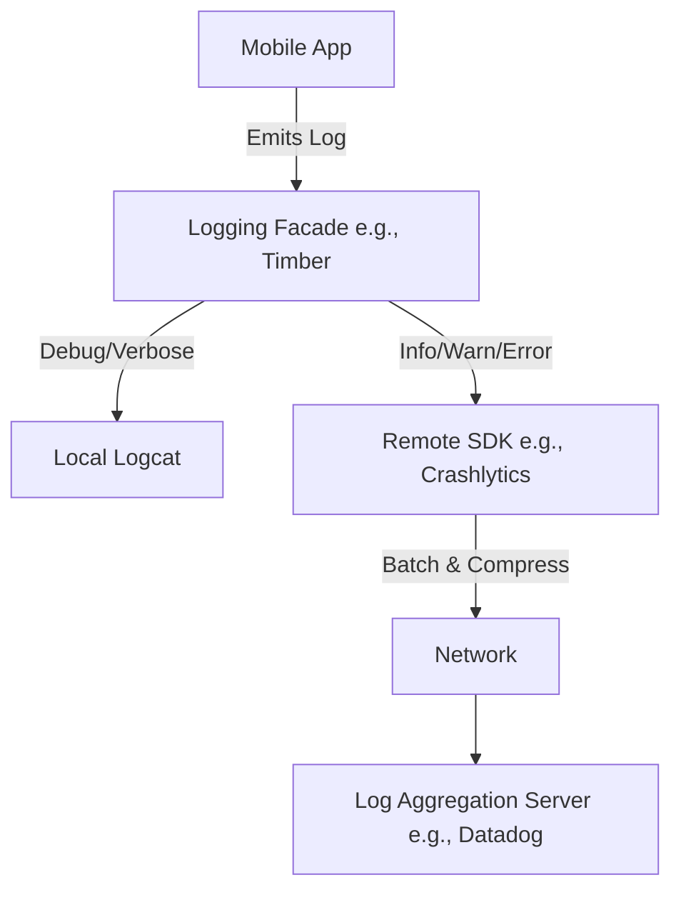

# Logging

## Overview

Logging is the practice of emitting discrete, timestamped text records of events that occur while an application is running. It is the most fundamental pillar of Observability. If an app crashes in a user's pocket on the other side of the world, logs are the forensic evidence required to recreate the timeline and fix the bug.

## Why It Matters

When you are developing locally, you have a debugger. When an app is in production, you are completely blind. You cannot attach a debugger to 10 million distributed mobile devices. 

If a user reports, "The checkout button doesn't work," and you have no logs, you are forced to guess. If you have proper logging, you can query the system and see: `[INFO] User clicked Checkout -> [WARN] Network timeout after 10s -> [ERROR] Failed to fallback to cache`. The mystery is solved in seconds.

## Historical Context

Logging is as old as computing itself (printing to a teletype terminal). In Android, the standard `android.util.Log` (`Log.d`, `Log.e`) writes to `logcat`, a circular buffer on the device. However, `logcat` is volatile (it disappears when the device reboots) and local (you can't see it from your office). Modern mobile engineering relies on Remote Logging (e.g., Firebase Crashlytics, Datadog), where logs are batched and shipped over the network to a central server.

## First Principles

1.  **Immutability:** A log is a historical record of an event that occurred at a specific point in time. It cannot be changed.
2.  **Verbosity Levels:** Not all logs are equal. They must be categorized by severity (Debug, Info, Warn, Error) so they can be filtered.
3.  **Signal vs. Noise:** A log file with 10,000 entries of `[DEBUG] scrolling...` hides the one `[ERROR]` that matters. Logs must provide actionable signal.

## Mental Model

Think of an airplane's Black Box (Flight Data Recorder).
It doesn't record every single time the pilot blinks. It records critical events: altitude changes, engine temperature, and autopilot disengagement. If the plane lands safely, the data is usually ignored. If the plane crashes, investigators use that data to reconstruct exactly what happened in the 5 minutes leading up to the disaster.

## Internal Mechanics

Logs typically contain three parts:
1.  **Timestamp:** When it happened (e.g., `2024-10-27T10:15:30Z`).
2.  **Context/Tag:** Where it happened (e.g., `CheckoutRepository`).
3.  **Message:** What happened (e.g., `Payment gateway timeout`).

### Log Levels

Properly utilizing levels determines whether your logging is a useful tool or a spam cannon.

| Level | Usage | Production Behavior |
| :--- | :--- | :--- |
| **VERBOSE / TRACE** | Extremely granular step-by-step execution. | *Stripped at compile time.* |
| **DEBUG** | Data payloads, network responses, lifecycle events. | *Usually disabled or ignored remotely.* |
| **INFO** | Major business milestones (e.g., `UserLoggedIn`, `OrderPlaced`). | *Sent to remote server.* |
| **WARN** | Something unexpected happened, but the app recovered (e.g., `Cache miss, fetching from network`). | *Sent to remote server. May trigger alerts if volume spikes.* |
| **ERROR** | A failure that impacts the user (e.g., `Failed to process payment`). | *Always sent. Triggers immediate alerts.* |

## Architecture



## Production Example

**The Logging Facade (Timber)**

In Android, you should never call `android.util.Log` directly in your business logic. If you do, and later decide to switch from Firebase to Datadog, you have to rewrite 5,000 log statements. 

Instead, use a Facade (like Jake Wharton's `Timber`).

```kotlin
// App Initialization (Application class)
if (BuildConfig.DEBUG) {
    // In debug mode, print everything to the local console
    Timber.plant(Timber.DebugTree())
} else {
    // In production, only send WARN and ERROR to the remote server
    Timber.plant(CrashlyticsTree())
}

// Business Logic (Repository)
fun fetchUser() {
    Timber.i("Fetching user profile") // Clean, decoupled logging
    try {
        api.getUser()
    } catch (e: Exception) {
        Timber.e(e, "Failed to fetch user profile")
    }
}
```

## Tradeoffs

**Advantages**
- **Post-Mortem Debugging:** The only reliable way to fix bugs you cannot reproduce locally.
- **Auditing:** Tracking business metrics (e.g., how many times did users hit the offline fallback?).

**Disadvantages**
- **Performance:** Writing strings to disk and sending them over the network costs battery, CPU, and user data. Over-logging causes noticeable jank.
- **Security & Privacy (PII):** If you accidentally log a credit card number, a password, or a Social Security Number (`Timber.d("User data: $user")`), you have caused a massive security breach and potentially violated GDPR/HIPAA.
- **Storage Costs:** Storing terabytes of raw text logs on AWS or Datadog is incredibly expensive.

## Failure Modes

- **Logging PII (Personally Identifiable Information):** The most dangerous failure mode. You must scrub logs before they leave the device. *Never log raw network request bodies or full user objects.*
- **The Boy Who Cried Wolf (Spamming Errors):** If a network timeout throws an `ERROR` log, and the user is driving through a tunnel, you will get 50,000 ERROR logs a minute. Errors should be reserved for actionable code bugs, not expected environmental factors. Expected network drops should be `WARN` or `INFO`.
- **String Concatenation in the Fast Path:**
  ```kotlin
  // BAD: The string is built and memory is allocated EVEN IF debug logging is disabled.
  Timber.d("User array is " + users.joinToString() + " and size is " + users.size)
  ```
  *(Fix: Modern loggers use lambdas: `Timber.d { "User array is..." }`. The string is only evaluated if the log level is active).*

## Staff Engineer Thinking

When reviewing a PR, a Staff engineer asks:

1.  **Is this log actionable?** If I see `Timber.i("Got here")`, I delete it. A log must provide context. What is "here"? What state were we in when we got here?
2.  **Are we leaking PII?** I actively check data classes for `toString()` overrides. If `User` has a `password` field, the `toString()` method must mask it, because someone, eventually, will log the whole object.
3.  **Will this break the budget?** If a developer adds an `INFO` log inside a `RecyclerView` `onBindViewHolder` method, it will fire 60 times a second as the user scrolls. That will cost the company thousands of dollars in Datadog ingestion fees. I push it down to `VERBOSE` so it never leaves the device.

## Common Misconceptions

- **"Crash reporting is the same as logging."** No. A crash report (e.g., Firebase Fatal Crash) captures the exact stack trace when the app dies. Logs are the breadcrumbs leading *up* to the crash. A crash report tells you *where* the app died; logs tell you *why*.
- **"More logs are better."** False. Storing and searching through logs is expensive. Finding a bug in 100 high-quality logs takes 2 minutes. Finding a bug hidden inside 100,000 garbage logs takes two days.

## Probing Questions

1.  Why is it an anti-pattern to use `android.util.Log` directly in an Android codebase?
2.  Explain the difference between `WARN` and `ERROR` log levels. Give a concrete Android example for each.
3.  How does a Facade pattern (like Timber) make a codebase more resilient to third-party SDK changes?
4.  What is PII, and what mechanisms can an Android team put in place to ensure it never gets sent to a remote logging server?
5.  Why is it dangerous to put a network call inside a `Timber.d()` block? (e.g., `Timber.d("Response: ${api.fetchData()}")`).
6.  How do logs complement Crash Reports when investigating a production bug?
7.  If you need to log the time it takes for an API to respond, is raw text logging the best tool? (Hint: See `metrics.md`).
8.  Explain the performance impact of logging inside a hot loop (like a View's `onDraw` method).
9.  How can you configure ProGuard/R8 to automatically strip `Log.d` statements from a production release build?
10. Describe a scenario where an over-zealous logging strategy could actually cause an app to crash with an `OutOfMemoryError` or `IOException`.

## Further Reading

- [`structured-logging.md`](structured-logging.md) — The evolution of raw text logs into queryable JSON.
- [`metrics.md`](metrics.md) — Why you shouldn't use logs to count things.
- [`tracing.md`](tracing.md) — How to connect isolated logs across multiple asynchronous operations.
