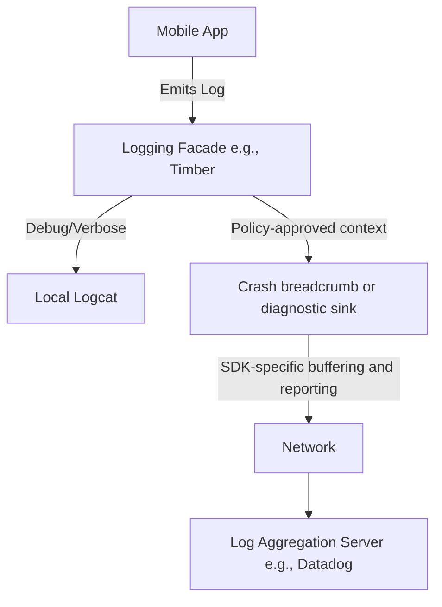

# Logging

## Overview

Logging is the practice of emitting discrete, timestamped text records of events that occur while an application is running. It is the most fundamental pillar of Observability. If an app crashes in a user's pocket on the other side of the world, logs are the forensic evidence required to recreate the timeline and fix the bug.

## Why It Matters

When you are developing locally, you have a debugger. When an app is in production, you are completely blind. You cannot attach a debugger to 10 million distributed mobile devices. 

If a user reports, "The checkout button doesn't work," and you have no logs, you are forced to guess. If you have proper logging, you can query the system and see: `[INFO] User clicked Checkout -> [WARN] Network timeout after 10s -> [ERROR] Failed to fallback to cache`. The mystery is solved in seconds.

## Historical Context

Logging is as old as computing itself (printing to a teletype terminal). In Android, the standard `android.util.Log` (`Log.d`, `Log.e`) writes to `logcat`, a circular buffer on the device. However, `logcat` is volatile (it disappears when the device reboots) and local (you can't see it from your office). Remote diagnostic sinks can batch approved logs for analysis. Crashlytics custom logs are bounded context attached to reports, not a general-purpose stream of every app log.

## First Principles

1.  **Immutability:** A log is a historical record of an event that occurred at a specific point in time. It cannot be changed.
2.  **Verbosity Levels:** Not all logs are equal. They must be categorized by severity (Debug, Info, Warn, Error) so they can be filtered.
3.  **Signal vs. Noise:** A log file with 10,000 entries of `[DEBUG] scrolling...` hides the one `[ERROR]` that matters. Logs must provide actionable signal.

## Mental Model

Think of an airplane's Black Box (Flight Data Recorder).
It doesn't record every single time the pilot blinks. It records critical events: altitude changes, engine temperature, and autopilot disengagement. If the plane lands safely, the data is usually ignored. If the plane crashes, investigators use that data to reconstruct exactly what happened in the 5 minutes leading up to the disaster.

## Internal Mechanics

Logs typically contain three parts:
1.  **Timestamp:** When it happened (e.g., `2024-10-27T10:15:30Z`).
2.  **Context/Tag:** Where it happened (e.g., `CheckoutRepository`).
3.  **Message:** What happened (e.g., `Payment gateway timeout`).

### Log Levels

Properly utilizing levels determines whether your logging is a useful tool or a spam cannon.

| Level | Usage | Production Behavior |
| :--- | :--- | :--- |
| **VERBOSE / TRACE** | Granular diagnostic detail. | Suppress or explicitly remove noisy calls; release builds do not automatically strip them. |
| **DEBUG** | Development diagnostics without sensitive payloads. | Usually local-only; gate expensive argument construction explicitly. |
| **INFO** | Operational milestones. | Route approved diagnostics only; product events have a separate governed schema. |
| **WARN** | Unexpected condition with recovery. | Sample or retain under policy; ordinary cache misses need not be warnings. |
| **ERROR** | A failure that impacts the user. | Minimise and route under policy; severity alone neither exports data nor pages anyone. |

## Architecture



The facade routes only policy-approved context; severity alone does not export a record. [Crashlytics custom logs](https://firebase.google.com/docs/crashlytics/customize-crash-reports) attach context to reports rather than guaranteeing delivery of a complete log stream.

## Production Example

**The Logging Facade (Timber)**

In Android, you should never call `android.util.Log` directly in your business logic. If you do, and later decide to switch from Firebase to Datadog, you have to rewrite 5,000 log statements. 

Instead, use a Facade (like Jake Wharton's `Timber`).

```kotlin
// App Initialization (Application class)
if (BuildConfig.DEBUG) {
    // In debug mode, print everything to the local console
    Timber.plant(Timber.DebugTree())
} else {
    // Explicit policies select breadcrumbs and non-fatal reports (defined below).
    Timber.plant(PolicyReleaseTree(breadcrumbPolicy, nonFatalPolicy))
}

// Business Logic (Repository)
fun fetchUser() {
    Timber.i("Fetching user profile") // Clean, decoupled logging
    try {
        api.getUser()
    } catch (e: Exception) {
        Timber.e(e, "Failed to fetch user profile")
    }
}
```

## Tradeoffs

**Advantages**
- **Post-Mortem Debugging:** The only reliable way to fix bugs you cannot reproduce locally.
- **Auditing:** Tracking business metrics (e.g., how many times did users hit the offline fallback?).

**Disadvantages**
- **Performance:** Writing strings to disk and sending them over the network costs battery, CPU, and user data. Over-logging causes noticeable jank.
- **Security & Privacy (PII):** If you accidentally log a credit card number, a password, or a Social Security Number (`Timber.d("User data: $user")`), you have caused a massive security breach and potentially violated GDPR/HIPAA.
- **Storage Costs:** Storing terabytes of raw text logs on AWS or Datadog is incredibly expensive.

## Failure Modes

- **Logging PII (Personally Identifiable Information):** The most dangerous failure mode. You must scrub logs before they leave the device. *Never log raw network request bodies or full user objects.*
- **The Boy Who Cried Wolf (Spamming Errors):** If a network timeout throws an `ERROR` log, and the user is driving through a tunnel, you will get 50,000 ERROR logs a minute. Errors should be reserved for actionable code bugs, not expected environmental factors. Expected network drops should be `WARN` or `INFO`.
- **String Concatenation in the Fast Path:**
  ```kotlin
  // BAD: The string is built and memory is allocated EVEN IF debug logging is disabled.
  Timber.d("User array is " + users.joinToString() + " and size is " + users.size)
  ```
  Timber 5.0.1 has no `Timber.d { ... }` overload. Guard expensive development-only construction explicitly:

  ```kotlin
  if (BuildConfig.DEBUG) {
      Timber.d("User count: %d", users.size)
  }
  ```

  Formatting arguments can still be eager: do not put expensive work or side effects in an argument expression. A custom lazy facade must actually check its policy before invoking the lambda.

## Staff Engineer Thinking

When reviewing a PR, a Staff engineer asks:

1.  **Is this log actionable?** If I see `Timber.i("Got here")`, I delete it. A log must provide context. What is "here"? What state were we in when we got here?
2.  **Are we leaking PII?** I actively check data classes for `toString()` overrides. If `User` has a `password` field, the `toString()` method must mask it, because someone, eventually, will log the whole object.
3.  **Will this break the budget?** Binding frequency depends on scrolling, recycling, and updates; `onBindViewHolder` is not a per-frame callback. Measure event volume and disable or sample noisy diagnostics under explicit routing policy; changing severity alone does not prevent export.

## Common Misconceptions

- **"Crash reporting is the same as logging."** No. A crash report (e.g., Firebase Fatal Crash) captures the exact stack trace when the app dies. Logs are the breadcrumbs leading *up* to the crash. A crash report tells you *where* the app died; logs tell you *why*.
- **"More logs are better."** False. Storing and searching through logs is expensive. Finding a bug in 100 high-quality logs takes 2 minutes. Finding a bug hidden inside 100,000 garbage logs takes two days.

## Probing Questions

1.  Why is it an anti-pattern to use `android.util.Log` directly in an Android codebase?
2.  Explain the difference between `WARN` and `ERROR` log levels. Give a concrete Android example for each.
3.  How does a Facade pattern (like Timber) make a codebase more resilient to third-party SDK changes?
4.  What is PII, and what mechanisms can an Android team put in place to ensure it never gets sent to a remote logging server?
5.  Why is it dangerous to put a network call inside a `Timber.d()` block? (e.g., `Timber.d("Response: ${api.fetchData()}")`).
6.  How do logs complement Crash Reports when investigating a production bug?
7.  If you need to log the time it takes for an API to respond, is raw text logging the best tool? (Hint: See `metrics.md`).
8.  Explain the performance impact of logging inside a hot loop (like a View's `onDraw` method).
9.  How can you configure ProGuard/R8 to automatically strip `Log.d` statements from a production release build?
10. Describe a scenario where an over-zealous logging strategy could actually cause an app to crash with an `OutOfMemoryError` or `IOException`.

## Mobile Implementation (Android)

Logs on mobile aren't logs the way servers do them. There's no `tail -f`. Android logging writes to local Logcat subject to access restrictions; it is not inherently disabled in release builds. A curated subset may be routed to a remote sink (Crashlytics breadcrumbs, in-house telemetry, or vendor RUM).

| Sink | When |
|---|---|
| `Log.d/i/w/e` → logcat | Local device output, including release calls unless explicitly suppressed or removed |
| **Timber or another facade** | Routes to trees/sinks selected by build and runtime policy; it is not automatically disabled in release |
| **Crash-report breadcrumbs** | A bounded, approved context buffer attached to a later report |
| **Remote diagnostic sink/RUM** | Sampled structured operational events selected under [`telemetry-taxonomy.md`](telemetry-taxonomy.md) |

```kotlin
// Release routing is explicit; log priority alone does not select a remote signal.
fun interface BreadcrumbPolicy {
    fun approved(priority: Int, tag: String?, message: String): String?
}

fun interface NonFatalPolicy {
    fun shouldRecord(priority: Int, throwable: Throwable): Boolean
}

class PolicyReleaseTree(
    private val breadcrumbPolicy: BreadcrumbPolicy,
    private val nonFatalPolicy: NonFatalPolicy,
) : Timber.Tree() {
    override fun log(priority: Int, tag: String?, message: String, t: Throwable?) {
        breadcrumbPolicy.approved(priority, tag, message)?.let {
            FirebaseCrashlytics.getInstance().log(it)
        }
        if (t != null && nonFatalPolicy.shouldRecord(priority, t)) {
            FirebaseCrashlytics.getInstance().recordException(t)
        }
    }
}

class App : Application() {
    override fun onCreate() {
        super.onCreate()
        if (BuildConfig.DEBUG) Timber.plant(Timber.DebugTree())
        else Timber.plant(PolicyReleaseTree(breadcrumbPolicy, nonFatalPolicy))
    }
}
```

Three mobile-specific rules:

1. **Minimize at the call site.** Avoid secrets and unnecessary personal/stable identifiers before they enter Logcat, local buffers, or remote telemetry. Pattern redaction is a defense in depth, not proof that all sensitive data was removed.
2. **Define release behavior.** Suppress or remove noisy calls where appropriate, use lazy arguments for expensive work, and verify the optimized artifact; neither R8 nor a facade universally strips calls by default.
3. **Don't log identifiers that survive uninstall.** Even hashed `userId` lets adversaries correlate; if it's needed for cross-session debugging, use a session-scoped UUID with TTL.

Mobile logging can serve local debugging, bounded crash context, or sampled remote diagnosis. Each route needs a purpose and owner; a crash breadcrumb buffer is not a complete event stream.

## Answer Key

1. **Why is it an anti-pattern to use `android.util.Log` directly in an Android codebase?**
   It heavily couples the codebase to the Android SDK and makes it nearly impossible to globally reroute, filter, or mock log statements (e.g., to a remote sink).
2. **Explain the difference between `WARN` and `ERROR` log levels. Give a concrete Android example for each.**
   WARN means something unexpected happened but the app recovered (e.g., cache miss fallback), while ERROR means a failure impacted the user (e.g., payment failure).
3. **How does a Facade pattern (like Timber) make a codebase more resilient to third-party SDK changes?**
   It reduces call-site coupling and centralizes routing policy. A vendor change can still require schema, privacy, batching, sampling, retention, and migration work.
4. **What is PII, and what mechanisms can reduce the risk of sending it to a remote logging server?**
   Classify and minimize fields at the call site, prohibit secrets and raw identifiers, use typed allowlists, restrict generic object serialization, add redaction as defense in depth, and test representative payloads. No regex wrapper can guarantee that every sensitive value is detected.
5. **Why is it dangerous to put a network call inside a `Timber.d()` block? (e.g., `Timber.d("Response: ${api.fetchData()}")`).**
   Because the string interpolation (and thus the network call) is evaluated unconditionally before being passed to Timber, executing the call even if debug logs are disabled.
6. **How do logs complement Crash Reports when investigating a production bug?**
   A crash report provides the stack trace (where it died), while logs provide the breadcrumbs and state changes leading up to it (why it died).
7. **If you need to log the time it takes for an API to respond, is raw text logging the best tool? (Hint: See `metrics.md`).**
   No, raw text logging is expensive to parse; numerical metrics (histograms) are designed for tracking durations and aggregations efficiently.
8. **Explain the performance impact of logging inside a hot loop (like a View's `onDraw` method).**
   Eager construction and enabled output add allocation and sink work. Whether that causes jank depends on frequency, payload, device, build, and sink; profile the release-equivalent path.
9. **How can you configure ProGuard/R8 to automatically strip `Log.d` statements from a production release build?**
   A `BuildConfig.DEBUG` guard enables dead-code removal for that build variant. For existing Android log calls, configure R8 explicitly, for example `-maximumremovedandroidloglevel 3` to remove VERBOSE/DEBUG calls, or a narrowly scoped `-assumenosideeffects` rule. Verify the optimised artifact and preserve required diagnostics; do not assume argument side effects are removed.
10. **Describe a scenario where an over-zealous logging strategy could actually cause an app to crash with an `OutOfMemoryError` or `IOException`.**
    Logging massive payloads (like raw bitmap data or 10MB JSON responses) can exhaust heap memory, or fill up local disk space leading to I/O failures.

## Further Reading

- [`structured-logging.md`](structured-logging.md) — The evolution of raw text logs into queryable JSON.
- [`metrics.md`](metrics.md) — Why you shouldn't use logs to count things.
- [`tracing.md`](tracing.md) — How to connect isolated logs across multiple asynchronous operations.
- [`telemetry-taxonomy.md`](telemetry-taxonomy.md) — Canonical selection policy for logs, metrics, traces, exceptions, product events, and breadcrumbs.
- [Timber](https://github.com/JakeWharton/timber) — the conventional Android logging wrapper.
- [Crashlytics breadcrumbs / custom keys](https://firebase.google.com/docs/crashlytics/customize-crash-reports) — context attached to crash reports.
- [Timber 5.0.1 API implementation](https://github.com/JakeWharton/timber/blob/5.0.1/timber/src/main/java/timber/log/Timber.kt)
- [R8 additional rule types](https://developer.android.com/topic/performance/app-optimization/additional-rule-types)
