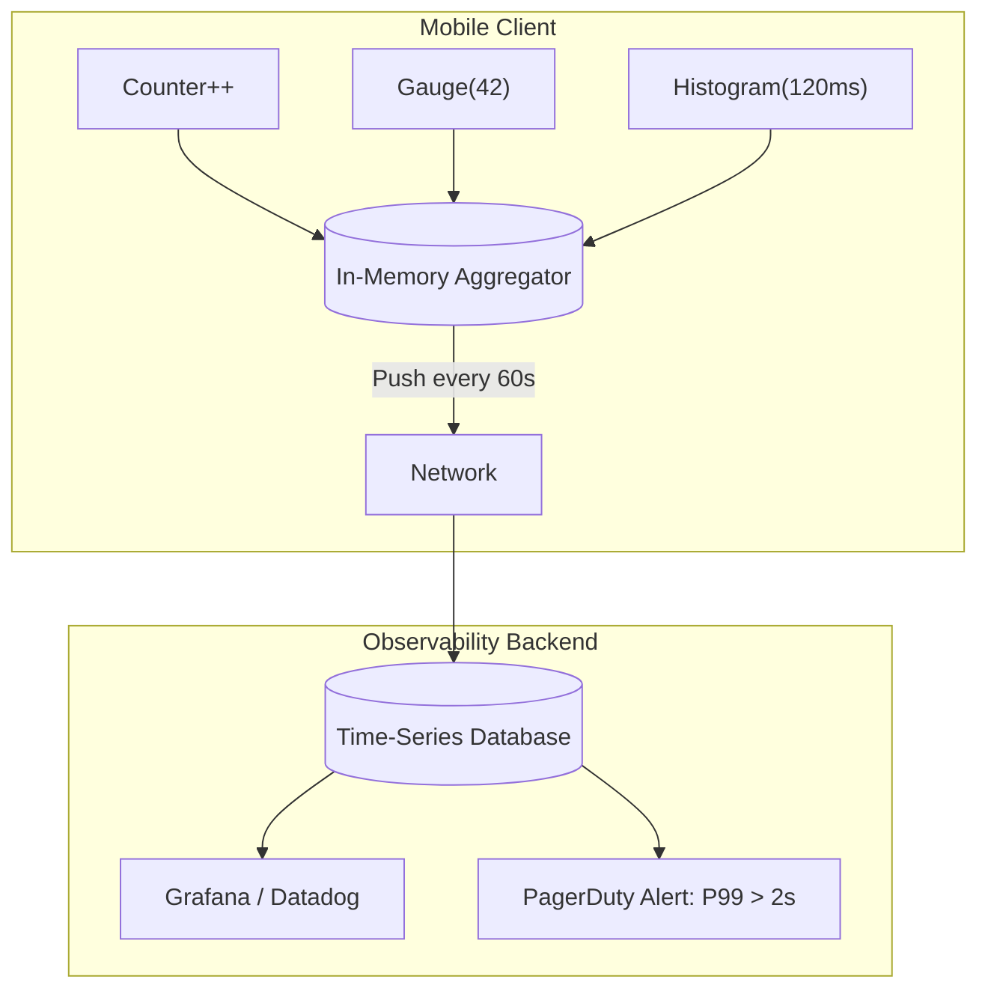

# Metrics

## Overview

Metrics are aggregatable numerical measurements of your system's performance and health, captured over time. Unlike Logs (which describe discrete, isolated events), metrics are mathematically combinable (e.g., sums, averages, percentiles). They are the foundation of alerting, dashboards, and SLIs.

## Why It Matters

Logs tell you *why* something is broken. Metrics tell you *that* something is broken.

If a backend server goes down and 500,000 mobile clients fail to checkout, logging that failure 500,000 times will overwhelm your logging infrastructure, cost tens of thousands of dollars in ingestion fees, and potentially crash the backend observability database. 

Metrics solve this. Instead of sending 500,000 heavy JSON logs, the mobile app simply increments a counter: `checkout_failures++`. The mobile app periodically sends a single number (`500,000`) to the server. The network payload is tiny, but the signal to the SRE team is instantaneous and deafening.

## Historical Context

In traditional server-side engineering (like Prometheus), metrics are usually "pull-based": the server exposes a `/metrics` endpoint, and a scraper fetches the numbers every 10 seconds. In mobile, this is impossible (phones are behind NATs and sleep frequently). Mobile metrics must be "push-based": the app accumulates numbers in memory and pushes them to the server when the network is active (e.g., via Firebase Performance Monitoring or Datadog RUM).

## First Principles

1.  **Numbers, Not Text:** Metrics are pure math. They are extremely cheap to store, aggregate, and query over long periods.
2.  **Aggregation over Precision:** You do not care about the exact millisecond a single user's network call took. You care that the 95th percentile (P95) of all network calls is slower than 2 seconds.
3.  **Dimensionality (Tags):** A raw number is useless without context. A metric must be tagged with dimensions (e.g., `os_version`, `carrier`, `endpoint`) so you can slice the data to find the root cause.

## Mental Model

Think of a highway toll booth.
- **Logging:** Stopping every single car, asking the driver for their name, their destination, and their mood, and writing a 5-page report. You will cause a massive traffic jam.
- **Metrics:** Giving the toll operator a clicker. Every time a car passes, they click it. At the end of the day, you have a single number: 5,432 cars. If you want more detail (Dimensionality), you give them three clickers: one for Cars, one for Trucks, one for Motorcycles.

## Internal Mechanics

There are three primary types of metrics:

### 1. Counters

A number that only goes up (or resets to zero). Used for counting discrete events.
- *Examples:* `app_crashes_total`, `checkout_success_total`, `network_errors_total`.

```kotlin
// Incrementing a counter with tags
metricsClient.increment(
    name = "network_request_total", 
    tags = mapOf("endpoint" to "/checkout", "status" to "500")
)
```

### 2. Gauges

A number that can go up or down, representing a current state at a specific moment in time.
- *Examples:* `device_battery_level`, `thread_pool_active_count`, `sqlite_database_size_mb`.

```kotlin
// Recording a gauge value
metricsClient.gauge(
    name = "memory_usage_mb", 
    value = 145.5
)
```

### 3. Histograms / Distributions

A collection of values that allows you to calculate statistical distributions (min, max, average, median, P90, P95, P99). Used for measuring durations or sizes.
- *Examples:* `api_latency_ms`, `app_startup_time_ms`, `image_download_size_bytes`.

```kotlin
// Recording a duration
val durationMs = measureTimeMillis { api.checkout() }
metricsClient.histogram(
    name = "api_latency_ms", 
    value = durationMs, 
    tags = mapOf("endpoint" to "/checkout")
)
// The backend will automatically calculate the P99 latency for this endpoint.
```

## Architecture



## Production Example

**Firebase Performance Monitoring**

Google provides Firebase Performance Monitoring, which is a pre-built metrics solution for Android. By simply including the Gradle plugin, it automatically hooks into the Android OS and OkHttp to generate histograms for app startup time and network latency.

For custom business logic, you can define your own trace metrics:

```kotlin
// Firebase custom trace (effectively a Histogram metric)
val trace = FirebasePerformance.getInstance().newTrace("image_processing_time")
trace.start()
// Add custom dimensions (Tags)
trace.putAttribute("image_format", "webp") 

val processedImage = processImage(rawImage)

trace.stop() // Records the duration and pushes to Firebase
```

## Tradeoffs

**Advantages**
- **Incredibly Cheap:** You can retain metrics for years because they take up almost no disk space. (Logs are usually deleted after 14-30 days to save money).
- **Fast Dashboarding:** Rendering a graph of a single metric over 30 days takes milliseconds. Querying 10 million logs to build the same graph takes minutes.
- **Proactive Alerting:** Metrics are the only reliable way to trigger automated alerts (e.g., "Alert me if the error rate counter exceeds 5% in a 5-minute window").

**Disadvantages**
- **Loss of Context:** A counter tells you that 500 network errors happened. It does *not* tell you *why* they happened. You still need logs for the forensic investigation.
- **High Cardinality Explosions:** If you tag a metric with a unique ID (like `user_id`), the Time-Series Database creates a separate time-series for every single user. If you have 10 million users, you just created 10 million metrics. Your observability backend will crash, and you will receive a massive bill.

## Failure Modes

- **The High Cardinality Trap:**
  ```kotlin
  // DISASTER: Tagging a metric with a highly unique value
  metricsClient.increment(
      "user_login", 
      tags = mapOf("user_id" to "123456789") // Millions of unique values!
  )
  ```
  *(Fix: Tags must only be low-cardinality enumerations, like `os_version`, `carrier_name`, or `error_code`).*
- **Using Logs for Math:** Writing `Timber.i("Checkout successful")` and then writing a complex query in Datadog to count how many times that exact string appears per minute. This is incredibly slow, fragile, and expensive. Use a `Counter`.
- **Averaging Percentiles:** If you calculate the P95 latency on the mobile device, and send that number to the server, the server cannot mathematically average the P95 from Device A and the P95 from Device B to get a global P95. The math doesn't work. Mobile devices must send raw distributions, and the *server* must calculate the percentiles.

## Staff Engineer Thinking

When designing a telemetry strategy, a Staff engineer applies the rule: **"Metrics for the What, Logs for the Why, Traces for the Where."**

1.  **Is this an Alert?** If a developer wants to set up an alert (e.g., "Ping slack if login fails"), I enforce that the alert must be driven by a Metric, never by a Log query. Log queries are too slow and brittle for reliable alerting.
2.  **Are we managing Cardinality?** I strictly audit the tags added to metrics. If a developer tries to add `device_id`, `session_id`, or `query_string` as a tag to a metric, I reject the PR. High cardinality destroys Time-Series Databases.
3.  **Are we looking at Averages?** If a dashboard shows "Average Network Latency," I will delete it. Averages lie. If 90% of requests take 10ms, and 10% take 10,000ms (timeout), the average is 1,000ms. Everything looks fine, but 10% of users are completely broken. I insist on P95 and P99 percentiles.

## Common Misconceptions

- **"Metrics are just numbers extracted from Logs."** While backend systems *can* generate metrics from logs (Log-based metrics), it is vastly more efficient for the client to generate the metric in memory and bypass the logging pipeline entirely.
- **"I need to track exactly how long this specific user took to load the screen."** You cannot use Metrics for this. Metrics are aggregated. You cannot pull an individual user's experience out of a Histogram. To track an individual user's journey, you need Distributed Tracing.

## Probing Questions

1.  What is the fundamental difference between a Log and a Metric in terms of storage and query performance?
2.  Explain the concept of "Cardinality" in metrics tagging. Why is adding a `user_id` tag to a metric dangerous?
3.  What is the difference between a Counter, a Gauge, and a Histogram? Give an Android example for each.
4.  Why is it mathematically incorrect to calculate an average (mean) when measuring network latency? What should you use instead?
5.  How do mobile constraints (battery, network connectivity) change how metrics are delivered to the server compared to backend systems?
6.  If you want to trigger a PagerDuty alert when the app crash rate spikes, why should you use a metric instead of querying crash logs?
7.  Explain the mantra: "Metrics tell you *that* you have a problem; Logs tell you *why* you have a problem."
8.  How does Firebase Performance Monitoring automatically generate metrics without requiring explicit code instrumentation?
9.  Describe a scenario where a Gauge metric is more appropriate than a Counter metric.
10. If a metric tells you that P99 checkout latency has spiked to 15 seconds, but the logs show no errors, what is the next Observability tool you need to find the bottleneck? (Hint: Tracing).

## Mobile Implementation (Android)

The metric-pipeline shape on Android pulls from three sources:

| Source | What it measures | How |
|---|---|---|
| **Android Vitals** | Crash-free rate, ANR, slow start, slow render | Auto-collected by Play Services on every Play-installed device |
| **Firebase Crashlytics** | Custom non-fatal counters, breadcrumbs | SDK call sites in your code |
| **In-house telemetry SDK** | Domain metrics (cart_started, payment_succeeded), perf (frame jank) | See `mobile-system-design/telemetry-sdk.md` |

Foreground/background is the canonical mobile dimension every metric should carry. Battery saver state, network class (Wi-Fi / cellular / metered), Android API level, OEM (Samsung / Xiaomi / Pixel / etc.), and country are the next-most-load-bearing. **Never** tag with `userId`, `deviceId`, or `sessionId` — cardinality bombs.

```kotlin
// Tagging a histogram with mobile-specific dimensions
class HistogramRecorder @Inject constructor(
    private val tags: MobileTagsProvider,
) {
    fun record(name: String, valueMs: Long, extra: Map<String, String> = emptyMap()) {
        telemetry.histogram(
            name = name,
            value = valueMs,
            tags = tags.snapshot() + extra,
        )
    }
}

class MobileTagsProvider @Inject constructor(
    @ApplicationContext private val ctx: Context,
    private val foreground: ForegroundObserver,
) {
    fun snapshot(): Map<String, String> = mapOf(
        "app_version" to BuildConfig.VERSION_NAME,
        "android_api" to Build.VERSION.SDK_INT.toString(),
        "oem" to Build.MANUFACTURER.lowercase(),
        "device_tier" to DeviceClass.tier().name.lowercase(),  // low / mid / flagship
        "network_class" to networkClass(ctx),                   // wifi / cellular / none
        "metered" to networkMetered(ctx).toString(),
        "fg_state" to if (foreground.isAppInForeground()) "fg" else "bg",
        "battery_saver" to powerSaver(ctx).toString(),
    )
}
```

Mobile-distinctive metrics worth instrumenting from day one: cold-start TTID/TTFD (via `JankStats` + `ReportFullyDrawn`), jank frames per session (`JankStats`), network call duration broken down by `network_class`, crash-free sessions (Crashlytics), unhandled-exception rate (uncaught handler + Crashlytics), engagement (DAU/MAU as gauges).

Push cadence: aggregate in-memory in the SDK; flush every 30-60 seconds OR on transition to background (`ProcessLifecycleOwner.onStop`). Never push per-event — battery + bandwidth catastrophe.

## Answer Key

1. **What is the fundamental difference between a Log and a Metric in terms of storage and query performance?**
   Logs are heavy text records that are expensive to store and slow to query, while metrics are highly compressible numerical aggregations that are fast to query.
2. **Explain the concept of "Cardinality" in metrics tagging. Why is adding a `user_id` tag to a metric dangerous?**
   Cardinality is the number of unique combinations of tags; adding `user_id` creates an explosion of time-series, which will crash the database and skyrocket costs.
3. **What is the difference between a Counter, a Gauge, and a Histogram? Give an Android example for each.**
   A Counter strictly increases (e.g., `crash_count`), a Gauge goes up or down (e.g., `battery_level`), and a Histogram tracks distributions (e.g., `api_latency`).
4. **Why is it mathematically incorrect to calculate an average (mean) when measuring network latency? What should you use instead?**
   Averages mask extreme outliers and hide the pain of users experiencing severe timeouts; percentiles (like P95 or P99) should be used instead.
5. **How do mobile constraints (battery, network connectivity) change how metrics are delivered to the server compared to backend systems?**
   Mobile metrics cannot be scraped; they must be batched in memory and pushed over the network efficiently to minimize battery drain.
6. **If you want to trigger a PagerDuty alert when the app crash rate spikes, why should you use a metric instead of querying crash logs?**
   Evaluating numerical metrics is instantaneous and robust, whereas querying large volumes of text logs for alerts is slow, brittle, and expensive.
7. **Explain the mantra: "Metrics tell you *that* you have a problem; Logs tell you *why* you have a problem."**
   Metrics provide high-level, aggregate signals indicating system health, while logs provide the granular, step-by-step forensic evidence needed to debug the root cause.
8. **How does Firebase Performance Monitoring automatically generate metrics without requiring explicit code instrumentation?**
   It uses a Gradle plugin to inject bytecode that automatically intercepts OS-level events and OkHttp network calls to record durations.
9. **Describe a scenario where a Gauge metric is more appropriate than a Counter metric.**
   Tracking the size of an on-device SQLite database over time, as it can both increase when data is added and decrease when data is cleared.
10. **If a metric tells you that P99 checkout latency has spiked to 15 seconds, but the logs show no errors, what is the next Observability tool you need to find the bottleneck? (Hint: Tracing).**
    Distributed Tracing, which will provide a visual breakdown of exactly where the 15 seconds were spent across multiple systems or threads.

## Further Reading

- [`structured-logging.md`](structured-logging.md) — Why you shouldn't use logs to count things.
- [`tracing.md`](tracing.md) — The tool used to find *where* the latency reported by a metric is actually occurring.
- [`slis.md`](slis.md) — How metrics are formulated into contractual promises of reliability.
- [Android Vitals](https://developer.android.com/topic/performance/vitals) — Play Console's auto-collected metrics.
- [JankStats](https://developer.android.com/topic/performance/jankstats) — frame-jank RUM library.
