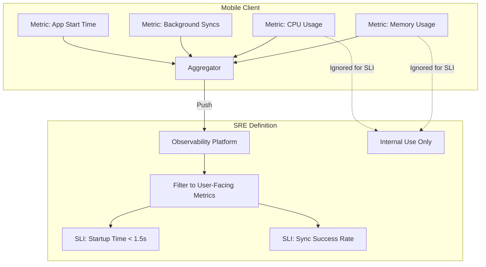

# Service Level Indicators (SLIs)

## Overview

A Service Level Indicator (SLI) is a carefully chosen, quantifiable measure of the level of service provided to the user. It answers the question: "Is this specific feature currently working from the user's perspective?" 

While your app might emit 500 different [Metrics](metrics.md) (e.g., CPU usage, memory consumption, thread pool size), only a very small handful of those metrics qualify as SLIs. SLIs are the foundation upon which SLOs and Error Budgets are built.

## Why It Matters

Imagine you are looking at a dashboard with 50 different graphs. CPU is at 80%, Memory is at 400MB, Network I/O is spiky, and the Garbage Collector is running frequently. Is the app broken? Should you wake up the on-call engineer at 3:00 AM? You can't tell.

SLIs cut through the noise. An SLI forces you to measure exactly what the user cares about. If the SLI is "Percentage of app startups that complete in under 2 seconds," you don't care about CPU usage. If the startup time is 1.5 seconds, the user is happy, the SLI is healthy, and the on-call engineer sleeps.

## Historical Context

SLIs are the bedrock of Site Reliability Engineering (SRE), a discipline invented by Google in the 2000s to manage massive global systems. Historically, operations teams measured "Server Uptime" (is the ping responding?). SRE shifted the focus to "User Happiness" (is the server returning a 200 OK within 200ms?). In mobile engineering, translating backend SLIs (Server Uptime) to frontend SLIs (Crash-Free Sessions) is a relatively recent, but highly necessary, evolution.

## First Principles

1.  **User-Centric:** SLIs must directly reflect the user's experience. "Database Disk I/O" is not an SLI. "Search Results Latency" is an SLI.
2.  **Proportional:** An SLI is almost always expressed as a proportion (a percentage): `(Good Events / Total Valid Events) * 100`.
3.  **Actionable:** If an SLI drops, it must unequivocally mean that users are suffering and an engineer needs to fix something immediately.

## Mental Model

Think of a restaurant.
- **Internal Metrics:** How hot the oven is, how many potatoes are in the pantry, how fast the dishwasher runs. If the oven is slightly cool, the chef might worry, but the customer doesn't know.
- **The SLI:** The percentage of customers who receive their food within 20 minutes of ordering. This is exactly what the customer cares about.

## Internal Mechanics

Formulating an SLI requires standardizing the mathematical equation:

$$ \text{SLI} = \frac{\text{Good Events}}{\text{Valid Events}} \times 100 $$

### Example 1: The Crash-Free Session SLI (Availability)

This is the most common SLI in mobile engineering.
- **Good Event:** A user session that ends normally (backgrounded or closed).
- **Valid Event:** Any user session that starts.
- **SLI:** "99.9% of user sessions are crash-free."

### Example 2: The Checkout SLI (Reliability)

- **Good Event:** A user tapping "Pay" and seeing the "Success" screen.
- **Valid Event:** A user tapping "Pay".
- **SLI:** "99.5% of 'Pay' button taps result in a success screen."
*(Note: If the user inputs an invalid credit card, the payment fails, but the app worked correctly. This must NOT be counted as a "Bad Event". It is an expected business outcome. Only system failures are bad events).*

### Example 3: The Startup Time SLI (Latency)

- **Good Event:** The app draws the first frame (TTID) in under 1,500 milliseconds.
- **Valid Event:** Every cold start of the app.
- **SLI:** "95% of cold starts complete in under 1.5 seconds."

## Architecture



## Production Example

**Measuring Latency Correctly**

A common mistake is defining a Latency SLI as "Average API Response Time."

As discussed in [Metrics](metrics.md), averages lie. If 99 users have a 10ms response, and 1 user has a 10,000ms timeout, the average is 109ms. The SLI looks great! But 1% of your users are completely broken.

**The Pro Production SLI:**
You use a Histogram metric to calculate Percentiles.
- **SLI:** "The 95th Percentile (P95) of the Feed API response time is $< 300\text{ms}$."

This guarantees that 95 out of 100 users are experiencing a fast app.

## Tradeoffs

**Advantages**
- **Alignment:** Focuses the entire engineering team on the exact same goal: the user's experience.
- **Noise Reduction:** Prevents engineers from panicking over internal metrics (like high CPU usage) if the SLIs (like frame rate) are perfectly fine.

**Disadvantages**
- **Hard to Define:** Distinguishing between a "System Error" (which hurts the SLI) and a "User Error" (like a typo in a password, which shouldn't hurt the SLI) requires complex instrumentation.
- **Mobile Environment Variance:** A backend server has a stable network. A mobile app is used on 2G networks in tunnels. If your SLI is "Network request $< 2\text{s}$", it will constantly fail for users on bad networks, even if your code is perfect. (Mobile SLIs often require complex filtering, like `WHERE network_type = WIFI`).

## Failure Modes

- **Too Many SLIs:** Defining an SLI for every single button in the app. If you have 50 SLIs, you have no SLIs. A mobile app should have 3 to 5 core SLIs that represent the critical user journeys (e.g., App Startup, Core Feed Load, Checkout).
- **Internal SLIs:** Creating an SLI for "Database Cache Hit Rate is $> 80\%$." The user does not care if the data came from the cache or the network, as long as it loaded fast. The Cache Hit Rate is a metric to help you achieve your Latency SLI, but it is not an SLI itself.
- **Measuring at the Wrong Boundary:** If the mobile team defines their SLI based on the *Backend's* reported response time, they are blind to the time the packet spent traveling through the air, and the time the phone spent parsing the JSON. The user experiences the *total* time. SLIs must be measured as close to the user's eyeballs as possible (on the mobile device).

## Staff Engineer Thinking

When setting up SRE practices, a Staff engineer asks:

1.  **If this metric spikes, do we wake someone up?** If the answer is no, it is not an SLI. It is just an interesting metric. SLIs are the triggers for critical alerts.
2.  **Does this measure the user's pain?** I frequently push back on backend teams who claim "100% Uptime" while the mobile app is crashing due to a malformed JSON payload. The backend SLI is green, but the Mobile SLI is red. The Mobile SLI is the only one that reflects the truth.
3.  **Is the "Good Event" scientifically sound?** If the SLI is "Video playback is smooth," how do we measure "smooth"? We must mathematically define it: "Video playback has fewer than 1 dropped frame per 60 seconds."

## Common Misconceptions

- **"SLIs are the same as KPIs."** KPIs (Key Performance Indicators) are business metrics (e.g., "Revenue per User", "Daily Active Users"). SLIs are engineering reliability metrics (e.g., "Crash-Free Rate"). A high SLI enables a high KPI.
- **"We need to get our SLIs to 100%."** Impossible and dangerous. An SLI is an *indicator*. The *goal* for that indicator is the SLO (Service Level Objective), which is covered next.

## Probing Questions

1.  What is the mathematical formula for a standard SLI?
2.  Why is "CPU Usage" an invalid SLI for an Android application?
3.  Explain the difference between a "System Error" and a "User Error" when calculating a Checkout Success SLI.
4.  Why must SLIs be measured from the mobile client rather than the backend server?
5.  What is the danger of having too many SLIs (e.g., 50+) for a single mobile application?
6.  How does the volatility of mobile networks make defining Latency SLIs uniquely difficult compared to backend development?
7.  If you want an SLI for UI smoothness, how would you mathematically define a "Good Event" using Android's frame rendering metrics?
8.  Why are Percentiles (P95, P99) superior to Averages (Mean) when defining Latency SLIs?
9.  Explain the relationship between raw Metrics (Counters, Histograms) and SLIs.
10. Describe a scenario where backend SLIs are green (100% success), but mobile SLIs are red (0% success). What could cause this?

## Mobile Implementation (Android)

The canonical mobile SLIs map roughly to Play's "bad behavior" metrics plus a few you define per-product:

| SLI | Definition | Source | Why mobile |
|---|---|---|---|
| **Crash-free users** | `1 - (users_with_crash / DAU)` per version | Crashlytics / Android Vitals | Direct user experience |
| **ANR-free users** | `1 - (users_with_ANR / DAU)` | Android Vitals | Play's distribution gate |
| **Cold start TTID** | p95 milliseconds | `JankStats`, `ReportFullyDrawn`, Vitals | First-impression latency |
| **Frame jank rate** | `janky_frames / total_frames` | `JankStats` | Scroll smoothness perception |
| **Network success rate** | `non_5xx_responses / total` per endpoint, **on-device measured** | OkHttp listener + telemetry SDK | Backend SLI is wrong-end measurement |
| **Critical-flow success** | e.g., `checkout_succeeded / checkout_started` | Custom analytics | Domain-specific |
| **Sync recovery** | `synced_within_5min / outbox_writes_offline` | Telemetry | Offline-first apps |

```kotlin
// SLI: critical-flow checkout success
class CheckoutSliRecorder @Inject constructor(private val telemetry: TelemetryClient) {
    fun started(orderId: String) {
        telemetry.counter("sli.checkout.attempted").increment()
    }
    fun succeeded(orderId: String) {
        telemetry.counter("sli.checkout.succeeded").increment()
    }
}
```

Mobile-distinct rules:

1. **Measure on the device, not the server.** A backend that returns 200 means the bytes left the server. The user might have lost connection between BFF and device. The mobile SLI counts *received-and-rendered*, not server-side success.
2. **Slice by foreground vs background.** A network call timing in the background fights Doze; expecting the same p95 as foreground is wrong.
3. **Slice by device tier.** A flagship's cold-start budget and a low-tier emerging-market budget cannot be the same SLI.
4. **Don't aggregate frame jank globally.** A heavy carousel might be janky by design (expected); a settings page should never be. Per-screen SLIs.
5. **Cumulative ANRs vs user-perceived ANRs.** Play distinguishes; you should too. User-perceived (within an interactive session) is the stricter measure.

## Further Reading

- [`slos.md`](slos.md) — How to set targets for your SLIs.
- [`metrics.md`](metrics.md) — The raw data from which SLIs are calculated.
- [Google SRE Book: Service Level Objectives](https://sre.google/sre-book/service-level-objectives/) — the theory.
- [Android Vitals](https://developer.android.com/topic/performance/vitals) — the SLIs Play measures for you.
- [`mobile-system-design/telemetry-sdk.md`](../mobile-system-design/telemetry-sdk.md) — the on-device pipeline.
