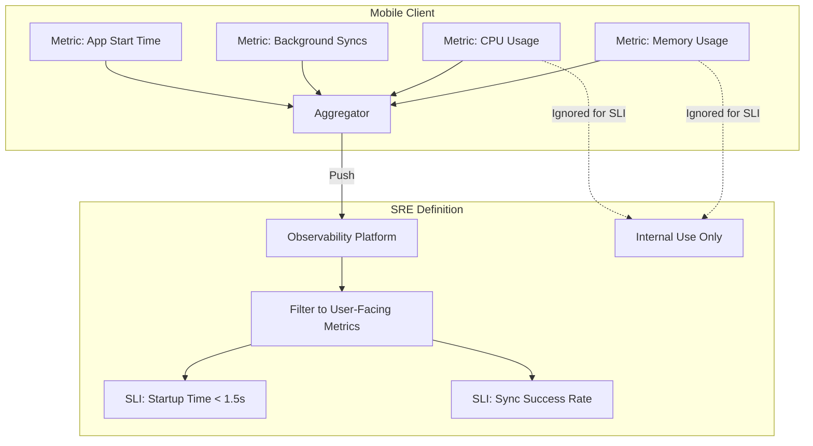

# Service Level Indicators (SLIs)

## Overview

A Service Level Indicator (SLI) is a carefully chosen, quantifiable measure of the level of service provided to the user. It answers the question: "Is this specific feature currently working from the user's perspective?" 

While your app might emit 500 different [Metrics](metrics.md) (e.g., CPU usage, memory consumption, thread pool size), only a very small handful of those metrics qualify as SLIs. SLIs are the foundation upon which SLOs and Error Budgets are built.

## Why It Matters

Imagine you are looking at a dashboard with 50 different graphs. CPU is at 80%, Memory is at 400MB, Network I/O is spiky, and the Garbage Collector is running frequently. Is the app broken? Should you wake up the on-call engineer at 3:00 AM? You can't tell.

SLIs cut through the noise. An SLI forces you to measure exactly what the user cares about. If the SLI is "Percentage of app startups that complete in under 2 seconds," you don't care about CPU usage. If the startup time is 1.5 seconds, the user is happy, the SLI is healthy, and the on-call engineer sleeps.

## Historical Context

SLIs are the bedrock of Site Reliability Engineering (SRE), a discipline invented by Google in the 2000s to manage massive global systems. Historically, operations teams measured "Server Uptime" (is the ping responding?). SRE shifted the focus to "User Happiness" (is the server returning a 200 OK within 200ms?). In mobile engineering, translating backend SLIs (Server Uptime) to frontend SLIs (Crash-Free Sessions) is a relatively recent, but highly necessary, evolution.

## First Principles

1.  **User-Centric:** SLIs must directly reflect the user's experience. "Database Disk I/O" is not an SLI. "Search Results Latency" is an SLI.
2.  **Proportional:** An SLI is almost always expressed as a proportion (a percentage): `(Good Events / Total Valid Events) * 100`.
3.  **Actionable:** A degraded SLI should inform a decision: page, hold a rollout, create a ticket, or investigate a cohort. Not every SLI breach warrants immediate paging.

## Mental Model

Think of a restaurant.
- **Internal Metrics:** How hot the oven is, how many potatoes are in the pantry, how fast the dishwasher runs. If the oven is slightly cool, the chef might worry, but the customer doesn't know.
- **The SLI:** The percentage of customers who receive their food within 20 minutes of ordering. This is exactly what the customer cares about.

## Internal Mechanics

Formulating an SLI requires standardizing the mathematical equation:

$$ \text{SLI} = \frac{\text{Good Events}}{\text{Valid Events}} \times 100 $$

### Example 1: The Crash-Free Session SLI (Availability)

This is the most common SLI in mobile engineering.
- **Good Event:** An eligible session without a fatal crash, under the reporting SDK's session definition. Backgrounding is not itself proof that a session was crash-free.
- **Valid Event:** Any user session that starts.
- **SLI:** "99.9% of user sessions are crash-free."

### Example 2: The Checkout SLI (Reliability)

- **Good Event:** An accepted checkout attempt reaches and displays its correct terminal outcome within the declared deadline: success or an expected business decline.
- **Valid Event:** Every accepted checkout attempt, counted once by operation ID. Define how cancellation, duplicate taps, unresolved attempts, and timeouts are handled.
- **SLI:** "99.5% of accepted attempts reach a correct terminal outcome within the deadline."

This is technical completion. Purchase conversion (`purchases / attempts`) is a separate product metric. A decline correctly displayed is technically successful; a missing or incorrect decline result is not.

### Example 3: The Startup Time SLI (Latency)

- **Good Event:** The app draws the first frame (TTID) in under 1,500 milliseconds.
- **Valid Event:** Every cold start of the app.
- **SLI:** "95% of cold starts complete in under 1.5 seconds."

## Architecture



## Production Example

**Measuring Latency Correctly**

A common mistake is defining a Latency SLI as "Average API Response Time."

For 99 requests taking 10 ms and one timing out at 10,000 ms, the mean is 109.9 ms. P95 is still 10 ms, so replacing the mean with P95 does not expose the 1% failure rate.

Track both availability (`successful eligible requests / all eligible requests`) and timely success (`successful requests within 300 ms / all eligible requests`). Include transport failures and deadline expiry in the denominator. Preserve mergeable latency distributions for tail diagnosis. Request percentiles describe requests, not distinct users; repeated failures can be concentrated in a small cohort.

## Tradeoffs

**Advantages**
- **Alignment:** Focuses the entire engineering team on the exact same goal: the user's experience.
- **Noise Reduction:** Prevents engineers from panicking over internal metrics (like high CPU usage) if the SLIs (like frame rate) are perfectly fine.

**Disadvantages**
- **Hard to Define:** Distinguishing between a "System Error" (which hurts the SLI) and a "User Error" (like a typo in a password, which shouldn't hurt the SLI) requires complex instrumentation.
- **Mobile Environment Variance:** A backend server has a stable network. A mobile app is used on 2G networks in tunnels. If your SLI is "Network request $< 2\text{s}$", it will constantly fail for users on bad networks, even if your code is perfect. Keep an all-eligible-user experience SLI and slice by network class. A Wi-Fi-only SLO is valid only when its restricted eligibility is explicit; it cannot represent users on cellular networks.

## Failure Modes

- **Too Many SLIs:** Defining an SLI for every single button in the app. If you have 50 SLIs, you have no SLIs. A mobile app should have 3 to 5 core SLIs that represent the critical user journeys (e.g., App Startup, Core Feed Load, Checkout).
- **Internal SLIs:** Creating an SLI for "Database Cache Hit Rate is $> 80\%$." The user does not care if the data came from the cache or the network, as long as it loaded fast. The Cache Hit Rate is a metric to help you achieve your Latency SLI, but it is not an SLI itself.
- **Measuring at the Wrong Boundary:** If the mobile team defines their SLI based on the *Backend's* reported response time, they are blind to the time the packet spent traveling through the air, and the time the phone spent parsing the JSON. The user experiences the *total* time. SLIs must be measured as close to the user's eyeballs as possible (on the mobile device).

## Staff Engineer Thinking

When setting up SRE practices, a Staff engineer asks:

1.  **What decision follows a breach?** Assign an owner and route: immediate mitigation, release hold, business-hours investigation, or ticket. Startup latency can be a valid SLI without being a paging condition.
2.  **Does this measure the user's pain?** I frequently push back on backend teams who claim "100% Uptime" while the mobile app is crashing due to a malformed JSON payload. The backend SLI is green, but the Mobile SLI is red. The Mobile SLI is the only one that reflects the truth.
3.  **Is the "Good Event" scientifically sound?** If the SLI is "Video playback is smooth," how do we measure "smooth"? We must mathematically define it: "Video playback has fewer than 1 dropped frame per 60 seconds."

## Common Misconceptions

- **"SLIs are the same as KPIs."** KPIs (Key Performance Indicators) are business metrics (e.g., "Revenue per User", "Daily Active Users"). SLIs are engineering reliability metrics (e.g., "Crash-Free Rate"). A high SLI enables a high KPI.
- **"We need to get our SLIs to 100%."** Impossible and dangerous. An SLI is an *indicator*. The *goal* for that indicator is the SLO (Service Level Objective), which is covered next.

## Probing Questions

1.  What is the mathematical formula for a standard SLI?
2.  Why is "CPU Usage" an invalid SLI for an Android application?
3.  Explain the difference between a "System Error" and a "User Error" when calculating a Checkout Success SLI.
4.  Why must SLIs be measured from the mobile client rather than the backend server?
5.  What is the danger of having too many SLIs (e.g., 50+) for a single mobile application?
6.  How does the volatility of mobile networks make defining Latency SLIs uniquely difficult compared to backend development?
7.  If you want an SLI for UI smoothness, how would you mathematically define a "Good Event" using Android's frame rendering metrics?
8.  Why are Percentiles (P95, P99) superior to Averages (Mean) when defining Latency SLIs?
9.  Explain the relationship between raw Metrics (Counters, Histograms) and SLIs.
10. Describe a scenario where backend SLIs are green (100% success), but mobile SLIs are red (0% success). What could cause this?

## Mobile Implementation (Android)

The canonical mobile SLIs map roughly to Play's "bad behavior" metrics plus a few you define per-product:

| SLI | Definition | Source | Why mobile |
|---|---|---|---|
| **Crash-free users** | `1 - (unique_users_with_fatal_crash / unique_active_users)` in the same selected window/cohort | Crashlytics | Distinct-user impact; not interchangeable with Play's daily metric |
| **User-perceived ANR rate** | Daily active users with ≥1 user-perceived ANR / DAU | Android Vitals | Play's ANR distribution metric |
| **Cold start TTID** | p95 milliseconds | Vitals TTID; Macrobenchmark `StartupTimingMetric` for lab measurements | First-impression latency |
| **Frame jank rate** | `janky_frames / total_frames` | `JankStats` | Scroll smoothness perception |
| **Network success rate** | Correct terminal outcomes / all eligible on-device operations, per endpoint; include transport failures | OkHttp listener + telemetry SDK | Backend SLI is wrong-end measurement |
| **Critical-flow success** | e.g., timely correct checkout outcomes / accepted attempts | Custom analytics | Domain-specific |
| **Sync recovery** | `synced_within_5min / outbox_writes_offline` | Telemetry | Offline-first apps |

Classify HTTP outcomes against the operation contract: an expected validation decline can be a correct terminal result, while an unresolved 401, rate-limit failure, DNS/TLS failure, or timeout can prevent completion. A non-5xx response alone is not proof of success. For deadline-based SLIs, evaluate matured attempts or track in-flight work separately; do not mark a newly started operation as failed before its deadline.

```kotlin
// Illustrative counter facade. The operation owner emits accepted once and
// exactly one terminal classification per attempt; it reconciles timeouts
// and late results. Durable operation state, not these counters, deduplicates.
class CheckoutSliRecorder @Inject constructor(private val telemetry: TelemetryClient) {
    fun accepted() {
        telemetry.counter("sli.checkout.attempted").increment()
    }
    fun completedCorrectly() {
        telemetry.counter("sli.checkout.completed_correctly").increment()
    }
}
```

Mobile-distinct rules:

1. **Measure on the device, not the server.** A backend that returns 200 means the bytes left the server. The user might have lost connection between BFF and device. The mobile SLI counts *received-and-rendered*, not server-side success.
2. **Slice by foreground vs background.** A network call timing in the background fights Doze; expecting the same p95 as foreground is wrong.
3. **Slice by device tier.** A flagship's cold-start budget and a low-tier emerging-market budget cannot be the same SLI.
4. **Don't aggregate frame jank globally.** A heavy carousel might be janky by design (expected); a settings page should never be. Per-screen SLIs.
5. **Overall vs user-perceived ANRs.** Play currently counts input-dispatch timeouts in the user-perceived subset. This is a different numerator, not a universally stricter rate threshold.

### Ownership matrix

Every SLI needs a named owner and a first mitigation. Otherwise it becomes a dashboard tile nobody trusts.

| SLI | Primary owner | Required slices | First mitigation |
|---|---|---|---|
| Crash-free users | Release owner + feature owner | app version, OEM, API level, ABI | Halt rollout, disable feature, hotfix |
| ANR-free users | Android platform/performance owner | app version, device tier, foreground/background | Halt rollout, revert SDK/init path, ship hotfix |
| Cold start p95/p99 | App platform owner | app version, device tier, first install vs repeat launch | Hold rollout, defer startup work, update baseline profile |
| Jank rate | Feature owner | screen, refresh rate, device tier | Disable animation/list feature, reduce composition cost |
| Critical-flow success | Product feature owner | app version, backend region, network class | Kill switch or backend fallback |

The owner is accountable for the runbook and for deleting or retuning the SLI if it stops driving decisions. "Everyone watches this" usually means no one watches it.

## Answer Key

1. **What is the mathematical formula for a standard SLI?**
   (Good Events / Total Valid Events) * 100.
2. **Why is "CPU Usage" an invalid SLI for an Android application?**
   It measures an internal system state rather than the actual user experience or user pain.
3. **Explain the difference between a "System Error" and a "User Error" when calculating a Checkout Success SLI.**
   For technical completion, a correct, timely business decline is a good terminal outcome, while a transport failure, wrong result, or deadline expiry is bad. Purchase conversion is separate; keep numerator and denominator consistent.
4. **Why must SLIs be measured from the mobile client rather than the backend server?**
   Measuring at the client captures the total latency and complete end-to-end user experience, including network transit and on-device processing.
5. **What is the danger of having too many SLIs (e.g., 50+) for a single mobile application?**
   It creates noise, dilutes focus, and leads to alert fatigue, making it impossible to identify and prioritize critical user journeys.
6. **How does the volatility of mobile networks make defining Latency SLIs uniquely difficult compared to backend development?**
   Network conditions affect real user experience. Keep an all-eligible-user SLI and network slices; use restricted eligibility only when the SLO explicitly promises service to that population.
7. **If you want an SLI for UI smoothness, how would you mathematically define a "Good Event" using Android's frame rendering metrics?**
   Define the frame deadline or the chosen jank heuristic and refresh rate. A nominal interval is about 16.7 ms at 60 Hz and 8.3 ms at 120 Hz; JankStats uses a configurable heuristic (default multiplier 2), not a universal 16 ms definition.
8. **Why are Percentiles (P95, P99) superior to Averages (Mean) when defining Latency SLIs?**
   Percentiles describe distribution tails better than a mean, but P95 can hide 1% failures. Pair latency with availability, include failed operations, and slice cohorts; request percentiles make no distinct-user guarantee.
9. **Explain the relationship between raw Metrics (Counters, Histograms) and SLIs.**
   Raw metrics provide the underlying data points that are filtered and aggregated to calculate the proportions used in SLIs.
10. **Describe a scenario where backend SLIs are green (100% success), but mobile SLIs are red (0% success). What could cause this?**
    The backend successfully processes the request and returns a 200 OK, but a malformed JSON payload crashes the mobile client during parsing.

## Further Reading

- [`slos.md`](slos.md) — How to set targets for your SLIs.
- [`metrics.md`](metrics.md) — The raw data from which SLIs are calculated.
- [Google SRE Book: Service Level Objectives](https://sre.google/sre-book/service-level-objectives/) — the theory.
- [Android Vitals](https://developer.android.com/topic/performance/vitals) — the SLIs Play measures for you.
- [`mobile-system-design/telemetry-sdk.md`](../mobile-system-design/telemetry-sdk.md) — the on-device pipeline.
- [Crashlytics crash-free metrics](https://firebase.google.com/docs/crashlytics/crash-free-metrics)
- [Play ANR definitions](https://developer.android.com/google/play/vitals/anr)
- [Startup TTID and TTFD](https://developer.android.com/topic/performance/vitals/launch-time)
- [JankStats frame heuristics](https://developer.android.com/topic/performance/jankstats)
- [Prometheus histograms and summaries](https://prometheus.io/docs/practices/histograms/)
