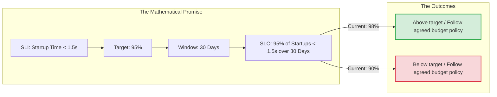

# Service Level Objectives (SLOs)

## Overview

A Service Level Objective (SLO) is the specific target value (or range of values) for a Service Level Indicator ([SLI](slis.md)). If the SLI is *what* you measure, the SLO is the *target* you are aiming for. 

SLOs are the mathematical definition of "good enough." They are the internal agreement between Engineering, Product, and Business about how reliable an app needs to be.

## Why It Matters

"We want the app to never crash" is a noble sentiment, but it is impossible. Hardware fails, OS updates break APIs, and human developers write bugs. Trying to reach 100% reliability is infinitely expensive and stifles innovation (you can never ship a new feature because it introduces risk).

An SLO forces a realistic conversation: "We agree that a 99.9% crash-free rate is our target." For a crash-free-session SLI, this permits up to 0.1% of eligible sessions to contain a fatal crash in the stated window; it does not predict that this many will crash. It gives the engineering team a concrete goal, preventing endless arguments with Product Managers over whether a bug is "critical" or "acceptable."

## Historical Context

SLOs are the central pillar of Site Reliability Engineering (SRE). Before SRE, Engineering wanted to ship features fast (risking crashes), and Operations wanted stability (resisting new features). The SLO was invented as the neutral, mathematical peacemaker. An agreed policy uses the SLO and error budget to guide release risk, reliability work, and exceptions. (This dynamic is formalized as [Error Budgets](error-budgets.md)).

## First Principles

1.  **100% is the Wrong Target:** If you set an SLO of 100%, you are guaranteeing failure. The internet is not 100% reliable; therefore, your app cannot be.
2.  **User Happiness is the Baseline:** An SLO should be set just slightly above the point where users start complaining. Reliability beyond the SLO has an opportunity cost. Balance further investment against user harm, safety, security, contractual duties, and feature value.
3.  **Measured over a Time Window:** "99% success" means nothing. "99% success *over a rolling 30-day window*" is an SLO.

## Mental Model

Think of a speed limit on a highway.
- **The SLI:** The radar gun measuring your car's speed (e.g., 68 mph).
- **The SLO:** The posted speed limit sign (e.g., 65 mph). 
- **The Tolerance:** If the SLO is 65 mph, the police (SREs) know that cars going 66 or 67 are technically violating it, but it's not worth pulling them over. But if a car hits 80 mph, alarms go off.

## Internal Mechanics

Formulating an SLO requires taking an SLI and attaching a target and a time window.

### Example 1: The Crash-Free Session SLO

- **The SLI:** $\frac{\text{Crash-Free Sessions}}{\text{Total Sessions}} \times 100$
- **The SLO:** 99.9% measured over a rolling 30-day window.

*(If you have 10,000,000 sessions a month, this SLO means you are "allowed" 10,000 sessions containing a fatal crash in that window. If you hit 11,000 such sessions, you have violated the SLO).*

### Example 2: The Latency SLO

- **The SLI:** Percentage of Feed API calls completing in under 300ms.
- **The SLO:** 95% measured over a rolling 7-day window.

*(This means out of 100 API calls, it is perfectly acceptable for 5 of them to take longer than 300ms).*

## Architecture



The measured startup proportion is above or below the 95% target; release actions follow the agreed [error-budget policy](error-budgets.md).

## Production Example

**The "Nines"**

Reliability targets are often discussed in terms of "nines." Each additional nine reduces the allowed failure fraction tenfold; engineering cost depends on the architecture and failure modes.

| Nines | SLO | Allowed Failure (Downtime/Errors per month) | Illustrative use case (not an industry guarantee) |
| :--- | :--- | :--- | :--- |
| **Two Nines** | 99.0% | ~7 hours / 10,000 errors per 1M | Internal tools, beta apps. |
| **Three Nines** | 99.9% | ~43 minutes / 1,000 errors per 1M | Standard consumer mobile apps. |
| **Four Nines** | 99.99% | ~4 minutes / 100 errors per 1M | E-commerce checkout, banking. |
| **Five Nines** | 99.999% | ~26 seconds / 10 errors per 1M | Highly available services; safety-critical systems need additional safety analysis. |

For a photo-upload target, define whether success means immediate completion or eventual completion after a durable retry. Device, OS, network, and backend failures constrain the result. Measure the end-to-end journey; there is no universal OS or carrier reliability percentage from which to infer an app guarantee.

## Tradeoffs

**Advantages**
- **Objective Decision Making:** Removes emotion from bug triage. Use the SLO and cohort impact to prioritise reliability work, alongside security, safety, data integrity, and other obligations.
- **Velocity:** By explicitly stating that 0.1% failure is acceptable, engineers are given the psychological safety to merge code quickly and ship features, knowing they don't have to be perfect.

**Disadvantages**
- **Aspirational SLOs:** If you set a target of 99.99%, but your app currently runs at 95%, the SLO is useless. It will constantly fire alerts, engineers will ignore the alerts (Alert Fatigue), and the SLO loses all meaning.
- **Hidden Pain:** If the SLO is "99% of users can log in," the math looks great. But if the 1% who fail are specifically Android 10 users who are permanently locked out due to an API bug, your SLO is green but a specific segment of users is furiously angry. (This requires dimensional slicing of SLOs).

## Failure Modes

- **The Strict SLA Confusion:**
  - **SLI:** The measurement.
  - **SLO:** The internal target.
  - **SLA (Service Level Agreement):** The *legal contract* with the customer. "If we fail to meet 99%, we refund you $10,000."
  - *Failure Mode:* Engineering teams confusing an internal SLO with an external SLA and panicking. SLOs should always be stricter than SLAs so you have time to fix the issue before the lawyers get involved.
- **Window Blindness:** Using a "Since the beginning of time" window. If you had a massive outage in 2022, your lifetime SLO will be forever ruined. Use an explicit rolling window (such as the last 30 days) or calendar period (such as a month). Rolling windows continuously age out old events; calendar windows align with reporting periods. Neither is a lifetime measurement.
- **Setting Targets Based on Current Performance:** "Our app currently crashes 5% of the time, so our SLO is 95%." No. The SLO must be based on *User Happiness*. If users are leaving because crashes disrupt the journey, agree on a user-centred target and apply the error-budget policy to release risk, mitigation, and reliability work. Do not substitute either the current failure rate or an unconditional feature freeze for that policy.

## Staff Engineer Thinking

When negotiating an SLO with Product Management, a Staff engineer asks:

1.  **What happens when we violate it?** An SLO without a consequence is just a suggestion. Does Product agree to release holds, mitigation, reliability work, and exceptions under the error-budget policy? Choose a response proportionate to the harm; a universal development freeze is not required.
2.  **Is this technically possible?** Can the Android hardware support this? Measure TTID/TTFD on representative devices and startup states before promising a target; no fixed Zygote-fork duration establishes a universal lower bound.
3.  **Are we hiding behind averages?** Use good-event fractions or percentiles for latency tails, alongside error rate and device/network slices. A request P95 describes requests, not 95% of distinct users or a particular device cohort.

## Common Misconceptions

- **"If we violate the SLO, someone gets fired."** No. Violating an SLO is a systemic failure, not a human failure. It means the system's guardrails failed. The response is a Blameless Post-Mortem, not punishment.
- **"We need an SLO for every single feature."** You only need SLOs for the critical user journeys (e.g., Login, View Feed, Checkout). Setting an SLO for "Changing the profile picture avatar color" creates noise and wastes SRE resources.

## Probing Questions

1.  Explain the relationship between an SLI, an SLO, and an SLA.
2.  Why is setting an SLO of 100% considered a fundamental SRE anti-pattern?
3.  Describe the relationship between "Nines" of reliability and the engineering cost required to achieve them.
4.  What must be defined and measured before promising "Five Nines" (99.999%) for a mobile journey?
5.  What is a rolling time window in an SLO, and when might a calendar period be preferable?
6.  If a Product Manager demands an SLO that is higher than the current performance of the app, what is the architectural implication for the next few sprints?
7.  How does an explicitly defined SLO give engineers the "permission" to ship code faster?
8.  Describe a scenario where a Latency SLO is perfectly green, but thousands of users are completely unable to use the app. (Hint: Averages vs Percentiles).
9.  Why should SLOs only be applied to Critical User Journeys (CUJs) rather than every single screen in the app?
10. If an internal engineering team consistently violates their SLO, but users aren't complaining and revenue is up, what does that tell you about the SLO?

## Mobile Implementation (Android)

Product SLOs and Play distribution thresholds answer different questions. Name the source, population, window, and units before comparing them.

| Play stability metric | Overall bad-behavior threshold | Per phone-model threshold |
|---|---|---|
| User-perceived crash rate | 1.09% of daily active users | 8% |
| User-perceived ANR rate | 0.47% of daily active users | 8% |

These are affected-user rates, not session rates or Crashlytics crash-free-user targets. Play generally evaluates recent 28-day data and can act sooner on spikes. Exceeding a threshold can reduce discoverability; it is not an automatic app-removal rule. See [Android vitals](https://developer.android.com/google/play/vitals) and [Play's metric definitions](https://support.google.com/googleplay/android-developer/answer/9844486?hl=en).

| Example internal target | Measurement |
|---|---|
| Crash-free users ≥ 99.5% | Crashlytics unique users in the selected window/cohort |
| User-perceived ANR rate ≤ 0.30% | Play affected daily active users |
| Cold-start TTID P95 < 1.5 s | Defined device tier and cold-start population |
| Janky frames < 2% | Defined frame heuristic, refresh rate, and screen |
| Network success ≥ 99% | Eligible on-device operations and explicit outcome classification |
| Checkout technical completion ≥ 99.5% | Correct terminal outcomes, including expected business declines |

These are illustrative product decisions, not Play floors. [Vitals' excessive cold-start classification](https://developer.android.com/google/play/vitals/launch-time) (5 seconds or longer) is not a P95 limit. Play also reports excessive partial wake locks (5% threshold), and documents memory/bitmap/code-optimization visibility changes starting February 2027. Those signals do not replace a feature-specific battery-per-active-hour SLO; track changing policy in the [Currency Watchlist](../milestones.md#currency-watchlist).

```kotlin
import java.math.BigDecimal

// Illustrative release policy, not Play's enforcement algorithm.
// Construct rates from validated decimal strings, never via Double.
// Fractions: BigDecimal("0.003") means 0.30%.
data class SloCheck(
    val crashFreeUsers: BigDecimal,
    val userPerceivedAnrFraction: BigDecimal,
    val ttidP95Ms: Long,
    val checkoutTechnicalSuccess: BigDecimal,
)

enum class PromoteDecision { Hold, HaltCritical, HaltRegression, PromoteEligible }

fun shouldPromoteRollout(check: SloCheck, prev: SloCheck): PromoteDecision {
    val valid = listOf(check, prev).all { sample ->
        listOf(sample.crashFreeUsers, sample.userPerceivedAnrFraction,
            sample.checkoutTechnicalSuccess).all { it >= BigDecimal.ZERO && it <= BigDecimal.ONE } &&
            sample.ttidP95Ms > 0
    }
    if (!valid) return PromoteDecision.Hold
    // Only the crash policy matches evaluate_crash_gate in crash-rate-gating.md.
    // Evaluate all halt conditions before any hold condition.
    val delta = prev.crashFreeUsers - check.crashFreeUsers
    if (check.crashFreeUsers < BigDecimal("0.98")) return PromoteDecision.HaltCritical
    if (delta > BigDecimal("0.005")) return PromoteDecision.HaltRegression
    if (check.userPerceivedAnrFraction > BigDecimal("0.003")) return PromoteDecision.HaltCritical
    if (check.crashFreeUsers < BigDecimal("0.995") || delta > BigDecimal("0.001")) {
        return PromoteDecision.Hold
    }
    if (BigDecimal.valueOf(check.ttidP95Ms) >
        BigDecimal.valueOf(prev.ttidP95Ms) * BigDecimal("1.10")) return PromoteDecision.Hold
    if (check.checkoutTechnicalSuccess < BigDecimal("0.995")) return PromoteDecision.Hold
    return PromoteDecision.PromoteEligible
}
```

Missing, malformed, non-finite, or insufficient input must hold the rollout upstream, before constructing these decimal values. The example assumes fresh, sufficient, comparable cohorts and does not estimate statistical confidence. Decimal string construction and exact subtraction preserve the stated crash-policy boundaries; converting a previously rounded Double cannot recover lost precision. See the [matching crash policy](../release-engineering/crash-rate-gating.md#4-the-auto-halt-workflow).

Mobile-distinct:

1. **Keep app-wide and version slices.** The app-wide SLO describes fleet experience; comparable version/cohort measurements gate the rollout. Declare which one a budget covers.
2. **Vendor thresholds are external constraints.** Product targets can be tighter and use different populations, but must not be labelled as vendor enforcement rules.
3. **Use device-tier targets deliberately.** Measure representative hardware and distinguish cold, warm, and hot starts.
4. **Define battery measurements.** A feature's battery cost per active hour differs from Play's excessive-wake-lock metric. State collection limitations and eligibility.
5. **Inspect cohort harm.** Global success can hide a failing OEM/API/network cohort; apply minimum-sample rules and targeted mitigations.

### Alert routing policy

An SLO breach is not automatically a page. Route by user impact and available mitigation.

| Breach | Route | Why |
|---|---|---|
| New release breaches the declared critical or regression crash gate | PagerDuty + release channel | Halt rollout or kill feature immediately |
| Checkout/login critical-flow success drops sharply | PagerDuty | Revenue/access outage with clear mitigation path |
| Cold start p95 regresses 20% in staged rollout | Release channel | Hold rollout; rarely worth waking someone at 3 AM |
| Jank increases on one non-critical screen | Feature channel | Needs owner action, not incident response |
| Background sync success dips but retries recover | Ticket/business hours | User impact is delayed and self-healing |

This policy prevents alert fatigue. Paging is reserved for cases where a human can reduce user harm right now.

## Answer Key

1. **Explain the relationship between an SLI, an SLO, and an SLA.**
   An SLI is the measurement, the SLO is the internal target for that measurement, and the SLA is the external legal contract tied to financial penalties.
2. **Why is setting an SLO of 100% considered a fundamental SRE anti-pattern?**
   It is impossible to achieve due to unpredictable external factors (hardware, networks), and striving for it halts feature velocity by eliminating all tolerance for risk.
3. **Describe the relationship between "Nines" of reliability and the engineering cost required to achieve them.**
   Each additional nine reduces the allowed failure fraction tenfold. Achieving it may require redundancy and operational changes; cost is system-specific rather than universally exponential.
4. **What must be defined and measured before promising "Five Nines" (99.999%) for a mobile journey?**
   Define the eligible population, operation, success deadline, failure handling, and observation window. Measure representative end-to-end results and dependencies; a universal OS/carrier percentage cannot establish the guarantee.
5. **What is a rolling time window in an SLO, and when might a calendar period be preferable?**
   A rolling window continuously measures a recent interval and ages out old events. A calendar period can instead align with business reporting; document when it resets and how boundary incidents are handled.
6. **If a Product Manager demands an SLO that is higher than the current performance of the app, what is the architectural implication for the next few sprints?**
   Agree on a realistic target, investment plan, and error-budget policy. A release hold may be appropriate, but a new aspirational target does not automatically require freezing all development.
7. **How does an explicitly defined SLO give engineers the "permission" to ship code faster?**
   It establishes an error budget, creating psychological safety and mathematical proof that a small amount of failure from new releases is acceptable.
8. **Describe a scenario where a Latency SLO is perfectly green, but thousands of users are completely unable to use the app. (Hint: Averages vs Percentiles).**
   A request P95 can remain healthy while a small cohort always fails, especially if failed operations are excluded. Pair latency with availability and cohort slices; request percentiles do not guarantee per-user success.
9. **Why should SLOs only be applied to Critical User Journeys (CUJs) rather than every single screen in the app?**
   Tracking every feature creates alert fatigue and wastes SRE resources; CUJs focus on the core actions necessary for the business to survive.
10. **If an internal engineering team consistently violates their SLO, but users aren't complaining and revenue is up, what does that tell you about the SLO?**
    Check cohort harm, measurement quality, and user expectations before changing the target. It may be misaligned, but aggregate revenue and absence of complaints do not prove reliability is adequate.

## Further Reading

- [`slis.md`](slis.md) — The metrics that the SLO is measuring.
- [`error-budgets.md`](error-budgets.md) — The mathematical consequence of violating an SLO.
- [`alerting.md`](alerting.md) — How the system notifies humans when an SLO is in danger.
- [Android vitals thresholds](https://developer.android.com/google/play/vitals)
- [Crashlytics crash-free definitions](https://firebase.google.com/docs/crashlytics/crash-free-metrics)
- [Android startup measurement](https://developer.android.com/topic/performance/vitals/launch-time)
- [Cloud Monitoring SLO periods](https://docs.cloud.google.com/monitoring/api/ref_v3/rest/v3/services.serviceLevelObjectives)
- [Google SRE: Embracing Risk](https://sre.google/sre-book/embracing-risk/)
- [JDK BigDecimal contract](https://docs.oracle.com/en/java/javase/17/docs/api/java.base/java/math/BigDecimal.html) — exact decimal construction and arithmetic.
- [Google SRE: Example Error Budget Policy](https://sre.google/workbook/error-budget-policy/) — release decisions and exceptions belong to an agreed policy.
