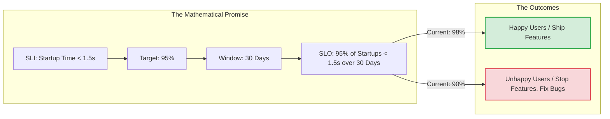

# Service Level Objectives (SLOs)

## Overview

A Service Level Objective (SLO) is the specific target value (or range of values) for a Service Level Indicator ([SLI](slis.md)). If the SLI is *what* you measure, the SLO is the *target* you are aiming for. 

SLOs are the mathematical definition of "good enough." They are the internal agreement between Engineering, Product, and Business about how reliable an app needs to be.

## Why It Matters

"We want the app to never crash" is a noble sentiment, but it is impossible. Hardware fails, OS updates break APIs, and human developers write bugs. Trying to reach 100% reliability is infinitely expensive and stifles innovation (you can never ship a new feature because it introduces risk).

An SLO forces a realistic conversation: "We agree that a 99.9% crash-free rate is our target." This implies that 0.1% of sessions *will* crash, and that is acceptable. It gives the engineering team a concrete goal, preventing endless arguments with Product Managers over whether a bug is "critical" or "acceptable."

## Historical Context

SLOs are the central pillar of Site Reliability Engineering (SRE). Before SRE, Engineering wanted to ship features fast (risking crashes), and Operations wanted stability (resisting new features). The SLO was invented as the neutral, mathematical peacemaker. If the SLO is met, ship the features. If the SLO is violated, stop shipping features and fix the bugs. (This dynamic is formalized as [Error Budgets](error-budgets.md)).

## First Principles

1.  **100% is the Wrong Target:** If you set an SLO of 100%, you are guaranteeing failure. The internet is not 100% reliable; therefore, your app cannot be.
2.  **User Happiness is the Baseline:** An SLO should be set just slightly above the point where users start complaining. Any engineering effort spent improving reliability *beyond* the SLO is wasted money that could have been spent on new features.
3.  **Measured over a Time Window:** "99% success" means nothing. "99% success *over a rolling 30-day window*" is an SLO.

## Mental Model

Think of a speed limit on a highway.
- **The SLI:** The radar gun measuring your car's speed (e.g., 68 mph).
- **The SLO:** The posted speed limit sign (e.g., 65 mph). 
- **The Tolerance:** If the SLO is 65 mph, the police (SREs) know that cars going 66 or 67 are technically violating it, but it's not worth pulling them over. But if a car hits 80 mph, alarms go off.

## Internal Mechanics

Formulating an SLO requires taking an SLI and attaching a target and a time window.

### Example 1: The Crash-Free Session SLO

- **The SLI:** $\frac{\text{Crash-Free Sessions}}{\text{Total Sessions}} \times 100$
- **The SLO:** 99.9% measured over a rolling 30-day window.

*(If you have 10,000,000 sessions a month, this SLO means you are "allowed" 10,000 crashes a month. If you hit 11,000 crashes, you have violated the SLO).*

### Example 2: The Latency SLO

- **The SLI:** Percentage of Feed API calls completing in under 300ms.
- **The SLO:** 95% measured over a rolling 7-day window.

*(This means out of 100 API calls, it is perfectly acceptable for 5 of them to take longer than 300ms).*

## Architecture



## Production Example

**The "Nines"**

Reliability SLOs are almost always discussed in terms of "Nines." Every nine you add increases the engineering cost exponentially.

| Nines | SLO | Allowed Failure (Downtime/Errors per month) | Typical Use Case |
| :--- | :--- | :--- | :--- |
| **Two Nines** | 99.0% | ~7 hours / 10,000 errors per 1M | Internal tools, beta apps. |
| **Three Nines** | 99.9% | ~43 minutes / 1,000 errors per 1M | Standard consumer mobile apps. |
| **Four Nines** | 99.99% | ~4 minutes / 100 errors per 1M | E-commerce checkout, banking. |
| **Five Nines** | 99.999% | ~26 seconds / 10 errors per 1M | Pacemakers, Aviation systems. |

If a Product Manager demands "Five Nines" of reliability for an Android app's photo upload feature, a Staff Engineer must gently explain that the iOS/Android operating systems themselves barely achieve Three Nines, and mobile network carriers (AT&T, Verizon) are often Two Nines. You cannot build a Five Nines app on top of a Two Nines network.

## Tradeoffs

**Advantages**
- **Objective Decision Making:** Removes emotion from bug triage. "Do we fix this obscure bug?" Look at the SLO. If we are above it, no. If we are below it, yes.
- **Velocity:** By explicitly stating that 0.1% failure is acceptable, engineers are given the psychological safety to merge code quickly and ship features, knowing they don't have to be perfect.

**Disadvantages**
- **Aspirational SLOs:** If you set a target of 99.99%, but your app currently runs at 95%, the SLO is useless. It will constantly fire alerts, engineers will ignore the alerts (Alert Fatigue), and the SLO loses all meaning.
- **Hidden Pain:** If the SLO is "99% of users can log in," the math looks great. But if the 1% who fail are specifically Android 10 users who are permanently locked out due to an API bug, your SLO is green but a specific segment of users is furiously angry. (This requires dimensional slicing of SLOs).

## Failure Modes

- **The Strict SLA Confusion:**
  - **SLI:** The measurement.
  - **SLO:** The internal target.
  - **SLA (Service Level Agreement):** The *legal contract* with the customer. "If we fail to meet 99%, we refund you $10,000."
  - *Failure Mode:* Engineering teams confusing an internal SLO with an external SLA and panicking. SLOs should always be stricter than SLAs so you have time to fix the issue before the lawyers get involved.
- **Window Blindness:** Using a "Since the beginning of time" window. If you had a massive outage in 2022, your lifetime SLO will be forever ruined. SLOs must use rolling windows (e.g., the last 30 days) to reflect the *current* reality of the system.
- **Setting Targets Based on Current Performance:** "Our app currently crashes 5% of the time, so our SLO is 95%." No. The SLO must be based on *User Happiness*. If users are leaving 1-star reviews because it crashes 5% of the time, the SLO must be set to 99%, and you must stop shipping features until you hit it.

## Staff Engineer Thinking

When negotiating an SLO with Product Management, a Staff engineer asks:

1.  **What happens when we violate it?** An SLO without a consequence is just a suggestion. If we drop below 99.9%, does Product agree to freeze all new feature development to fix stability? If not, the SLO is useless.
2.  **Is this technically possible?** Can the Android hardware support this? If the SLO requires launching the app in under 200ms, and we know the Android Zygote process takes 150ms just to fork, the SLO is physically impossible.
3.  **Are we hiding behind averages?** I will always push for Percentile-based latency SLOs. I don't care if the average user is happy. I want an SLO that ensures the 95th percentile (the users on cheap Android devices with slow internet) are happy.

## Common Misconceptions

- **"If we violate the SLO, someone gets fired."** No. Violating an SLO is a systemic failure, not a human failure. It means the system's guardrails failed. The response is a Blameless Post-Mortem, not punishment.
- **"We need an SLO for every single feature."** You only need SLOs for the critical user journeys (e.g., Login, View Feed, Checkout). Setting an SLO for "Changing the profile picture avatar color" creates noise and wastes SRE resources.

## Probing Questions

1.  Explain the relationship between an SLI, an SLO, and an SLA.
2.  Why is setting an SLO of 100% considered a fundamental SRE anti-pattern?
3.  Describe the relationship between "Nines" of reliability and the engineering cost required to achieve them.
4.  Why is it physically impossible to guarantee "Five Nines" (99.999%) reliability for a mobile application?
5.  What is a "Rolling Time Window" in the context of an SLO, and why is it necessary?
6.  If a Product Manager demands an SLO that is higher than the current performance of the app, what is the architectural implication for the next few sprints?
7.  How does an explicitly defined SLO give engineers the "permission" to ship code faster?
8.  Describe a scenario where a Latency SLO is perfectly green, but thousands of users are completely unable to use the app. (Hint: Averages vs Percentiles).
9.  Why should SLOs only be applied to Critical User Journeys (CUJs) rather than every single screen in the app?
10. If an internal engineering team consistently violates their SLO, but users aren't complaining and revenue is up, what does that tell you about the SLO?

## Mobile Implementation (Android)

Mobile SLOs anchor on Play's actual distribution thresholds plus market-specific tightening:

| SLO | Floor (Play penalises below) | Target (good) | Excellent |
|---|---|---|---|
| **Crash-free users** | 99.0% | 99.5% | 99.8% |
| **ANR rate** | < 0.47% sessions | < 0.30% | < 0.20% |
| **User-perceived ANR rate** | (Play's UX-ANR) | < 0.20% | < 0.10% |
| **Cold start p95** (mid-tier) | < 5s | < 1.5s | < 1.0s |
| **Frame jank rate** | < 5% | < 2% | < 1% |
| **Network success p95** | (varies by endpoint) | 99% | 99.9% |
| **Checkout success** | 95% | 98% | 99.5% |

Play's threshold for "bad behavior" (ANR > 0.47%, crash > 1.09%) leads to reduced distribution and Search demotion. Treat those as the absolute floors. Your SLO target sits well above.

```kotlin
// SLO check: gate a staged rollout on SLOs being met
data class SloCheck(
    val crashFreeUsers: Double,
    val anrRate: Double,
    val ttidP95Ms: Long,
    val checkoutSuccess: Double,
)

fun shouldPromoteRollout(check: SloCheck, prev: SloCheck): PromoteDecision {
    if (check.crashFreeUsers < 0.99) return PromoteDecision.HaltCritical
    if (check.anrRate > 0.30) return PromoteDecision.HaltCritical
    if (check.crashFreeUsers < prev.crashFreeUsers - 0.005) return PromoteDecision.HaltRegression
    if (check.ttidP95Ms > prev.ttidP95Ms * 1.10) return PromoteDecision.Hold
    if (check.checkoutSuccess < 0.98) return PromoteDecision.Hold
    return PromoteDecision.PromoteEligible
}
```

Mobile-distinct:

1. **SLOs are per-version, not per-app.** A new version with a regression is a separate measurement; staged rollout exists for this reason.
2. **The "good enough" threshold is Android Vitals' thresholds.** Below them, Play actively hurts you. Above them, your SLOs are aspirational.
3. **SLOs differ by device tier.** A 1.5s cold-start target is a flagship goal. Apply tier-specific SLOs or you'll over-promise on emerging markets.
4. **Battery is an SLO too.** "< 5% battery / active hour" for a streaming feature. Measure via in-app telemetry; Play doesn't surface this.
5. **OEM cohort SLOs.** Samsung A series sometimes hits ANRs that Pixel doesn't; track separately and degrade gracefully on outliers.

## Further Reading

- [`slis.md`](slis.md) — The metrics that the SLO is measuring.
- [`error-budgets.md`](error-budgets.md) — The mathematical consequence of violating an SLO.
- [`alerting.md`](alerting.md) — How the system notifies humans when an SLO is in danger.
