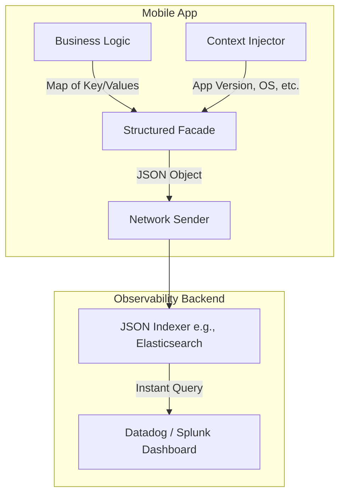

# Structured Logging

## Overview

Structured Logging is the practice of emitting logs not as raw text strings ("User Alice bought item 123"), but as strictly typed, machine-readable data structures (usually JSON). This transforms logs from a block of text that humans have to read into a database that machines can instantly query, aggregate, and alert upon.

## Why It Matters

Raw text logs are useless at scale. If you want to know how many users experienced a checkout failure on version 2.4.1 of your Android app, and your logs are just text: `Timber.e("Checkout failed for user $userId with error $errorCode")`, you have to write a complex, brittle Regular Expression to parse millions of strings to find the answer.

If you use Structured Logging, your log is a JSON object: `{"event": "checkout_failed", "user_id": "987", "error_code": "500", "app_version": "2.4.1"}`. You can now write a simple SQL-like query in Datadog or Splunk: `SELECT COUNT(*) WHERE event='checkout_failed' AND app_version='2.4.1'`. The answer returns in milliseconds.

## Historical Context

In the early days of SRE, log aggregation tools (like the ELK stack: Elasticsearch, Logstash, Kibana) relied heavily on Logstash to parse massive text files using regex (Grok patterns) to extract variables. This was incredibly slow and fragile—if a developer changed a typo in the log message, the regex broke, and the dashboard went blank. Structured logging pushes the responsibility of formatting the data to the client (the mobile app), completely eliminating the brittle parsing step.

## First Principles

1.  **Machine-Readable First:** Logs are for machines to query, not for humans to read linearly. Humans read the *results* of the queries via dashboards.
2.  **Context is King:** A structured log should automatically include the environment (OS version, app version, device model, battery state) without the developer having to explicitly add it to every log statement.
3.  **Strict Typology:** A `user_id` should always be a String. If one module logs it as an Int `123` and another logs it as a String `"123"`, the backend database (like Elasticsearch) will reject the conflicting types, causing dropped logs.

## Mental Model

Think of managing a massive library.
- **Raw Text Logs (A box of receipts):** Someone hands you a cardboard box filled with 10,000 handwritten receipts. If you want to find all receipts from Tuesdays in March, you have to read every single piece of paper.
- **Structured Logs (An Excel Spreadsheet):** You are handed a spreadsheet with columns for `Date`, `Day_Of_Week`, `Amount`, and `Customer`. Finding Tuesdays in March takes exactly one click (Filter -> Day_Of_Week -> Tuesday).

## Internal Mechanics

Instead of passing a single String to the logger, you pass an Event object or a Key-Value Map.

### The Problem with Text

```kotlin
// BAD: Raw Text Logging
val latency = 450
val endpoint = "/checkout"
Timber.i("API call to $endpoint took $latency ms")

// To graph this in Datadog, the SRE team must write this Regex:
// /API call to (?<endpoint>\/[a-zA-Z0-9\/_-]+) took (?<latency>\d+) ms/
// If a developer changes it to "API request to...", the Regex breaks silently.
```

### The Structured Solution

```kotlin
// GOOD: Structured Logging (Using a hypothetical facade)
val telemetry = mapOf(
    "event_name" to "api_request",
    "endpoint" to "/checkout",
    "latency_ms" to 450
)
StructuredLogger.logInfo(telemetry)

// The resulting payload sent to the backend:
// {
//   "timestamp": "2024-10-27T10:15:30Z",
//   "level": "INFO",
//   "device_model": "Pixel 8", // Automatically injected context
//   "app_version": "2.4.1",    // Automatically injected context
//   "event_name": "api_request",
//   "endpoint": "/checkout",
//   "latency_ms": 450
// }
```

## Architecture



## Production Example

**Global Context Injection (MDC)**

A major benefit of Structured Logging is the Mapped Diagnostic Context (MDC). This is a thread-local map of key-value pairs. 

When a user logs in, you can set `userId` in the MDC. From that point forward, *every single log* emitted by the app will automatically include `{"user_id": "123"}`, even if the developer doesn't explicitly pass it.

```kotlin
// On Login
StructuredLogger.setGlobalContext("user_id", "123")
StructuredLogger.setGlobalContext("session_id", "abc-456")

// In a completely different module, 10 minutes later:
StructuredLogger.logWarn(mapOf("event" to "gps_signal_lost"))

// The Backend receives:
// {
//   "event": "gps_signal_lost",
//   "user_id": "123",        <-- Injected automatically
//   "session_id": "abc-456"  <-- Injected automatically
// }
```

When a customer support agent gets a ticket for this user, they can query `user_id = 123` and see their entire session history across every module in the app.

## Tradeoffs

**Advantages**
- **Infinite Queryability:** You can aggregate, average, sum, and filter on any field instantly.
- **Alerting Reliability:** Alerts based on structured data (`latency_ms > 5000`) are robust. Alerts based on Regex parsing are incredibly fragile.
- **Enforced Discipline:** Developers must think about *what* data they are recording, rather than just writing a prose sentence.

**Disadvantages**
- **Unreadable in Console:** JSON objects are ugly to read in the local Android Studio `logcat` compared to a nice English sentence. (Usually solved by having the Facade print a formatted string locally, but send JSON remotely).
- **Data Dictionary Maintenance:** If Team A logs `user_id` and Team B logs `userId` and Team C logs `customer_id`, the data is fragmented and unqueryable. Structured logging requires a strict, company-wide Data Dictionary (Schema) to be effective.

## Failure Modes

- **The Stringified JSON Trap:**
  ```json
  {
    "event": "error",
    "details": "{\"reason\":\"timeout\", \"code\":500}"
  }
  ```
  Here, the developer took a structured object, converted it to a String, and put it inside the log. The backend database cannot query `details.code` because `details` is just a string, not a nested JSON object. You have defeated the entire purpose of structured logging.
- **Type Clashing:** Logging `{"retry_count": 5}` (Integer) on Monday, and then a new developer logs `{"retry_count": "five"}` (String) on Tuesday. The backend database indexing will crash and drop the logs for Tuesday.
- **Exploding Cardinality:** Logging dynamic data as keys instead of values.
  ```json
  // BAD: Dynamic Keys
  { "error_user_123": "timeout" }
  
  // GOOD: Static Keys, Dynamic Values
  { "event": "error", "user_id": "123", "reason": "timeout" }
  ```
  Dynamic keys will destroy the indexing engine of your observability backend.

## Staff Engineer Thinking

When setting up a logging architecture, a Staff engineer asks:

1.  **Do we have an owned schema?** Use a reviewed schema/data dictionary for remotely retained fields. Different event families may have different owners; raw user identifiers do not become safe merely because an enum names the key.
2.  **Are dashboards parsing prose?** Repeated regex extraction is a sign to consider structured fields at the source, while preserving a migration path for legacy records.
3.  **Is local debugging usable?** A facade can render approved fields for local development and route only policy-selected, redacted, sampled records to a remote diagnostic sink. Do not copy every log into Crashlytics.

## Common Misconceptions

- **"We use Firebase Analytics, so we have structured logging."** Firebase Analytics is an *Analytics* tool (Product/Marketing), not a full Observability/Logging tool (Engineering). Analytics events are structured, but you cannot easily log thousands of debug/info technical state changes to Firebase Analytics without destroying your marketing data and blowing past quotas.
- **"Structured logging is always smaller than text."** Encoding, batching, compression, schema repetition, and payload content determine size. Measure representative records and enforce a budget.

## Probing Questions

1.  Why is extracting variables from text logs using Regular Expressions considered a fragile practice in SRE?
2.  Explain the concept of Mapped Diagnostic Context (MDC) or Global Context Injection. How does it improve debugging?
3.  Write a simple JSON payload demonstrating a well-structured log vs a poorly structured log with dynamic keys.
4.  If Team A logs `latencyMs` and Team B logs `latency_ms`, how does this impact the SRE team's ability to create dashboards?
5.  Why is it important to strictly enforce data types (e.g., String vs Int) for JSON values in structured logging?
6.  How do you balance the need for machine-readable JSON in production with the need for human-readable text during local Android Studio debugging?
7.  What is the difference between an Analytics Event (e.g., Mixpanel) and a Structured Log (e.g., Datadog)?
8.  Describe a scenario where a "Stringified JSON Trap" prevents an engineer from writing a critical alert.
9.  Why does structured logging push the responsibility of data formatting from the backend (Logstash) to the client (Mobile App)?
10. If an app crashes, how does having the `app_version` and `os_version` explicitly structured as keys in the JSON help triage the issue faster than if they were embedded in a text sentence?

## Mobile Implementation (Android)

On Android, a structured diagnostic event is a typed record routed through a diagnostic logging/RUM sink under the [telemetry taxonomy](telemetry-taxonomy.md). It is not automatically a product-analytics event and need not be transmitted at all when local-only diagnostics are sufficient.

```kotlin
@Serializable
data class CheckoutDiagnostic(
    val operationId: String,
    val endpointTemplate: String,
    val durationBucket: String,
    val outcome: String,
    val failureCategory: String? = null,
)

fun recordCheckoutDiagnostic(event: CheckoutDiagnostic) {
    diagnosticSink.record(
        schema = "checkout_diagnostic.v1",
        fields = event.toFieldMap(),
    )
}
```

When a crash-report policy approves a small subset as useful parent-report context, attach only those bounded fields as custom keys:

```kotlin
FirebaseCrashlytics.getInstance().apply {
    setCustomKey("checkout.endpoint", event.endpointTemplate)
    setCustomKey("checkout.duration_bucket", event.durationBucket)
    setCustomKey("checkout.outcome", event.outcome)
}
```

Three mobile-distinct considerations:

1. **Schema enforcement.** Use typed builders or generated schemas and validate again at ingestion; compile-time shape does not validate privacy purpose or value cardinality.
2. **Bounded payload and retention.** Enforce the selected sink's current count/size limits, sampling, local queue age, and server retention. Drop or truncate according to documented policy.
3. **Time semantics.** Use an explicit instant and timezone/offset model where wall-clock correlation is needed; use monotonic time for local durations when available.

## Answer Key

1. **Why is extracting variables from text logs using Regular Expressions considered a fragile practice in SRE?**
   Regex relies on exact string formats. If a developer changes a typo or wording in the log message, the regex silently breaks, dropping data and breaking dashboards.
2. **Explain the concept of Mapped Diagnostic Context (MDC) or Global Context Injection. How does it improve debugging?**
   MDC is a context map that a logging integration may attach to records in the current execution context. It can add approved correlation fields, but thread/coroutine propagation must be configured and fields remain subject to privacy and cardinality policy.
3. **Write a simple JSON payload demonstrating a well-structured log vs a poorly structured log with dynamic keys.**
   Well-structured: `{"event": "error", "user_id": "123", "reason": "timeout"}`. Poorly structured: `{"error_user_123": "timeout"}` (which explodes database cardinality).
4. **If Team A logs `latencyMs` and Team B logs `latency_ms`, how does this impact the SRE team's ability to create dashboards?**
   It fragments queries and dashboards unless ingestion maps both fields or the producers converge on a versioned schema. A shared data dictionary makes that migration explicit.
5. **Why is it important to strictly enforce data types (e.g., String vs Int) for JSON values in structured logging?**
   Backend databases like Elasticsearch expect consistent types per key. If types clash (e.g., logging an Int instead of a String), the database rejects and drops the logs.
6. **How do you balance the need for machine-readable JSON in production with the need for human-readable text during local Android Studio debugging?**
   Use a facade that can render developer-friendly local output and route only approved structured diagnostics to a remote sink. Remote production transmission is a policy decision, not the default fate of every log.
7. **What is the difference between an Analytics Event (e.g., Mixpanel) and a Structured Log (e.g., Datadog)?**
   Product events answer product/experiment questions under their own schema and exposure rules. Structured logs preserve diagnostic execution context; they may also be sampled and tightly volume-limited. Choose by decision, owner, privacy, retention, and cost.
8. **Describe a scenario where a "Stringified JSON Trap" prevents an engineer from writing a critical alert.**
   If a JSON object is converted into a string value (`"details": "{\"code\": 500}"`), the backend cannot index the nested fields, making it impossible to trigger an alert when `code == 500`.
9. **Why does structured logging push the responsibility of data formatting from the backend (Logstash) to the client (Mobile App)?**
   Because the client inherently knows the exact structure and types of the data, formatting it at the source eliminates the need for slow, brittle, and error-prone regex parsing on the backend.
10. **If an app crashes, how does having the `app_version` and `os_version` explicitly structured as keys in the JSON help triage the issue faster than if they were embedded in a text sentence?**
    It allows instant, database-level filtering and grouping, enabling engineers to immediately isolate the blast radius rather than reading thousands of log lines.

## Further Reading

- [`logging.md`](logging.md) — The foundation upon which structured logging is built.
- [`metrics.md`](metrics.md) — If you are using structured logs just to count things, you should be using metrics instead.
- [`telemetry-taxonomy.md`](telemetry-taxonomy.md) — Canonical signal-selection, privacy, sampling, retention, and deletion policy.
- [The 12-Factor App: Logs](https://12factor.net/logs)
- [Crashlytics custom keys](https://firebase.google.com/docs/crashlytics/customize-crash-reports) — structured context per crash.
- [`mobile-system-design/analytics-sdk.md`](../mobile-system-design/analytics-sdk.md) — the typed event pipeline.
