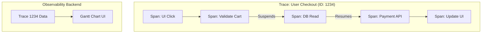

# Tracing

## Overview

Tracing is the observability pillar that tracks the lifecycle of a single request or operation as it flows through a system. While logs tell you *what* happened, and metrics tell you *how often* it happens, tracing tells you exactly *where* the time went and *which* components were involved in a specific execution path.

## Why It Matters

In a highly modular Android app using Coroutines, a user clicking "Checkout" might trigger:
1. A UI state change
2. A local database read on an IO thread
3. A network request to validate the cart
4. A network request to process payment
5. A database write to update inventory
6. A UI state change back on the Main Thread

If the entire process takes 8 seconds, a metric will just say `checkout_duration_ms: 8000`. Which step was slow? Did the DB read take 7 seconds, or did the payment API timeout? Raw logs are chaotic because hundreds of other threads are interleaving logs at the exact same time. 

Tracing ties all these asynchronous, multi-threaded operations together into a single, cohesive visual timeline (a Gantt chart).

## Historical Context

In single-threaded applications, profiling was easy: you just looked at the call stack. But with the rise of multi-core processors, reactive programming (RxJava), and Coroutines, the call stack became useless. A Coroutine might suspend on Thread A and resume 5 seconds later on Thread B. The stack trace is broken. Tracing (specifically via Context Propagation) was invented to artificially stitch these asynchronous jumps back together.

## First Principles

1.  **The Trace:** Represents the entire end-to-end journey of an operation (e.g., "The Checkout Process").
2.  **The Span:** Represents a single unit of work *within* the Trace (e.g., "Database Read", "Payment API Call"). Spans have a start time, an end time, and a parent-child relationship.
3.  **Context Propagation:** The mechanism of passing the `Trace ID` and `Span ID` along with the execution flow, jumping across threads and network boundaries.

## Mental Model

Think of a package delivery.
- **Metrics:** "We delivered 500 packages today. Average delivery time: 3 days."
- **Logs:** "Package scanned at warehouse." "Truck left." "Delivered."
- **Tracing (The Tracking Number):** You enter a specific Tracking Number. You see a visual timeline:
  - Total Journey (Trace): 3 Days
    - Processing Facility (Span): 1 Day
    - Transit (Span): 1.5 Days
    - Out for Delivery (Span): 0.5 Days

You can instantly see that Transit took the longest.

## Internal Mechanics

To make tracing work, every step of the process must know the overarching `Trace ID`.

### The Manual Way (Painful)

```kotlin
// BAD: Passing Trace IDs manually through every function signature
fun doCheckout() {
    val traceId = UUID.randomUUID().toString()
    readDatabase(traceId)
    callNetwork(traceId)
}

fun readDatabase(traceId: String) {
    Log.d(TAG, "[$traceId] Reading DB...")
}
```

### The Coroutine Way (Context Propagation)

Kotlin Coroutines provide a brilliant mechanism for tracing: `CoroutineContext`. You can inject the Trace ID into the Coroutine Context, and it will automatically follow the coroutine, even as it suspends and resumes across different threads.

```kotlin
// 1. Define a Context Element
data class TraceContextElement(val traceId: String) : AbstractCoroutineContextElement(TraceContextElement) {
    companion object Key : CoroutineContext.Key<TraceContextElement>
}

// 2. Inject it at the root
viewModelScope.launch(TraceContextElement(UUID.randomUUID().toString())) {
    
    // 3. Retrieve it anywhere deep in the stack, regardless of thread jumps
    val myTraceId = coroutineContext[TraceContextElement]?.traceId
    Timber.d("[$myTraceId] Doing work on ${Thread.currentThread().name}")
    
    withContext(Dispatchers.IO) {
        val ioTraceId = coroutineContext[TraceContextElement]?.traceId
        // ioTraceId is GUARANTEED to be identical to myTraceId!
        Timber.d("[$ioTraceId] Doing DB work on ${Thread.currentThread().name}")
    }
}
```

## Architecture



## Production Example

**Firebase Performance Monitoring (Custom Traces)**

While Firebase calls them "Traces," they are essentially single Spans. 

```kotlin
val trace = FirebasePerformance.getInstance().newTrace("db_cache_read")
trace.start()
try {
    val data = database.getCache()
    trace.putAttribute("cache_hit", (data != null).toString())
} finally {
    trace.stop() // Ends the span and calculates duration
}
```

**OpenTelemetry (OTel)**

The industry standard for true distributed tracing. It automatically handles context propagation and creating parent-child relationships between Spans.

```kotlin
// Start the root Span (The Trace)
val span = tracer.spanBuilder("CheckoutFlow").startSpan()

// Put the span in the current context
span.makeCurrent().use { scope ->
    try {
        // Child Span
        val dbSpan = tracer.spanBuilder("DatabaseRead").startSpan()
        dbSpan.makeCurrent().use { 
            readDb() 
        }
        dbSpan.end()

        // Child Span
        val netSpan = tracer.spanBuilder("NetworkCall").startSpan()
        netSpan.makeCurrent().use { 
            callApi() 
        }
        netSpan.end()

    } finally {
        span.end() // Finishes the root trace
    }
}
```

## Tradeoffs

**Advantages**
- **Surgical Debugging:** You can visually see exactly where a bottleneck is occurring in a complex, multi-threaded flow.
- **Dependency Mapping:** Tracing automatically visualizes which systems talk to which other systems.

**Disadvantages**
- **Implementation Overhead:** Proper tracing requires massive instrumentation. Every major function, database call, and network request must be wrapped in a Span.
- **Sampling:** Traces generate massive amounts of data. You cannot trace 100% of user requests in production. You must configure "Sampling" (e.g., only record 1 out of every 100 checkouts), which means you might miss the trace for a specific failing edge case.
- **Context Leakage:** If you pass a `CoroutineContext` incorrectly, or use a global thread pool that doesn't respect the context, the Trace breaks, and the visualization is orphaned.

## Failure Modes

- **The Broken Context:** A Coroutine makes a network call using an old Java callback library (e.g., Retrofit 1 or a legacy SDK). The callback executes on a random thread pool. The Trace ID is lost. The operation appears to finish instantly in the visualization, and the network call is untracked. *(Fix: All asynchronous jumps must propagate the context).*
- **Over-Instrumentation:** Creating a Span for every single function call in the app.
  ```kotlin
  fun add(a: Int, b: Int): Int {
      val span = tracer.startSpan("add") // BAD! This takes 1ms. The overhead is 5ms!
      val res = a + b
      span.end()
      return res
  }
  ```
  *(Fix: Only wrap significant architectural boundaries: Network, Disk IO, IPC).*
- **100% Sampling Rate in Production:** Sending a massive, multi-span JSON object to Datadog every time any user taps a button. You will bankrupt the company within a week.

## Staff Engineer Thinking

When evaluating performance issues, a Staff engineer uses Tracing as a scalpel:

1.  **Do we have a Waterfall?** I look at the Trace visualization. Are the Spans executing sequentially (Network 1 finishes -> Network 2 starts)? Can they be executed concurrently (`async { }`)? Tracing makes architectural inefficiencies blatantly obvious.
2.  **Is the boundary traced?** I ensure that our standard OkHttp Interceptor automatically wraps every network call in a Span, and our standard Room Dao wrapper wraps every DB call. Developers shouldn't have to write tracing code manually for basic infrastructure.
3.  **How are we tying Logs to Traces?** A Trace shows me the Database Read took 5 seconds. But *why*? I need the Logs. I enforce that the `Trace ID` is automatically injected into the MDC (Structured Logging) so I can pivot instantly from the slow Trace to the exact Logs emitted during that 5-second window.

## Common Misconceptions

- **"Tracing is just for the Backend."** Historically, yes. But as Mobile apps adopted complex asynchronous architectures (Coroutines/Flow/Rx), local on-device tracing became mandatory to understand UI performance.
- **"Firebase Performance Traces are true Distributed Traces."** No. Firebase "Traces" are isolated metrics/histograms. They do not natively link together into a tree (Parent -> Child) or propagate across network boundaries to the backend server. For true tracing, you need OpenTelemetry.

## Probing Questions

1.  What is the difference between a Trace and a Span?
2.  Why did single-threaded applications not require complex Tracing infrastructure?
3.  Explain how Kotlin `CoroutineContext` solves the problem of Context Propagation across multiple threads.
4.  If a Trace shows a 10-second gap between two Spans, what does that usually indicate about the system?
5.  Why is "Sampling" a mandatory concept when implementing Tracing in a production mobile app?
6.  How does an "Over-Instrumented" trace actually degrade the performance of the mobile app?
7.  If a developer uses a third-party analytics SDK that relies on callbacks, how might that break the Trace?
8.  How do Traces, Metrics, and Logs work together during a severe production incident? (Describe the workflow).
9.  What is a "Waterfall" in the context of a Trace visualization, and how do you fix it in Kotlin?
10. Why is injecting the `Trace ID` into your Structured Logging payload (MDC) so critical for debugging?

## Mobile Implementation (Android)

The two canonical tracing surfaces on Android:

| Source | What it traces | When |
|---|---|---|
| **Firebase Performance Monitoring** | Auto: app start, network calls (OkHttp), custom traces | Default first instinct |
| **OpenTelemetry Android SDK** | Full OTel-compatible spans, manual instrumentation, exportable | When you self-host the backend |

```kotlin
// Firebase Performance custom trace + sub-spans
val checkout = FirebasePerformance.getInstance().newTrace("checkout_flow").apply {
    putAttribute("payment_method", "card")
    putAttribute("network_class", networkClass())
    start()
}

try {
    val validation = checkout.newMetric("validation_ms")
    val ms = measureTimeMillis { validateCart() }
    validation.setValue(ms)

    val authMs = measureTimeMillis { authorizePayment() }
    checkout.putMetric("authorize_ms", authMs)

    val captureMs = measureTimeMillis { capturePayment() }
    checkout.putMetric("capture_ms", captureMs)
} finally {
    checkout.stop()
}
```

The mobile-distinct concerns:

1. **Span granularity vs battery.** A span per HTTP call is reasonable; a span per Compose recomposition is not. Sample.
2. **Foreground/background boundary.** A span open when the app backgrounds gets paused (or worse, abandoned). Either close before `onStop` or accept that long-tail traces will be incomplete.
3. **Process death.** A span in progress when the process is killed is lost. Mitigate by writing partial trace data to Room before suspending high-stakes operations.
4. **Cellular variance.** A 200 ms span on Wi-Fi is fine; on a 3G connection in a tunnel it's 8 seconds. Tag with `network_class` and slice dashboards accordingly.
5. **JankStats integration.** `JankStats` reports per-frame durations; treat each janky frame as a synthetic span attached to the current screen for "where did the jank happen" forensics.

## Further Reading

- [`distributed-tracing.md`](distributed-tracing.md) — How to pass the Trace ID from the mobile device to the backend server.
- [`structured-logging.md`](structured-logging.md) — How to embed the Trace ID into every log.
- [OpenTelemetry Android](https://opentelemetry.io/docs/instrumentation/android/) — full OTel SDK for mobile.
- [Firebase Performance Monitoring](https://firebase.google.com/docs/perf-mon) — auto-instrumented spans + custom traces.
- [JankStats](https://developer.android.com/topic/performance/jankstats) — frame-level perf events.
