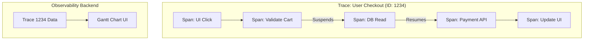

# Tracing

> **Canonical owner:** traces, spans, in-process context propagation, instrumentation boundaries, and sampling semantics live here. [`distributed-tracing.md`](distributed-tracing.md) applies these mechanics to network carriers, ingress trust, and cross-system correlation.

## Overview

Tracing is the observability pillar that tracks the lifecycle of a single request or operation as it flows through a system. While logs tell you *what* happened, and metrics tell you *how often* it happens, tracing tells you exactly *where* the time went and *which* components were involved in a specific execution path.

## Why It Matters

In a highly modular Android app using Coroutines, a user clicking "Checkout" might trigger:
1. A UI state change
2. A local database read on an IO thread
3. A network request to validate the cart
4. A network request to process payment
5. A database write to update inventory
6. A UI state change back on the Main Thread

If the entire process takes 8 seconds, a metric will just say `checkout_duration_ms: 8000`. Which step was slow? Did the DB read take 7 seconds, or did the payment API timeout? Raw logs are chaotic because hundreds of other threads are interleaving logs at the exact same time. 

Tracing ties all these asynchronous, multi-threaded operations together into a single, cohesive visual timeline (a Gantt chart).

## Historical Context

In synchronous code, a sampled call stack can often explain the active execution path. Asynchronous work, queues, callbacks, and coroutines split one logical operation across stacks and time. Tracing context connects those boundaries so an operation can still be inspected as a parent/child timeline.

## First Principles

1.  **The Trace:** Represents the entire end-to-end journey of an operation (e.g., "The Checkout Process").
2.  **The Span:** Represents a single unit of work *within* the Trace (e.g., "Database Read", "Payment API Call"). Spans have a start time, an end time, and a parent-child relationship.
3.  **Context Propagation:** The mechanism that carries the current span context across in-process asynchronous boundaries. Cross-process carriers and trust policy are the application covered in [Distributed Tracing](distributed-tracing.md).

## Mental Model

Think of a package delivery.
- **Metrics:** "We delivered 500 packages today. Average delivery time: 3 days."
- **Logs:** "Package scanned at warehouse." "Truck left." "Delivered."
- **Tracing (The Tracking Number):** You enter a specific Tracking Number. You see a visual timeline:
  - Total Journey (Trace): 3 Days
    - Processing Facility (Span): 1 Day
    - Transit (Span): 1.5 Days
    - Out for Delivery (Span): 0.5 Days

The recorded spans make Transit the longest measured stage; uninstrumented gaps and clock quality still matter.

## Internal Mechanics

To preserve parentage, each instrumented asynchronous boundary needs access to the current span context.

### The Manual Way (Painful)

```kotlin
// BAD: Passing Trace IDs manually through every function signature
fun doCheckout() {
    val traceId = UUID.randomUUID().toString()
    readDatabase(traceId)
    callNetwork(traceId)
}

fun readDatabase(traceId: String) {
    Log.d(TAG, "[$traceId] Reading DB...")
}
```

### A Coroutine Correlation Context

Kotlin `CoroutineContext` can carry an explicit correlation value across suspension. The simplified example below is useful for log correlation, but it is not a substitute for an OpenTelemetry context-storage/instrumentation integration: a trace also needs the current span, flags, baggage policy, and correct parentage.

```kotlin
// 1. Define a Context Element
data class TraceContextElement(val traceId: String) : AbstractCoroutineContextElement(TraceContextElement) {
    companion object Key : CoroutineContext.Key<TraceContextElement>
}

// 2. Inject it at the root
viewModelScope.launch(TraceContextElement(UUID.randomUUID().toString())) {
    
    // 3. Retrieve it anywhere deep in the stack, regardless of thread jumps
    val myTraceId = coroutineContext[TraceContextElement]?.traceId
    Timber.d("[$myTraceId] Doing work on ${Thread.currentThread().name}")
    
    withContext(Dispatchers.IO) {
        val ioTraceId = coroutineContext[TraceContextElement]?.traceId
        // This context element follows this structured coroutine boundary.
        Timber.d("[$ioTraceId] Doing DB work on ${Thread.currentThread().name}")
    }
}
```

## Architecture



## Production Example

**Firebase Performance Monitoring (Custom Traces)**

While Firebase calls them "Traces," they are essentially single Spans. 

```kotlin
val trace = FirebasePerformance.getInstance().newTrace("db_cache_read")
trace.start()
try {
    val data = database.getCache()
    trace.putAttribute("cache_hit", (data != null).toString())
} finally {
    trace.stop() // Ends the span and calculates duration
}
```

**OpenTelemetry (OTel)**

OpenTelemetry provides vendor-neutral tracing APIs, SDKs, propagation, and instrumentation. Context is not magically preserved across every callback or coroutine: use the supported coroutine/context integration and instrument unsupported asynchronous boundaries explicitly. The synchronous scope below illustrates parentage; do not carry a thread-local `makeCurrent()` scope across suspension unless the selected integration supports it.

```kotlin
// Start the root Span (The Trace)
val span = tracer.spanBuilder("CheckoutFlow").startSpan()

// Put the span in the current context
span.makeCurrent().use { scope ->
    try {
        // Child Span
        val dbSpan = tracer.spanBuilder("DatabaseRead").startSpan()
        try {
            dbSpan.makeCurrent().use {
                readDb()
            }
        } catch (t: Throwable) {
            dbSpan.recordException(t)
            dbSpan.setStatus(StatusCode.ERROR)
            throw t
        } finally {
            dbSpan.end()
        }

        // Child Span
        val netSpan = tracer.spanBuilder("NetworkCall").startSpan()
        try {
            netSpan.makeCurrent().use {
                callApi()
            }
        } catch (t: Throwable) {
            netSpan.recordException(t)
            netSpan.setStatus(StatusCode.ERROR)
            throw t
        } finally {
            netSpan.end()
        }

    } finally {
        span.end() // Finishes the root trace
    }
}
```

## Tradeoffs

**Advantages**
- **Execution-path diagnosis:** Recorded spans show timing and parentage across instrumented boundaries.
- **Dependency evidence:** Aggregated traces can reveal observed call relationships, subject to sampling and coverage.

**Disadvantages**
- **Implementation overhead:** Useful tracing needs consistent instrumentation at selected boundaries, correct context propagation, privacy review, export, and maintenance.
- **Sampling:** Trace volume can add CPU, storage, bandwidth, privacy, and ingestion cost. A low-volume or targeted workload may record every trace, but large production fleets normally need an explicit sampling and retention budget.
- **Context Leakage:** If you pass a `CoroutineContext` incorrectly, or use a global thread pool that doesn't respect the context, the Trace breaks, and the visualization is orphaned.

## Failure Modes

- **The Broken Context:** A coroutine calls a callback-based SDK whose executor is not instrumented. The child work may appear as an orphan or gap because the current span context did not cross the boundary. *(Fix: use supported instrumentation or explicitly capture/restore context at the boundaries that need correlation.)*
- **Over-Instrumentation:** Creating a Span for every single function call in the app.
  ```kotlin
  fun add(a: Int, b: Int): Int {
      val span = tracer.startSpan("add") // Usually too fine-grained to justify a span.
      val res = a + b
      span.end()
      return res
  }
  ```
  *(Fix: Only wrap significant architectural boundaries: Network, Disk IO, IPC).*
- **Unbudgeted full capture:** Recording every high-volume operation without measuring overhead, privacy, retention, and ingestion cost. Full capture can still be appropriate for bounded or low-volume workloads.

## Staff Engineer Thinking

When evaluating performance issues, a Staff engineer uses Tracing as a scalpel:

1.  **Do we have a Waterfall?** I look at the Trace visualization. Are the Spans executing sequentially (Network 1 finishes -> Network 2 starts)? Can they be executed concurrently (`async { }`)? Tracing makes architectural inefficiencies blatantly obvious.
2.  **Is the right boundary traced?** Use supported infrastructure instrumentation where it produces actionable spans, then add manual spans only for product operations or gaps whose diagnostic value exceeds their cost.
3.  **How are logs tied to traces?** Add trace/span correlation fields to approved structured diagnostic logs when that pivot is useful; apply the same privacy, sampling, retention, and access policy rather than copying identifiers into every message.

### Sampling contract

- **Head sampling** decides near trace creation using known context. It is cheap and propagates a consistent sampled flag, but it cannot know that a later span will fail.
- **Parent-based sampling** follows the upstream decision so one trace is not arbitrarily fragmented at every hop. Public ingress may validate or replace untrusted client decisions.
- **Tail sampling** decides after a collector has observed enough of the trace, enabling latency- or error-biased retention at higher collection cost.
- **Targeted capture** can temporarily raise sampling for a privacy-approved cohort, operation, or diagnostic window. Bound it by time, volume, and rollback.

Document where the decision is made, how it propagates, which attributes are allowed, and what happens when mobile and backend policies disagree. Distributed propagation and trust handling are covered in [`distributed-tracing.md`](distributed-tracing.md).

## Common Misconceptions

- **"Tracing is just for the backend."** Client tracing can help when a mobile workflow crosses meaningful asynchronous or network boundaries, but local profiling, metrics, or structured events may be sufficient for simpler problems.
- **"Any product named a trace is a distributed span tree."** Vendor terminology differs. Verify whether the selected signal carries parent/child context across boundaries, or instead records independent duration/metric measurements.

## Probing Questions

1.  What is the difference between a Trace and a Span?
2.  Why can a synchronous call stack be sufficient for some diagnoses, and which asynchronous boundaries make tracing useful?
3.  What can a custom Kotlin `CoroutineContext` element propagate, and what additional integration does a tracing SDK need?
4.  If a trace shows a 10-second gap between two spans, which hypotheses should you test?
5.  When can full trace capture be reasonable, and what must a production sampling contract define?
6.  How does an "Over-Instrumented" trace actually degrade the performance of the mobile app?
7.  If a third-party SDK invokes callbacks on its own executor, how might that affect trace context?
8.  How do Traces, Metrics, and Logs work together during a severe production incident? (Describe the workflow).
9.  What is a "Waterfall" in the context of a Trace visualization, and how do you fix it in Kotlin?
10. Why is injecting the `Trace ID` into your Structured Logging payload (MDC) so critical for debugging?

## Mobile Implementation (Android)

The two canonical tracing surfaces on Android:

| Source | What it traces | When |
|---|---|---|
| **Firebase Performance Monitoring** | Auto-collected and custom performance measurements supported by the configured Android SDK | When its signal model and managed backend meet the product need |
| **OpenTelemetry Android SDK** | OTel-compatible spans, context propagation, instrumentation, and configurable export | When vendor-neutral instrumentation/export and cross-boundary correlation meet the product need |

```kotlin
// Firebase Performance custom trace + sub-spans
val checkout = FirebasePerformance.getInstance().newTrace("checkout_flow").apply {
    putAttribute("payment_method", "card")
    putAttribute("network_class", networkClass())
    start()
}

try {
    val validation = checkout.newMetric("validation_ms")
    val ms = measureTimeMillis { validateCart() }
    validation.setValue(ms)

    val authMs = measureTimeMillis { authorizePayment() }
    checkout.putMetric("authorize_ms", authMs)

    val captureMs = measureTimeMillis { capturePayment() }
    checkout.putMetric("capture_ms", captureMs)
} finally {
    checkout.stop()
}
```

The mobile-distinct concerns:

1. **Span granularity vs cost.** A span per meaningful boundary may be reasonable; a span per Compose recomposition is usually noise. Measure overhead and sample deliberately.
2. **Lifecycle boundary.** App backgrounding does not inherently pause a span. End spans when the represented operation ends or is abandoned, and let the SDK/exporter handle lifecycle flushing according to its documented policy rather than tying every span to `Activity.onStop()`.
3. **Process death.** In-memory spans may be lost when the process dies. Preserve durable business-operation state separately; use supported exporter buffering when available, and start new work as a new span/trace linked or correlated to that operation instead of serializing an active SDK span ad hoc.
4. **Cellular variance.** A 200 ms span on Wi-Fi is fine; on a 3G connection in a tunnel it's 8 seconds. Tag with `network_class` and slice dashboards accordingly.
5. **JankStats integration.** `JankStats` reports frame-performance data. Correlate that signal with a privacy-safe screen/interaction context as metrics, events, or spans according to the backend model; a janky frame is not automatically a distributed span.

## Answer Key

1. **What is the difference between a Trace and a Span?**
   A Trace represents the entire end-to-end journey of an operation, while a Span represents a single unit of work within that journey.
2. **Why can a synchronous call stack be sufficient for some diagnoses, and which asynchronous boundaries make tracing useful?**
   A stack sample can describe the active nested calls in one execution context. Queues, callbacks, coroutines, remote calls, and work separated in time require explicit context and timing if they must be reconstructed as one logical operation.
3. **What can a custom Kotlin `CoroutineContext` element propagate, and what additional integration does a tracing SDK need?**
   It can carry a chosen correlation value through structured coroutine suspension. A tracing integration must also preserve the current span and flags, establish correct parentage, bridge unsupported callbacks/executors, and close scopes safely.
4. **If a trace shows a 10-second gap between two spans, which hypotheses should you test?**
   Test for uninstrumented work, queueing, lock/thread contention, suspension, process/background delay, clock skew, lost context, and a missing exporter before treating the gap as one specific cause.
5. **When can full trace capture be reasonable, and what must a production sampling contract define?**
   Full capture may fit a low-volume workload or bounded diagnostic window. The contract must define decision point, head/parent/tail behavior, propagation, volume and retention budgets, allowed attributes, privacy controls, and disagreement at public ingress.
6. **How does an "Over-Instrumented" trace actually degrade the performance of the mobile app?**
   Wrapping fast micro-operations (like basic math) in Spans introduces overhead that exceeds the cost of the operation itself, slowing down the app.
7. **If a third-party SDK invokes callbacks on its own executor, how might that affect trace context?**
   The current context may not cross that executor automatically, creating an orphan span or missing parentage. Verify supported instrumentation or capture/restore context explicitly at the boundary.
8. **How do Traces, Metrics, and Logs work together during a severe production incident? (Describe the workflow).**
   Metrics trigger the alert (the 'that'), Traces isolate the latency or bottleneck to a specific span (the 'where'), and Logs provide the granular context (the 'why').
9. **What is a "Waterfall" in the context of a Trace visualization, and how do you fix it in Kotlin?**
   A waterfall is a sequence of spans. It is not automatically a defect: first confirm the operations are independent and concurrency will preserve ordering, resource, cancellation, and failure semantics; then structured concurrency such as `async`/`awaitAll` may reduce latency.
10. **Why is injecting the `Trace ID` into your Structured Logging payload (MDC) so critical for debugging?**
    A trace/span correlation field can support a useful pivot from a span to approved diagnostic logs. Include it only where the logging context propagation, privacy, retention, and query path are defined.

## Further Reading

- [`distributed-tracing.md`](distributed-tracing.md) — How to pass the Trace ID from the mobile device to the backend server.
- [`structured-logging.md`](structured-logging.md) — How approved diagnostic logs can carry correlation fields.
- [`telemetry-taxonomy.md`](telemetry-taxonomy.md) — Signal selection, privacy, sampling, retention, and deletion policy.
- [OpenTelemetry documentation](https://opentelemetry.io/docs/) — current instrumentation and specification entry point.
- [Firebase Performance Monitoring](https://firebase.google.com/docs/perf-mon) — auto-instrumented spans + custom traces.
- [JankStats](https://developer.android.com/topic/performance/jankstats) — frame-level perf events.
