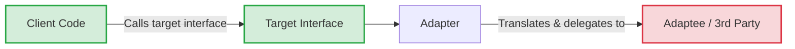

# Adapter Pattern

## Overview

The Adapter pattern converts the interface of a class into another interface the clients expect. It lets classes work together that couldn't otherwise because of incompatible interfaces. In mobile development, it is the fundamental glue between your pristine domain models and the messy reality of external systems, UI frameworks, and legacy code.

## Why It Exists

Systems speak different languages. A server returns JSON. Your UI needs a `String` formatted as a currency. Your domain logic needs a `Double` representing cents. Without adapters, the UI parsing logic bleeds into the network layer, or network models bleed into the UI, creating a tightly coupled monolith where changing a backend API requires rewriting rendering logic. The Adapter exists to isolate these translations.

## Historical Context

One of the original "Gang of Four" (GoF) structural patterns from 1994. While the original pattern focused heavily on object-oriented class hierarchies (Class Adapters vs. Object Adapters), modern usage in Kotlin often leans on functions, mappers, and extension functions to achieve the same result with less boilerplate. In Android, the term is famously (and somewhat confusingly) overloaded by `RecyclerView.Adapter`, which is an adapter in the GoF sense (adapting data to views) but with massive framework-specific responsibilities attached.

## First Principles

1.  **Impedance Mismatch:** When component A produces $X$ but component B requires $Y$, you need a mechanism to convert $X \rightarrow Y$.
2.  **Anti-Corruption:** Adapters protect your core domain from the outside world. If a third-party SDK changes its data structure, you update the adapter, not your core logic.
3.  **Single Responsibility:** The component doing the work shouldn't also be responsible for translating the inputs and outputs.

## Mental Model

Think of a travel power adapter. The wall socket provides 220V with round pins (the Adaptee). Your laptop charger expects 110V with flat pins (the Target). You can't change the wall socket, and you shouldn't modify your laptop charger. You put an adapter between them that translates the physical shape and the electrical voltage.

## Internal Mechanics

There are two classic flavors, plus a modern functional approach.

### 1. Object Adapter (Composition - Recommended)

The adapter holds a reference to the adaptee and translates calls.

```kotlin
// What the client expects
interface AnalyticsTracker {
    fun trackEvent(eventName: String, params: Map<String, String>)
}

// The incompatible third-party SDK (Adaptee)
class FirebaseAnalyticsSdk {
    fun logEvent(name: String, bundle: Bundle) { /* ... */ }
}

// The Adapter
class FirebaseAnalyticsAdapter(
    private val firebaseSdk: FirebaseAnalyticsSdk
) : AnalyticsTracker {

    override fun trackEvent(eventName: String, params: Map<String, String>) {
        // Translate Map to Android Bundle
        val bundle = Bundle().apply {
            params.forEach { (key, value) -> putString(key, value) }
        }
        // Delegate to the actual SDK
        firebaseSdk.logEvent(eventName, bundle)
    }
}
```

### 2. Functional Adapter (Mappers / Extension Functions)

When adapting data structures rather than behaviors, Kotlin extension functions serve as lightweight adapters.

```kotlin
// Data from network
data class UserDto(val f_name: String, val l_name: String, val unix_ts: Long)

// Domain model
data class User(val fullName: String, val joinedDate: LocalDate)

// The Adapter (Mapper)
fun UserDto.toDomain(): User {
    return User(
        fullName = "$f_name $l_name",
        joinedDate = Instant.ofEpochSecond(unix_ts)
            .atZone(ZoneId.systemDefault())
            .toLocalDate()
    )
}
```

## Architecture



## Production Example

Consider migrating an app's image loading library from Glide to Coil. If every fragment in your app calls `Glide.with(this).load(url).into(imageView)`, the migration is a nightmare.

Instead, define a target interface:

```kotlin
interface ImageLoader {
    fun loadImage(imageView: ImageView, url: String)
}
```

Write a `GlideImageLoaderAdapter` and inject it everywhere. When you migrate, you write a `CoilImageLoaderAdapter`, swap the dependency injection binding, and zero UI classes change. The adapter has protected your application code from library lock-in.

## Android Example

The `RecyclerView.Adapter` is the most ubiquitous example.

- **Target (Client):** `RecyclerView` needs `View` objects to display on screen.
- **Adaptee:** An `ArrayList<User>` containing domain data.
- **Adapter:** `RecyclerView.Adapter` translates the data array into inflated, populated `ViewHolder` objects that the framework can render.

```kotlin
class UserListAdapter(
    private val users: List<User> // Adaptee
) : RecyclerView.Adapter<UserViewHolder>() { // Target interface mandated by Android

    override fun onCreateViewHolder(parent: ViewGroup, viewType: Int): UserViewHolder {
        // Translate context to View
    }

    override fun onBindViewHolder(holder: UserViewHolder, position: Int) {
        // Translate User data into View properties
        holder.bind(users[position])
    }
}
```

## Tradeoffs

**Advantages**
- **Flexibility:** Allows integrating incompatible systems without modifying their source code (crucial for third-party SDKs).
- **Testability:** You can easily test client code by providing a mock of the target interface, completely bypassing the heavy/flaky Adaptee.
- **Migration:** Makes replacing legacy systems or swapping libraries trivial.

**Disadvantages**
- **Complexity:** Increases the overall complexity of the code by adding numerous small classes and interfaces.
- **Performance Overhead:** In performance-critical loops (e.g., parsing thousands of JSON items or rendering 60fps), the object creation and translation overhead of mappers can add up.

## Failure Modes

- **The Leaky Adapter:** When the adapter's interface reveals details about the adaptee. E.g., an `AnalyticsTracker` interface that requires a `Bundle` instead of a `Map`. The client is now coupled to Android via the interface.
- **The Two-Way Adapter Anti-pattern:** Trying to make an adapter translate both ways simultaneously often leads to bloated, confusing classes. Prefer two separate, one-way adapters (e.g., `toDomain()` and `toDto()`).
- **Over-abstraction:** Creating adapters for standard library classes or APIs that are already stable and widely used (like wrapping `java.util.UUID`) usually adds boilerplate without value.

## Staff Engineer Thinking

When reviewing a PR that integrates a new SDK or API, a Staff engineer looks for the adapter boundary:

1.  **Is this an Anti-Corruption Layer?** Are we letting a vendor's API design dictate our domain terminology? The adapter should map *their* weird names to *our* ubiquitous language.
2.  **Where does the translation happen?** Data mapping should happen at the absolute edges of the system (Network $\rightarrow$ Domain, Domain $\rightarrow$ UI). If domain models contain `@SerializedName` annotations, the boundary has been breached.
3.  **Is it a Class Adapter or Object Adapter?** Class adapters (using multiple inheritance) are rigid and rarely used in Kotlin. Object adapters (composition) are preferred because they allow adapting subclasses and injecting dependencies.

## Common Misconceptions

- **"Adapter and Facade are the same."** False. An Adapter changes the *shape* of an interface to match what a client expects. A Facade *simplifies* a complex subsystem into a single, easier-to-use interface.
- **"Adapter and Decorator are the same."** False. An Adapter changes the interface but usually keeps the behavior the same. A Decorator keeps the interface the same but changes or enhances the behavior.
- **"Mappers aren't Adapters."** False. In a functional paradigm, a function `(A) -> B` is the purest form of an adapter. It adapts type A to type B.

## Probing Questions

1.  How does the Adapter pattern facilitate the Dependency Inversion Principle (the 'D' in SOLID)?
2.  If you have to integrate an ancient Java library that relies heavily on checked exceptions into a modern Kotlin coroutine codebase, how would an adapter help?
3.  What are the performance implications of having a 5-layer deep mapping architecture (Network $\rightarrow$ Entity $\rightarrow$ Domain $\rightarrow$ UIState $\rightarrow$ View)?
4.  Why is `RecyclerView.Adapter` considered an adapter? What exactly is it adapting?
5.  In what scenario would you choose *not* to write an adapter for a third-party library?
6.  Explain the concept of an Anti-Corruption Layer (ACL) and how the Adapter pattern implements it.
7.  How do you test an Adapter class? Do you mock the Adaptee, or use a real instance?
8.  How does Kotlin's `typealias` relate to the concept of adapting interfaces?
9.  Can an adapter be stateful? Provide a scenario where that might happen.
10. If an external API returns a 404 error, should the adapter translate that into a domain-specific exception, or pass the 404 through?

## Further Reading

- [`repository.md`](repository.md) — A Repository is fundamentally an adapter between the data access layer and the domain layer.
- Martin Fowler on [Anti-Corruption Layer](https://learn.microsoft.com/en-us/azure/architecture/patterns/anti-corruption-layer)
- Refactoring Guru: [Adapter Pattern](https://refactoring.guru/design-patterns/adapter)
