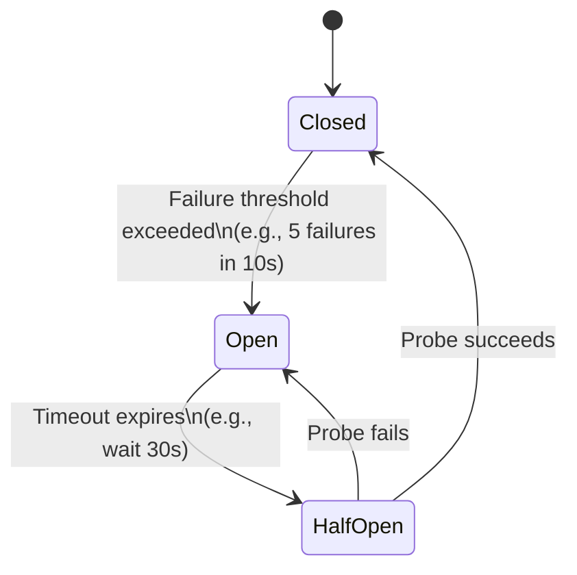

# Circuit Breaker Pattern

## Overview

The Circuit Breaker pattern is a resilience engineering pattern that prevents an application from repeatedly trying to execute an operation that is likely to fail. By failing fast, it prevents cascading system failures, conserves client battery/radio, and gives struggling backend services time to recover.

## Why It Exists

If a backend service goes down, mobile clients will naturally experience failures. If 10 million mobile clients instantly implement an aggressive [Retry](retry.md) strategy, they will unintentionally execute a massive Distributed Denial of Service (DDoS) attack against their own backend, ensuring the service stays dead. 

Furthermore, making a network request that will certainly fail wastes the user's battery, wakes up the cellular radio unnecessarily, and delays UI error rendering. The Circuit Breaker stops the bleeding on both ends.

## Historical Context

Popularized by Michael Nygard in his seminal book *Release It!* (2007). While originally focused on server-to-server communication, it has become essential in mobile engineering as fleets of mobile devices represent the largest potential load generators for any API.

## First Principles

1.  **Fail Fast:** If you know an operation will fail, failing immediately is better than failing after a 30-second network timeout.
2.  **Protect the Downstream:** Do not kick a server while it is down.
3.  **Self-Healing:** The system should automatically detect when the downstream service recovers and resume traffic.

## Mental Model

Think of the electrical circuit breaker in your house. 
- Normally, the circuit is **Closed** (electricity flows).
- If you plug in too many appliances, a fault occurs. To prevent a fire, the breaker trips and becomes **Open** (electricity stops). You cannot turn on the TV; the power is cut immediately at the box.
- After removing the appliances, you flip the switch to test it. If it stays flipped (**Half-Open**), electricity resumes. If it trips again, it stays **Open**.

## Internal Mechanics

The Circuit Breaker is a State Machine with three distinct states:

1.  **Closed:** The normal state. Requests flow through. The breaker counts recent failures. If the failure rate exceeds a threshold (e.g., 50% over the last 10 requests), the breaker trips to **Open**.
2.  **Open:** The fault state. All requests fail instantly with a `CircuitBreakerOpenException`. No network calls are made. A timer starts (e.g., 30 seconds).
3.  **Half-Open:** The test state. After the timer expires, the breaker allows *a single* (or a small number of) probe request(s) through. 
    *   If the probe succeeds, the backend has recovered. The breaker transitions to **Closed** and resets its counters.
    *   If the probe fails, the backend is still sick. The breaker transitions back to **Open** and restarts the timer.

## Architecture



## Production Example

In Android, Circuit Breakers are typically implemented as OkHttp Interceptors or Wrappers around Repository calls.

```kotlin
class CircuitBreaker(
    private val failureThreshold: Int = 5,
    private val resetTimeoutMillis: Long = 30_000
) {
    private var state = State.CLOSED
    private var failureCount = 0
    private var lastFailureTime = 0L

    enum class State { CLOSED, OPEN, HALF_OPEN }

    suspend fun <T> execute(block: suspend () -> T): T {
        evaluateState()

        if (state == State.OPEN) {
            // Fail fast without hitting the network
            throw CircuitBreakerOpenException("Circuit is open")
        }

        return try {
            val result = block()
            onSuccess()
            result
        } catch (e: IOException) {
            onFailure()
            throw e
        }
    }

    private fun evaluateState() {
        if (state == State.OPEN) {
            if (System.currentTimeMillis() - lastFailureTime > resetTimeoutMillis) {
                state = State.HALF_OPEN
            }
        }
    }

    private fun onSuccess() {
        failureCount = 0
        state = State.CLOSED
    }

    private fun onFailure() {
        failureCount++
        lastFailureTime = System.currentTimeMillis()
        if (failureCount >= failureThreshold) {
            state = State.OPEN
        }
    }
}
```

## Android Integration (OkHttp)

Implementing this as an OkHttp interceptor ensures all traffic routed through that client is protected.

```kotlin
class CircuitBreakerInterceptor(private val breaker: CircuitBreaker) : Interceptor {
    override fun intercept(chain: Interceptor.Chain): Response {
        // We use runBlocking here because Interceptors are synchronous, 
        // but in reality you'd adapt the CircuitBreaker to be synchronous for this use case.
        return breaker.executeSync {
            val response = chain.proceed(chain.request())
            // 5xx errors are server crashes; we should trip the breaker for these.
            if (response.code in 500..599) {
                throw ServerFaultException()
            }
            response
        }
    }
}
```

## Tradeoffs

**Advantages**
- **Saves Battery & Bandwidth:** Prevents the device's radio from staying active during known outages.
- **Improved UX:** Instead of the UI showing a spinner for 30 seconds before failing, the Circuit Breaker causes an instant failure, allowing the UI to immediately show an "Offline / Service Unavailable" banner.
- **Backend Mercy:** Prevents the "Thundering Herd" problem where mobile clients repeatedly hammer a recovering server.

**Disadvantages**
- **State Complexity:** The Circuit Breaker is stateful. If it's a Singleton, it affects the whole app. If it's scoped incorrectly, it doesn't protect the server effectively.
- **Tuning Difficulty:** Setting the correct failure threshold and timeout is hard. If the threshold is too low, the breaker trips on normal network blips (flaky cell connection). If too high, it doesn't protect the server.

## Failure Modes

- **Tripping on Client Errors (4xx):** A 400 Bad Request or 401 Unauthorized means the *client* sent bad data. Retrying won't help, but the server isn't sick. Tripping the breaker here will lock the app. Breakers should only trip on 5xx errors or network timeouts (IOExceptions).
- **The Global Breaker:** Having one single Circuit Breaker for the entire `Retrofit` instance. If the `ImageService` goes down, the breaker trips, and now the `AuthService` (which is healthy) is completely blocked because they share the same breaker. Breakers should be scoped per-service or per-host.
- **Persistent State:** Circuit breaker state should generally be held in memory. Persisting the `OPEN` state to disk means if the user forces-closes the app and restarts, the app might still refuse to connect even if the server came back online while the app was closed.

## Staff Engineer Thinking

When reviewing resilience patterns, a Staff engineer asks:

1.  **How does this interact with Retry?** If you have a Retry mechanism and a Circuit Breaker, the order matters. The Retry must be *inside* the Circuit Breaker. If the Circuit Breaker is inside the Retry, the Retry loop will just hammer the `CircuitBreakerOpenException` locally.
2.  **What is the fallback?** When the breaker throws `CircuitBreakerOpenException`, what does the Repository do? Does it return a cached value? Does it bubble up to the UI? The pattern is useless if the fallback behavior isn't defined.
3.  **Is the threshold dynamic?** A static "5 errors" threshold is naive. On a stable Wi-Fi connection, 5 errors means the server is dead. On a moving train, 5 errors is normal background noise. Advanced implementations adjust thresholds based on the active `NetworkCapabilities`.

## Common Misconceptions

- **"Circuit Breaker and Retry are the same thing."** No. They are opposites that work together. Retry says "The network is flaky; try again." Circuit Breaker says "The network is dead; STOP trying."
- **"It's only for microservices."** While born in the backend, mobile clients are the edge of the distributed system. An un-broken mobile client is a weapon pointed at the backend.

## Probing Questions

1.  Explain the transition from `Half-Open` to `Closed` vs `Half-Open` to `Open`.
2.  Why is it critical to differentiate between a 404 (Not Found) and a 503 (Service Unavailable) when implementing a Circuit Breaker?
3.  If an app uses multiple backend services (e.g., a Payment API and an Analytics API), how should the Circuit Breakers be scoped?
4.  How does a Circuit Breaker improve the user experience (UX) during an outage compared to standard network timeouts?
5.  What is the "Thundering Herd" problem, and how does the Circuit Breaker prevent mobile apps from causing it?
6.  Where is the best place to implement a Circuit Breaker in modern Android architecture? (e.g., ViewModel, Repository, OkHttp Interceptor). Defend your choice.
7.  How should a `CircuitBreakerOpenException` be translated into UI state?
8.  If the app is backgrounded and the OS kills the process while the breaker is `OPEN`, what state should it be in when the app restarts?
9.  How do you test a Circuit Breaker implementation using unit tests without dealing with real timing and `Thread.sleep()`?
10. Describe how a Circuit Breaker might integrate with an offline-first architecture.

## Further Reading

- [`retry.md`](retry.md) — The complementary pattern. Retry handles transient errors; Circuit Breaker handles systemic errors.
- [`engineering-fundamentals/state-machines.md`](../engineering-fundamentals/state-machines.md) — The mathematical foundation of the Circuit Breaker.
- [`principles/design-for-failure.md`](../principles/design-for-failure.md) — The overarching philosophy.
- Martin Fowler: [CircuitBreaker](https://martinfowler.com/bliki/CircuitBreaker.html)
