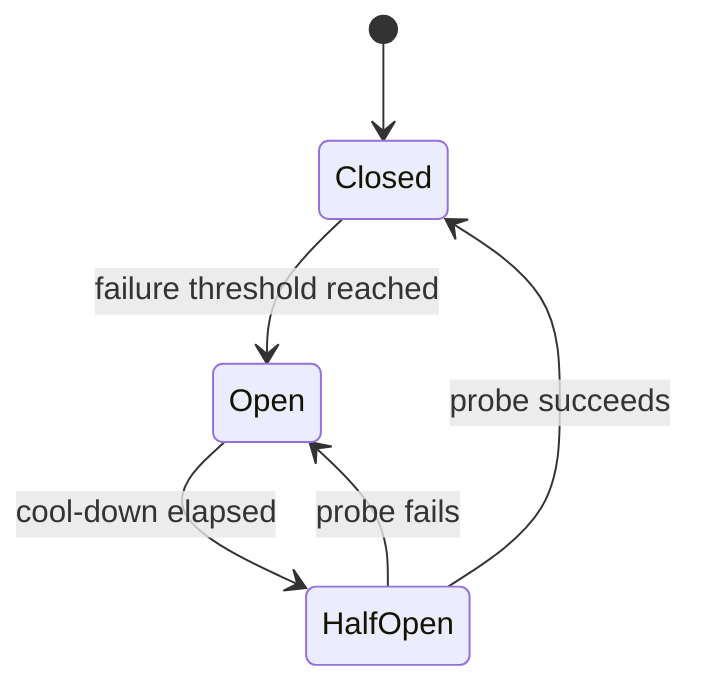

# Circuit Breaker Pattern

> The Circuit Breaker pattern prevents an application from repeatedly trying to execute an operation that is likely to fail. While traditionally thought of as a backend microservice pattern, a Staff engineer knows that mobile clients *must* implement client-side circuit breakers. If a backend service goes down, millions of Android apps aggressively retrying the API will cause a "thundering herd" that acts as a self-inflicted DDoS attack, keeping the servers down. A client-side circuit breaker fails fast, saves device battery, and protects the backend infrastructure.

---

## Overview

A Circuit Breaker acts as a state machine that sits between your app (the client) and a remote resource (the API). It monitors the success/failure rate of the calls.

### The Three States



Closed permits calls, Open fails fast, and Half-Open admits bounded probes rather than releasing all queued traffic.
1. **Closed (Normal):** The circuit is closed, allowing requests to flow freely to the API. If a request fails, a failure counter increments.
2. **Open (Failing):** If the failure threshold is reached (e.g., 5 consecutive 503 errors), the circuit "trips" open. **All subsequent requests fail immediately with an exception, without ever hitting the network.** A timeout timer starts.
3. **Half-Open (Testing):** After the timeout expires, the circuit allows a limited number of test requests through. If they succeed, the circuit resets to **Closed**. If they fail, it trips back to **Open** and the timer restarts.

---

## 1. Why Android Needs Circuit Breakers

Backend teams use tools like Envoy or Istio to manage circuit breaking between microservices. However, if the API Gateway itself goes down, the mobile clients are the only line of defense.

If your app has a naive retry policy (e.g., retry 3 times on failure) and the server is down, millions of active apps will multiply the load on the backend by 3x. When the server tries to recover, it is immediately crushed by the backlog of retries.

**Benefits of a Client-Side Circuit Breaker:**
1. **Protects the Backend:** Prevents the Thundering Herd problem.
2. **Saves Battery:** Failing immediately is extremely cheap. Waking up the cellular radio to wait 10 seconds for a timeout drains the battery.
3. **Improves UX:** Instead of making the user stare at a spinning loader for 15 seconds before showing an error, the app shows the error (or cached offline data) instantly.

---

## 2. Core Android Example: OkHttp Interceptor

The most effective place to implement a circuit breaker in Android is at the HTTP layer, using an OkHttp `Interceptor`. This ensures all API calls respect the breaker.

```kotlin
// A thread-safe state machine for the Circuit Breaker
class CircuitBreaker(
    private val failureThreshold: Int = 3,
    private val resetTimeoutMillis: Long = 30_000 // 30 seconds
) {
    private val failureCount = AtomicInteger(0)
    private var lastFailureTime = AtomicLong(0)
    
    // States: 0 = CLOSED, 1 = OPEN, 2 = HALF_OPEN
    private val state = AtomicInteger(0)

    fun allowRequest(): Boolean {
        if (state.get() == 0) return true // CLOSED - let it through

        val now = System.currentTimeMillis()
        if (state.get() == 1) { // OPEN
            if (now - lastFailureTime.get() > resetTimeoutMillis) {
                // Timeout passed. Transition to HALF_OPEN to test the waters
                if (state.compareAndSet(1, 2)) {
                    return true // Allow one test request through
                }
            }
            return false // Still OPEN, block the request
        }
        
        // If HALF_OPEN, another thread is already testing. Block this one.
        return false 
    }

    fun recordSuccess() {
        failureCount.set(0)
        state.set(0) // Reset to CLOSED
    }

    fun recordFailure() {
        lastFailureTime.set(System.currentTimeMillis())
        val currentFailures = failureCount.incrementAndGet()
        
        if (currentFailures >= failureThreshold || state.get() == 2) {
            // Trip the breaker to OPEN
            state.set(1)
        }
    }
}
```

Now, inject this into an OkHttp Interceptor:

```kotlin
class CircuitBreakerInterceptor(
    private val circuitBreaker: CircuitBreaker
) : Interceptor {

    override fun intercept(chain: Interceptor.Chain): Response {
        val request = chain.request()

        // 1. Check if we should even attempt the network call
        if (!circuitBreaker.allowRequest()) {
            throw CircuitBreakerOpenException("Circuit is open. Failing fast.")
        }

        try {
            // 2. Attempt the network call
            val response = chain.proceed(request)

            if (response.isSuccessful || response.code in 400..499) {
                // 4xx errors are client bugs, not server downtime. Don't trip the breaker.
                circuitBreaker.recordSuccess()
            } else if (response.code >= 500) {
                // 5xx errors indicate server struggle.
                circuitBreaker.recordFailure()
            }

            return response
            
        } catch (e: IOException) {
            // Network timeouts or connection drops
            circuitBreaker.recordFailure()
            throw e
        }
    }
}

class CircuitBreakerOpenException(message: String) : IOException(message)
```

---

## 3. Handling the Exception in the UI (Fallback State)

When the OkHttp interceptor throws `CircuitBreakerOpenException`, Retrofit propagates it to your Repository/ViewModel. 

A Staff engineer uses this specific exception to trigger a "Degraded Mode" in the UI.

```kotlin
class HomeViewModel(private val repository: Repository) : ViewModel() {
    private val _uiState = MutableStateFlow<UiState>(UiState.Loading)
    val uiState = _uiState.asStateFlow()

    fun loadHomeFeed() {
        viewModelScope.launch {
            try {
                val data = repository.fetchFeed()
                _uiState.value = UiState.Success(data)
            } catch (e: CircuitBreakerOpenException) {
                // The server is down. Show cached data with an offline banner immediately.
                val cachedData = repository.getCachedFeed()
                _uiState.value = UiState.Degraded(cachedData, message = "Server unavailable")
            } catch (e: Exception) {
                _uiState.value = UiState.Error("An error occurred")
            }
        }
    }
}
```

---

## 4. Resilience4j (The Library Alternative)

If you don't want to build a custom thread-safe state machine, you can use **Resilience4j**, a lightweight, modular fault tolerance library designed for Java 8+ (a modern replacement for Netflix Hystrix).

While heavily used on backends, it can be used on Android via Kotlin Coroutines.

```kotlin
// Setup the registry
val circuitBreakerConfig = CircuitBreakerConfig.custom()
    .failureRateThreshold(50.0f) // Trip if 50% of calls fail
    .waitDurationInOpenState(Duration.ofSeconds(30))
    .slidingWindowSize(10) // Evaluate over the last 10 calls
    .build()

val circuitBreaker = CircuitBreakerRegistry.of(circuitBreakerConfig)
    .circuitBreaker("backendAPI")

// In your Repository, wrap the suspend function
suspend fun fetchUsers(): List<User> {
    return circuitBreaker.executeSuspendFunction {
        api.getUsers()
    }
}
```

---

## 5. Failure Modes & Tradeoffs

| Failure Mode | Cause | Prevention / Solution |
|---|---|---|
| **Tripping on Bad Internet** | The user goes into a tunnel (IOException). The circuit breaker trips. The user exits the tunnel 5 seconds later, but the app blocks requests for 30 seconds because the circuit is OPEN. | Separate "Server Errors" (HTTP 503) from "Network Connectivity Errors" (SocketTimeout). Only trip the breaker on 503/504 errors, not pure network drops. |
| **Global Breaker Lockout** | Using a single global CircuitBreaker for all endpoints. If the `ImageServer` goes down, the breaker trips, and the app blocks calls to the perfectly healthy `AuthServer`. | Instantiate multiple CircuitBreakers keyed by base URL or domain (e.g., one for `api.company.com`, one for `cdn.company.com`). |
| **Silent Failures** | The UI doesn't explicitly handle the `CircuitBreakerOpenException` and treats it like a generic error, showing a generic "Something went wrong" message. | Catch the specific exception and show a Degraded state, utilizing local SQLite/Room caches to keep the app functional. |

---

## 6. Common Pitfalls

### Pitfall 1: Confusing Retry with Circuit Breaker
Many engineers use a Retry Interceptor with exponential backoff (1s, 2s, 4s) to handle failures. **Retry is not a Circuit Breaker.** Retry *adds* load to the server in hopes it recovers. A Circuit Breaker *removes* load to allow it to recover. 
*Fix:* You must use both together. Wrap your Retrofit call in a Retry block (to handle blips), but put the Circuit Breaker interceptor underneath it. If the breaker trips, the Retry block will instantly fail 3 times in 3 milliseconds (because the breaker throws immediately), aborting the operation.

### Pitfall 2: Memory Leaks in Half-Open State
In the Half-Open state, if you allow exactly 1 request through to test the server, and that request hangs forever (no timeout configured on OkHttp), the circuit remains permanently Half-Open, blocking all other requests infinitely.
*Fix:* Always configure strict OkHttp `readTimeout` and `connectTimeout`. The test request must fail fast if the server is still struggling.

---

## Probing Questions

1.  **Concurrency:** In the custom OkHttp Interceptor implementation above, `AtomicInteger` and `AtomicLong` are used. If 10 coroutines make a network request simultaneously and the server returns a 503 for all of them at the exact same millisecond, how does `compareAndSet` prevent the state machine from corruption?
2.  **Jitter:** When a Circuit Breaker transitions from OPEN to HALF_OPEN, and a test request succeeds, the state transitions to CLOSED. If millions of apps transition to CLOSED at the same time, what happens to the backend? How would you add "Jitter" to the `resetTimeoutMillis` to mitigate this?
3.  **HTTP Status Codes:** Why is it an anti-pattern to record a failure and trip the circuit breaker when the server returns an HTTP 400 (Bad Request) or 401 (Unauthorized)?
4.  **Backend vs Frontend Breakers:** Your API Gateway has an Envoy circuit breaker configured to reject requests if the internal database is down. Why do you still need an OkHttp circuit breaker on the Android client?
5.  **Offline First:** How does the Circuit Breaker pattern synergize with the Repository Pattern and a local Room database to create an "Offline-First" application architecture?

## Answer Key

1. **Concurrency:** `compareAndSet` prevents state machine corruption because it's an atomic operation. It ensures that only one thread can successfully transition the state from OPEN to HALF_OPEN (1 to 2) and subsequently perform the test request.
2. **Jitter:** If millions of apps transition to CLOSED at the same time, the backend gets hit by a thundering herd (retry storm). Jitter adds a random delay to the `resetTimeoutMillis` for each client so they attempt the test request at distributed times rather than all at once.
3. **HTTP Status Codes:** 400 and 401 are client errors (bad request, unauthorized), not server availability issues. Tripping the circuit breaker on these would block valid requests permanently when the server is actually healthy.
4. **Backend vs Frontend Breakers:** If the API Gateway itself goes down, the backend breaker is useless. The mobile client is the only line of defense to prevent battery drain and cellular network saturation on the device itself.
5. **Offline First:** The Circuit Breaker catches the exception and the Repository uses this to emit the cached Room database data instead. It allows the app to seamlessly transition to an offline state.

## Further Reading

- [`retry.md`](retry.md) — How to combine Circuit Breakers with Exponential Backoff Retry policies.
- [`../backend-for-mobile/api-design-for-mobile.md`](../backend-for-mobile/api-design-for-mobile.md) — The physical costs of cellular radio wakeups that Circuit Breakers prevent.
- [`../android/networking-and-security/retrofit-and-okhttp.md`](../android/networking-and-security/retrofit-and-okhttp.md) — OkHttp interceptor chain ordering (where the breaker should sit relative to logging and auth).
- [`../reference-architectures/offline-first-app.md`](../reference-architectures/offline-first-app.md) — Architecting the UI to gracefully fallback to local caches when the breaker trips.
