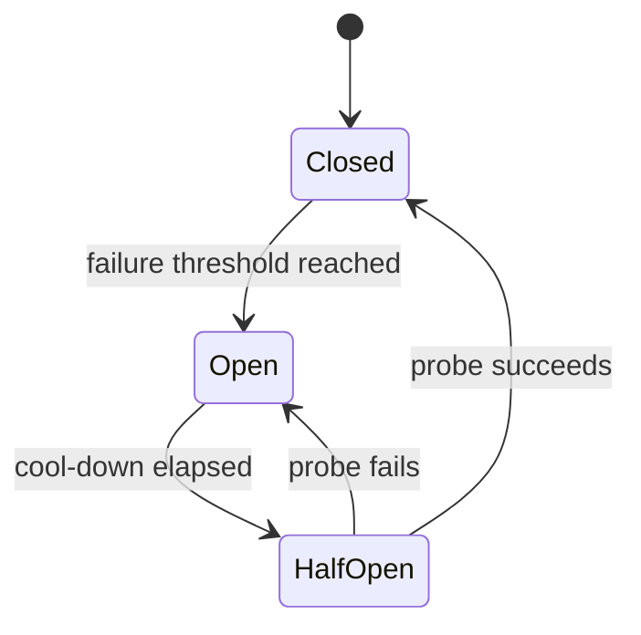

# Circuit Breaker Pattern

> The Circuit Breaker pattern prevents an application from repeatedly trying to execute an operation that is likely to fail. While traditionally thought of as a backend microservice pattern, a Staff engineer knows that client-side circuit breakers are one option when bounded retries, deadlines and failure feedback do not adequately limit repeated work. If a backend service goes down, millions of Android apps aggressively retrying the API will cause a "thundering herd" that acts as a self-inflicted DDoS attack, keeping the servers down. A client-side circuit breaker fails fast, saves device battery, and protects the backend infrastructure.

---

## Overview

A Circuit Breaker acts as a state machine that sits between your app (the client) and a remote resource (the API). It monitors the success/failure rate of the calls.

### The Three States



Closed permits calls, Open fails fast, and Half-Open admits bounded probes rather than releasing all queued traffic.
1. **Closed (Normal):** The circuit is closed, allowing requests to flow freely to the API. If a request fails, a failure counter increments.
2. **Open (Failing):** If the failure threshold is reached (e.g., 5 consecutive 503 errors), the circuit "trips" open. **All subsequent requests fail immediately with an exception, without ever hitting the network.** A timeout timer starts.
3. **Half-Open (Testing):** After the timeout expires, the circuit allows a limited number of test requests through. If they succeed, the circuit resets to **Closed**. If they fail, it trips back to **Open** and the timer restarts.

---

## 1. Why Android Needs Circuit Breakers

Backend teams use tools like Envoy or Istio to manage circuit breaking between microservices. However, if the API Gateway itself goes down, the mobile clients are the only line of defense.

If your app has a naive retry policy (e.g., retry 3 times on failure) and the server is down, millions of active apps will multiply the load on the backend by 3x. When the server tries to recover, it is immediately crushed by the backlog of retries.

**Benefits of a Client-Side Circuit Breaker:**
1. **Protects the Backend:** Prevents the Thundering Herd problem.
2. **Saves Battery:** Failing immediately is extremely cheap. Waking up the cellular radio to wait 10 seconds for a timeout drains the battery.
3. **Improves UX:** Instead of making the user stare at a spinning loader for 15 seconds before showing an error, the app shows the error (or cached offline data) instantly.

---

## 2. Core Android Example: OkHttp Interceptor

Choose the breaker boundary around the dependency/failure domain. An OkHttp application interceptor can cover calls through that client; it does not cover other clients, WebView or SDK-owned transports.

```kotlin
// Teaching core: synchronized compound transitions and generation-bound permits.
// Thresholds/cooldown are example policy; the clock must be monotonic.
class CircuitBreaker(
    private val failureThreshold: Int = 3,
    private val resetTimeoutMillis: Long = 30_000,
    private val nowMillis: () -> Long = { System.nanoTime() / 1_000_000 },
) {
    init { require(failureThreshold > 0 && resetTimeoutMillis >= 0) }
    enum class Outcome { SUCCESS, FAILURE, IGNORED }
    class Permit internal constructor(internal val generation: Long) {
        internal var completed = false
    }
    private enum class State { CLOSED, OPEN, HALF_OPEN }
    private var state = State.CLOSED
    private var generation = 0L
    private var failures = 0
    private var openedAt = 0L

    @Synchronized fun acquire(): Permit? {
        if (state == State.OPEN && nowMillis() - openedAt >= resetTimeoutMillis) {
            state = State.HALF_OPEN
            generation++
            return Permit(generation)
        }
        return if (state == State.CLOSED) Permit(generation) else null
    }

    @Synchronized fun complete(permit: Permit, outcome: Outcome) {
        if (permit.completed) return
        permit.completed = true
        if (permit.generation != generation) return // Ignore old in-flight results.
        when (outcome) {
            Outcome.SUCCESS -> {
                failures = 0
                if (state == State.HALF_OPEN) { state = State.CLOSED; generation++ }
            }
            Outcome.FAILURE -> {
                failures++
                if (state == State.HALF_OPEN || failures >= failureThreshold) open()
            }
            Outcome.IGNORED -> if (state == State.HALF_OPEN) open()
        }
    }

    private fun open() {
        state = State.OPEN
        openedAt = nowMillis()
        generation++
    }
}
```

Now, inject this into an OkHttp Interceptor:

```kotlin
class CircuitBreakerInterceptor(private val breaker: CircuitBreaker) : Interceptor {
    override fun intercept(chain: Interceptor.Chain): Response {
        val permit = breaker.acquire() ?: throw CircuitBreakerOpenException("Circuit open")
        try {
            val response = chain.proceed(chain.request())
            // Example availability policy, not an application-success classifier.
            breaker.complete(permit, if (response.code >= 500)
                CircuitBreaker.Outcome.FAILURE else CircuitBreaker.Outcome.SUCCESS)
            return response
        } catch (failure: IOException) {
            breaker.complete(permit, if (chain.call().isCanceled())
                CircuitBreaker.Outcome.IGNORED else CircuitBreaker.Outcome.FAILURE)
            throw failure
        } finally {
            breaker.complete(permit, CircuitBreaker.Outcome.IGNORED)
        }
    }
}
class CircuitBreakerOpenException(message: String) : IOException(message)
```

---

## 3. Handling the Exception in the UI (Fallback State)

When the OkHttp interceptor throws `CircuitBreakerOpenException`, Retrofit propagates it to your Repository/ViewModel. 

A Staff engineer uses this specific exception to trigger a "Degraded Mode" in the UI.

```kotlin
class HomeViewModel(private val repository: Repository) : ViewModel() {
    private val _uiState = MutableStateFlow<UiState>(UiState.Loading)
    val uiState = _uiState.asStateFlow()

    fun loadHomeFeed() {
        viewModelScope.launch {
            try {
                val data = repository.fetchFeed()
                _uiState.value = UiState.Success(data)
            } catch (e: CircuitBreakerOpenException) {
                // The server is down. Show cached data with an offline banner immediately.
                val cachedData = repository.getCachedFeed()
                _uiState.value = UiState.Degraded(cachedData, message = "Server unavailable")
            } catch (cancelled: CancellationException) {
                throw cancelled
            } catch (e: Exception) {
                _uiState.value = UiState.Error("An error occurred")
            }
        }
    }
}
```

---

## 4. Resilience4j (The Library Alternative)

If you don't want to build a custom thread-safe state machine, you can use **Resilience4j**, a lightweight, modular fault tolerance library whose 2.x line requires Java 17.

The following is a JVM library example. Verify the selected artifact's bytecode, dependencies and Android/desugaring support against your build before adopting it; coroutine support alone does not establish Android compatibility.

```kotlin
// Setup the registry
val circuitBreakerConfig = CircuitBreakerConfig.custom()
    .failureRateThreshold(50.0f) // Trip if 50% of calls fail
    .waitDurationInOpenState(Duration.ofSeconds(30))
    .slidingWindowSize(10) // Evaluate over the last 10 calls
    .minimumNumberOfCalls(10)
    .permittedNumberOfCallsInHalfOpenState(1)
    .build()

val circuitBreaker = CircuitBreakerRegistry.of(circuitBreakerConfig)
    .circuitBreaker("backendAPI")

// In your Repository, wrap the suspend function
suspend fun fetchUsers(): List<User> {
    return circuitBreaker.executeSuspendFunction {
        api.getUsers()
    }
}
```

---

## 5. Failure Modes & Tradeoffs

| Failure Mode | Cause | Prevention / Solution |
|---|---|---|
| **Tripping on Bad Internet** | The user goes into a tunnel (IOException). The circuit breaker trips. The user exits the tunnel 5 seconds later, but the app blocks requests for 30 seconds because the circuit is OPEN. | Separate "Server Errors" (HTTP 503) from "Network Connectivity Errors" (SocketTimeout). Choose whether the breaker measures backend availability or the whole network path. This teaching example counts non-cancellation I/O failures; mobile connectivity changes can make a shorter cooldown or a reset policy appropriate. Do not claim an IOException proves server downtime. |
| **Global Breaker Lockout** | Using a single global CircuitBreaker for all endpoints. If the `ImageServer` goes down, the breaker trips, and the app blocks calls to the perfectly healthy `AuthServer`. | Instantiate multiple CircuitBreakers keyed by base URL or domain (e.g., one for `api.company.com`, one for `cdn.company.com`). |
| **Silent Failures** | The UI doesn't explicitly handle the `CircuitBreakerOpenException` and treats it like a generic error, showing a generic "Something went wrong" message. | Catch the specific exception and show a Degraded state, utilizing local SQLite/Room caches to keep the app functional. |

---

## 6. Common Pitfalls

### Pitfall 1: Confusing Retry with Circuit Breaker
Many engineers use a Retry Interceptor with exponential backoff (1s, 2s, 4s) to handle failures. **Retry is not a Circuit Breaker.** Retry *adds* load to the server in hopes it recovers. A Circuit Breaker *removes* load to allow it to recover. 
*Fix:* Use either or both only when justified. Ordering determines which failures/attempts the breaker observes. Explicitly exclude CircuitBreakerOpenException from retry; backoff does not disappear merely because an exception was fast.

### Pitfall 2: Memory Leaks in Half-Open State
In the Half-Open state, if you allow exactly 1 request through to test the server, and that request hangs forever (no timeout configured on OkHttp), the circuit remains permanently Half-Open, blocking all other requests infinitely.
*Fix:* Bound the whole call with `callTimeout` as well as appropriate phase timeouts. Release/complete a probe on every exit, including cancellation and unexpected exceptions.

---

## Probing Questions

1.  **Concurrency:** Why are atomic fields alone insufficient for a multi-field breaker, and how do synchronized transitions and generation-bound permits prevent a late success from an older call from closing a newly opened circuit?
2.  **Jitter:** When a Circuit Breaker transitions from OPEN to HALF_OPEN, and a test request succeeds, the state transitions to CLOSED. If millions of apps transition to CLOSED at the same time, what happens to the backend? How would you add "Jitter" to the `resetTimeoutMillis` to mitigate this?
3.  **HTTP Status Codes:** Why is it an anti-pattern to record a failure and trip the circuit breaker when the server returns an HTTP 400 (Bad Request) or 401 (Unauthorized)?
4.  **Backend vs Frontend Breakers:** Your API Gateway has an Envoy circuit breaker configured to reject requests if the internal database is down. Why do you still need an OkHttp circuit breaker on the Android client?
5.  **Offline First:** How does the Circuit Breaker pattern synergize with the Repository Pattern and a local Room database to create an "Offline-First" application architecture?

## Answer Key

1. **Concurrency:** Synchronize the compound state/counter/timestamp transition. Admit one half-open probe and associate each call with a generation; opening or finishing a probe invalidates older in-flight results. A CAS on one field alone does not enforce those invariants.
2. **Jitter:** If millions of apps transition to CLOSED at the same time, the backend gets hit by a thundering herd (retry storm). Jitter adds a random delay to the `resetTimeoutMillis` for each client so they attempt the test request at distributed times rather than all at once.
3. **HTTP Status Codes:** 400 and 401 are client errors (bad request, unauthorized), not server availability issues. Tripping the circuit breaker on these would unnecessarily block valid requests during the cooldown when the server is actually healthy.
4. **Backend vs Frontend Breakers:** If the API Gateway itself goes down, the backend breaker is useless. Client deadlines, retry budgets, backoff and optional breakers also bound device-side costs. A mobile breaker is one defense, not a universal requirement.
5. **Offline First:** The Circuit Breaker catches the exception and the Repository uses this to emit the cached Room database data instead. It allows the app to seamlessly transition to an offline state.

## Further Reading

- [`retry.md`](retry.md) — How to combine Circuit Breakers with Exponential Backoff Retry policies.
- [`../backend-for-mobile/api-design-for-mobile.md`](../backend-for-mobile/api-design-for-mobile.md) — The physical costs of cellular radio wakeups that Circuit Breakers prevent.
- [`../android/networking-and-security/retrofit-and-okhttp.md`](../android/networking-and-security/retrofit-and-okhttp.md) — OkHttp interceptor chain ordering (where the breaker should sit relative to logging and auth).
- [`../reference-architectures/offline-first-app.md`](../reference-architectures/offline-first-app.md) — Architecting the UI to gracefully fallback to local caches when the breaker trips.
- [Resilience4j state machine, metrics and probes](https://resilience4j.readme.io/docs/circuitbreaker)
- [Resilience4j 2 Java 17 requirement](https://resilience4j.readme.io/docs/getting-started)
- [OkHttp application interceptors and response ownership](https://raw.githubusercontent.com/square/okhttp/master/docs/features/interceptors.md)
- [Java monotonic elapsed-time contract](https://docs.oracle.com/en/java/javase/17/docs/api/java.base/java/lang/System.html#nanoTime())
- [Cancellation is not an ordinary failure](https://kotlinlang.org/docs/cancellation-and-timeouts.html)
