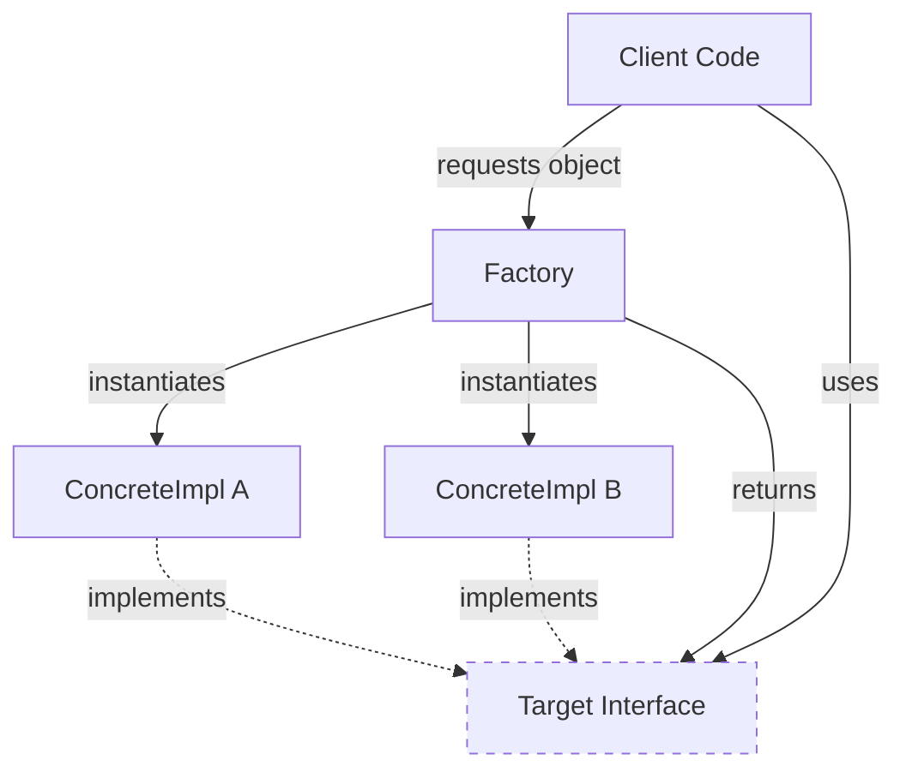

# Factory Pattern

## Overview

The Factory pattern is a creational design pattern that provides an interface for creating objects in a superclass, but allows subclasses or implementing classes to alter the type of objects that will be created. In modern Android, it is the primary mechanism for decoupling *what* an object is from *how* it is constructed, especially when construction requires complex dependencies or contextual logic.

## Why It Exists

Calling a constructor directly (`val api = AnalyticsApi(config, tokenManager, logger)`) hardcodes the dependency. If the construction logic changes, every caller must change. If the caller shouldn't know about `tokenManager`, the abstraction leaks. Factories encapsulate the "how to build it" logic, allowing the caller to simply ask for "a working instance."

## Historical Context

The GoF book defines two distinct factory patterns: **Factory Method** (subclasses decide which class to instantiate) and **Abstract Factory** (families of related objects). In modern Kotlin and Android, these rigid class-hierarchy definitions have largely blurred. "Factory" now generally refers to any component whose sole responsibility is producing instances of other components, often implemented as top-level functions, companion objects, or Dependency Injection (DI) provider methods.

## First Principles

1.  **Separation of Construction from Use:** The code that *uses* an object shouldn't be the code that *creates* it.
2.  **Dependency Inversion:** Depend on abstractions, not concretions. A factory returns an interface, hiding the concrete implementation class from the caller.
3.  **Encapsulation of Complexity:** If building an object requires parsing a config file, validating a token, and instantiating five sub-dependencies, hide that mess inside a factory.

## Mental Model

Think of a car factory. You (the client) walk in and say "I want a Sedan." You don't know how to weld a chassis, mix the paint, or source the engine parts. The factory handles the complex assembly process and hands you a completed, driveable `Car` interface.

## Internal Mechanics

### 1. The Simple Factory (Companion Object)

In Kotlin, the simplest factory is often just a function on a `companion object`.

```kotlin
interface AnalyticsTracker {
    fun logEvent(name: String)
}

class FirebaseTracker private constructor(private val apiKey: String) : AnalyticsTracker {
    override fun logEvent(name: String) { /* ... */ }

    companion object {
        // The Factory Method
        fun create(config: AppConfig): AnalyticsTracker {
            require(config.firebaseKey.isNotEmpty()) { "Missing Firebase Key" }
            return FirebaseTracker(config.firebaseKey)
        }
    }
}
```
*Note: The constructor is `private`. The only way to get an instance is through the factory, ensuring it's always built correctly.*

### 2. The Abstract Factory (Interface)

When the exact type of factory needs to be decided at runtime or injected for testing.

```kotlin
// The Product
interface VideoPlayer {
    fun play(url: String)
}

// The Factory Interface
interface VideoPlayerFactory {
    fun createPlayer(): VideoPlayer
}

// Concrete Factories
class ExoPlayerFactory(private val context: Context) : VideoPlayerFactory {
    override fun createPlayer(): VideoPlayer = ExoPlayerWrapper(context)
}

class MockPlayerFactory : VideoPlayerFactory {
    override fun createPlayer(): VideoPlayer = MockVideoPlayer()
}
```

### 3. Dependency Injection (The Modern Factory)

In modern Android, Dagger/Hilt acts as the ultimate Abstract Factory for the entire application. A `@Provides` annotated function is literally a Factory Method.

```kotlin
@Module
@InstallIn(SingletonComponent::class)
object AnalyticsModule {
    
    // This IS a Factory Method
    @Provides
    @Singleton
    fun provideAnalyticsTracker(
        config: AppConfig, // Dagger resolves the dependencies
        logger: Logger
    ): AnalyticsTracker {
        return if (config.isDebug) {
            DebugTracker(logger)
        } else {
            FirebaseTracker(config.apiKey)
        }
    }
}
```

## Architecture



## Production Example

Consider an app that needs to load different UI components based on a server-driven UI (SDUI) JSON response.

```kotlin
// The JSON: { "type": "hero_banner", "imageUrl": "..." }

interface SduiComponentFactory {
    fun createComponent(json: JsonObject): SduiComponent
}

class DefaultSduiFactory : SduiComponentFactory {
    override fun createComponent(json: JsonObject): SduiComponent {
        return when (val type = json.getString("type")) {
            "hero_banner" -> HeroBannerComponent(json.getString("imageUrl"))
            "product_carousel" -> ProductCarouselComponent(json.getArray("items"))
            "text_block" -> TextBlockComponent(json.getString("text"))
            else -> UnknownComponent(type) // Fallback strategy
        }
    }
}
```
The parsing engine delegates to the factory. If a new component type is added, you update the factory, not the core rendering engine.

## Android Example

The most prominent Android-specific example is the `ViewModelProvider.Factory`.

Because the Android framework (specifically, the `Activity`/`Fragment` lifecycle) must create and manage the instance of your `ViewModel`, you cannot call its constructor yourself. If your `ViewModel` requires arguments (like a Repository), you *must* provide a Factory to the framework teaching it *how* to build your specific `ViewModel`.

```kotlin
class UserViewModelFactory(
    private val repository: UserRepository
) : ViewModelProvider.Factory {
    override fun <T : ViewModel> create(modelClass: Class<T>): T {
        if (modelClass.isAssignableFrom(UserViewModel::class.java)) {
            @Suppress("UNCHECKED_CAST")
            return UserViewModel(repository) as T
        }
        throw IllegalArgumentException("Unknown ViewModel class")
    }
}
```
*(Note: Hilt's `@HiltViewModel` annotation generates this exact factory boilerplate for you under the hood.)*

## Tradeoffs

**Advantages**
- **Decoupling:** Clients don't know the concrete classes they use, only the interfaces.
- **Single Responsibility Principle:** Moves complex creation code out of the business logic.
- **Open/Closed Principle:** You can introduce new types of products without breaking existing client code (just update the factory).

**Disadvantages**
- **Over-engineering:** Introducing interfaces, concrete implementations, and factories for a simple class that has no dependencies and only one implementation is unnecessary boilerplate.
- **Complexity:** "AbstractFactoryImpl" style architectures can make it difficult to figure out where an object is *actually* being instantiated when tracing code.

## Failure Modes

- **The Factory God Object:** A single `AppFactory` that knows how to build every object in the system. Factories should be scoped to specific domains or component families.
- **Factories that do real work:** A factory's job is *only* to instantiate and assemble. If a factory method makes a network call or runs a heavy database query to fetch configuration before returning the object, it's doing too much. (Pass the config in, or return an object that knows how to fetch it asynchronously).
- **Redundant Factories in a DI World:** Writing manual Factory classes when you are already using Dagger/Hilt. Use the DI framework's `@Provides` methods; don't reinvent the wheel.

## Staff Engineer Thinking

When reviewing factory usage, a Staff engineer asks:

1.  **Who owns the lifecycle?** A factory creates the object, but who is responsible for tearing it down or releasing its resources? If the factory caches instances (like a Singleton factory), how is the cache cleared?
2.  **Is this masking a leaky abstraction?** If a factory requires 15 arguments just to build a simple `Logger`, the problem isn't the factory; the problem is the `Logger`'s design.
3.  **Why isn't this handled by the DI framework?** In modern Android, manual factories are usually a code smell unless dealing with dynamic runtime parameters (like SDUI parsing or Assisted Injection).

## Common Misconceptions

- **"A Factory must be a separate class."** False. A factory is a *role*. A top-level Kotlin function `fun createTracker(): Tracker` is a factory.
- **"Factories are obsolete because of Dagger/Hilt."** Partially false. While DI handles static dependency graphs, factories are still strictly necessary for **Assisted Injection** (where some parameters are provided by the DI graph, and others are provided dynamically at runtime by the user, like a `userId` from a click event).

## Probing Questions

1.  What is the difference between a Factory Method and an Abstract Factory? Does the distinction matter in modern Kotlin?
2.  How does the Factory pattern relate to the Dependency Inversion Principle?
3.  Explain the concept of "Assisted Injection" in Dagger/Hilt. How does it relate to the Factory pattern?
4.  Why does Android require a `ViewModelProvider.Factory` instead of letting you just instantiate a `ViewModel` directly?
5.  What are the signs that a Factory has become a "God Object"?
6.  If a Factory method needs to perform an asynchronous operation (like fetching a config from the network) before it can return the object, how should you design the API?
7.  How do you test a class that relies on a Factory to create its dependencies?
8.  Compare using a Companion Object factory method versus a top-level Kotlin function.
9.  Can a Factory return a Singleton? Should it?
10. In a multi-module architecture, where should the Factory interface live, and where should the concrete implementation live?

## Further Reading

- [`adapter.md`](adapter.md) — Factories often instantiate Adapters to hide third-party SDKs from the domain.
- [`strategy.md`](strategy.md) — A Factory is often used to decide *which* Strategy implementation to instantiate at runtime based on configuration.
- Refactoring Guru: [Factory Method](https://refactoring.guru/design-patterns/factory-method) and [Abstract Factory](https://refactoring.guru/design-patterns/abstract-factory)
