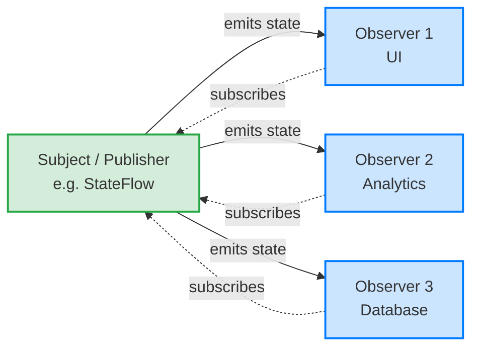

# Observer Pattern

## Overview

The Observer pattern defines a one-to-many dependency between objects so that when one object changes state, all its dependents are notified and updated automatically. In modern Android, this pattern is the beating heart of Reactive Programming and Unidirectional Data Flow (UDF), implemented via Kotlin `Flow`, `LiveData`, or RxJava.

## Why It Exists

If the UI needs to display the user's current location, how does it get updates?
1. **Polling:** The UI asks the GPS hardware "Are we there yet?" every 100ms. (Drains battery, high latency).
2. **Direct Callback:** The GPS hardware holds a reference to the `TextView` and updates it. (Massive coupling, memory leaks when the UI is destroyed).
3. **Observer:** The GPS hardware emits events. Anyone who cares (the UI, the analytics tracker, the local database) subscribes. The GPS doesn't know *who* is listening, and the listeners only react when data changes.

The Observer pattern decouples the *producer* of data from the *consumer* of data.

## Historical Context

Another original GoF pattern. Historically, it was implemented manually: a `Subject` interface maintained a `List<Observer>` and iterated over it to call `notify()`. This manual approach was fragile (concurrent modification exceptions, memory leaks from forgotten unregisters). Today, language-level primitives (Kotlin Flow/Coroutines) or robust libraries (RxJava) handle the plumbing, threading, and lifecycle management, making the raw manual implementation obsolete.

## First Principles

1.  **Publish-Subscribe (Pub/Sub):** Publishers produce events; Subscribers consume them. They are completely decoupled.
2.  **Push vs. Pull:** Data is *pushed* to consumers when ready, eliminating the need for consumers to *pull* (poll) continuously.
3.  **Lifecycle Awareness:** In mobile, Observers must stop listening when the UI is destroyed, otherwise the app crashes or leaks memory.

## Mental Model

Think of a YouTube channel. The creator (Subject) uploads a video. YouTube doesn't know who you are personally, it just knows you clicked "Subscribe". When the video goes live, YouTube sends a push notification to your phone, your tablet, and your smart TV (Observers). You consume the content when it arrives.

## Internal Mechanics

### 1. The Manual Implementation (Legacy/Conceptual)

Understanding this is crucial for understanding what `Flow` does under the hood.

```kotlin
interface Observer<T> {
    fun onUpdate(value: T)
}

class LocationSubject {
    private val observers = mutableListOf<Observer<Location>>()
    private var lastLocation: Location? = null

    fun subscribe(observer: Observer<Location>) {
        observers.add(observer)
        lastLocation?.let { observer.onUpdate(it) } // Replay last state
    }

    fun unsubscribe(observer: Observer<Location>) {
        observers.remove(observer)
    }

    // Called by the OS location engine
    fun updateLocation(newLocation: Location) {
        lastLocation = newLocation
        // Notify all subscribers
        observers.forEach { it.onUpdate(newLocation) }
    }
}
```

### 2. The Modern Kotlin Flow Implementation

Kotlin `StateFlow` and `SharedFlow` are the modern, built-in implementations of the Observer pattern.

```kotlin
class LocationRepository(private val locationEngine: LocationEngine) {
    
    // The Subject (Mutable, private)
    private val _locationFlow = MutableStateFlow<Location?>(null)
    
    // The Observable (Immutable, public)
    val locationFlow: StateFlow<Location?> = _locationFlow.asStateFlow()

    init {
        locationEngine.requestLocationUpdates { newLocation ->
            // Update state; all observers are automatically notified
            _locationFlow.value = newLocation
        }
    }
}
```

## Architecture



## Production Example

Unidirectional Data Flow (UDF) is the dominant architecture in modern Android (MVVM/MVI with Compose/ViewBinding). The entire architecture is just the Observer pattern applied to the UI.

```kotlin
class CartViewModel(private val repo: CartRepository) : ViewModel() {
    
    // 1. Subject holds UI State
    val uiState: StateFlow<CartUiState> = repo.cartItems
        .map { items -> CartUiState.Success(items, calculateTotal(items)) }
        .stateIn(viewModelScope, SharingStarted.WhileSubscribed(5000), CartUiState.Loading)
        
    fun addItem(item: Item) {
        viewModelScope.launch { repo.insert(item) } // Triggers repo flow update
    }
}

// 2. Observer (Compose UI) reacts to state changes
@Composable
fun CartScreen(viewModel: CartViewModel) {
    // collectAsState() registers the UI as an Observer
    val state by viewModel.uiState.collectAsState()
    
    when (state) {
        is CartUiState.Loading -> LoadingSpinner()
        is CartUiState.Success -> CartList(state.items, state.total)
    }
}
```

## Android Example

Beyond UI architecture, Android system APIs use Observers heavily. 
- `BroadcastReceiver` is a system-wide observer pattern.
- `ContentObserver` listens for changes in `ContentProvider` databases (like Contacts or Media).
- `SharedPreferences.OnSharedPreferenceChangeListener` notifies when settings change.

## Tradeoffs

**Advantages**
- **Decoupling:** Subjects and Observers can be modified, tested, and reused independently.
- **Reactive Design:** UIs naturally reflect the current state of data without manual refresh logic.
- **Broadcasting:** One event can trigger multiple unrelated side-effects effortlessly.

**Disadvantages**
- **The "Lapsed Listener" Memory Leak:** If an Observer (like a UI component) subscribes to a long-lived Subject (like a Singleton Repository) and forgets to unsubscribe, the Subject holds a reference to the Observer forever, causing a massive memory leak. (Lifecycle-aware components like `repeatOnLifecycle` or `collectAsState` fix this).
- **Tracing Complexity:** When an event fires, it can be very difficult to trace through the codebase to see *which* components react to it and in *what order*. Execution flow is implicit rather than explicit.
- **Event Cascades:** Observer A reacts to Subject X, which mutates Subject Y, which triggers Observer B, which mutates Subject X... leading to infinite loops or unpredictable states.

## Failure Modes

- **Cold vs. Hot Confusion:** Understanding the difference between a Cold stream (starts producing only when subscribed, every subscriber gets its own execution) and a Hot stream (always running, subscribers share the emissions) is the #1 source of bugs in Reactive programming. `StateFlow` is Hot.
- **Lifecycle Ignorance:** Collecting a `Flow` in a Fragment's `lifecycleScope.launch` without `repeatOnLifecycle`. The Flow will continue emitting and updating the UI while the app is in the background, wasting battery and potentially causing crashes.
- **Backpressure:** The Subject produces events faster than the Observer can consume them. E.g., a sensor emits 1000 events/sec, but the UI can only draw 60 frames/sec. Without dropping or buffering strategies (backpressure handling), the app OOMs (Out Of Memory).

## Staff Engineer Thinking

When reviewing reactive code, a Staff engineer focuses on lifecycle and execution contexts:

1.  **Does this leak?** Who owns the subscription? If a singleton holds a `Flow` and a Fragment collects it, is the collection properly cancelled when the Fragment is destroyed?
2.  **What thread is this observing on?** If the Subject emits on a background thread, is the Observer safely switching to the Main thread before touching the UI?
3.  **State vs. Event:** Is the Observer pattern being used for State (Current Temperature = 72°) or Events (User Clicked "Buy"). `StateFlow` conflates events (if you emit '72' twice, it only notifies once). Using State mechanics for one-off Events leads to dropped data.

## Common Misconceptions

- **"RxJava/Flow and Observer are different."** False. RxJava and Kotlin Coroutines/Flow are simply massive, feature-rich libraries built *on top* of the Observer pattern.
- **"Events and State are the same thing."** False. State has a value at all times (even if it's "Empty"). New subscribers should immediately receive the current state. Events are transient. If you subscribe *after* a toast message event fires, you should not see the toast. (This is the difference between `StateFlow` and `SharedFlow` without replay).

## Probing Questions

1.  How does the Observer pattern solve the issue of tight coupling between the UI and data layers?
2.  What is the "Lapsed Listener" problem, and how do Android Architecture Components (`LiveData`, `LifecycleCoroutineScope`) solve it?
3.  Explain the difference between Hot and Cold observables. Why does the UI layer prefer Hot observables (like `StateFlow`)?
4.  If a Subject emits identical data back-to-back, should the Observers be notified? (Discuss distinct-until-changed semantics).
5.  What is backpressure, and how does Kotlin Flow handle it compared to RxJava?
6.  When would you use the classic manual `List<Observer>` implementation instead of Kotlin Flow?
7.  How does Unidirectional Data Flow (UDF) utilize the Observer pattern?
8.  If you have a complex chain of mapped and combined Observables, how do you debug where an incorrect value originated?
9.  What is the difference between `LiveData` and `StateFlow`?
10. Can the Observer pattern be used across process boundaries in Android? How?

## Further Reading

- [`state.md`](state.md) — The UI observes the State pattern.
- [`engineering-fundamentals/sync-vs-async.md`](../engineering-fundamentals/sync-vs-async.md) — Observers are inherently asynchronous consumers.
- Kotlin Docs: [StateFlow and SharedFlow](https://developer.android.com/kotlin/flow/stateflow-and-sharedflow)
- Refactoring Guru: [Observer Pattern](https://refactoring.guru/design-patterns/observer)
