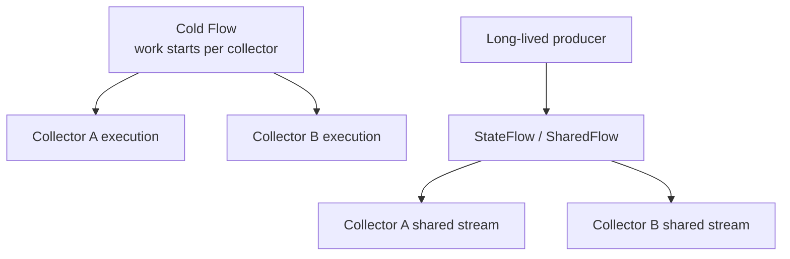

# Observer Pattern

> The Observer pattern is the absolute bedrock of modern Android architecture. Because the UI thread must never be blocked, Android applications are inherently asynchronous and event-driven. A Staff engineer must understand the evolution of the Observer pattern on Android—from the raw listener interfaces and `BroadcastReceiver`s of 2012, to `LiveData` and RxJava, to the modern standard of Kotlin's `Flow` and `StateFlow`. Crucially, you must know how to manage observer lifecycles to prevent memory leaks and background crashes.

---

## Overview

The Observer pattern defines a one-to-many dependency between objects so that when one object (the Subject/Publisher) changes state, all its dependents (the Observers/Subscribers) are notified and updated automatically.

In Android, this pattern is used to solve the fundamental architectural challenge: **Data lives in the background (network, database, repository), but it must be displayed on the Main (UI) thread.** The background cannot safely hold a reference to the UI (which leads to `Activity` leaks), so the UI must *observe* the background data.

---

## 1. The Evolution of Android Observers

### Era 1: Callbacks & Interfaces (2008 - 2014)
The classic approach was to pass a listener interface.

```kotlin
// The Observer Interface
interface OnDataLoadedListener {
    fun onSuccess(data: List<String>)
    fun onError(exception: Exception)
}

// The Subject
class UserRepository {
    fun fetchUsers(listener: OnDataLoadedListener) {
        // Run background thread...
        // Call listener.onSuccess() on Main thread
    }
}
```
**Fatal Flaw:** Callback hell, no lifecycle awareness, massive memory leaks if the `Activity` was destroyed before the background thread finished.

### Era 2: BroadcastReceivers & EventBuses (2014 - 2016)
Global publish-subscribe systems decoupled the components completely.

```kotlin
// Sending (Publisher)
EventBus.getDefault().post(UserLoggedInEvent(user))

// Receiving (Observer)
@Subscribe(threadMode = ThreadMode.MAIN)
fun onUserEvent(event: UserLoggedInEvent) {
    updateUi(event.user)
}
```
**Fatal Flaw:** Unstructured global state. It became impossible to trace where events originated. "Spaghetti architecture."

### Era 3: RxJava (2015 - 2019)
Functional Reactive Programming introduced streams of data.

```kotlin
userRepository.getUsers()
    .subscribeOn(Schedulers.io())
    .observeOn(AndroidSchedulers.mainThread())
    .subscribe(
        { users -> updateUi(users) }, // onNext
        { error -> showError(error) } // onError
    )
    .addTo(compositeDisposable)
```
**Fatal Flaw:** Massive learning curve, bloated APK size, and easy to cause leaks if `dispose()` wasn't called in `onDestroy()`.

### Era 4: LiveData (2017 - 2021)
Google's first official, lifecycle-aware observer.

```kotlin
// In ViewModel (Subject)
val users = MutableLiveData<List<User>>()

// In Fragment (Observer)
viewModel.users.observe(viewLifecycleOwner) { userList ->
    updateUi(userList)
}
```
**Fatal Flaw:** Tied to the Android SDK (cannot be used in Kotlin Multiplatform's `commonMain`), lacks rich operators (like `combine` or `flatMap`), and always dispatches on the Main thread.

### Era 5: Kotlin Flow & StateFlow (2021 - Present)
The modern standard. Language-level, coroutine-powered, multiplatform streams.

---

## 2. The Modern Standard: `StateFlow` and `SharedFlow`

Staff engineers build architectures using Kotlin's Coroutines and Flow APIs. The Observer pattern in modern Android is split into two distinct use cases: **State** (StateFlow) and **Events** (SharedFlow).

### Observing State (`StateFlow`)
State represents data that *is*. It always has a value, new observers immediately get the latest value, and identical consecutive values are conflated (ignored).

```kotlin
class UserViewModel(private val repository: UserRepository) : ViewModel() {
    
    // Internal mutable state (Subject)
    private val _uiState = MutableStateFlow<UiState>(UiState.Loading)
    
    // Public immutable state (The Observable)
    val uiState: StateFlow<UiState> = _uiState.asStateFlow()
    
    init {
        viewModelScope.launch {
            repository.getUserStream().collect { user ->
                _uiState.value = UiState.Success(user)
            }
        }
    }
}
```

### Observing Events (`SharedFlow`)
Events represent things that *happen*. They do not have a default value, they are consumed once, and identical consecutive events are valid.

```kotlin
class CheckoutViewModel : ViewModel() {
    
    // Internal publisher
    private val _navigationEvents = MutableSharedFlow<NavEvent>()
    
    // Public observer interface
    val navigationEvents: SharedFlow<NavEvent> = _navigationEvents.asSharedFlow()
    
    fun onCheckoutClicked() {
        viewModelScope.launch {
            // Emits the event to all active observers
            _navigationEvents.emit(NavEvent.NavigateToSuccess)
        }
    }
}
```

---

## 3. Safe UI Observation (The Android Lifecycle Trap)

The most complex part of the Observer pattern on Android is ensuring the observer stops listening when the UI is hidden. If an observer updates a `View` while the `Fragment` is stopped, the app will crash or leak memory.

### In the View System (XML)
You must use `repeatOnLifecycle` or `flowWithLifecycle` to pause collection when the Activity/Fragment goes to the background.

```kotlin
class UserFragment : Fragment() {
    override fun onViewCreated(view: View, savedInstanceState: Bundle?) {
        super.onViewCreated(view, savedInstanceState)
        
        // CRITICAL: Launch in the View's lifecycle scope
        viewLifecycleOwner.lifecycleScope.launch {
            // CRITICAL: Suspend collection when the UI is stopped (e.g. backgrounded)
            viewLifecycleOwner.repeatOnLifecycle(Lifecycle.State.STARTED) {
                viewModel.uiState.collect { state ->
                    renderUi(state)
                }
            }
        }
    }
}
```

### In Jetpack Compose
Compose handles observation elegantly using `collectAsStateWithLifecycle()`. This automatically subscribes and unsubscribes the observer as the Composable enters and leaves the composition, and pauses it when the app goes to the background.

```kotlin
@Composable
fun UserScreen(viewModel: UserViewModel) {
    // Collects the flow, automatically pausing when the app is backgrounded
    val uiState by viewModel.uiState.collectAsStateWithLifecycle()
    
    when (val state = uiState) {
        is UiState.Loading -> CircularProgressIndicator()
        is UiState.Success -> Text("Hello, ${state.user.name}")
    }
}
```

---

## 4. Cold vs. Hot Observables



Cold flows describe repeatable work, while hot flows represent shared state or events with an independent lifetime.

A fundamental concept for Staff engineers:

### Cold Observers (Flow)
A Cold observer only starts producing data when someone subscribes to it. It executes independently for *each* subscriber.

```kotlin
// This block runs from the beginning for EVERY collector
val countdownFlow = flow {
    for (i in 5 downTo 1) {
        emit(i)
        delay(1000)
    }
}
```
**Danger:** If you use a cold flow to execute a network request, and 3 different UI components observe it, the network request will be fired 3 times simultaneously.

### Hot Observers (StateFlow / SharedFlow)
A Hot observer produces data regardless of whether anyone is listening. Multiple subscribers share the same execution.

```kotlin
// Converts a Cold flow into a Hot flow
val sharedCountdown = countdownFlow.shareIn(
    scope = viewModelScope,
    started = SharingStarted.WhileSubscribed(5000), // Keep alive for 5s after last observer leaves
    replay = 1 // New observers get the last emitted value
)
```
Using `shareIn` or `stateIn` is critical for preventing redundant work in the data layer.

---

## 5. Failure Modes & Tradeoffs

| Failure Mode | Cause | Prevention / Solution |
|---|---|---|
| **The "Background Crash"** | Observing a Flow via `launchWhenStarted` or raw `launch`. The collector keeps running in the background, tries to update UI, and crashes (`IllegalStateException`). | Always use `repeatOnLifecycle` (Views) or `collectAsStateWithLifecycle` (Compose). |
| **Dropped Events** | Emitting an event into a `MutableSharedFlow` while the Fragment is recreating (e.g., config change). No observer is currently listening. | Buffer the flow (`replay = 1`), or better, model the event as State (e.g. `hasNavigated = false`). |
| **Memory Leak** | Storing a reference to a `View` or `Activity` inside an observer that outlives the UI component (e.g., in a Singleton Repository). | Ensure the subscription is tied to a `LifecycleOwner` that automatically disposes when destroyed. |
| **Redundant Network Calls** | Exposing a Cold `Flow` from a Repository directly to the UI. If the screen rotates, the UI re-subscribes, triggering a new API call. | Use `stateIn` in the ViewModel to cache the latest result and survive configuration changes. |

---

## 6. Common Pitfalls

### Pitfall 1: Using LiveData for Single Events
Many legacy codebases use `SingleLiveEvent` to trigger navigation or Snackbars. This is an anti-pattern. LiveData is inherently designed for state, not events. If a user receives an error Snackbar, backgrounds the app, and returns, the `LiveData` re-emits the last value, and the Snackbar shows again.
*Fix:* Use a `Channel` that receives `receiveAsFlow()`, or a `MutableSharedFlow(replay = 0)`.

### Pitfall 2: Blocking the Collector
Kotlin Flows are sequential by default. If you perform heavy work inside the `collect` block, you block the upstream flow from emitting new values.

```kotlin
viewModel.locationUpdates.collect { location ->
    // BAD: This blocks the flow. We miss new locations while saving!
    database.saveLocationBlocking(location) 
}
```
*Fix:* Use `buffer()`, `conflate()`, or launch a new child coroutine for the processing work.

---

## Probing Questions

1.  **StateFlow vs LiveData:** Both represent observable state. `StateFlow` requires an initial value, while `LiveData` does not. Why did the Kotlin language designers enforce an initial value for `StateFlow`, and how does this affect your UI layer design?
2.  **Backpressure:** In RxJava, backpressure (what happens when the publisher emits faster than the observer can consume) is explicitly handled via `Flowable`. How does Kotlin Coroutines and `Flow` handle backpressure natively?
3.  **Lifecycle Semantics:** Compare `launchWhenStarted` to `repeatOnLifecycle(STARTED)`. They sound identical, but `launchWhenStarted` is deprecated. What exactly happens to the coroutine in both cases when the user presses the Home button?
4.  **SharedFlow Configuration:** You create a `MutableSharedFlow<Event>(replay = 1, extraBufferCapacity = 10, onBufferOverflow = BufferOverflow.DROP_OLDEST)`. Explain exactly what happens to a new observer that subscribes to this flow 5 seconds after 20 events were emitted.
5.  **Multiplatform Context:** You are moving an Android ViewModel to KMP's `commonMain`. The iOS team wants to observe your `StateFlow` from Swift. What bridging library or pattern (e.g., SKIE) is required to translate Kotlin's `suspend` collection into something Swift's Combine or AsyncSequence can understand?

## Answer Key

1. **StateFlow vs LiveData:** `StateFlow` enforces an initial value because state must always exist. This forces developers to explicitly define the initial UI state (like `Loading`), removing nullability and race conditions on startup.
2. **Backpressure:** `Flow` handles backpressure natively via coroutine suspension. If the collector is slow, the emitter suspends until the collector is ready, preventing OutOfMemory errors.
3. **Lifecycle Semantics:** `launchWhenStarted` simply suspends the coroutine but keeps it alive in memory. `repeatOnLifecycle` completely cancels the coroutine and restarts it from scratch, freeing resources when the UI is hidden.
4. **SharedFlow Configuration:** The new observer receives only the very last event (because `replay = 1`), and ignores the previous 19. If the buffer was full, the oldest events were already dropped.
5. **Multiplatform Context:** You use libraries like SKIE or KMP-NativeCoroutines, which automatically generate Swift wrappers to convert Kotlin `StateFlow` and `SharedFlow` into Swift's `ObservableObject` or `AsyncSequence`.

## Further Reading

- [`../android/architecture/state-management.md`](../android/architecture/state-management.md) — Deep dive into modeling UI state with Sealed Classes and StateFlow.
- [`../kotlin/coroutines-and-flow/coroutines.md`](../kotlin/coroutines-and-flow/coroutines.md) — Understanding the underlying Coroutine scopes that power Flows.
- [`../android/compose/recomposition-and-state.md`](../android/compose/recomposition-and-state.md) — How Compose observes State changes to trigger UI updates.
- [`../backend-for-mobile/api-design-for-mobile.md`](../backend-for-mobile/api-design-for-mobile.md) — Emitting network responses into observable streams.
