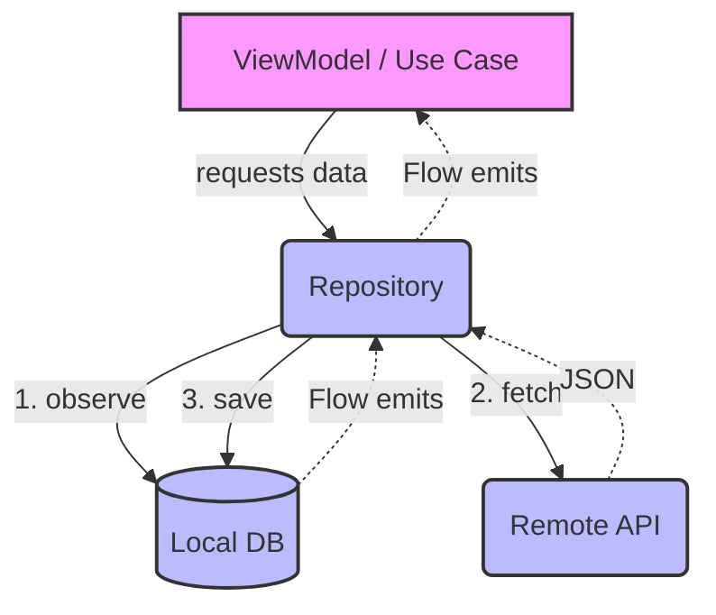

# Repository Pattern

## Overview

The Repository pattern mediates between the domain/business logic and data mapping layers using a collection-like interface for accessing domain objects. It encapsulates the set of objects persisted in a data store and the operations performed over them, providing a more object-oriented view of the persistence layer.

## Why It Exists

Domain logic needs data, but it shouldn't care *where* that data comes from or *how* it's stored. If a `ViewModel` or `UseCase` constructs SQL queries or makes direct network calls, the business rules become hopelessly coupled to infrastructure. The Repository exists to draw a strict boundary: the caller asks for domain objects; the repository figures out how to fetch, map, and cache them.

## Historical Context

Introduced by Eric Evans in *Domain-Driven Design* (2003) and popularized in enterprise software through patterns catalogs (like Fowler's *Patterns of Enterprise Application Architecture*). In Android, it gained mass adoption around 2017 with the introduction of Android Architecture Components and Google's official Guide to App Architecture, which explicitly mandated the pattern to manage the complexity of offline-first apps dealing with SQLite and REST APIs.

## First Principles

1.  **Separation of Concerns:** Business logic dictates *what* to do with data; repositories dictate *how* to get it.
2.  **Abstraction:** The caller sees a contract (an interface), not an implementation (Room, Retrofit, SharedPreferences).
3.  **Single Source of Truth (SSOT):** In complex apps, data might exist in memory, on disk, and on a server. The repository hides this complexity, exposing a single, coherent view of the data.

## Mental Model

Think of a repository as an **intelligent librarian**. You ask the librarian for a book on a specific topic. You don't care if the librarian gets it from the display shelf (memory cache), the basement archives (local database), or orders it from another library (network API). The librarian handles the logistics and hands you the book.

## Internal Mechanics

A modern Android repository typically coordinates three things: a local database (e.g., Room), a remote API (e.g., Retrofit), and a concurrency primitive (e.g., Kotlin Coroutines/Flow).

```kotlin
// The Domain Contract
interface UserRepository {
    fun getUser(userId: String): Flow<User>
    suspend fun refreshUser(userId: String)
}

// The Implementation
class OfflineFirstUserRepository(
    private val localDb: UserDao,
    private val remoteApi: UserApi,
    private val mapper: UserMapper
) : UserRepository {

    // 1. Return the local source of truth as a reactive stream
    override fun getUser(userId: String): Flow<User> {
        return localDb.observeUser(userId)
            .map { it?.let(mapper::toDomain) ?: User.EMPTY }
    }

    // 2. Encapsulate the sync logic
    override suspend fun refreshUser(userId: String) {
        try {
            val remoteUser = remoteApi.fetchUser(userId)
            // 3. Write to the local DB (which triggers the Flow in #1)
            localDb.insert(mapper.toEntity(remoteUser))
        } catch (e: Exception) {
            // Handle or rethrow, caller decides based on policy
            throw SyncException("Failed to refresh user", e)
        }
    }
}
```

Notice the architecture: the `getUser` function *only* reads from the local database. The `refreshUser` function fetches from the network and writes to the local database. The network never returns data directly to the caller. This is the "Local as Single Source of Truth" strategy.

## Architecture



## Production Example

In a large-scale e-commerce app, a `ProductRepository` doesn't just manage one API and one table. It might coordinate:
1.  A short-lived, LRU memory cache for instantaneous navigation.
2.  A Room database for offline browsing.
3.  A GraphQL API for structured product data.
4.  A distinct REST API for real-time inventory counts.

The repository's job is to merge these streams. The UI simply observes `val product: Flow<Product>`, completely oblivious to the fact that the title came from the database while the "Only 2 left in stock!" badge was merged in from a real-time web socket managed by the repository.

## Android Example

Google's modern architecture guidelines heavily lean on Repositories returning Kotlin `Flow`.

```kotlin
// Android-specific: managing lifecycle-aware collection
class UserViewModel(private val repository: UserRepository) : ViewModel() {
    
    // UI state is derived directly from the repository's Flow
    val uiState: StateFlow<UserUiState> = repository.getUser("123")
        .map { UserUiState.Success(it) }
        .catch { emit(UserUiState.Error(it.message)) }
        .stateIn(
            scope = viewModelScope,
            started = SharingStarted.WhileSubscribed(5000),
            initialValue = UserUiState.Loading
        )
}
```

## Tradeoffs

**Advantages**
- **Testability:** You can unit test the business logic by mocking the repository interface. No need for Robolectric or a real database.
- **Flexibility:** You can swap out a REST API for gRPC, or SQLite for Realm, without touching a single line of UI or UseCase code.
- **Centralized Data Policy:** Caching rules, retry logic, and fallback mechanisms live in one place, rather than being scattered across ViewModels.

**Disadvantages**
- **Boilerplate:** For a simple screen that just hits an API once and displays it, creating a Repository interface, implementation, entity mapper, and domain model is massive overkill.
- **"God" Repositories:** If not scoped correctly, repositories can become thousands of lines long, managing dozens of unrelated entities.
- **Pass-through Abstractions:** If your repository methods exactly mirror your DAO methods (`dao.insert()` -> `repo.insert()`), the repository is just useless indirection.

## Failure Modes

- **The "Leaky" Repository:** Returning `LiveData` or `Room` entity classes from the repository. The domain layer is now coupled to the Android framework and the database schema.
- **The "Swiss Army" Repository:** A `GlobalRepository` that handles Users, Settings, Products, and Analytics. Repositories should be scoped to a specific aggregate root or domain concept.
- **Network-as-Truth:** Calling an API and returning the result directly to the UI, bypassing the local cache. If the network drops, the app appears broken, even if the data was fetched five seconds ago.

## Staff Engineer Thinking

When reviewing a PR that introduces a new Repository, a Staff engineer asks:

1.  **Is this a true abstraction?** If we rip out Retrofit and use WebSockets tomorrow, does the repository interface have to change? If yes, it's leaking implementation details.
2.  **What is the caching invalidation strategy?** A cache without an eviction policy is a memory leak or a stale-data bug waiting to happen.
3.  **How does this handle backpressure?** If the local database emits 1000 updates a second, does the repository buffer, drop, or crash?
4.  **Are we hiding *too much* complexity?** Sometimes a repository masks the fact that an operation requires five sequential network calls. If the caller doesn't know it's expensive, they might call it in a tight loop.

## Common Misconceptions

- **"A Repository is just a wrapper around the database."** False. A DAO (Data Access Object) wraps a database. A Repository coordinates *multiple* data sources (DB, Network, Memory, File System) to fulfill a domain need.
- **"Every entity needs a repository."** False. Repositories should govern *Aggregate Roots* (in DDD terms). If a `User` has `Addresses`, you need a `UserRepository`, not an `AddressRepository`.
- **"Repositories should handle business logic."** False. Repositories handle *data* logic (mapping, caching, syncing). Business rules ("A user cannot buy alcohol if under 21") belong in the domain layer (Use Cases or Entities).

## Probing Questions

1.  What is the difference between a Repository and a DAO?
2.  How do you test a class that depends on a Repository?
3.  If your app is strictly online-only (no local DB), do you still need a Repository? Why or why not?
4.  How do you handle a scenario where the local DB read is fast, but the network fetch fails? What does the UI see?
5.  What happens if two different ViewModels call `repository.refreshData()` at the exact same time?
6.  How do you model pagination in a Repository?
7.  Should a Repository return `Result<T>` or throw Exceptions? Defend your choice.
8.  If a user logs out, how does the Repository clear its memory cache?
9.  Why might you choose to have an `interface` for a Repository versus just a concrete `class`?
10. In a modular app, which module owns the Repository interface, and which module owns the implementation?

## Further Reading

- [`offline-sync.md`](../mobile-system-design/offline-sync.md) — The ultimate application of the Repository pattern to coordinate local and remote state.
- [`strategy.md`](strategy.md) — Repositories often use strategies to determine *which* caching policy to apply.
- [`observer.md`](observer.md) — How the UI reacts to Repository changes (usually via Kotlin Flow today).
- Martin Fowler on [Repository](https://martinfowler.com/eaaCatalog/repository.html)
- Google's [Guide to App Architecture](https://developer.android.com/topic/architecture)
