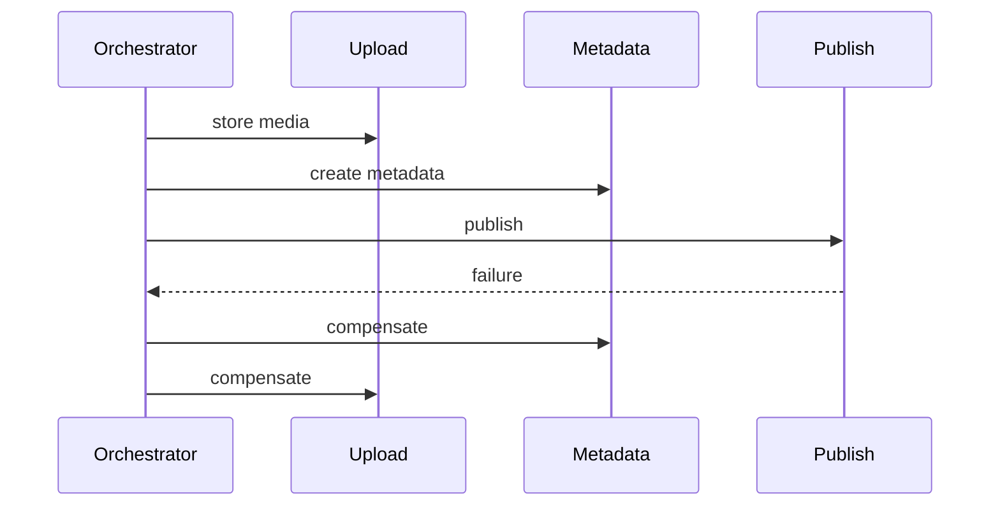

# Saga Pattern

> The Saga pattern manages long-running, distributed transactions without using global locks (like two-phase commits). While typically a backend microservices concept, mobile apps orchestrate mini-sagas constantly. A Staff engineer recognizes that a mobile "Checkout Flow" (Validate Cart -> Charge Card -> Upload Receipt -> Update UI) is a Saga. WorkManager can execute a persistent DAG of local workflow steps, but chaining alone is not a saga coordinator: compensation, durable progress and recovery need explicit design. A compensation is a new business operation, not an atomic database rollback.

---

## Overview

In a monolithic database, you wrap multiple operations in a `BEGIN TRANSACTION` and `COMMIT` block. If anything fails, the database rolls back atomically.

In a distributed system (like a mobile app talking to 3 different microservices), there is no global transaction lock. If you successfully charge a user's credit card (Service A), but fail to register their premium account (Service B), you are left in a fractured state.

A Saga solves this by breaking the transaction into a sequence of local transactions. If a step fails, the Saga executes **Compensating Actions**—reverse operations that undo the previous successful steps (e.g., issuing a refund API call to Service A).

---

## 1. Orchestrated vs. Choreographed Sagas



A saga provides durable progress and explicit compensations, not distributed atomicity; every step defines retry and reversal semantics.

There are two ways to organize a Saga:
1. **Choreography:** Events are published, and services react independently. (e.g., The app fires a "Payment Successful" event, and the UI listens for it to update). This is messy on mobile.
2. **Orchestration:** A central controller explicitly commands the steps. A durable coordinator makes dependencies explicit. Keep authoritative payment/critical business orchestration server-side; an Android client can coordinate recoverable local work.

---

## 2. Core Android Example: WorkManager Chaining

Android's WorkManager can schedule workflow steps, but does not supply a saga log or automatic compensation. It allows you to define a strict DAG (Directed Acyclic Graph) of operations that execute sequentially, passing data between steps, even if the app is killed or the network drops.

### The Saga Scenario: A Complex Photo Upload
Imagine a social media app where creating a post requires three distinct API calls to three different microservices:
1. `CompressAndFilterWorker` (Local CPU intensive)
2. `UploadToS3Worker` (Network intensive)
3. `NotifyBackendWorker` (Network intensive, depends on S3 URL)

### Creating the Orchestration (The Saga)
```kotlin
class PostViewModel(
    private val workManager: WorkManager,
    private val images: PrivateImageStore,
    private val sagas: PostSagaStore,
) : ViewModel() {
    // A UI-owned coroutine calls this and handles storage/enqueue failure.
    // draftId is persisted with the draft, not regenerated for each tap.
    suspend fun createPost(draftId: String, imageUri: Uri, caption: String): String {
        val fileId = images.copyOnceToPrivateStorage(draftId, imageUri)
        val saga = sagas.getOrCreate(draftId, fileId, caption)
        if (saga.isTerminal) return saga.id
        fun input(step: String, key: String) = workDataOf(
            "SAGA_ID" to saga.id, "FILE_ID" to saga.fileId,
            "STEP" to step, "STEP_KEY" to key,
        )
        val compressWork = OneTimeWorkRequestBuilder<CompressAndFilterWorker>()
            .setInputData(input("compress", saga.compressKey))
            .build()
        val connected = Constraints.Builder().setRequiredNetworkType(NetworkType.CONNECTED).build()
        val uploadWork = OneTimeWorkRequestBuilder<UploadToS3Worker>()
            .setInputData(input("upload", saga.uploadKey))
            .setConstraints(connected)
            .build()
        val notifyWork = OneTimeWorkRequestBuilder<NotifyBackendWorker>()
            .setInputData(input("publish", saga.publishKey))
            .setConstraints(connected)
            .build()
        workManager.beginUniqueWork(saga.id, ExistingWorkPolicy.KEEP, compressWork)
            .then(uploadWork)
            .then(notifyWork)
            .enqueue()
            .await()
        return saga.id
    }
}
```

`PrivateImageStore` has the [durable copy contract](command.md#issuing-the-command) used by the Command example. `PostSagaStore.getOrCreate` atomically returns/inserts one account-scoped saga per saved draft, retaining the image ID, caption, phase, per-step keys and compensation key before any worker runs. Repeated calls for that draft use the original immutable payload; edits require an explicitly new operation. Pending sagas are discovered by a recovery scan if enqueue was interrupted.

Each worker loads the saga, verifies its step/key against the record, records its phase before the external call, sends that saved key, and durably records the result. `NotifyBackendWorker` sends `saga.publishKey` when publishing; the backend deduplicates that logical publish. Save intermediate file/upload IDs in the saga record so later workers and recovery do not depend on transitive input forwarding. `KEEP` suppresses only unfinished duplicate chains; workers also short-circuit completed phases and reconcile unknown outcomes before replay, within the provider's deduplication window. This is an integration fragment requiring these store/worker implementations, not automatic saga behavior supplied by WorkManager.

Because WorkManager serializes the inputs/outputs between chained workers, if `uploadWork` succeeds, but `notifyWork` fails due to a network drop, a retryable failure must return Result.retry(); a permanent Result.failure() fails dependent work instead. Constraints and backoff bound eligibility, not a guaranteed resume time. Completed prerequisites need not rerun, but the same worker can repeat side effects after a lost acknowledgement or crash.

---

## 3. The Critical Component: Compensating Actions

If a Saga permanently fails in the middle, you must clean up the state. This is the **Compensating Action**.

Imagine a Checkout Saga:
1. Reserve Inventory (Success)
2. Charge Credit Card (Success)
3. Confirm Order (Permanent Failure - HTTP 403)

If the Saga stops here, the user is charged, but the order doesn't exist. The backend must own the payment/order compensation protocol; the mobile app queries its durable status.

### Implementing Rollbacks in Android

For a recoverable media-upload workflow, persist the saga ID, phase, resource ownership and stable compensation key before each external step. A UI observer or `observeForever` callback is not a durable recovery coordinator and can trigger duplicate or missed cleanup.

1. A restart/recovery scan finds incomplete workflow records and schedules reconciliation independently of an open screen.
2. Reconcile an unknown publish/upload outcome with the backend before deleting anything; an acknowledgement may have been lost after a successful publish.
3. For a confirmed permanent publish failure, invoke the authorized, idempotent orphan-upload cleanup and persist its result. A cleanup acknowledgement can also be lost, so its stable key and outcome remain recoverable.
4. Classify retry, cancellation and manual-repair states. Cancelling WorkManager does not undo completed remote effects or automatically schedule compensation.

App uninstall can remove the local recovery record. The backend therefore owns financial/critical workflows and should also expire or reconcile orphaned uploads. Local WorkManager work helps execute the protocol; it cannot turn device storage into a distributed commit log.

## 4. Failure Modes & Tradeoffs

| Failure Mode | Cause | Prevention / Solution |
|---|---|---|
| **Dangling Sagas** | A compensating action (like a refund API call) fails permanently. The system is permanently fractured. | Compensating actions must be aggressively retried and designed to be strictly idempotent. If they fail completely, they must trigger an alert to a human operator. |
| **App Uninstalls** | The user initiates a purchase Saga, the app charges the card, the network drops, and the user gets angry and uninstalls the app. The Saga stops permanently on the phone. | Never orchestrate financial or critical state changes on the mobile client. The client should issue a single `StartCheckoutCommand` to the backend, and let a backend Saga Orchestrator handle the multi-step transaction. |
| **UI Desync** | The UI updates optimistically, but the background WorkManager Saga fails an hour later. | If a Saga has compensating actions, the UI must also be "compensated". If a "Like" fails to sync, the local Room database must be updated to remove the "Like", and the UI will reflect this. |

---

## 5. Common Pitfalls

### Pitfall 1: Leaking Output Data in WorkManager Chains
In WorkManager, a worker receives merged direct-prerequisite outputs plus its own input. Earlier input/history is not automatically forwarded transitively; a downstream worker sees only what its prerequisites explicitly output. If you use generic keys like `"ID"`, Step 3 might accidentally overwrite the ID from Step 1.
*Fix:* Use highly specific keys for WorkManager data payloads (`"POST_ID"`, `"IMAGE_S3_URL"`). Use an `InputMerger` (like `OverwritingInputMerger`) deliberately.

### Pitfall 2: Sync vs Async Sagas
Users expect a checkout flow to be synchronous (blocking the screen with a spinner). WorkManager is asynchronous.
*Fix:* Do not use WorkManager for user-blocking Sagas. Use a lifecycle-owned coroutine for immediate UI coordination, with durable backend operation status and reconciliation. A ViewModel coroutine cannot guarantee a fallback enqueue after the process has already died; persist recovery intent before relying on scheduled compensation.

---

## Probing Questions

1.  **Choreography vs Orchestration:** EventBus implementations (where `Worker A` broadcasts an event, and `Worker B` listens for it to start) represent Choreographed Sagas. Why is an in-memory EventBus insufficient as the only recovery mechanism for a durable mobile workflow?
2.  **ACID Properties:** Sagas sacrifice one of the ACID properties of traditional databases to achieve availability in distributed systems. Which property is sacrificed, and how do compensating actions attempt to simulate it?
3.  **WorkManager Cancellation:** You orchestrate a 5-step Saga. The user presses a "Cancel" button in the UI during Step 2. You call `workManager.cancelUniqueWork()`. Does WorkManager automatically execute compensating actions for Step 1? How must you architect manual cancellation?
4.  **Idempotency:** Why is it absolutely critical that the API endpoints used in a Compensating Action (e.g., `POST /api/refund`) are idempotent? What happens if the network drops during the refund response?
5.  **BFF Synergy:** How does the Backend-for-Mobile (BFF) pattern completely eliminate the need for Saga Orchestration on the Android client?

## Answer Key

1. **Choreography vs Orchestration:** Choreography on mobile creates implicit dependencies that are hard to debug and visualize. If the app is killed, choreographing events via EventBus is lost, whereas WorkManager orchestration persists the DAG.
2. **ACID Properties:** Isolation is sacrificed. A saga lacks global ACID atomicity/isolation: intermediate local commits are visible, and compensation is another business action that can fail or differ from undo. It does not erase an email, payment delay or other already-observed effect.
3. **WorkManager Cancellation:** WorkManager does NOT automatically execute compensating actions on cancellation. Persist cancellation/reconciliation intent in a durable workflow record and make recovery discover it. Determine completed/unknown steps before compensation; an in-memory observer alone cannot guarantee that cleanup is enqueued.
4. **Idempotency:** If the network drops during the refund response, WorkManager will retry the refund. The backend must be idempotent so it doesn't refund the user twice for the same transaction.
5. **BFF Synergy:** A backend coordinator with durable progress, deduplication, retries, compensation and operator recovery can own the critical workflow. A BFF proxy alone supplies none of those guarantees; the client still persists operation identity and reconciles unknown outcomes.

## Further Reading

- [`command.md`](command.md) — The foundation of WorkManager; a Saga is just a chained sequence of Commands.
- [`retry.md`](retry.md) — Why Sagas and Compensating Actions must utilize durable retries.
- [`../android/concurrency/workmanager.md`](../android/concurrency/workmanager.md) — Deep dive into the SQLite-backed engine that powers Android Sagas.
- [`../backend-for-mobile/bff-pattern.md`](../backend-for-mobile/bff-pattern.md) — How to move orchestration off the phone and onto a dedicated server.
- [Microsoft saga local transactions and compensation limits](https://learn.microsoft.com/en-us/azure/architecture/patterns/saga)
- [WorkManager dependency, input merging and failure behavior](https://developer.android.com/develop/background-work/background-tasks/persistent/how-to/chain-work)
- [Android persistent-work scope](https://developer.android.com/develop/background-work/background-tasks/persistent)
- [Server-verified payment outcomes](https://docs.stripe.com/payments/payment-intents/verifying-status)
- [Unique work conflict policies](https://developer.android.com/develop/background-work/background-tasks/persistent/how-to/manage-work)
