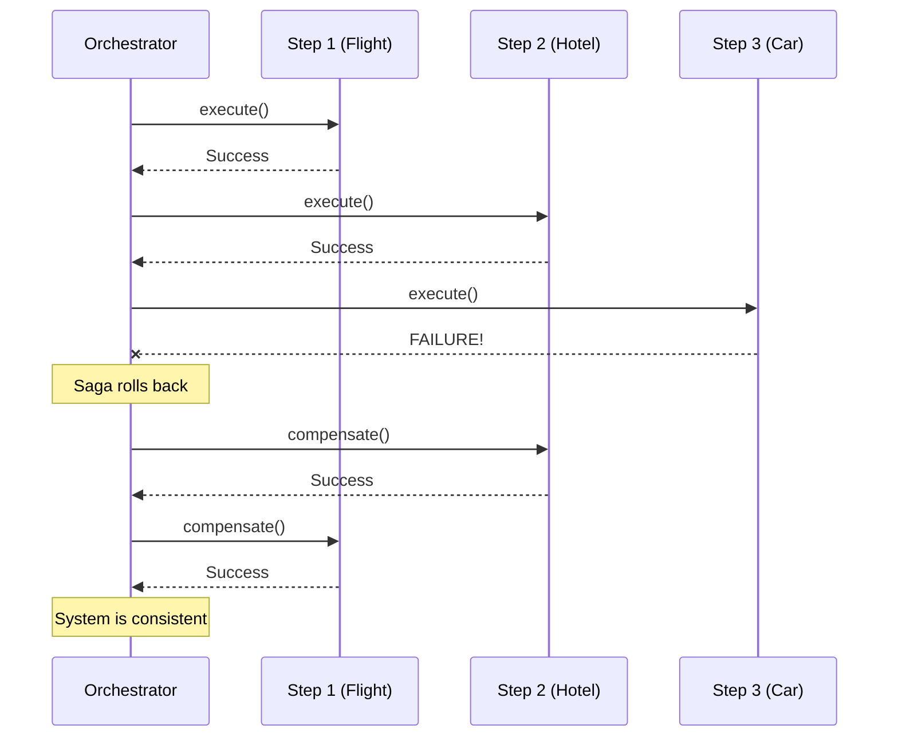

# Saga Pattern

## Overview

The Saga pattern is a failure management pattern that helps establish consistency in distributed applications, and coordinates transactions between multiple microservices. While primarily a backend concept, it is highly relevant to mobile engineering when building robust offline-first applications or when orchestrating complex, multi-step flows (like onboarding or checkout) that can fail partially.

## Why It Exists

In a monolithic database, if you need to deduct funds and ship an item, you use a Database Transaction (ACID). If the shipping step fails, the database automatically rolls back the funds deduction. 

In a distributed system (like a mobile app talking to 3 different backend services), there is no global transaction. If the app successfully deducts funds (API call 1) but crashes or loses network before it can request shipping (API call 2), the system is in an inconsistent state. The Saga pattern solves this by breaking the transaction into a sequence of local transactions, where each step has a corresponding "compensating action" to undo it if a subsequent step fails.

## Historical Context

First published in a 1987 paper by Hector Garcia-Molina and Kenneth Salem. It gained massive popularity recently as architectures shifted from Monoliths to Microservices. In mobile, its necessity grew as apps moved from being simple "dumb terminals" to intelligent clients coordinating multiple backend services directly.

## First Principles

1.  **No Distributed Transactions:** We accept that 2-Phase Commit (2PC) over a mobile network is impossible.
2.  **Sequence of Local Transactions:** A complex workflow is a series of isolated steps.
3.  **Compensating Transactions:** Every step `T(i)` that mutates state must have a corresponding compensating step `C(i)` that logically undoes it.
4.  **Forward or Backward Recovery:** If step 3 fails, we either execute `C(2)` and `C(1)` (Backward Recovery / Rollback), or we retry step 3 until it succeeds (Forward Recovery).

## Mental Model

Think of booking a vacation:
1. Book Flight. (Success)
2. Book Hotel. (Success)
3. Book Rental Car. (Fails - sold out!)

You cannot leave the system here. You don't need a flight and hotel if you have no car. 
The system executes the **compensating actions**:
1. Cancel Hotel (Compensates step 2)
2. Cancel Flight (Compensates step 1)

The system is returned to a consistent state (the user has nothing booked and hasn't paid).

## Internal Mechanics

There are two ways to coordinate a Saga:
1.  **Choreography:** Distributed decision making. Each service publishes an event, and the next service listens and reacts. (Common on the backend, rare on mobile).
2.  **Orchestration:** Centralized decision making. A single "Orchestrator" object commands the participants. (This is how it's done on Android).

### The Mobile Orchestrator Implementation

```kotlin
// The Steps
interface SagaStep {
    suspend fun execute()
    suspend fun compensate()
}

class BookFlightStep(private val api: FlightApi, private val req: FlightReq) : SagaStep {
    private var bookingId: String? = null
    
    override suspend fun execute() {
        bookingId = api.book(req)
    }
    
    override suspend fun compensate() {
        // If we successfully booked, we must cancel. 
        // Note: Compensating actions MUST be retried until they succeed.
        bookingId?.let { api.cancelBooking(it) } 
    }
}

// The Orchestrator
class VacationSagaOrchestrator(
    private val steps: List<SagaStep>
) {
    suspend fun runSaga(): SagaResult {
        val completedSteps = mutableListOf<SagaStep>()
        
        for (step in steps) {
            try {
                step.execute()
                completedSteps.add(step)
            } catch (e: Exception) {
                // A step failed. Rollback the completed steps in reverse order.
                rollback(completedSteps)
                return SagaResult.Failure(e)
            }
        }
        return SagaResult.Success
    }

    private suspend fun rollback(completedSteps: List<SagaStep>) {
        // Reverse order is critical. You cancel the hotel before the flight.
        for (step in completedSteps.reversed()) {
            try {
                // Wrap in retryWithBackoff. Compensations cannot be allowed to fail.
                retryWithBackoff { step.compensate() }
            } catch (fatal: Exception) {
                // If compensation permanently fails, the system requires manual intervention.
                logCritical("SAGA LEAK: Failed to compensate ${step.javaClass.simpleName}", fatal)
            }
        }
    }
}
```

## Architecture



## Production Example

**Multi-step Photo Upload with Metadata.**
A user takes a photo, adds filters, tags friends, and hits "Post".
The mobile client orchestrates the process:
1.  **Step 1:** Upload raw image bytes to an S3 bucket. (Returns an S3 URL).
2.  **Step 2:** Call the Vision API to run moderation checks on the S3 URL. (Success).
3.  **Step 3:** Call the Social API to create the Post object linking the S3 URL and tagged friends. (Fails - network drops).

If the client just stops, there is a massive unreferenced image file sitting in an S3 bucket costing the company money (an inconsistent state).
The Saga's compensating action for Step 1 is to `DELETE` the object from S3. 

*(Note: In reality, backend garbage collection is better for cleaning up orphaned S3 blobs, but this illustrates the mobile orchestration responsibility).*

## Android Example

A complex onboarding flow.
1. Create user account.
2. Accept terms of service.
3. Link credit card.

If the user force-closes the app during step 3, the orchestrator (usually backed by `WorkManager` or a persistent Room database queue) must resume the saga upon restart. It sees Step 1 and 2 are complete, and resumes Forward Recovery (prompting the user for the credit card again) rather than rolling back.

## Tradeoffs

**Advantages**
- **Data Consistency:** Prevents orphaned records, leaked money, and corrupted state in distributed systems.
- **Clear Flow:** Centralizes the complex error handling of multi-stage processes into a single Orchestrator.

**Disadvantages**
- **Complexity:** Requires writing two methods (`execute` and `compensate`) for every single action.
- **Compensating Failure:** If a compensating action fails permanently (e.g., the backend refund API goes down forever), the system is stuck in an inconsistent state requiring human intervention.
- **Lack of Isolation:** While a Saga is running, intermediate states are visible to other systems. (E.g., if Flight is booked, but Hotel isn't yet, the user's flight is genuinely booked and visible in the airline's system until the Saga rolls it back).

## Failure Modes

- **Non-Idempotent Compensations:** Compensating actions MUST be idempotent. If rolling back involves "Refund $10", and the network drops during the refund, the orchestrator will retry. If it's not idempotent, the user gets $20 back. See [`../distributed-systems/idempotency.md`](../distributed-systems/idempotency.md).
- **In-Memory Orchestrators for Long Sagas:** If your Saga takes 5 minutes, and your Orchestrator is just a Coroutine in a `ViewModel`, the OS will likely kill your app process before it finishes. The Saga state and the execution history must be persisted to disk (Room/WorkManager) so it can resume after process death.
- **Ignoring Forward Recovery:** Not all failures require rollback. If a network drops, the best action is usually to pause the Saga and resume it later (Forward Recovery), rather than immediately rolling back the entire complex process.

## Staff Engineer Thinking

When reviewing a multi-step API process, a Staff engineer asks:

1.  **What happens if the phone dies between step 2 and 3?** If the answer is "the system is permanently broken," a Saga or an atomic backend endpoint is required.
2.  **Is the client the right place for this?** If the mobile app is making 4 sequential API calls to 4 different microservices, we are creating a Chatty Client. The ideal solution is often a Backend-For-Frontend (BFF) that exposes a single atomic endpoint to the mobile app, and runs the Saga on the backend.
3.  **Are the compensations semantic?** Undoing an action isn't always a database `DELETE`. If a user is sent a welcome email (Step 1) and then fails payment (Step 2), you can't "un-send" the email. The semantic compensation is sending a follow-up email: "Sorry, your payment failed."

## Common Misconceptions

- **"Sagas are just two-phase commits."** No. 2PC locks resources across databases until everyone agrees. Sagas do not lock. They execute real transactions sequentially and use real transactions to undo them.
- **"It's only for the backend."** While the backend owns data, the mobile client often owns the *user intent*. If the client is orchestrating multiple backend endpoints to fulfill one user intent, the client is running a Saga.

## Probing Questions

1.  Explain the difference between Forward Recovery and Backward Recovery in a Saga.
2.  Why is the Saga pattern necessary in a microservices architecture?
3.  Describe a scenario where a compensating action might fail permanently. How do you handle this?
4.  Why must compensating actions be idempotent? Give a concrete example of what happens if they aren't.
5.  What is the difference between Orchestration and Choreography in the context of Sagas? Which is more appropriate for a mobile client?
6.  How does the lack of Isolation (the 'I' in ACID) in a Saga affect the user experience during a long-running transaction?
7.  If a mobile app needs to run a Saga, what tools (e.g., WorkManager, Room, Coroutines) would you use to ensure it survives process death?
8.  Why might a Staff engineer suggest moving a Saga from the mobile client to a Backend-For-Frontend (BFF)?
9.  Explain the semantic compensation required if a step in your Saga involves sending an SMS message to the user.
10. How do you test a Saga Orchestrator to ensure it correctly rolls back steps in the reverse order of execution?

## Further Reading

- [`circuit-breaker.md`](circuit-breaker.md) and [`retry.md`](retry.md) — Sagas heavily rely on these to execute individual steps robustly.
- [`../distributed-systems/idempotency.md`](../distributed-systems/idempotency.md) — Mandatory for understanding compensating transactions.
- [`../backend-for-mobile/bff-pattern.md`](../backend-for-mobile/bff-pattern.md) — The architectural alternative to running Sagas on the client.
- Chris Richardson: [Saga Pattern](https://microservices.io/patterns/data/saga.html)
