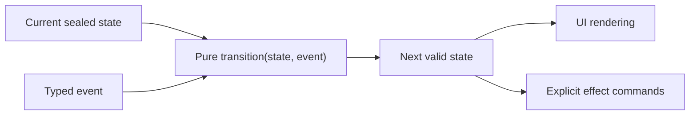

# State Pattern

> The State pattern allows an object to alter its behavior when its internal state changes. The object will appear to change its class. In modern Android, we don't build State by hand-wiring interfaces like the Gang of Four book suggests. Instead, we use Kotlin's **Sealed Classes and Interfaces** coupled with the `when` expression to build exhaustive state machines. A Staff engineer uses this pattern to guarantee the UI cannot enter an invalid state (e.g., showing a loading spinner and an error message simultaneously), a principle known as "Making Invalid States Impossible."

---

## Overview



Legal transitions remain explicit: rendering depends on state, while effects are commands rather than hidden UI mutations.

In traditional object-oriented programming, the State pattern is implemented by extracting state-specific behavior into separate classes that implement a common interface. The context object delegates execution to the current state object.

In Android, UI logic is notoriously complex. A screen might be Loading, Empty, Populated, Error, or Refreshing. If you model this with multiple boolean flags (`isLoading`, `hasError`, `data != null`), you create a combinatorial explosion of potential states. The State pattern, powered by algebraic data types (sealed classes), collapses this complexity.

---

## 1. The Classic vs. Modern Android Implementation

### The "Gang of Four" Approach (Java-style)
```java
// State interface
interface PlayerState {
    void play();
    void pause();
}

// Concrete states
class PlayingState implements PlayerState {
    private AudioPlayer player;
    public void play() { /* already playing */ }
    public void pause() { player.setState(new PausedState(player)); }
}

class PausedState implements PlayerState {
    private AudioPlayer player;
    public void play() { player.setState(new PlayingState(player)); }
    public void pause() { /* already paused */ }
}
```
This is overly verbose and spreads the business logic across dozens of files.

### The Modern Android Approach (Kotlin Sealed Classes)

Kotlin provides `sealed class` and `sealed interface`, which restrict class hierarchies. All subclasses must be defined in the same package (or file, prior to Kotlin 1.5). This allows the compiler to enforce exhaustive checks.

```kotlin
// The State Definition
sealed interface UiState {
    data object Loading : UiState
    data class Content(val users: List<User>) : UiState
    data class Error(val message: String, val canRetry: Boolean) : UiState
    data object Empty : UiState
}

// The Context (ViewModel)
class UserViewModel : ViewModel() {
    private val _state = MutableStateFlow<UiState>(UiState.Loading)
    val state: StateFlow<UiState> = _state.asStateFlow()

    fun loadData() {
        _state.value = UiState.Loading
        try {
            val data = repository.getUsers()
            _state.value = if (data.isEmpty()) UiState.Empty else UiState.Content(data)
        } catch (e: Exception) {
            _state.value = UiState.Error(e.message ?: "Unknown", canRetry = true)
        }
    }
}
```

### The Consumer (UI Layer)
In the View or Compose layer, you consume the state using an exhaustive `when` statement.

```kotlin
@Composable
fun UserScreen(viewModel: UserViewModel) {
    val state by viewModel.state.collectAsStateWithLifecycle()

    // The compiler forces you to handle ALL states.
    // If you add a 'Refreshing' state later, this code will fail to compile
    // until you explicitly handle it.
    when (val currentState = state) {
        is UiState.Loading -> LoadingSpinner()
        is UiState.Content -> UserList(currentState.users)
        is UiState.Empty -> EmptyStateView()
        is UiState.Error -> ErrorView(currentState.message, currentState.canRetry)
    }
}
```

---

## 2. Core Android Example 1: Model-View-Intent (MVI) Reducers

The State pattern is the foundation of the MVI architecture. In MVI, the UI emits Intents (Actions), which are processed by a reducer function to generate a brand new State object.

Instead of mutating individual properties, the State transitions entirely from State A to State B.

```kotlin
// The Actions (Transitions)
sealed interface UserAction {
    data object RefreshClicked : UserAction
    data class UserDeleted(val userId: String) : UserAction
}

// The Reducer (State Machine Logic)
fun reduce(currentState: UiState, action: UserAction): UiState {
    return when (currentState) {
        is UiState.Content -> {
            when (action) {
                is UserAction.RefreshClicked -> UiState.Loading
                is UserAction.UserDeleted -> {
                    val newList = currentState.users.filter { it.id != action.userId }
                    if (newList.isEmpty()) UiState.Empty else currentState.copy(users = newList)
                }
            }
        }
        is UiState.Error -> {
            when (action) {
                is UserAction.RefreshClicked -> UiState.Loading
                else -> currentState // Ignore delete actions if we are in an error state
            }
        }
        else -> currentState
    }
}
```
This centralizes the State transition logic. The reducer is a pure function, making it incredibly easy to unit test.

---

## 3. Core Android Example 2: ExoPlayer / Media Player States

Hardware or system-level components often have rigid, irreversible state transitions. The Android `MediaPlayer` and `ExoPlayer` are classic implementations of the State pattern.

ExoPlayer exposes states like:
- `STATE_IDLE`
- `STATE_BUFFERING`
- `STATE_READY`
- `STATE_ENDED`

You must query or observe this state to update your Play/Pause buttons.

```kotlin
player.addListener(object : Player.Listener {
    override fun onPlaybackStateChanged(playbackState: Int) {
        when (playbackState) {
            Player.STATE_BUFFERING -> showLoading()
            Player.STATE_READY -> hideLoadingAndShowControls()
            Player.STATE_ENDED -> showReplayButton()
        }
    }
})
```

---

## 4. Making Invalid States Impossible

A Staff engineer uses the State pattern to physically prevent bugs at compile time.

**Bad Approach (Combinatorial Explosion):**
```kotlin
data class BrokenUiState(
    val isLoading: Boolean = false,
    val data: List<User>? = null,
    val errorMessage: String? = null
)
```
In this model, `BrokenUiState(isLoading = true, data = listOf(user), errorMessage = "Failed")` is technically possible. The UI layer has to write complex `if/else` logic to figure out what to display. "Do I show the loading spinner if there is data but also an error?"

**Good Approach (State Pattern / Sealed Classes):**
By using `UiState.Loading`, `UiState.Content`, etc., the states are mutually exclusive. It is physically impossible to construct an object that is both Loading and an Error simultaneously.

*Note: If you need a "Refreshing" state (where old data is shown while a spinner spins), you explicitly model it: `data class Refreshing(val oldData: List<User>) : UiState`.*

---

## 5. Failure Modes & Tradeoffs

| Failure Mode | Cause | Prevention / Solution |
|---|---|---|
| **Lost UI Events** | Modeling one-time events (like a Toast or Navigation) inside a continuous State object. When the screen rotates, the state is re-emitted, and the Toast shows again. | Separate continuous State (`StateFlow`) from one-time Events (`SharedFlow` or `Channel`). |
| **State Bloat** | Putting everything into a single massive sealed class, causing unrelated UI components (like a bottom sheet and a header) to recompose when the other changes. | Split states by component. The header can have its own `HeaderState` and the list its own `ListState`. |
| **Non-Exhaustive Checks** | Casting the sealed class to a specific type instead of using `when`, or using an `else` branch in the `when` block. | **Never use `else` with sealed classes.** Let the compiler force you to handle new states when you add them. |
| **Fat Reducers** | Putting heavy I/O or repository calls inside the state reducer function. | Reducers must be pure synchronous functions. Handle side effects (API calls) outside the reducer, and pass the *result* of the API call into the reducer as a new Action. |

---

## 6. Common Pitfalls

### Pitfall 1: Mutating State Directly
In Kotlin, you should prefer immutable data classes within your sealed classes. If your state is `data class Content(var users: MutableList<User>)`, an observer might mutate the list directly without updating the `StateFlow`. Jetpack Compose will not detect this change, and the UI will not recompose.
*Fix:* Always use `val` and immutable `List`. Use the `.copy()` method to generate a brand new state object.

### Pitfall 2: Too Granular States
Creating states for every single UI widget (`ButtonEnabledState`, `TextColorState`).
*Fix:* The State pattern should model the logical state of the domain or the screen as a whole, not individual pixel properties. Map the logical state (e.g. `FormState.Invalid`) to UI properties (button disabled) at the view layer.

---

## Probing Questions

1.  **Compose Recomposition:** How does Jetpack Compose use Kotlin's structural equality (`==`) to determine if a new State object emitted by a `StateFlow` should trigger a recomposition? What happens if you emit a new object that is functionally identical to the old one?
2.  **MVI vs MVVM:** In traditional MVVM, a ViewModel might have `val isLoading = MutableLiveData<Boolean>()` and `val data = MutableLiveData<List<User>>()`. In MVI, everything is bundled into a single `StateFlow<UiState>`. What specific race conditions does the MVI State pattern solve that multiple LiveDatas cannot?
3.  **Sealed Interfaces vs Classes:** Kotlin introduced `sealed interface`. When would you use a `sealed interface` over a `sealed class` for modeling Android UI state? Does it affect exhaustive `when` blocks?
4.  **Handling Partial Failures:** You have a screen that shows a list of users and a user's profile image. The user list loads successfully, but the profile image API call fails. Design the sealed class hierarchy to represent this "Partial Success" state without losing the user list data.
5.  **Side Effects:** In a strict State Machine (like the classic pattern or Redux/MVI), where do Side Effects (like saving to a database or firing analytics) happen? Do they happen inside the State transition, before it, or after it?

## Answer Key

1. **Compose Recomposition:** Compose uses structural equality (`==`) to check if state changed. If you emit a functionally identical object, it skips recomposition.
2. **MVI vs MVVM:** MVI solves race conditions of observing multiple LiveDatas where one updates before the other (e.g. data loaded but isLoading still true for a frame). MVI provides a single atomic update.
3. **Sealed Interfaces vs Classes:** Sealed interfaces are used when state doesn't need to hold state/constructor parameters in the base class, or if an object needs to implement multiple sealed states. Exhaustive `when` blocks work identically for both.
4. **Handling Partial Failures:** `data class Content(val users: List<User>, val profileImageError: Boolean = false) : UiState` allows showing the list while indicating the image failed, preventing the entire screen from dropping into an Error state.
5. **Side Effects:** Side effects happen *outside* the pure state reducer (usually before generating an action or as a reaction to a specific effect stream). Reducers must remain pure functions to guarantee testability and predictable transitions.

## Further Reading

- [`../android/architecture/state-management.md`](../android/architecture/state-management.md) — Deep dive into Compose state, `remember`, and ViewModel state hoisting.
- [`../android/architecture/mvvm-vs-mvi.md`](../android/architecture/mvvm-vs-mvi.md) — Detailed comparison of separated streams (MVVM) vs. single state reducers (MVI).
- [`../kotlin/language-core/sealed-classes.md`](../kotlin/language-core/sealed-classes.md) — The language mechanics of exhaustive checking and memory layout.
