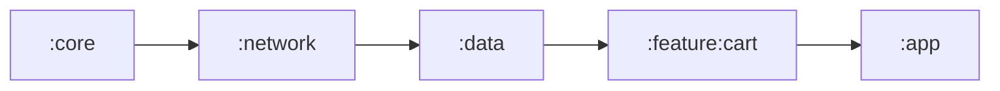
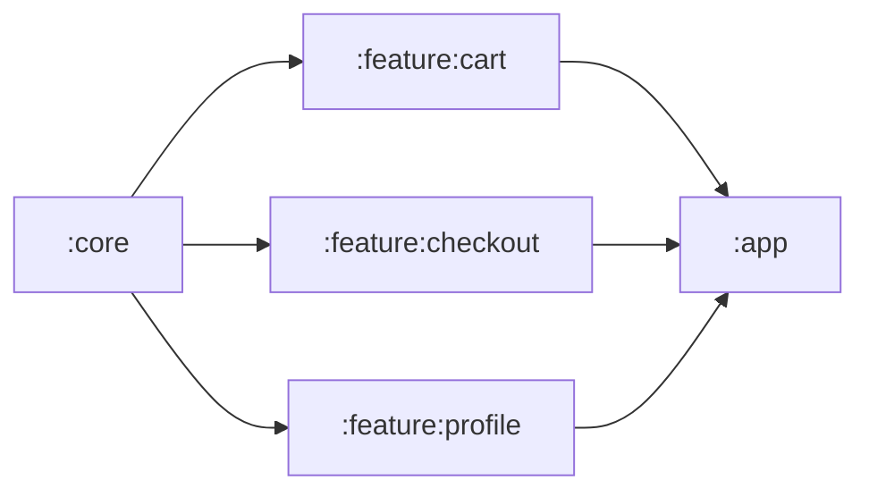

# Platform Engineering: Build Graph Scaling & Profiling

> A 10-minute local build caps an engineer at 6 compiles per hour. If sixty engineers each wait on six 10-minute builds a day, that is 60 × 6 × 10 min = 60 engineer-hours of waiting per day. The build graph is the single highest-leverage system a Platform Engineer owns: every second cut compounds across every engineer for every commit forever.

---

## Mental Model: The Build Is a Distributed System

Gradle is a JVM program that:

1. **Initializes** the build: reads `settings.gradle.kts` to find the projects and included builds that participate (the "initialization phase").
2. **Configures** those projects' `build.gradle.kts` files, registers their tasks, and builds the task graph — a Directed Acyclic Graph (DAG) whose edges include the dependencies between modules (the "configuration phase").
3. **Executes** the task graph, scheduling tasks onto worker threads, respecting dependencies, and reusing outputs from caches.

Think of it as a small distributed scheduler running on your laptop. Like any scheduler, three things kill it:

- **Serial bottlenecks** — narrow points in the DAG where 15 cores idle waiting on 1.
- **Cache invalidation** — work redone because the cache key is non-deterministic.
- **Lock contention** — the configuration phase, annotation processors, and synchronous I/O on the Gradle daemon thread.

The Platform Engineer's job: reshape the graph, harden the cache keys, and remove the locks.

---

## The Build Graph (DAG) Bottleneck

If module `C` depends on `B` and `B` depends on `A`, Gradle compiles `A → B → C` strictly serially. A 16-core MacBook sits 15-cores idle. The graph's **critical path** (the longest dependency chain) is the floor on build time, no matter how parallel the rest is.

### Bad shape — deep chain



Critical path: 5. Changing `:core` triggers rebuilds of everything downstream, one at a time.

### Good shape — wide fan-out from a thin core



Critical path: 3. All three features can compile in parallel on three cores once parallel execution is on (`org.gradle.parallel=true`, or the configuration cache, which runs tasks in parallel by default). The Platform team's job is to keep `:core` thin (interfaces, no implementation) and push behavior down into peer feature modules.

### Diagnose the graph

```bash
./gradlew :app:dependencies --configuration releaseRuntimeClasspath
./gradlew generateProjectDependencyGraph   # via the dependency-graph-generator plugin
./gradlew :app:buildEnvironment            # build-script (plugin) classpath
```

For a visual graph, the [`dependency-graph-generator`](https://github.com/vanniktech/gradle-dependency-graph-generator-plugin) plugin writes the module graph as DOT, PNG and SVG files under `build/reports/project-dependency-graph/`; attach the image to a PR description when proposing a refactor.

---

## `api` vs `implementation` — The Single Highest-Leverage Knob

```kotlin
// :feature:cart/build.gradle.kts
dependencies {
    api(project(":core"))            // BAD unless :core types appear in :feature:cart's public API
    implementation(project(":network")) // GOOD: :network is an internal detail
}
```

The distinction:

- **`api`** — the dependency is exposed to consumers: it lands on the compile classpath of anyone who depends on `:feature:cart`, so they transitively see `:core`'s types. A change to `:core`'s public API forces a recompile of every consumer that has it on its compile classpath.
- **`implementation`** — the dependency is hidden inside the module and stays off consumers' compile classpath. A change to `:network` recompiles `:feature:cart`; `:app` recompiles only if `:feature:cart`'s own ABI changes.

The default should be `implementation`. `api` is a deliberate ABI commitment. Catch leaks with:

```kotlin
// settings.gradle.kts — the settings-level plugin ID is build-health
plugins {
    id("com.autonomousapps.build-health") version "3.20.2"
}
// ./gradlew buildHealth
```

The Dependency Analysis plugin flags every `api` usage that should be `implementation`, unused dependencies, and every transitive dep that should be declared directly. If the project uses Kotlin or Android, those plugins must also be on the settings classloader. Run it in CI and make violations fail with `dependencyAnalysis { issues { all { onAny { severity("fail") } } } }` in the root build script.

---

## Module Type Taxonomy

Codify four module shapes so engineers don't invent their own:

| Type | Contents | Depends on | Depended on by |
|---|---|---|---|
| `:core:*` | Pure-Kotlin types, no Android. | Nothing. | Anyone. |
| `:feature:*:api` | Interfaces + DTOs the feature exposes. | `:core:*`. | `:app`, peer features. |
| `:feature:*:impl` | Implementation. Not visible to peers. | Its own `:api`, `:core:*`. | `:app` only. |
| `:app` | The Application class, DI wiring. | Every `:feature:*:api` + `:feature:*:impl`. | Nothing. |

Result: changing `:feature:cart:impl` only rebuilds `:feature:cart:impl` + `:app`. The other features are untouched because they only see `:feature:cart:api`.

---

## The Convention Plugin Pattern

Stop copy-pasting `build.gradle.kts`. Centralize all common config in a `build-logic/` composite build.

```
build-logic/
  convention/
    src/main/kotlin/
      AndroidLibraryConventionPlugin.kt
      AndroidFeatureConventionPlugin.kt
      JvmLibraryConventionPlugin.kt
    build.gradle.kts
  settings.gradle.kts
```

```kotlin
// build-logic/convention/src/main/kotlin/AndroidLibraryConventionPlugin.kt
class AndroidLibraryConventionPlugin : Plugin<Project> {
    override fun apply(target: Project) = with(target) {
        with(pluginManager) {
            apply("com.android.library")
            // AGP 9+ supplies built-in Kotlin for Android modules.
        }
        extensions.configure<LibraryExtension> {
            compileSdk = 36
            defaultConfig.minSdk = 26
            compileOptions {
                sourceCompatibility = JavaVersion.VERSION_17
                targetCompatibility = JavaVersion.VERSION_17
            }
        }
        // kotlinOptions {} is an error since Kotlin 2.2; use compilerOptions/the kotlin extension.
        // With built-in Kotlin, jvmTarget defaults to compileOptions.targetCompatibility.
        extensions.configure<KotlinAndroidProjectExtension> {
            explicitApi()   // strict mode, same as -Xexplicit-api=strict
        }
    }
}
```

Each feature module then becomes a one-liner:

```kotlin
// :feature:cart/build.gradle.kts
plugins {
    id("yourorg.android.library")
    id("yourorg.android.feature")
}
```

Benefit: upgrading the Kotlin compiler, AGP, or `compileSdk` is a one-file PR in `build-logic/`, not a 200-module sweep.

---

## Build Cache: Local + Remote

```kotlin
// settings.gradle.kts
buildCache {
    local { isEnabled = true; directory = File(rootDir, "build-cache") }
    remote<HttpBuildCache> {
        url = uri("https://gradle-cache.yourorg.internal/cache/")
        isPush = System.getenv("CI") == "true"   // only CI pushes; devs pull
        credentials {
            username = providers.gradleProperty("cacheUser").orNull
            password = providers.gradleProperty("cachePassword").orNull
        }
    }
}
```

The mental model: CI computes the cache; engineers download from it.

- CI builds `main` → uploads `:feature:cart` output keyed by hash of inputs.
- Engineer pulls `main`, runs build → local Gradle hashes the same inputs, finds the entry, downloads pre-compiled bytecode.
- On a full cache hit, a 10-minute clean build shrinks to configuration, download time and whatever tasks are not cacheable.

### Cache key fragility

The cache hits depend on the inputs hashing identically across machines. Common breakers:

- **Absolute paths in task inputs or generated code.** Declare path sensitivity on custom task inputs (`@PathSensitive(PathSensitivity.RELATIVE)`), and upgrade or report any processor or plugin that writes machine-specific paths into its outputs.
- **Timestamps in build outputs.** Since Gradle 9, archive tasks (`Jar`, `Zip`, …) produce reproducible archives by default (fixed file order and timestamps); on Gradle 8 set `isPreserveFileTimestamps = false` and `isReproducibleFileOrder = true`. Keep timestamps out of `base { archivesName }` and generated sources (`archivesBaseName` was removed in Gradle 9).
- **`Locale` / time-zone differences.** Force `LC_ALL=C.UTF-8` and `TZ=UTC` in CI.
- **Hostname / username** anywhere in outputs.

Track hit rate per task in Develocity (Gradle Enterprise) and gate the build-logic upgrade if hit rate drops below 80%.

---

## Configuration Cache

The configuration cache has been stable since Gradle 8.1, and Gradle 9 makes it the preferred (not yet default) mode of execution.

```properties
# gradle.properties
org.gradle.configuration-cache=true
# Incubating: stores cache entries in parallel (loading is always parallel)
org.gradle.configuration-cache.parallel=true
```

What it does: serializes the configured task graph to disk. On the next build, if nothing about the configuration changed, Gradle skips configuration entirely and jumps to execution. It also lets tasks run in parallel, even within the same project. The saving is roughly your configuration time per build; measure it with a build scan rather than assuming a number.

What breaks it:

- Tasks reading `project.foo` during execution.
- Plugins capturing `Project` references in task action closures.

What invalidates it: environment variables, system properties and files read at configuration time become cache inputs, so a value that changes on every build (a timestamp, a CI build number) forces reconfiguration every time. Read such values through `providers.environmentVariable()` wired into a task property, so they resolve at execution time instead.

```kotlin
// BAD — captures `project` at execution time
tasks.register("printVersion") {
    doLast { println(project.version) }  // CC violation
}

// GOOD — capture the value at configuration time
tasks.register("printVersion") {
    val version = project.version.toString()
    doLast { println(version) }
}
```

Run `./gradlew --configuration-cache <task>` and read the HTML report at `build/reports/configuration-cache/`. Every problem listed is a violation to fix or a plugin to upgrade.

---

## Build Profiling: `--scan` and Develocity

```bash
./gradlew assembleRelease --scan
```

A scan uploads detailed timing to `scans.gradle.com` (or self-hosted Develocity) and prints a URL. Read it like a flame graph. Key tabs:

| Tab | What to read |
|---|---|
| Timeline | Critical-path tasks; gaps between them = serial bottlenecks |
| Performance > Build cache | Per-task cache hit rate; misses are revenue left on the table |
| Performance > Configuration | Slow plugins; misuse of `afterEvaluate` |
| Performance > Network activity | Slow remote-cache hits, dependency download time |
| Plugins | Plugin versions across the build — surface stragglers |

### Things to escalate on

- **GC time > 10% of build wall time** → bump `org.gradle.jvmargs=-Xmx8g -XX:+UseG1GC`.
- **Configuration phase > 15 sec** → bad plugin doing I/O at configuration time.
- **Cache hit rate < 80%** → cache key fragility somewhere; bisect.
- **One task dominates the critical path** → split that module; or move its work to a pre-built artifact.

---

## KAPT → KSP Migration

KAPT (Kotlin Annotation Processing Tool) generates Java stubs from Kotlin sources and then runs Java annotation processors over them. The stub step is extra work on every processed module; measure its cost in your own build scans.

KSP (Kotlin Symbol Processing) analyzes Kotlin directly; Android's migration guide says it is up to 2× faster than KAPT.

Migration cheat sheet:

| Annotation processor | KSP support |
|---|---|
| Hilt | Stable with Dagger/Hilt 2.60+ and KSP 2.3.9+ |
| Room | Since Room 2.3.0 (experimental at first) |
| Moshi | KSP since 1.13 (`moshi-kotlin-codegen`) |
| Glide | `com.github.bumptech.glide:ksp` (no generated `GlideApp` API), or Coil 3 |
| Dagger (non-Hilt) | Stable with Dagger 2.60+ and KSP 2.3.9+ (dagger-compiler) |

```toml
# gradle/libs.versions.toml
[plugins]
ksp = { id = "com.google.devtools.ksp", version = "2.3.12" }   # KSP2 versions no longer encode the Kotlin version
hilt = { id = "com.google.dagger.hilt.android", version = "2.60.1" }
```

```kotlin
// :feature:cart/build.gradle.kts
plugins {
    id("yourorg.android.library")
    alias(libs.plugins.ksp)
    alias(libs.plugins.hilt)
}
dependencies {
    implementation(libs.hilt.android)
    ksp(libs.hilt.compiler)   // not kapt(...)
    implementation(libs.room.runtime)
    ksp(libs.room.compiler)
}
```

Measure before and after with `--scan` and present the win to leadership in build minutes saved per week.

---

## Worker Daemons, Parallelism, and Memory

```properties
# gradle.properties
org.gradle.parallel=true
org.gradle.workers.max=8
org.gradle.daemon=true
org.gradle.caching=true
org.gradle.jvmargs=-Xmx8g -XX:+UseG1GC -XX:MaxMetaspaceSize=1g -Dfile.encoding=UTF-8
kotlin.daemon.jvmargs=-Xmx4g
```

Rules of thumb:

- `workers.max` defaults to the number of CPU processors. Set it explicitly only when you have measured a reason, such as memory pressure on CI runners.
- `-Xmx` high enough that GC time < 5% of build time. Too high and you waste RAM that should go to the IDE; too low and GC dominates.
- Kotlin daemon gets its own heap — tune separately.

---

## Failure Modes (Real-World Build Regressions)

| Symptom | Likely cause | Fix |
|---|---|---|
| CI 3× slower than local | No remote cache push, or it's network-blocked | Verify `isPush = CI`, check cache server logs |
| Cache hit rate dropped overnight | A compiler or plugin upgrade changed the plugin classpath in every affected task's cache key (expected misses until CI repopulates the cache), or a new plugin embeds paths | If misses persist after CI has rebuilt `main`, bisect the plugin list; `--scan` cache report |
| `Configuration cache problems found` | Plugin reads project state at execution | Upgrade plugin, or quarantine the task |
| Random "duplicate class" errors | The same classes arrive through two artifacts (a library that bundles another you also declare, or local and remote copies of one library) | `./gradlew :app:dependencies` → remove the duplicate artifact or `exclude` it |
| OOM on CI but not locally | CI runner has less RAM | Tune `org.gradle.jvmargs` per env via `~/.gradle/gradle.properties` baked into the image |
| One module takes 90s to compile | Generated code blow-up (R class, Hilt, Room) | Split the module, or check generated-source size |
| `Daemon will be stopped at the end of the build` | Daemon OOM or sysprop mismatch | Increase `-Xmx`; standardize JVM across team |

---

## What "Done" Looks Like for a Build Platform Team

- Local clean build: under 3 minutes on a baseline laptop spec.
- Local incremental (one feature module change): under 30 seconds.
- CI build (full): under 12 minutes; under 6 with warm cache.
- Cache hit rate on `main`: > 85%.
- Configuration cache: enabled, zero violations.
- KAPT: zero modules (all on KSP).
- Build scans: published from every CI run; reviewed weekly.

Track these as SLOs in a dashboard. Regress any of them and the whole org feels it.

### Critical-path ownership

Every slow build has a longest path. Assign owners to that path the same way you assign owners to production services.

| Signal | Owner | Action |
|---|---|---|
| A module appears in the top 5 critical-path tasks for 2 weeks | Module owner + build platform | Split implementation, reduce generated code, or prebuild artifact |
| `:core` change rebuilds most of the app | Architecture/platform owner | Move business logic out; enforce `api` surface review |
| KAPT remains in a module | Module owner | Migrate to KSP or document blocking processor |
| Cache hit rate drops below 80% | Build platform | Bisect plugin/task inputs and block rollout of offending change |
| Configuration phase regresses by > 10% | Build platform | Profile plugins and remove configuration-time I/O |

The rule is simple: if a module taxes every engineer's build, the module owner owes the org a remediation plan. Build performance is shared infrastructure, not a local implementation detail.

---

## Common Pitfalls

- **Engineers add `api` "to make compile errors go away."** Add a CI check (Dependency Analysis plugin) that fails the build on new `api` usages.
- **The `:core` module becomes the new monolith.** Anything anyone needs ends up there, so every change rebuilds the world. Enforce a "no business logic in `:core`" rule and split aggressively.
- **Gradle version drift.** `./gradlew` always runs the version pinned in `gradle-wrapper.properties`, so drift comes from engineers or IDE settings invoking a locally installed `gradle` instead. Use the wrapper everywhere, and validate the wrapper JAR in CI (for example with Gradle's wrapper-validation GitHub Action).
- **`./gradlew clean` culture.** "Try clean build first" is a sign cache invalidation is broken. Fix the root cause; don't paper over it with `clean`.
- **Treating build perf as one engineer's hobby project.** Stand up a Build Platform sub-team with a real headcount. The savings are real engineering hours.

---

## Probing Questions

1. Your build takes 11 minutes locally. Walk through the first 30 minutes of investigation.
2. What's the difference between `api` and `implementation` at the bytecode level? Why does ABI matter for incremental builds?
3. The remote cache hit rate dropped from 90% to 40% after a Kotlin compiler upgrade. What's the most likely cause?
4. You enabled configuration caching and 12 plugins broke. How do you prioritize fixing them?
5. A feature team wants to add a 1.2 GB AAR dependency. What questions do you ask before approving?
6. You have a 5-minute configuration phase. What are the three highest-yield places to look?
7. KAPT vs KSP — what does the migration cost, and what does it return?
8. How do you convince a skeptical Director that 2 engineers on a Build Platform team will pay back in 6 months?

---

## Answer Key

1. **Your build takes 11 minutes locally. Walk through the first 30 minutes of investigation.**
   Run `./gradlew assembleDebug --scan`. Open the build scan and check the "Timeline" to identify critical-path bottlenecks. Check "Performance" for configuration time, cache hit rate, and garbage collection time. Look for KAPT tasks and non-incremental tasks.
2. **What's the difference between `api` and `implementation` at the bytecode level? Why does ABI matter for incremental builds?**
   There is no bytecode difference: `api` and `implementation` are Gradle configurations, not compiler output. They decide whether the dependency is exposed on consumers' compile classpath (`api`) or kept on the runtime classpath only (`implementation`). Gradle's compile avoidance recompiles a consumer only when the ABI (Application Binary Interface) of something on its compile classpath changes. With `api`, a dependency's ABI change ripples to every consumer; with `implementation`, it recompiles only the module that declares it, unless that module's own ABI changes.
3. **The remote cache hit rate dropped from 90% to 40% after a Kotlin compiler upgrade. What's the most likely cause?**
   A task's type and its plugin classpath are part of its cache key, so a new Kotlin Gradle plugin version gives every Kotlin compile task a new key and misses until CI has populated the cache for the new version; the new compiler's output then changes downstream keys too. If the hit rate stays low after CI has rebuilt `main`, look for machines still on the old version or a plugin embedding non-deterministic data (absolute paths, timestamps).
4. **You enabled configuration caching and 12 plugins broke. How do you prioritize fixing them?**
   Sort by impact: fix custom internal plugins first since you control them. For third-party plugins, check for updates; if unsupported, isolate their tasks or replace them. Prioritize plugins that block the primary `assembleDebug` flow over reporting or publishing plugins.
5. **A feature team wants to add a 1.2 GB AAR dependency. What questions do you ask before approving?**
   What is the impact on APK size, Dex count, and startup time? Does it contain native libraries for all ABIs? Does it slow down build times or break caching? Is there a lighter alternative?
6. **You have a 5-minute configuration phase. What are the three highest-yield places to look?**
   1. Network/Disk I/O during configuration (e.g., fetching git hashes or parsing large files). 2. Heavy logic in `afterEvaluate` blocks. 3. Plugins resolving dependencies prematurely during configuration instead of execution.
7. **KAPT vs KSP — what does the migration cost, and what does it return?**
   Cost: Updating processor dependencies, changing Gradle configurations, and potentially refactoring custom annotations. Return: Eliminates Java stubs generation, supports incremental processing natively, and can make annotation processing up to 2x faster; measure the actual saving with before-and-after build scans.
8. **How do you convince a skeptical Director that 2 engineers on a Build Platform team will pay back in 6 months?**
   Quantify the waste: (Engineers) × (Builds/day) × (Minutes saved/build) × (Loaded hourly rate). If cutting 2 minutes saves 50 engineers 20 minutes a day, that translates to thousands of engineering hours saved annually, far exceeding the cost of two headcount.

## Further Reading

- [`internal-developer-platforms.md`](internal-developer-platforms.md) — convention plugins as platform.
- [`library-versioning.md`](library-versioning.md) — `libs.versions.toml` and BoM.
- [`../android/architecture/modularization-strategies.md`](../android/architecture/modularization-strategies.md) — module taxonomy in depth.
- [`../android/performance/app-size-and-r8.md`](../android/performance/app-size-and-r8.md) — R8 / D8 / minification at build time.
- [Gradle — Performance Guide](https://docs.gradle.org/current/userguide/performance.html) — official tuning reference.
- [Gradle — Configuration Cache](https://docs.gradle.org/current/userguide/configuration_cache.html) — full mechanics and constraints.
- [Develocity (formerly Gradle Enterprise)](https://gradle.com/develocity/) — build scans + remote cache at scale.
- [Now in Android — `build-logic/`](https://github.com/android/nowinandroid/tree/main/build-logic) — Google's canonical example of convention plugins for a multi-module app.
- [Square — Evolution of Developer Productivity at Square, Part Two](https://developer.squareup.com/blog/evolution-of-developer-productivity-at-square-part-two/) — practitioner post with real build numbers.
