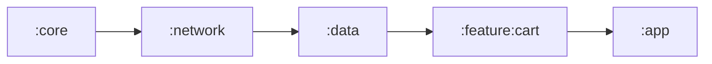
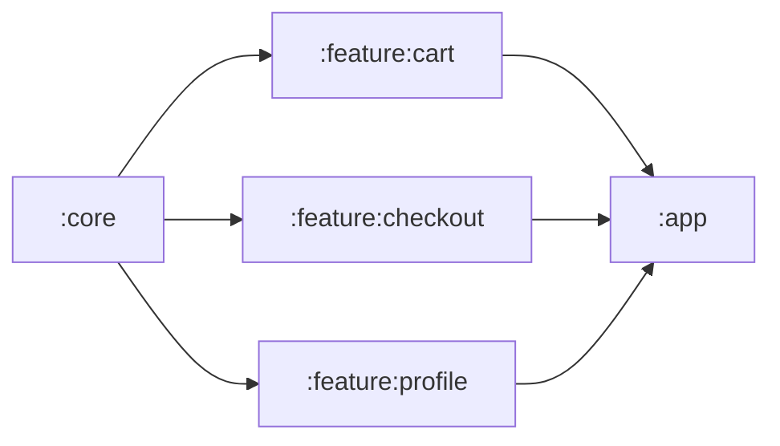

# Platform Engineering: Build Graph Scaling & Profiling

> A 10-minute local build forces 6 compiles per hour. Sixty engineers × 6 builds × 10 min = 60 engineer-hours destroyed per day. The build graph is the single highest-leverage system a Platform Engineer owns: every second cut compounds across every engineer for every commit forever.

---

## Mental Model: The Build Is a Distributed System

Gradle is a JVM program that:

1. **Configures** every `build.gradle.kts` in the project to assemble a `Project` tree (the "configuration phase").
2. **Resolves** the dependency graph between modules — a Directed Acyclic Graph (DAG) — and the dependency graph between tasks within each module.
3. **Executes** the task graph, scheduling tasks onto worker threads, respecting dependencies, and reusing outputs from caches.

Think of it as a small distributed scheduler running on your laptop. Like any scheduler, three things kill it:

- **Serial bottlenecks** — narrow points in the DAG where 15 cores idle waiting on 1.
- **Cache invalidation** — work redone because the cache key is non-deterministic.
- **Lock contention** — the configuration phase, annotation processors, and synchronous I/O on the Gradle daemon thread.

The Platform Engineer's job: reshape the graph, harden the cache keys, and remove the locks.

---

## The Build Graph (DAG) Bottleneck

If module `C` depends on `B` and `B` depends on `A`, Gradle compiles `A → B → C` strictly serially. A 16-core MacBook sits 15-cores idle. The graph's **critical path** (the longest dependency chain) is the floor on build time, no matter how parallel the rest is.

### Bad shape — deep chain



Critical path: 5. Changing `:core` triggers rebuilds of everything downstream, one at a time.

### Good shape — wide fan-out from a thin core



Critical path: 3. All three features compile in parallel on three cores. The Platform team's job is to keep `:core` thin (interfaces, no implementation) and push behavior down into peer feature modules.

### Diagnose the graph

```bash
./gradlew :app:dependencies --configuration releaseRuntimeClasspath
./gradlew projectDependencyGraph   # via the dependency-graph plugin
./gradlew :app:buildEnvironment
```

For a visual graph, the [`dependency-graph-generator`](https://github.com/savvasdalkitsis/module-dependency-graph) plugin produces a Mermaid or DOT file that you can paste straight into a PR description when proposing a refactor.

---

## `api` vs `implementation` — The Single Highest-Leverage Knob

```kotlin
// :feature:cart/build.gradle.kts
dependencies {
    api(project(":core"))            // BAD: leaks :core types into :feature:cart's ABI
    implementation(project(":network")) // GOOD: :network is an internal detail
}
```

The distinction:

- **`api`** — the dependency is part of the module's public ABI. Anyone who depends on `:feature:cart` transitively sees `:core`'s types. A change to `:core`'s public API forces a recompile of every transitive consumer.
- **`implementation`** — the dependency is hidden inside the module. Consumers don't see it. A change to `:network` triggers a recompile of `:feature:cart` only, not of `:app`.

The default should be `implementation`. `api` is a deliberate ABI commitment. Catch leaks with:

```kotlin
// settings.gradle.kts
plugins {
    id("com.autonomousapps.dependency-analysis") version "1.+"
}
// ./gradlew buildHealth
```

The Dependency Analysis plugin flags every `api` usage that should be `implementation` and every transitive dep that should be declared directly. Run it in CI.

---

## Module Type Taxonomy

Codify three module shapes so engineers don't invent their own:

| Type | Contents | Depends on | Depended on by |
|---|---|---|---|
| `:core:*` | Pure-Kotlin types, no Android. | Nothing. | Anyone. |
| `:feature:*:api` | Interfaces + DTOs the feature exposes. | `:core:*`. | `:app`, peer features. |
| `:feature:*:impl` | Implementation. Not visible to peers. | Its own `:api`, `:core:*`. | `:app` only. |
| `:app` | The Application class, DI wiring. | Every `:feature:*:api` + `:feature:*:impl`. | Nothing. |

Result: changing `:feature:cart:impl` only rebuilds `:feature:cart:impl` + `:app`. The other features are untouched because they only see `:feature:cart:api`.

---

## The Convention Plugin Pattern

Stop copy-pasting `build.gradle.kts`. Centralize all common config in a `build-logic/` composite build.

```
build-logic/
  convention/
    src/main/kotlin/
      AndroidLibraryConventionPlugin.kt
      AndroidFeatureConventionPlugin.kt
      JvmLibraryConventionPlugin.kt
    build.gradle.kts
  settings.gradle.kts
```

```kotlin
// build-logic/convention/src/main/kotlin/AndroidLibraryConventionPlugin.kt
class AndroidLibraryConventionPlugin : Plugin<Project> {
    override fun apply(target: Project) = with(target) {
        with(pluginManager) {
            apply("com.android.library")
            apply("org.jetbrains.kotlin.android")
        }
        extensions.configure<LibraryExtension> {
            compileSdk = 34
            defaultConfig.minSdk = 26
            compileOptions {
                sourceCompatibility = JavaVersion.VERSION_17
                targetCompatibility = JavaVersion.VERSION_17
            }
        }
        tasks.withType<KotlinCompile>().configureEach {
            kotlinOptions {
                jvmTarget = "17"
                freeCompilerArgs += listOf(
                    "-Xexplicit-api=strict",
                    "-opt-in=kotlin.RequiresOptIn",
                )
            }
        }
    }
}
```

Each feature module then becomes a one-liner:

```kotlin
// :feature:cart/build.gradle.kts
plugins {
    id("yourorg.android.library")
    id("yourorg.android.feature")
}
```

Benefit: upgrading the Kotlin compiler, AGP, or `compileSdk` is a one-file PR in `build-logic/`, not a 200-module sweep.

---

## Build Cache: Local + Remote

```kotlin
// settings.gradle.kts
buildCache {
    local { isEnabled = true; directory = File(rootDir, "build-cache") }
    remote<HttpBuildCache> {
        url = uri("https://gradle-cache.yourorg.internal/cache/")
        isPush = System.getenv("CI") == "true"   // only CI pushes; devs pull
        credentials {
            username = providers.gradleProperty("cacheUser").get()
            password = providers.gradleProperty("cachePassword").get()
        }
    }
}
```

The mental model: CI computes the cache; engineers download from it.

- CI builds `main` → uploads `:feature:cart` output keyed by hash of inputs.
- Engineer pulls `main`, runs build → local Gradle hashes the same inputs, finds the entry, downloads pre-compiled bytecode.
- A 10-minute clean build collapses to network download time.

### Cache key fragility

The cache hits depend on the inputs hashing identically across machines. Common breakers:

- **Absolute paths embedded in generated code.** Hilt, Glide, and earlier KAPT versions did this. The fix is the `relocate-paths` plugin or upgrading.
- **Timestamps in build outputs.** Set `archivesBaseName` without timestamps; configure `Jar` tasks with `preserveFileTimestamps = false` and `reproducibleFileOrder = true`.
- **`Locale` / time-zone differences.** Force `LC_ALL=C.UTF-8` and `TZ=UTC` in CI.
- **Hostname / username** anywhere in outputs.

Track hit rate per task in Develocity (Gradle Enterprise) and gate the build-logic upgrade if hit rate drops below 80%.

---

## Configuration Cache

Gradle 8+ ships configuration caching as production-ready.

```properties
# gradle.properties
org.gradle.configuration-cache=true
org.gradle.configuration-cache.parallel=true
```

What it does: serializes the configured task graph to disk. On the next build, if nothing about the configuration changed, Gradle skips configuration entirely and jumps to execution. Typical savings: 8-25 seconds per build on a 100-module project.

What breaks it:

- Tasks reading `project.foo` during execution.
- Plugins capturing `Project` references in task action closures.
- `System.getenv()` reads outside declared providers.

```kotlin
// BAD — captures `project` at execution time
tasks.register("printVersion") {
    doLast { println(project.version) }  // CC violation
}

// GOOD — capture the value at configuration time
tasks.register("printVersion") {
    val version = project.version.toString()
    doLast { println(version) }
}
```

Run `./gradlew --configuration-cache <task>` and read the HTML report at `build/reports/configuration-cache/`. Every problem listed is a violation to fix or a plugin to upgrade.

---

## Build Profiling: `--scan` and Develocity

```bash
./gradlew assembleRelease --scan
```

A scan uploads detailed timing to `scans.gradle.com` (or self-hosted Develocity) and prints a URL. Read it like a flame graph. Key tabs:

| Tab | What to read |
|---|---|
| Timeline | Critical-path tasks; gaps between them = serial bottlenecks |
| Performance > Build cache | Per-task cache hit rate; misses are revenue left on the table |
| Performance > Configuration | Slow plugins; misuse of `afterEvaluate` |
| Performance > Network activity | Slow remote-cache hits, dependency download time |
| Plugins | Plugin versions across the build — surface stragglers |

### Things to escalate on

- **GC time > 10% of build wall time** → bump `org.gradle.jvmargs=-Xmx8g -XX:+UseG1GC`.
- **Configuration phase > 15 sec** → bad plugin doing I/O at configuration time.
- **Cache hit rate < 80%** → cache key fragility somewhere; bisect.
- **One task dominates the critical path** → split that module; or move its work to a pre-built artifact.

---

## KAPT → KSP Migration

KAPT (Kotlin Annotation Processing Tool) runs a Java stub-generation step before Kotlin compilation. It is single-threaded, breaks incremental compilation in old versions, and adds 30-90s on large modules.

KSP (Kotlin Symbol Processing) is 2× faster and incremental.

Migration cheat sheet:

| Annotation processor | KSP support |
|---|---|
| Hilt | KSP since Hilt 2.48 |
| Room | KSP since Room 2.5 |
| Moshi | KSP since 1.13 |
| Glide | Use KSP fork or Coil 3 |
| Dagger (non-Hilt) | KSP since 2.48 (dagger-compiler) |

```kotlin
// libs.versions.toml
[plugins]
ksp = { id = "com.google.devtools.ksp", version = "1.9.22-1.0.17" }

// :feature:cart/build.gradle.kts
plugins {
    id("yourorg.android.library")
    alias(libs.plugins.ksp)
}
dependencies {
    implementation(libs.hilt.android)
    ksp(libs.hilt.compiler)   // not kapt(...)
    implementation(libs.room.runtime)
    ksp(libs.room.compiler)
}
```

Measure before and after with `--scan` and present the win to leadership in build minutes saved per week.

---

## Worker Daemons, Parallelism, and Memory

```properties
# gradle.properties
org.gradle.parallel=true
org.gradle.workers.max=8
org.gradle.daemon=true
org.gradle.caching=true
org.gradle.jvmargs=-Xmx8g -XX:+UseG1GC -XX:MaxMetaspaceSize=1g -Dfile.encoding=UTF-8
kotlin.daemon.jvmargs=-Xmx4g
```

Rules of thumb:

- `workers.max` ≈ number of physical cores. Hyperthreading rarely helps for JVM compilers.
- `-Xmx` high enough that GC time < 5% of build time. Too high and you waste RAM that should go to the IDE; too low and GC dominates.
- Kotlin daemon gets its own heap — tune separately.

---

## Failure Modes (Real-World Build Regressions)

| Symptom | Likely cause | Fix |
|---|---|---|
| CI 3× slower than local | No remote cache push, or it's network-blocked | Verify `isPush = CI`, check cache server logs |
| Cache hit rate dropped overnight | Compiler upgrade changed bytecode, or new plugin embedding paths | Bisect plugin list; `--scan` cache report |
| `Configuration cache problems found` | Plugin reads project state at execution | Upgrade plugin, or quarantine the task |
| Random "duplicate class" errors | Two modules both bring the same transitive dep | `./gradlew :app:dependencies` → `exclude` or version-align |
| OOM on CI but not locally | CI runner has less RAM | Tune `org.gradle.jvmargs` per env via `~/.gradle/gradle.properties` baked into the image |
| One module takes 90s to compile | Generated code blow-up (R class, Hilt, Room) | Split the module, or check generated-source size |
| `Daemon will be stopped at the end of the build` | Daemon OOM or sysprop mismatch | Increase `-Xmx`; standardize JVM across team |

---

## What "Done" Looks Like for a Build Platform Team

- Local clean build: under 3 minutes on a baseline laptop spec.
- Local incremental (one feature module change): under 30 seconds.
- CI build (full): under 12 minutes; under 6 with warm cache.
- Cache hit rate on `main`: > 85%.
- Configuration cache: enabled, zero violations.
- KAPT: zero modules (all on KSP).
- Build scans: published from every CI run; reviewed weekly.

Track these as SLOs in a dashboard. Regress any of them and the whole org feels it.

### Critical-path ownership

Every slow build has a longest path. Assign owners to that path the same way you assign owners to production services.

| Signal | Owner | Action |
|---|---|---|
| A module appears in the top 5 critical-path tasks for 2 weeks | Module owner + build platform | Split implementation, reduce generated code, or prebuild artifact |
| `:core` change rebuilds most of the app | Architecture/platform owner | Move business logic out; enforce `api` surface review |
| KAPT remains in a module | Module owner | Migrate to KSP or document blocking processor |
| Cache hit rate drops below 80% | Build platform | Bisect plugin/task inputs and block rollout of offending change |
| Configuration phase regresses by > 10% | Build platform | Profile plugins and remove configuration-time I/O |

The rule is simple: if a module taxes every engineer's build, the module owner owes the org a remediation plan. Build performance is shared infrastructure, not a local implementation detail.

---

## Common Pitfalls

- **Engineers add `api` "to make compile errors go away."** Add a CI check (Dependency Analysis plugin) that fails the build on new `api` usages.
- **The `:core` module becomes the new monolith.** Anything anyone needs ends up there, so every change rebuilds the world. Enforce a "no business logic in `:core`" rule and split aggressively.
- **Gradle wrapper version drift.** Some engineers on 8.5, CI on 8.7. Pin the wrapper and add a CI guard that asserts `./gradlew --version` matches.
- **`./gradlew clean` culture.** "Try clean build first" is a sign cache invalidation is broken. Fix the root cause; don't paper over it with `clean`.
- **Treating build perf as one engineer's hobby project.** Stand up a Build Platform sub-team with a real headcount. The savings are real engineering hours.

---

## Probing Questions

1. Your build takes 11 minutes locally. Walk through the first 30 minutes of investigation.
2. What's the difference between `api` and `implementation` at the bytecode level? Why does ABI matter for incremental builds?
3. The remote cache hit rate dropped from 90% to 40% after a Kotlin compiler upgrade. What's the most likely cause?
4. You enabled configuration caching and 12 plugins broke. How do you prioritize fixing them?
5. A feature team wants to add a 1.2 GB AAR dependency. What questions do you ask before approving?
6. You have a 5-minute configuration phase. What are the three highest-yield places to look?
7. KAPT vs KSP — what does the migration cost, and what does it return?
8. How do you convince a skeptical Director that 2 engineers on a Build Platform team will pay back in 6 months?

---

## Further Reading

- [`internal-developer-platforms.md`](internal-developer-platforms.md) — convention plugins as platform.
- [`library-versioning.md`](library-versioning.md) — `libs.versions.toml` and BoM.
- [`../android/architecture/modularization-strategies.md`](../android/architecture/modularization-strategies.md) — module taxonomy in depth.
- [`../android/performance/app-size-and-r8.md`](../android/performance/app-size-and-r8.md) — R8 / D8 / minification at build time.
- [Gradle — Performance Guide](https://docs.gradle.org/current/userguide/performance.html) — official tuning reference.
- [Gradle — Configuration Cache](https://docs.gradle.org/current/userguide/configuration_cache.html) — full mechanics and constraints.
- [Develocity (formerly Gradle Enterprise)](https://gradle.com/develocity/) — build scans + remote cache at scale.
- [Now in Android — `build-logic/`](https://github.com/android/nowinandroid/tree/main/build-logic) — Google's canonical example of convention plugins for a multi-module app.
- [Square — Gradle build perf at Cash App](https://developer.squareup.com/blog/) — practitioner posts on real numbers.
