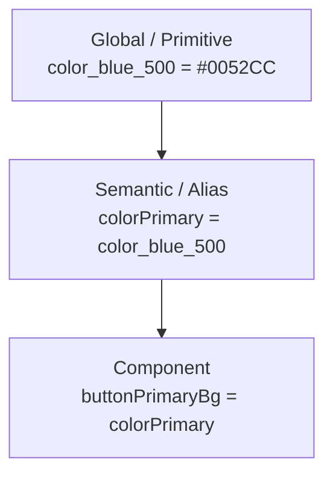

# Platform Engineering: Design Systems Architecture

> Without a design system, 10 product teams ship 15 shades of blue, 8 button radii, and 4 typography scales. With one, a rebrand is a one-PR change to a tokens file. The design system is the highest-leverage UI investment a Platform team makes: every screen in the app inherits its quality bar.

---

## What a Design System Is (and Isn't)

A design system is **not** a folder of `CompanyButton.kt` components. It is a vocabulary shared between designers and engineers that compresses thousands of independent UI decisions into a small set of typed tokens.

It has three layers:

1. **Tokens** — typed values (colors, spacing, typography, motion). The vocabulary.
2. **Components** — opinionated building blocks (Button, TextField, Card) that consume tokens.
3. **Patterns** — composed screens / interactions (EmptyState, ErrorScreen, OnboardingStep) that consume components.

The leverage is in layer 1. If your tokens are wrong, no amount of component polish recovers it.

---

## The Three-Tier Token Architecture



**Global tokens** are raw values. They have no opinion. Engineers should not consume them directly in feature code.

**Semantic tokens** carry intent. `colorPrimary`, `colorError`, `colorOnSurface`. Dark mode is implemented here — a single dark-mode alias map remaps `colorSurface → color_neutral_900` without touching feature code.

**Component tokens** scope a semantic token to a specific use. `buttonPrimaryBackground`, `chipDisabledBorder`. They let designers tweak one component without affecting the rest.

### Why three tiers, not one

```kotlin
// One tier — hardcoded everywhere:
Button(modifier = Modifier.background(Color(0xFF0052CC)))  // 200 occurrences

// Two tiers — better, but a rebrand still touches every consumer of `primary`:
Button(modifier = Modifier.background(colorPrimary))

// Three tiers — a rebrand changes ONE line in the semantic layer:
Button(modifier = Modifier.background(buttonPrimaryBg))
// buttonPrimaryBg = colorPrimary = color_red_500  ← only this line changes
```

The third tier is what lets a single Figma update propagate through code without breaking consumers.

---

## Tokens in Code: Compose-First

```kotlin
// :core:design-system/src/main/kotlin/.../theme/Tokens.kt
@Immutable
data class CompanyColors(
    val primary: Color,
    val onPrimary: Color,
    val surface: Color,
    val onSurface: Color,
    val error: Color,
    val onError: Color,
    val outline: Color,
    // ... ~25 semantic tokens, not 200 primitives
)

@Immutable
data class CompanyTypography(
    val displayLarge: TextStyle,
    val titleLarge: TextStyle,
    val bodyLarge: TextStyle,
    val labelSmall: TextStyle,
)

@Immutable
data class CompanySpacing(
    val xs: Dp = 4.dp, val sm: Dp = 8.dp, val md: Dp = 16.dp,
    val lg: Dp = 24.dp, val xl: Dp = 32.dp,
)

@Immutable
data class CompanyShapes(
    val small: Shape, val medium: Shape, val large: Shape,
)
```

`@Immutable` is essential — it tells the Compose compiler the values never change, so recompositions can skip them. Without it, every recomposition treats the token bundle as unstable and re-runs every child.

### Wiring via `CompositionLocal`

```kotlin
val LocalCompanyColors = staticCompositionLocalOf<CompanyColors> {
    error("No CompanyColors provided. Wrap your content in CompanyTheme.")
}
val LocalCompanyTypography = staticCompositionLocalOf<CompanyTypography> {
    error("No CompanyTypography provided.")
}
// ...same for spacing/shapes

object CompanyTheme {
    val colors: CompanyColors @Composable @ReadOnlyComposable get() = LocalCompanyColors.current
    val typography: CompanyTypography @Composable @ReadOnlyComposable get() = LocalCompanyTypography.current
    val spacing: CompanySpacing @Composable @ReadOnlyComposable get() = LocalCompanySpacing.current
    val shapes: CompanyShapes @Composable @ReadOnlyComposable get() = LocalCompanyShapes.current
}

@Composable
fun CompanyTheme(
    darkTheme: Boolean = isSystemInDarkTheme(),
    content: @Composable () -> Unit,
) {
    val colors = if (darkTheme) DarkColors else LightColors
    CompositionLocalProvider(
        LocalCompanyColors provides colors,
        LocalCompanyTypography provides DefaultTypography,
        LocalCompanySpacing provides CompanySpacing(),
        LocalCompanyShapes provides DefaultShapes,
        content = content,
    )
}
```

`staticCompositionLocalOf` (not `compositionLocalOf`) — because reading colors should not be observed for recomposition (we never change them in flight; we re-provide the entire theme). This is a measurable perf win on large screens.

Engineers then consume tokens by name:

```kotlin
Text(
    text = "Hello",
    color = CompanyTheme.colors.onSurface,
    style = CompanyTheme.typography.titleLarge,
    modifier = Modifier.padding(CompanyTheme.spacing.md),
)
```

No hex codes. No `8.dp`. Refactoring the entire visual language is now mechanical.

---

## Components: Slot APIs Over Boolean Soup

The temptation: as designers add variants, the component grows parameters.

```kotlin
// BAD — every new variant adds a boolean. 16 booleans = 65,536 combinations.
@Composable
fun CompanyButton(
    text: String,
    onClick: () -> Unit,
    icon: ImageVector? = null,
    isLeadingIcon: Boolean = true,
    isLoading: Boolean = false,
    isDestructive: Boolean = false,
    isFullWidth: Boolean = false,
    isCompact: Boolean = false,
    // ...
)
```

The fix: **slot APIs**. The component owns the container (background, ripple, padding, accessibility) and exposes `@Composable` lambdas for content.

```kotlin
@Composable
fun CompanyButton(
    onClick: () -> Unit,
    modifier: Modifier = Modifier,
    enabled: Boolean = true,
    style: CompanyButtonStyle = CompanyButtonStyle.Primary,
    content: @Composable RowScope.() -> Unit,   // <-- the slot
) {
    Surface(
        onClick = onClick,
        modifier = modifier.heightIn(min = 48.dp),
        enabled = enabled,
        shape = CompanyTheme.shapes.medium,
        color = style.containerColor(enabled),
        contentColor = style.contentColor(enabled),
    ) {
        Row(
            horizontalArrangement = Arrangement.Center,
            verticalAlignment = Alignment.CenterVertically,
            modifier = Modifier.padding(horizontal = CompanyTheme.spacing.md),
            content = content,
        )
    }
}

// Caller composes content freely:
CompanyButton(onClick = { /* */ }) {
    Icon(Icons.Default.Add, contentDescription = null)
    Spacer(Modifier.width(CompanyTheme.spacing.xs))
    Text("Add item")
}
```

Plus a `sealed class CompanyButtonStyle` (Primary, Secondary, Destructive, Ghost) for the *opinionated* variations. Slot for content; sealed enum for visual style. Together they cover the matrix without exploding parameter lists.

---

## Module Strictness: Banning Raw Material Components

Feature modules must depend on `:core:design-system`, never on `androidx.compose.material3` or `android.widget.*` directly.

```kotlin
// :feature:cart/build.gradle.kts
dependencies {
    implementation(project(":core:design-system"))
    // implementation(libs.androidx.compose.material3)   // BANNED — design-system already re-exports what's needed
}
```

Enforce with a Lint rule:

```kotlin
// :build-logic/convention/.../DesignSystemDetector.kt
class RawMaterialImportDetector : Detector(), Detector.UastScanner {
    override fun getApplicableUastTypes() = listOf(UImportStatement::class.java)
    override fun createUastHandler(context: JavaContext) = object : UElementHandler() {
        override fun visitImportStatement(node: UImportStatement) {
            val fqName = node.importReference?.asRenderString().orEmpty()
            if (fqName.startsWith("androidx.compose.material3.Button") ||
                fqName.startsWith("androidx.compose.material.Button")) {
                context.report(
                    ISSUE_RAW_BUTTON,
                    node,
                    context.getLocation(node),
                    "Use CompanyButton from :core:design-system instead of raw Material Button."
                )
            }
        }
    }
    companion object {
        val ISSUE_RAW_BUTTON = Issue.create(
            id = "RawMaterialButtonImport",
            briefDescription = "Importing raw Material Button",
            explanation = "Feature modules must use CompanyButton.",
            category = Category.CORRECTNESS,
            priority = 8,
            severity = Severity.ERROR,
            implementation = Implementation(
                RawMaterialImportDetector::class.java,
                Scope.JAVA_FILE_SCOPE,
            ),
        )
    }
}
```

Ship the lint check as part of the design-system module so it auto-applies wherever the design system is consumed.

---

## Multi-Brand Support

If the app ships under two brands (parent + sub-brand, white-label, regional variants), the token tier separation pays off massively.

```kotlin
// :brand:default/Tokens.kt
val DefaultLightColors = CompanyColors(
    primary = Color(0xFF0052CC),
    // ...
)

// :brand:premium/Tokens.kt
val PremiumLightColors = CompanyColors(
    primary = Color(0xFFB8860B),
    // ...
)

// :app/MainActivity.kt
val colors = when (BuildConfig.BRAND) {
    "default" -> DefaultLightColors
    "premium" -> PremiumLightColors
    else -> error("Unknown brand")
}
CompositionLocalProvider(LocalCompanyColors provides colors) { App() }
```

Feature code never references the brand directly. The brand-pick lives at the app root; everything downstream consumes semantic tokens.

---

## Accessibility: Bake It Into the System

Every component in the design system must:

- Hit minimum tap target (48 × 48 dp).
- Expose proper `contentDescription` slots for icon-only variants.
- Honor `LocalContentColor` and contrast ratios (WCAG AA = 4.5:1 for body text).
- Respect text scaling: every `TextStyle` uses `sp`, not `dp`.
- Handle TalkBack focus order via `Modifier.semantics`.

The platform team's leverage: feature engineers don't think about accessibility; they get it for free as long as they use `CompanyButton`. The price of taking that leverage away (one team builds a raw Button) is one regression that ships to thousands of users.

Add a Compose Preview that renders every component at 200% text scale + dark mode + RTL:

```kotlin
@Preview(name = "200% scale", fontScale = 2.0f)
@Preview(name = "Dark", uiMode = UI_MODE_NIGHT_YES)
@Preview(name = "RTL", locale = "ar")
annotation class ComponentPreviews
```

Tag every design-system component with `@ComponentPreviews` and add a Paparazzi snapshot test that fails CI if pixels drift.

---

## Figma ↔ Code: Token Sync Pipeline

The mature setup: designers maintain tokens in Figma (Tokens Studio, Figma Variables); a CI job pulls them and generates Kotlin.

```yaml
# .github/workflows/sync-tokens.yml
name: Sync design tokens
on:
  schedule: [{ cron: "0 6 * * 1" }]   # Monday 6am
  workflow_dispatch:
jobs:
  sync:
    runs-on: ubuntu-latest
    steps:
      - uses: actions/checkout@v4
      - run: ./gradlew :tools:token-sync:run
      - uses: peter-evans/create-pull-request@v6
        with:
          title: "chore(tokens): sync from Figma"
          branch: tokens-sync
          body: "Auto-generated from Figma. Review color/spacing diffs carefully."
```

The `:tools:token-sync` task:

1. Reads Figma's REST API (`/v1/files/<key>/variables/local`).
2. Maps Figma variables → Kotlin generated source under `:core:design-system/build/generated/tokens/`.
3. Runs `./gradlew spotlessApply` to format.

Result: designers never wait on engineers to push a token change. Engineers never type a hex code.

---

## Versioning the Design System as a Public API

Treat `:core:design-system` as a public SDK consumed by your own feature teams. Every change is a potential break.

| Change type | SemVer | Process |
|---|---|---|
| New component or new token | MINOR | Add, ship, announce |
| New optional parameter on existing component | MINOR | Default value preserves old behavior |
| Renaming an existing API | MAJOR | `@Deprecated(replaceWith = ...)` for one release; then remove |
| Changing default behavior (e.g., button height 44dp → 48dp) | MAJOR | Coordinate rollout; flag in release notes |
| Removing a component | MAJOR | Six-month deprecation; migration tool |

Publish the design system as a versioned artifact (even internally) using the [`library-versioning.md`](library-versioning.md) playbook. Use [binary-compatibility-validator](https://github.com/Kotlin/binary-compatibility-validator) to detect accidental ABI breaks.

---

## Governance: Who Decides

Without governance, every team adds tokens for their use case and the system becomes the union of all features' wishlists.

| Decision | Owned by |
|---|---|
| New semantic token | Design system maintainers + Design lead |
| New component | Design system maintainers; feature team writes the PR |
| Tweak to component default | Design system maintainers; gated by snapshot diff review |
| Brand-level color change | Brand team; auto-propagates via tokens |
| Adding a *primitive* color | Designer + DS lead — rare; primitives are stable |

Run a weekly "Design Systems Sync" with 1 designer + 2 engineers. PRs queued through it. The bottleneck is intentional — design-system changes ripple too far to ship without review.

### Adoption metrics

The design system is only leverage if feature teams use it.

| Metric | Target | Enforcement |
|---|---|---|
| Feature modules depending on `:core:design-system` | 100% for UI modules | Build graph audit |
| Raw Material component imports | 0 in feature modules | Lint error |
| Hardcoded colors/spacing | 0 outside DS module | Lint + review |
| Component snapshot coverage | 100% for public components | CI |
| Accessibility preview coverage | 100% for public components | Paparazzi/Compose preview tests |
| Deprecated component usage | 0 after migration window | Lint warning -> error |

Publish adoption like any platform metric. If only half the org uses the design system, the problem is either missing components, weak enforcement, or a paved road that is harder than the dirt road.

---

## Failure Modes

| Symptom | Cause | Fix |
|---|---|---|
| 15 shades of blue ship in production | Hardcoded `#xxxxxx` everywhere | Lint rule banning `Color(0xFF...)` outside `:core:design-system` |
| Dark mode broken on one screen | Feature team used a primitive, not semantic, token | Three-tier discipline + lint |
| Buttons grew to 32 parameters | No slot APIs | Refactor to slot + sealed enum styles |
| Every release breaks 5 feature modules | DS treats itself as internal, not a public API | SemVer + ABI validator + deprecation cycles |
| Designers tweak a color, engineers don't notice | No automated sync | Token-sync CI job → PR |
| Half the org uses DS, half doesn't | No enforcement | Lint rule fails CI on raw Material imports |
| DS team has 20 open PRs nobody reviews | No governance cadence | Weekly sync; named maintainers |

---

## Common Pitfalls

- **Designing tokens around components, not intent.** `loginButtonColor` is wrong — it's a component token masquerading as semantic. Use `colorPrimary`.
- **The system as a wall, not a kitchen.** If feature teams can't extend, they fork. Provide slot APIs and a clear "how to propose a new component" path.
- **No accessibility baseline.** Then a screen reader regression slips through and the brand pays for it. Bake AA contrast and 48dp targets into the components themselves.
- **Hex codes still appearing in feature code.** Means the lint rule isn't enforced, or the available tokens don't cover a real use case. Investigate before fighting.
- **One-person ownership.** When that engineer leaves, the system rots. Always two named maintainers and documented governance.

---

## Probing Questions

1. Why three tiers (primitive → semantic → component) instead of two?
2. Why `staticCompositionLocalOf` rather than `compositionLocalOf` for tokens?
3. Walk through how you'd implement dark mode such that no `if (isDarkTheme)` appears in feature code.
4. A feature team needs a new button variant the DS doesn't have. Walk through the decision tree.
5. How do you prevent the design system from becoming the dumping ground for every team's bespoke component?
6. A rebrand drops on Q3. Walk through the engineering rollout plan.
7. The Figma source of truth and the Kotlin generated code drift. How do you detect and fix it?
8. Multi-brand: when does a token belong at the brand layer vs the global layer?

---

## Further Reading

- [`build-graph-scaling.md`](build-graph-scaling.md) — keeping `:core:design-system` from becoming a build bottleneck.
- [`library-versioning.md`](library-versioning.md) — versioning the DS as a public API.
- [`sdk-distribution.md`](sdk-distribution.md) — if the DS ships beyond your org.
- [`../android/compose/recomposition-and-state.md`](../android/compose/recomposition-and-state.md) — why `@Immutable` matters for token bundles.
- [`../android/compose/modifiers-and-layout.md`](../android/compose/modifiers-and-layout.md) — modifier composition patterns the DS exposes.
- [Material Design 3 — Design tokens](https://m3.material.io/foundations/design-tokens/overview) — Google's reference vocabulary.
- [Tokens Studio for Figma](https://tokens.studio/) — token authoring and export.
- [Now in Android — DS module](https://github.com/android/nowinandroid/tree/main/core/designsystem) — Google's canonical Compose DS structure.
- [Airbnb — Building a Visual Language](https://airbnb.design/building-a-visual-language/) — the cultural and technical reasoning.
