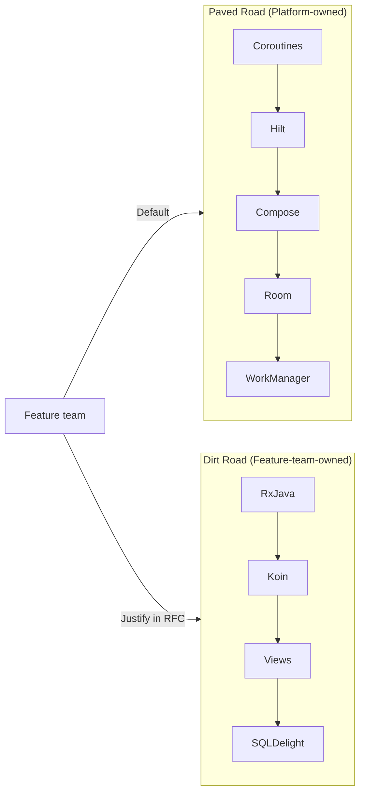

# Platform Engineering: Internal Developer Platforms (IDP)

> An Internal Developer Platform is the operating system for your engineering org. Built well, it makes the right thing the easy thing and feature teams ship faster than they imagined possible. Built badly, it's a tax line, a gatekeeper, and a graveyard of internal CLIs nobody uses. The Platform Engineer's job is to make the paved road *measurably* faster than the dirt road.

---

## The Mental Model: Platform as a Product

Feature teams are your customers. The IDP is your product. That framing changes everything:

- You ship release notes.
- You measure adoption.
- You hold office hours.
- You get NPS-style feedback after every release.
- You deprecate with empathy, with migration tooling, and with a runway.

A platform team that ships in stealth and demands compliance fails. A platform team that markets internally, measures impact, and answers questions in Slack inside 30 minutes thrives.

---

## The Paved Road

The principle:

- **Paved road:** the platform-blessed way. Coroutines for async. Hilt for DI. Compose for UI. Room for storage. WorkManager for background. Maintained, secured, observed by the Platform team. Free upgrades. Free CI. Free observability.
- **Dirt road:** off-paved choices (RxJava, Koin, custom DI, custom HTTP client). Allowed, but the feature team owns it: upgrades, security patches, on-call. The platform won't roll out cross-cutting changes for you.



The leverage: you don't have to ban dirt-road choices. You just have to make the paved road *obviously* cheaper. When the paved road ships a free Compose 1.6 upgrade and the dirt-road team has to spend a sprint upgrading themselves, the paved road wins on its own.

---

## What's in the Platform: The Six Pillars

### 1. Project scaffolding

`yourorg create-module --type feature --name cart` generates a working, build-passing, test-passing module in 10 seconds.

```bash
$ yourorg create-module --type feature --name cart
✔ Created :feature:cart:api
✔ Created :feature:cart:impl
✔ Wired Hilt module
✔ Added sample screen with Compose preview
✔ Added unit test scaffold
✔ Registered in settings.gradle.kts
✔ Build: PASS (12.3s)

Next: open :feature:cart:impl/ui/CartScreen.kt
```

How to build it: the Platform team maintains a `:tools:scaffolder` Gradle task or a small Kotlin CLI. It reads Mustache templates, fills in package names, writes files, and runs `./gradlew :feature:cart:impl:assemble` to verify.

A GitHub Template Repository covers the simpler case (one repo per feature). For monorepos, a CLI is the right shape.

### 2. Convention plugins (build config as platform code)

See [`build-graph-scaling.md`](build-graph-scaling.md) for the deep dive. The short version:

```kotlin
// :feature:cart:impl/build.gradle.kts — what feature engineers write
plugins {
    id("yourorg.android.feature")   // <-- the only line they think about
}
dependencies {
    implementation(project(":feature:cart:api"))
}
```

Behind `yourorg.android.feature` is a convention plugin in `build-logic/` that sets `compileSdk`, Kotlin compiler flags, Compose compiler, lint rules, test scaffolding, code coverage, and Hilt. Feature engineers never write any of it.

### 3. CI/CD pipeline

Feature engineers should never write `.github/workflows/*.yml`.

```yaml
# .github/workflows/pr.yml — owned by the Platform team
name: PR
on: pull_request
jobs:
  build:
    uses: yourorg/android-ci/.github/workflows/standard-pr.yml@v3
    with:
      module-affected-strategy: gradle-deps
```

The reusable `standard-pr.yml` workflow:

- Detects affected modules via `./gradlew :app:checkAffected`.
- Runs unit tests + lint + ktlint + detekt + dependency-analysis on affected modules only.
- Runs Paparazzi snapshot tests.
- Runs an instrumented smoke test on a Firebase Test Lab matrix.
- Reports back to GitHub via checks API.

When the Platform team upgrades the workflow from `@v3` to `@v4` (e.g., adding a new lint rule), all consumers get it on the next merge automatically.

### 4. Observability

Every app built on the platform ships with:

- Crashlytics with breadcrumbs and metadata pre-wired.
- Performance traces (cold start, screen render, network call).
- A "log a breadcrumb" API consistent across all modules.
- A standard event bus for analytics.

Feature teams write `Logger.event("cart.checkout.clicked")` and `Tracer.trace("checkout.flow")` — they don't think about which SDK is underneath. When the Platform team swaps Crashlytics for Sentry in 2 years, no feature code changes.

### 5. Release infrastructure

- Standardized release branch policy.
- Automated changelog generation from PR labels.
- Bundletool integration, signing config kept in the build infrastructure.
- Play Console upload step in the CI.
- Staged rollout policy (1% → 10% → 50% → 100%) baked into the release tooling.

See [`../release-engineering.md`](../release-engineering.md) for what feature teams consume.

### 6. Developer environment

`yourorg doctor` checks the dev's machine and tells them what's wrong:

```bash
$ yourorg doctor
✔ JDK 17 (Temurin) installed
✔ Android SDK 34 + 26 platforms installed
✘ Android Studio is Hedgehog Beta (recommended: Iguana Stable)
   Fix: brew install --cask android-studio
✘ ANDROID_HOME not set
   Fix: append `export ANDROID_HOME=$HOME/Library/Android/sdk` to ~/.zshrc
✔ git LFS installed
✔ Build cache reachable

2 issues found. Run `yourorg doctor --fix` to auto-fix.
```

The cost is one weekend to build it. The savings is one onboarding day per new hire, forever.

---

## Measuring the Platform: Developer Experience Metrics

If you don't measure DevEx, you can't improve it and you can't defend headcount.

| Metric | Target | How to measure |
|---|---|---|
| **Local clean build P90** | < 3 min | Develocity scans, anonymously bucketed |
| **Local incremental build P90** | < 30 sec | Same |
| **PR CI duration P90** | < 12 min | GitHub Actions checks API |
| **PR CI failure rate (flakes only)** | < 2% | CI run analysis |
| **Time to first commit (new hire)** | < 2 days | `yourorg doctor` telemetry + first-PR date |
| **`yourorg` CLI adoption** | > 80% of active engineers/week | CLI ping-home |
| **Build success rate** | > 99% | CI |
| **Crashlytics SDK adoption** | 100% | Build-time enforcement |
| **Quarterly DevEx survey NPS** | > 40 | Internal form |

Publish the dashboard. Make it un-fakeable. Tie it to the platform team's OKRs.

### What "P90 build time" means at scale

If the P90 local incremental build is 90 seconds, every engineer loses ~30 minutes/day to waiting. At 100 engineers, that's 50 hours/day, ~10,000 hours/year, ~$3M/year at fully-loaded cost. Cutting it to 30 seconds returns $2M/year. That's how you defend two platform headcount.

---

## The CLI: When and How

A `yourorg <command>` CLI shows up in mature platforms. It's worth it when:

- You have ≥ 30 engineers (otherwise a GitHub template + 2 scripts is enough).
- You have ≥ 5 recurring multi-step workflows (create module, doctor, release, swap branch + sync, rotate signing key).
- You have a maintainer (otherwise it rots in 6 months).

Implementation tactics:

- Write it in Kotlin via [Clikt](https://ajalt.github.io/clikt/) or as a Gradle composite build — Kotlin keeps the language consistent and lets you reuse build-logic code.
- Distribute via Homebrew tap (Mac) + scoop (Windows) + apt repo (Linux).
- Auto-update on every invocation with a 1-min cache.
- Ship telemetry from day one (anonymously) so you can measure adoption per command.
- Default to `--dry-run` for destructive commands.

### Anti-pattern: the gatekeeper CLI

The CLI exists to *unblock* engineers, not block them. If `yourorg release --start` requires approval from the Platform team, you've built a turnstile. The right model: `yourorg release --start` runs immediately; the Platform team gets notified asynchronously and can roll back if something goes wrong.

---

## Embedding: How the Platform Stays Honest

Two failure modes plague platform teams:

- **The Ivory Tower** — platform engineers haven't shipped a feature in 18 months. They've forgotten what slow CI feels like.
- **The Order-Taker** — platform engineers do whatever feature teams ask, ending up with a fragmented toolset.

The fix: **rotation embedding**. Every 6 months, one platform engineer embeds in a feature team for a sprint. They ship a real feature using the platform's own tools. They feel every paper cut. They file the bugs. They write the post-embed retrospective.

The other direction also works: every 12 months, a feature engineer embeds in the platform team for a quarter. They bring the user's perspective into platform planning.

---

## Governance and the Paved-Road Edge

When a feature team wants to add a new top-level dependency (a new HTTP client, a new DI framework), they file a "Paved Road Extension RFC":

```
# RFC <N>: Add Ktor as a paved-road HTTP client (alternative to Retrofit)

## Proposer
<feature team>

## Motivation
3-sentence pitch.

## What changes if approved
- Platform team takes over Ktor security patches.
- New paved-road tag in tokens; engineers can pick Retrofit or Ktor.
- All paved-road services (BFF, tracing, breadcrumbs) wrapped for both.

## What it costs the Platform team
- 2 weeks integration; 2 hours/month maintenance.

## What it costs if we DON'T do it
- Feature team builds Ktor themselves; no shared interceptors; pages on-call wakes up.

## Decision
DACI: Driver=feature team, Approver=Platform lead, Contributors=affected feature teams.
```

The platform lead decides explicitly. Most extensions are rejected; that's the point. Each accepted one expands the maintenance surface forever.

---

## Failure Modes

| Symptom | Cause | Fix |
|---|---|---|
| Engineers route around the platform | Paved road is slower or harder than dirt road | Measure DevEx; pick one paper cut a sprint; fix it |
| Build times creep up quarter over quarter | No P90 alert; no owner | Dashboard + SEV-3 alert on regression |
| CI YAML diverges across repos | No central reusable workflow | Move to `uses: yourorg/<repo>/...@v3` pattern |
| Platform team is 4 engineers; nobody else contributes | No contribution path | "Paved Road Extension" RFC + docs on `build-logic/` |
| New hires take 1 week to first commit | No `yourorg doctor`, no scaffolder | Build them; measure time-to-first-commit |
| One feature team's flaky tests block everyone | No quarantine policy | Quarantine + fix-it ticket with 2-week SLA |
| Platform team becomes a turnstile | Approvals required for routine ops | Async approval; defaults proceed |

---

## Cost-Benefit: How to Get Headcount

The Director asks: "Why do I need 4 engineers on the platform team?"

Bring numbers:

| Investment | Annual cost (loaded) | Return |
|---|---|---|
| 4 platform engineers | $1.5M | — |
| Cuts P90 local build 90s → 30s for 100 engineers | — | $2M/yr engineering time |
| Removes "Gradle config week" from onboarding (100 hires/yr × 2 days) | — | $300k/yr |
| Reduces UI test flake P90 from 20% → 2% | — | $400k/yr (CI compute + engineer time) |
| Standardizes Crashlytics + observability | — | Faster MTTR on incidents; 1 prevented SEV-1/yr ≈ $1M |
| Net | — | +$2.2M/yr |

The Director funds the team. You report on the dashboard quarterly. Repeat.

---

## Common Pitfalls

- **The CLI nobody installs.** You shipped it; you forgot adoption. Telemetry from day one; measure weekly.
- **The platform team that doesn't ship code.** Build-logic, CLI, scaffolder, doctor — these are real software. Treat them with the same review rigor as product code.
- **No SLA on platform problems.** "Build is broken" needs a sub-2-hour response. If the platform team disappears into deep work, feature teams revert to dirt roads.
- **Platform engineers as ticket-takers.** You get JIRA tickets, you do them, you ship nothing strategic. Carve protected platform-evolution time (50%+) explicitly.
- **The "shadow IT" platform.** A feature engineer builds their own scaffolder, shares it, others adopt it. Now there are two. Either absorb it into the platform or sunset it; never let two coexist.
- **Mistaking activity for impact.** 80 closed tickets is not impact. P90 build time dropping from 90s to 30s is.

---

## Probing Questions

1. Why does "platform as a product" framing matter? What changes if you adopt it?
2. Walk through what's on the paved road today in your org. What's on the dirt road? Why?
3. Your CLI has 30% adoption after 3 months. How do you diagnose why?
4. A feature team wants to use Ktor instead of Retrofit. Walk through your decision process.
5. The build cache hit rate fell from 90% to 60% in one week. What's your first hour of investigation?
6. How do you defend a platform headcount request to a skeptical VP?
7. What's the difference between an ivory-tower platform team and a well-functioning one?
8. A feature team's flaky tests are blocking every other team's merges. What do you do?

---

## Further Reading

- [`build-graph-scaling.md`](build-graph-scaling.md) — the build is the platform's most-used surface.
- [`design-systems-architecture.md`](design-systems-architecture.md) — UI platform as a product.
- [`library-versioning.md`](library-versioning.md) — how the platform ships changes safely.
- [`sdk-distribution.md`](sdk-distribution.md) — what to do when consumers are outside your org.
- [`../release-engineering.md`](../release-engineering.md) — the platform's release infrastructure.
- [`../observability.md`](../observability.md) — observability as platform service.
- [Thoughtworks — Platform-as-a-Product](https://www.thoughtworks.com/insights/blog/platform-engineering-product-thinking) — the foundational framing.
- [Team Topologies (Skelton & Pais)](https://teamtopologies.com/) — Platform team vs Stream-aligned team vs Enabling team.
- [Spotify — Paved Path](https://engineering.atspotify.com/) — early write-ups on golden paths.
- [Now in Android — `build-logic/`](https://github.com/android/nowinandroid/tree/main/build-logic) — canonical convention-plugin shape.
