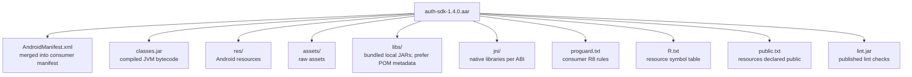

# Platform Engineering: SDK Distribution & Publishing

> Shipping an Android SDK is publishing a public API to engineers you'll never meet. Every method signature is a contract; every default behavior is an assumption you can't take back. The Platform Engineer's job is not just the code — it's the distribution pipeline, the API surface discipline, the deprecation cadence, and the consumer integration story. A well-shipped SDK adds leverage across every app that consumes it; a badly-shipped one becomes the reason the next reorg happens.

---

## When You Have An SDK (Whether You Realize It Or Not)

You have an SDK the moment **another team consumes your code via Maven coordinates** — not when you stand up `sdk.yourcompany.com`.

Common scenarios:

- **Multi-app companies** — Rider, Driver, and Merchant apps all consume `:auth-sdk`, `:payments-sdk`, `:analytics-sdk`.
- **Public SDKs** — Firebase, Stripe, Branch, Segment publish to Google's Maven repository or Maven Central (JCenter was shut down on August 15, 2024).
- **White-label / partner SDKs** — Your code embedded in a partner's app; you don't control their release cadence.
- **Cross-org internal libraries** — Your platform team's `:design-system` consumed by 20 product teams.

The discipline is the same in all four cases. The blast radius differs.

---

## The Artifact: AAR vs JAR vs Source

| Format | When to use | Trade-off |
|---|---|---|
| **AAR (Android Archive)** | Android-specific SDK with resources, AndroidManifest entries, or `assets/` | Standard for Android libraries. Includes resources + manifest merging. |
| **JAR** | Pure-Kotlin / pure-Java SDK with no Android dependencies | Smaller, faster to download. No resource support. Use for `:auth-tokens` (pure logic), not `:design-system` (resources). |
| **Source dependency / composite build** | Internal monorepo modules consumed by sibling modules | Compiled inside the consumer's build (on clean builds and cache misses) — bad for cross-team SDKs. Good for tight feedback inside one repo. |
| **KMP publication** | KMP SDK targeting iOS + Android from one codebase | Multiplatform: klibs for native targets, an AAR for the Android target; more complex publishing. Use when iOS team is also a consumer. |

For internal SDKs consumed by separate apps: **publish AARs**. Consuming source forces every consumer to rebuild your SDK on every clean build — destroys their build times for no benefit.

### Inside an AAR



`proguard.txt` is critical — covered below.

---

## The Build: `maven-publish` Pipeline

Pure Kotlin/Java SDK:

```kotlin
// :sdk:auth-tokens/build.gradle.kts
plugins {
    `java-library`
    `maven-publish`
    kotlin("jvm")
    id("org.jetbrains.kotlinx.binary-compatibility-validator")
}

kotlin {
    explicitApi()
    jvmToolchain(17)
}

publishing {
    publications {
        create<MavenPublication>("maven") {
            groupId = "com.yourorg.sdk"
            artifactId = "auth-tokens"
            version = project.version.toString()
            from(components["java"])

            pom {
                name = "Auth Tokens"
                description = "JWT validation and refresh."
                url = "https://github.com/yourorg/auth-tokens"
                licenses {
                    license {
                        name = "Apache-2.0"
                        url = "https://www.apache.org/licenses/LICENSE-2.0"
                    }
                }
                scm {
                    connection = "scm:git:git://github.com/yourorg/auth-tokens.git"
                    url = "https://github.com/yourorg/auth-tokens"
                }
            }
        }
    }
}
```

Android library (AAR):

```kotlin
// :sdk:auth/build.gradle.kts
plugins {
    id("com.android.library")
    // AGP 9+ provides built-in Kotlin for Android modules.
    `maven-publish`
    id("org.jetbrains.kotlinx.binary-compatibility-validator")
}

android {
    namespace = "com.yourorg.sdk.auth"
    compileSdk = 36
    defaultConfig {
        minSdk = 24
        consumerProguardFiles("consumer-rules.pro")
    }
    publishing {
        singleVariant("release") {
            withSourcesJar()
            withJavadocJar()
        }
    }
}

kotlin { explicitApi() }

afterEvaluate {
    publishing {
        publications {
            create<MavenPublication>("release") {
                from(components["release"])
                groupId = "com.yourorg.sdk"
                artifactId = "auth"
                version = project.version.toString()
                pom { /* ... same as above ... */ }
            }
        }
        repositories {
            maven {
                name = "Artifactory"
                url = uri(
                    if (version.toString().endsWith("SNAPSHOT"))
                        "https://artifactory.yourorg.internal/android-snapshots"
                    else
                        "https://artifactory.yourorg.internal/android-releases"
                )
                credentials {
                    // orNull, not get(): get() would fail configuration of every
                    // build on machines without these variables, not just publishing.
                    username = providers.environmentVariable("ARTIFACTORY_USER").orNull
                    password = providers.environmentVariable("ARTIFACTORY_PASSWORD").orNull
                }
            }
        }
    }
}
```

Publish locally to test:

```bash
./gradlew :sdk:auth:publishReleasePublicationToMavenLocal
```

Then in a sample consumer app:

```kotlin
// consumer settings.gradle.kts
dependencyResolutionManagement {
    repositories {
        google()
        mavenCentral()
        mavenLocal {                // last, and only for your own SDK's group
            content { includeGroup("com.yourorg.sdk") }
        }
    }
}
```

This local round-trip is the fastest way to catch publishing bugs before pushing to Artifactory. Keep `mavenLocal()` out of production builds: Gradle advises against it because it is an unverified cache whose contents can change at any time, and Gradle disables caching for it.

---

## API Surface Management: `explicitApi` + `internal`

The default Kotlin visibility is `public`. Every public class, method, field is a binding contract — once shipped in version `1.0`, you cannot change it without a `2.0` major bump.

```kotlin
// :sdk:auth/build.gradle.kts
kotlin { explicitApi() }    // 'strict' is the default for explicitApi()
```

Now the compiler refuses to build until every member has an explicit visibility:

```kotlin
public class AuthClient(
    private val transport: Transport,    // OK: explicit
    val config: Config,                  // ERROR: needs `public` or `internal`
) {
    public fun login(creds: Credentials): AuthResult { /* ... */ }

    internal fun debugDump(): String { /* visible inside SDK, not to consumers */ }

    private fun rotateKeys() { /* ... */ }
}
```

Discipline:

- **`public`** — only the small set of classes consumers should call. The SDK's contract.
- **`internal`** — implementation visible only inside the same Kotlin module (one Gradle source set and its tests), invisible to Kotlin consumers. It does **not** cross Gradle modules: code shared between the SDK's own modules must be `public`, so mark it with an opt-in annotation (`@RequiresOptIn`) or move it behind the facade. `internal` declarations are still public in JVM bytecode, so Java callers can reach them.
- **`private`** — single-class implementation detail.

A mature SDK is shaped like an hourglass: a wide internal implementation, a narrow public Facade. The narrower the public surface, the cheaper future evolution is.

### Binary Compatibility Validator

```kotlin
plugins {
    id("org.jetbrains.kotlinx.binary-compatibility-validator") version "0.18.2"
}
```

The plugin is in maintenance mode; new projects can use the Kotlin Gradle plugin's experimental built-in [`abiValidation`](https://kotlinlang.org/docs/gradle-binary-compatibility-validation.html) instead (`checkKotlinAbi` / `updateKotlinAbi`). With the plugin, run `./gradlew apiDump` once to create `:sdk:auth/api/auth.api` and commit it. Every subsequent change to public ABI fails `apiCheck` (part of `check`) in CI unless the developer runs `./gradlew apiDump` and commits the diff. The diff goes to PR review:

```diff
 public final class com/yourorg/sdk/auth/AuthClient {
-    public final fun login (Ljava/lang/String;Ljava/lang/String;)Lcom/yourorg/sdk/auth/AuthResult;
+    public final fun login (Lcom/yourorg/sdk/auth/Credentials;)Lcom/yourorg/sdk/auth/AuthResult;
 }
```

Reviewer's job: confirm the major-version bump. Without this guard, SemVer is wishful thinking.

---

## Consumer ProGuard / R8 Rules

When the consumer app runs R8 in release mode, it shrinks, obfuscates, and optimizes their code — including your SDK. If your SDK relies on reflection (Moshi/Gson, JSON parsing, dependency injection), R8 will silently strip the classes it can't see being used, and your SDK crashes at runtime in production only.

Ship `consumer-rules.pro` *inside* the AAR:

```pro
# :sdk:auth/consumer-rules.pro
# Keep only what this SDK reaches by reflection or JNI. The consumer's own
# code keeps the public API it actually calls, so don't keep that here.

# Example: a token store the SDK instantiates by name via Class.forName
-keep class com.yourorg.sdk.auth.internal.KeystoreTokenStore { <init>(); }

# Example: a reflectively-serialized response model (not needed with Moshi codegen)
-keepclassmembers class com.yourorg.sdk.auth.internal.TokenResponse { <fields>; }

# No rules for Moshi, kotlinx-coroutines or OkHttp: those artifacts bundle
# their own consumer rules.
```

Android's library-optimization guidance is strict about what consumer rules may contain: no broad or package-wide keeps such as `-keep class com.yourorg.sdk.** { *; }`, and no global options such as `-dontobfuscate`. Every rule you ship applies to the consumer's entire app.

```kotlin
android {
    defaultConfig {
        consumerProguardFiles("consumer-rules.pro")
    }
}
```

`consumerProguardFiles` (not `proguardFiles`) injects the rules into every consumer's R8 run automatically. The consumer doesn't need to know about them.

Verify by enabling R8 in the sample app, running its release build's tests, and checking `app/build/outputs/mapping/release/missing_rules.txt` (it lists missing-class warnings, not reflection that R8 broke).

---

## `api` vs `implementation` in the SDK's POM

```kotlin
dependencies {
    implementation("com.squareup.okhttp3:okhttp:4.12.0")   // hidden from consumer
    api("com.squareup.moshi:moshi:1.15.0")                  // exposed; consumer can use Moshi types
}
```

When you publish, Gradle writes a `.pom` file:

```xml
<dependencies>
    <dependency>
        <groupId>com.squareup.okhttp3</groupId>
        <artifactId>okhttp</artifactId>
        <version>4.12.0</version>
        <scope>runtime</scope>            <!-- implementation → runtime -->
    </dependency>
    <dependency>
        <groupId>com.squareup.moshi</groupId>
        <artifactId>moshi</artifactId>
        <version>1.15.0</version>
        <scope>compile</scope>            <!-- api → compile -->
    </dependency>
</dependencies>
```

**Rules:**

- Use `implementation` for **internal** dependencies. They appear at runtime so your SDK works, but consumers can't call them.
- Use `api` only when your SDK's **public types reference** the dependency's types. If your `login()` method returns a `Moshi.JsonAdapter`, you must `api(moshi)` so the consumer can compile.

If you `api` everything, you force version constraints on the consumer that may conflict with their own dependencies. Minimize `api`; **don't `api` a third-party HTTP client unless your public API takes or returns its types** (for example, an SDK that accepts the consumer's `OkHttpClient`).

---

## Fat AARs vs Transitive Dependencies

The temptation: "let me bundle OkHttp inside the AAR so the consumer doesn't need to declare it."

The result: a **duplicate class** build error. Many consumers already have OkHttp in their build; now the same classes arrive through two artifacts, and the build fails.

Don't fat-AAR. Let the POM declare your transitives:

```kotlin
dependencies {
    implementation("com.squareup.okhttp3:okhttp:4.12.0")
}
```

The consumer's Gradle sees `okhttp` in your POM, resolves a single version (by default the highest one requested), and the build works.

### Exception: relocated/shadowed deps

If your SDK genuinely cannot share a transitive (e.g., you've forked a library, or the version skew with the consumer is unfixable), use the Shadow plugin (now `com.gradleup.shadow`; formerly `com.github.johnrengelman.shadow`) to relocate the package. Shadow builds JARs, so do this in a separate JVM module that your AAR depends on:

```kotlin
// :sdk:auth-shaded-okhttp/build.gradle.kts (a JVM module)
plugins {
    id("com.gradleup.shadow")
}

tasks.shadowJar {
    relocate("okhttp3", "com.yourorg.sdk.shaded.okhttp3")
}
```

Configuring `shadowJar` doesn't change what a plain `project(...)` dependency resolves to; that still selects the unshaded JAR. The AAR must consume the module's `shadow` configuration explicitly:

```kotlin
// :sdk:auth/build.gradle.kts
dependencies {
    implementation(project(path = ":sdk:auth-shaded-okhttp", configuration = "shadow"))
}
```

(Alternatively, make the shadowed JAR the shaded module's only outgoing artifact by replacing the artifacts of its `apiElements` and `runtimeElements` configurations, as Shadow's multi-project guide shows.)

Now the SDK uses `com.yourorg.sdk.shaded.okhttp3.OkHttpClient` — invisible to consumers. Use very sparingly: every consumer that also uses OkHttp now ships two copies, and you maintain a shaded copy forever.

---

## Sample Integration App

Every SDK must ship a **sample app** in the same repo:

```
sdk-repo/
  :sdk:auth/                  # the SDK
  :sample/                    # the sample app — integrates the SDK like a real consumer
  :integration-tests/         # full E2E flow tests
```

The sample app:

- Uses the SDK via the **published Maven coordinates** (locally or from `mavenLocal()`), not a `project(":sdk:auth")` dependency. This catches POM bugs.
- Runs in CI on every commit.
- Demonstrates the documented usage pattern.

Without a sample app, you ship breakage to consumers and learn about it from their Slack messages.

---

## GitHub Actions Release Workflow

```yaml
# .github/workflows/release.yml
name: Release
on:
  push:
    tags: ['v*.*.*']

permissions:
  contents: write   # push gh-pages and create the GitHub Release

jobs:
  release:
    runs-on: ubuntu-latest
    steps:
      - uses: actions/checkout@v7
        with: { fetch-depth: 0 }

      - uses: actions/setup-java@v6
        with: { distribution: temurin, java-version: '17' }

      - name: Set version from tag
        run: echo "ORG_GRADLE_PROJECT_version=${GITHUB_REF_NAME#v}" >> $GITHUB_ENV

      - name: Validate API
        run: ./gradlew :sdk:auth:apiCheck

      - name: Run all tests
        run: ./gradlew :sdk:auth:test :sample:assembleRelease

      - name: Publish to Artifactory
        env:
          ARTIFACTORY_USER: ${{ secrets.ARTIFACTORY_USER }}
          ARTIFACTORY_PASSWORD: ${{ secrets.ARTIFACTORY_PASSWORD }}
        run: ./gradlew :sdk:auth:publish

      - name: Generate Dokka docs   # Dokka 2.1+ (Gradle plugin v2): dokkaHtml is gone
        run: ./gradlew :sdk:auth:dokkaGenerate

      - name: Publish docs to GitHub Pages
        uses: peaceiris/actions-gh-pages@v4
        with:
          github_token: ${{ secrets.GITHUB_TOKEN }}
          publish_dir: ./sdk/auth/build/dokka/html

      - name: Create GitHub Release
        uses: softprops/action-gh-release@v3
        with:
          name: ${{ github.ref_name }}
          body_path: CHANGELOG.md
          files: sdk/auth/build/outputs/aar/*.aar
```

Pipeline guarantees:

- Tag-driven (`v1.4.0`) — no accidental publishes.
- ABI snapshot must match what's in the repo before publishing.
- Sample app must build before publishing.
- Dokka docs auto-published.

---

## Documentation: Dokka + Examples

API reference alone is insufficient. Ship:

1. **Dokka HTML** — auto-generated from KDoc; hosted at `docs.sdk.yourorg.com/auth/1.4.0/`.
2. **Quick-start guide** (`README.md`) — three-line copy-paste integration:
   ```kotlin
   AuthSdk.initialize(this, AuthConfig(apiKey = BuildConfig.AUTH_KEY))
   val result = AuthSdk.client.login(Credentials("user", "pass"))
   ```
3. **Migration guides** for each MAJOR bump (`MIGRATION-v2.md`).
4. **Sample app** — runnable, current.
5. **Changelog** — what changed, every release.

Bad SDK docs cost consumer engineering hours that scale linearly with adoption. Spend the time.

---

## SDK Versioning & Adoption Telemetry

See [`library-versioning.md`](library-versioning.md) for SemVer policy. SDK-specific concerns:

- Publish a stable SemVer (`1.4.0`) and a `1.4.0-SNAPSHOT` channel for early adopters.
- Add **init-time version reporting** so you know who's on what:
  ```kotlin
  public object AuthSdk {
      public fun initialize(context: Context, config: AuthConfig) {
          reportVersion(BuildConfig.SDK_VERSION, config.consumerAppId, context.packageName)
          // ...
      }
  }
  ```
- Dashboard: SDK version × consumer app × DAU. Now "can we drop 1.x?" is a data-driven decision.

---

## Failure Modes

| Symptom | Cause | Fix |
|---|---|---|
| Consumer crashes only in release build | Missing `consumer-rules.pro` for reflection | Add R8 keep rules; ship inside AAR |
| Duplicate class build error on integration | Fat AAR or bundled JAR that duplicates a library the consumer also uses | Declare transitives in the POM; don't bundle them |
| Consumer Moshi types don't compile | `implementation(moshi)` instead of `api` | Use `api` only when types appear on SDK's public surface |
| ABI broke on a PATCH release | No binary-compatibility-validator | Add the plugin; gate CI on `apiCheck` |
| Sample app passes; consumer fails | Sample uses `project(":sdk")` not Maven coordinates | Sample must consume via `mavenLocal()` |
| Mismatched versions of the SDK's own artifacts inside one app | No BOM | Publish an SDK BOM (see `library-versioning.md`) |
| Mystery NoSuchMethodError on Android 8 | SDK calls a platform API newer than the device's API level without an `SDK_INT` check (a higher library `minSdk` fails the consumer's manifest merge at build time instead) | Keep Lint's `NewApi` check as an error; test on `minSdk` devices |
| Released `1.4.0` but consumers can't find it | Artifactory ACLs / repo not declared | After publishing, resolve it from Artifactory in a clean consumer project without `mavenLocal()` |
| Public API leaks `internal` types | No `explicitApi` | Enable `kotlin { explicitApi() }` |
| SDK pulls in 14 MB of transitive deps | Heavy deps not isolated | Audit; relocate if needed; replace heavy deps |

---

## SDK Size: A First-Class Metric

Consumer engineers will ask: "How much will this add to my APK?"

Measure and publish:

```bash
./gradlew :sample:assembleRelease   # R8 on; build once with and once without the SDK
# Compare the two APKs with APK Analyzer (Build > Analyze APK) or apkanalyzer
```

Targets for an Android SDK:

| SDK type | Target compressed size |
|---|---|
| Pure-logic SDK | < 100 KB |
| Network + logic SDK | < 300 KB |
| UI + media SDK | < 1 MB |
| ML / video SDK | "as small as possible" + explicit doc on impact |

Crash these thresholds and consumers will resist adoption. Use R8 effectively, avoid heavy transitives, audit periodically.

---

## Common Pitfalls

- **Treating the SDK like internal code.** A typo'd method name is a 2-month deprecation cycle, not a quick rename. Review every public-API change like a published contract.
- **No ProGuard rules shipped.** Works in debug, crashes in release. Always ship `consumer-rules.pro` and exercise R8 in your CI.
- **Heavy transitives.** Pulling Apache HttpClient, Gson, and Guava into an "auth SDK" can add megabytes to every consumer APK. Audit and replace with lighter equivalents.
- **No sample app.** First sign you can't see how your SDK feels to consumers. The sample doubles as integration test + onboarding doc.
- **Single-channel publishing.** No snapshot channel = no way to try a fix before tagging a release. Publish snapshots from `main`.
- **No version telemetry.** You won't know which versions are live and can't make data-driven sunset decisions.
- **Manual publishing from a laptop.** One engineer holding the signing key is a SEV-2 waiting to happen. CI-driven, tag-driven, reproducible.
- **Skipping Dokka docs.** Forces every consumer to read your source. Multiplies onboarding cost.

---

## Probing Questions

1. Walk through every step from a `git push` of a tag to the consumer app pulling in the new AAR. Where can it go wrong?
2. Your SDK works in debug, crashes with `NoSuchMethodException` only in release builds. Walk through the first 30 minutes of investigation.
3. Why is `consumer-rules.pro` shipped inside the AAR instead of letting the consumer manage R8 rules?
4. When does `api(dep)` make sense vs `implementation(dep)`? Give an example of each.
5. A consumer team complains the SDK adds 3 MB to their APK. Walk through your audit.
6. Walk through your deprecation plan for removing a widely-used public method.
7. Your SDK depends on OkHttp 4.12; the consumer app uses OkHttp 4.9. What happens? How would you protect against the worst case?
8. Why is shipping a sample app non-negotiable for an SDK team?

---

## Answer Key

1. **Walk through every step from a `git push` of a tag to the consumer app pulling in the new AAR. Where can it go wrong?**
   CI triggers on the tag, runs tests and ABI checks (can fail here), builds the AAR, and publishes to Artifactory (can fail on auth/network). The consumer updates their build script and syncs Gradle. If the consumer's repository setup is missing the Artifactory URL or credentials, the resolution fails.
2. **Your SDK works in debug, crashes with `NoSuchMethodException` only in release builds. Walk through the first 30 minutes of investigation.**
   This is an R8 shrinking/obfuscation issue. Pull the consumer's `mapping.txt` and `missing_rules.txt`. Check if reflection is used (e.g., for JSON parsing) on the class throwing the error. Add appropriate `-keep` rules to the SDK's `consumer-rules.pro` and verify via a local release build of the sample app.
3. **Why is `consumer-rules.pro` shipped inside the AAR instead of letting the consumer manage R8 rules?**
   It abstracts the internal implementation details from the consumer. Forcing consumers to write rules for what your SDK reaches by reflection causes integration friction and risks release-only crashes whenever you change those internals. (Libraries such as Moshi and kotlinx-coroutines already ship their own rules.)
4. **When does `api(dep)` make sense vs `implementation(dep)`? Give an example of each.**
   Use `api` if the dependency's types are part of your public API (e.g., returning a `Moshi.JsonAdapter` requires `api("moshi")`). Use `implementation` for internal workings that the consumer shouldn't access directly (e.g., using `implementation("okhttp")` for your network calls).
5. **A consumer team complains the SDK adds 3 MB to their APK. Walk through your audit.**
   Build a release (R8-enabled) sample app with and without the SDK and compare the APKs in APK Analyzer. Inspect the AAR's `classes.jar` and the dependency tree for fat dependencies (like Guava), and `res/` and `assets/` for uncompressed images or large files. Replace heavy libraries with lighter alternatives and ensure you aren't bundling transitive dependencies directly into the AAR.
6. **Walk through your deprecation plan for removing a widely-used public method.**
   In a minor release, mark the method `@Deprecated` with a `ReplaceWith` hint, pointing to the new method. In a later minor release, elevate the deprecation level to `ERROR`, then to `HIDDEN` (still in the binary for already-compiled callers). In the next major release, remove the method entirely and document the change in the migration guide.
7. **Your SDK depends on OkHttp 4.12; the consumer app uses OkHttp 4.9. What happens? How would you protect against the worst case?**
   Gradle resolves the conflict by picking the highest version (4.12). If this breaks the consumer, they might `force` 4.9, which could break your SDK. To protect against this, write integration tests against older versions, or if strictly necessary, shade (relocate) OkHttp using the Shadow plugin.
8. **Why is shipping a sample app non-negotiable for an SDK team?**
   It serves as executable documentation, proves that integration works via the published Maven coordinates, and acts as the primary testbed for R8 rules and consumer-facing API ergonomics. Without it, you are testing in a vacuum.

## Further Reading

- [`library-versioning.md`](library-versioning.md) — SemVer + BOM + deprecation policy.
- [`build-graph-scaling.md`](build-graph-scaling.md) — keeping SDK builds fast.
- [`internal-developer-platforms.md`](internal-developer-platforms.md) — SDKs as platform deliverables.
- [`design-systems-architecture.md`](design-systems-architecture.md) — UI SDK case study.
- [`../android/performance/app-size-and-r8.md`](../android/performance/app-size-and-r8.md) — R8 mechanics consumers rely on.
- [Android — Create an Android Library](https://developer.android.com/studio/projects/android-library) — official AAR reference.
- [Gradle — `maven-publish` plugin](https://docs.gradle.org/current/userguide/publishing_maven.html) — publishing reference.
- [Kotlin — binary-compatibility-validator](https://github.com/Kotlin/binary-compatibility-validator) — ABI guard plugin (maintenance mode; see also the Kotlin Gradle plugin's built-in ABI validation).
- [Android — Optimization for library authors](https://developer.android.com/topic/performance/app-optimization/library-optimization) — what consumer keep rules may and may not contain.
- [Dokka](https://kotlinlang.org/docs/dokka-introduction.html) — Kotlin API docs.
- [OkHttp repository](https://github.com/lysine-dev/okhttp) — reference library structure and release workflow (moved from `square/okhttp`).
