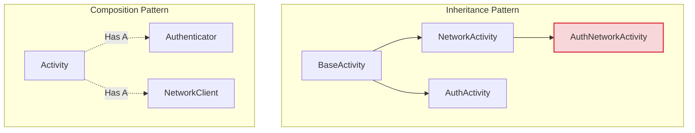

# Composition Over Inheritance

## Overview

"Favor Object Composition over Class Inheritance" is the foundational rule of object-oriented design. It means you should achieve code reuse by assembling small, focused objects together (Composition: a "has-a" relationship) rather than creating deep, rigid class hierarchies (Inheritance: an "is-a" relationship). In Android, the shift from XML/Activities to Jetpack Compose is the ultimate realization of this principle.

## Why It Matters

Inheritance is the tightest form of coupling in programming. When Class B inherits from Class A, Class B is permanently and rigidly bound to the internals of Class A. If you change a method in Class A, you risk breaking Class B, Class C, and every other subclass down the tree. This leads to the "Fragile Base Class" problem.

Furthermore, a class can usually only inherit from one superclass. If you have a `LoggingActivity` and an `AuthActivity`, and you need an Activity that logs *and* authenticates, inheritance forces you into impossible architectural corners. Composition allows you to easily inject a `Logger` and an `Authenticator` into any class.

## Historical Context

This is the second principle listed in the introduction of the legendary 1994 "Gang of Four" Design Patterns book. For decades, Java developers ignored it, building massive 7-layer inheritance hierarchies (`BaseFragment -> BaseNetworkFragment -> BaseListFragment -> BasePagingListFragment`). 

Modern Android development has aggressively rejected inheritance. Kotlin makes classes `final` by default. Jetpack Compose completely abandons inheritance-based Views (`class MyButton : Button()`) in favor of composition-based functions (`@Composable fun MyButton() { Text() }`).

## First Principles

1.  **"Is-A" vs "Has-A":** A `Car` *is a* `Vehicle` (Inheritance). A `Car` *has an* `Engine` (Composition). If you aren't absolutely sure it's an "is-a" relationship, use Composition.
2.  **Flatten the Hierarchy:** Deep inheritance trees ($>2$ levels) are almost always a mistake. They hide logic and create massive cognitive load.
3.  **Interfaces > Base Classes:** If you want polymorphism (treating different objects uniformly), use Interfaces, not abstract base classes.

## Mental Model

Think of building a robot.
- **Inheritance:** You have a `BaseRobot`. You want it to fly, so you create `FlyingRobot : BaseRobot`. You want it to swim, so you create `SwimmingRobot : BaseRobot`. Now you want one that flies *and* swims. Do you create `FlyingSwimmingRobot : FlyingRobot`? What if it needs to inherit the swimming logic? The hierarchy is broken.
- **Composition:** You have a `Robot`. You build a `Jetpack` component and a `Flippers` component. You want a flying robot? Hand the robot a Jetpack. You want a flying, swimming robot? Hand it both. The robot doesn't change; you just compose it with different parts.

## Internal Mechanics

### The Fragile Base Class (Inheritance Failure)

```kotlin
// BAD: The Base Class Trap
open class BaseViewModel : ViewModel() {
    val isLoading = MutableStateFlow(false)
    val error = MutableSharedFlow<String>()

    protected fun launchWithLoading(block: suspend () -> Unit) {
        // ... complex coroutine logic that toggles isLoading and catches errors
    }
}

// Subclasses are locked into the exact way the base class handles errors and loading.
class ProfileViewModel : BaseViewModel() {
    fun load() = launchWithLoading { api.getProfile() }
}
```
*Why this fails:* What if `SettingsViewModel` needs to handle loading state differently for just one method? It can't. It's bound to the `BaseViewModel`. If you modify `BaseViewModel` to accommodate `Settings`, you might accidentally break `Profile`.

### The Composable Solution (Composition)

```kotlin
// GOOD: Composition via independent components
class ErrorHandler {
    val errorFlow = MutableSharedFlow<String>()
    suspend fun handle(block: suspend () -> Unit) { ... }
}

class LoadingDelegate {
    val isLoading = MutableStateFlow(false)
    suspend fun wrap(block: suspend () -> Unit) { ... }
}

// The ViewModel HAS a loader and an error handler. It IS NOT a loader itself.
class ProfileViewModel(
    private val errorHandler: ErrorHandler,
    private val loader: LoadingDelegate
) : ViewModel() {
    
    fun load() = viewModelScope.launch {
        errorHandler.handle {
            loader.wrap { api.getProfile() }
        }
    }
}
```

## Architecture



## Production Example

**Jetpack Compose UI**

The classic Android View system relied on deep inheritance. A `Button` inherited from `TextView`, which inherited from `View`. If you wanted a Button with an image in it, you couldn't easily compose it; you had to write a custom class that inherited and overrode measurement and drawing logic.

Compose destroys this. There is no `View` class to inherit from.

```kotlin
// You don't inherit from Button. You CALL a Button and compose things inside it.
@Composable
fun IconTextButton(onClick: () -> Unit) {
    Button(onClick = onClick) { // Button is a container
        Row { // Row is a container
            Icon(Icons.Filled.Favorite, contentDescription = null) // Has an Icon
            Spacer(Modifier.width(8.dp))
            Text("Like") // Has a Text
        }
    }
}
```
You build complex UIs entirely by composing small, independent functions together, bypassing inheritance completely. Modifiers are the purest expression of this principle: instead of subclassing `View` to create a `ClickablePaddedText` that inherits click and padding behavior, you start with a base `Text` and compose behaviors onto it via modifiers (`Modifier.clickable {}.padding(16.dp)`).

## Tradeoffs

**Advantages**
- **Flexibility:** You can swap components at runtime (e.g., swapping a `NetworkLogger` for a `ConsoleLogger`). Inheritance is locked at compile-time.
- **Testability:** You can easily inject a `MockAuthenticator` into a class. You cannot easily mock a Base Class that your class inherits from.
- **Prevents God Classes:** Base classes tend to accumulate hundreds of utility methods over the years, becoming unmaintainable "God Classes". Composition forces you to break utilities into separate, focused objects.

**Disadvantages**
- **Boilerplate:** Composition requires you to explicitly wire objects together (Dependency Injection) and often requires forwarding methods. If Class A holds Class B, and needs to expose Class B's methods, you have to write forwarding boilerplate. (Kotlin's interface delegation via the `by` keyword solves a lot of this).
- **Indirection:** Tracing logic can be slightly harder. Instead of looking at the superclass, you have to look at the injected interface and figure out which concrete implementation is running at runtime.

## Failure Modes

- **The `BaseFragment` / `BaseActivity` Anti-Pattern:** Creating a `BaseFragment` that handles Google Analytics, Dependency Injection, Toolbar setup, and Keyboard hiding. Every fragment in the app is now a massive, bloated object, even if it only needs to show a single line of text. *(Fix: Use composition or Kotlin Extension Functions instead).*
- **Misusing Interface Delegation:** Kotlin's `class MyClass(delegate: Engine) : Engine by delegate` is powerful, but overusing it to hide massive amounts of composition behind a single interface leads to the exact same coupling problems as inheritance.
- **Forced Composition for True "Is-A" Relationships:** Sometimes, a `Cat` really *is an* `Animal`. If you have a perfectly valid taxonomic hierarchy where polymorphic behavior is required and logic is strictly shared, inheritance is the correct tool. Don't build an `AnimalContainer(val catData: Cat)` just to avoid the `open` keyword.

## Staff Engineer Thinking

When reviewing code, a Staff engineer heavily scrutinizes the `open` keyword:

1.  **Is this class designed for extension?** Joshua Bloch (Effective Java) states: "Design and document for inheritance or else prohibit it." If a class is not specifically engineered, documented, and tested to be subclassed, it should be `final` (which is default in Kotlin).
2.  **Is there a hidden `Base` class?** I will actively refactor PRs that introduce a `BaseViewModel`. If code needs to be shared, I will ask the author to extract it into an injected utility class, a Kotlin Extension function, or a Use Case / Interactor.
3.  **Are we using inheritance for code reuse?** Inheritance is for *polymorphism* (treating a Cat as an Animal). It is a terrible tool for *code reuse* (inheriting from `StringUtils` to get access to a `formatDate` method). Code reuse must be done via Composition.

## Common Misconceptions

- **"Inheritance is bad."** Inheritance is not inherently bad; it is just highly specialized. It is a surgical scalpel. Most developers treat it like a hammer and use it for everything, which is why it gets a bad reputation.
- **"Interfaces are inheritance."** Implementing an interface is *subtyping*, not *implementation inheritance*. Implementing an interface does not tightly couple you to any existing code or state, making it extremely safe compared to inheriting from an abstract base class.

## Probing Questions

1.  What is the "Fragile Base Class" problem, and how does Composition solve it?
2.  Why does Kotlin make classes `final` by default, whereas Java makes them `open` by default?
3.  Explain how Jetpack Compose utilizes Composition over Inheritance compared to the traditional Android XML View system.
4.  If you need to share a generic "Error Handling" algorithm across 10 ViewModels, how do you do it without creating a `BaseViewModel`?
5.  What is the difference between Subtyping (Interfaces) and Implementation Inheritance (Classes)?
6.  How does Kotlin's `by` keyword (Interface Delegation) make the Composition pattern easier to implement?
7.  Give an example of a situation where Class Inheritance is actually the *correct* architectural choice.
8.  How does the "Composition Over Inheritance" principle relate to the Single Responsibility Principle (SOLID)?
9.  Why does deep class inheritance make unit testing incredibly difficult?
10. Describe the impact on Android APK size and method count when choosing Composition over a massive `BaseActivity` hierarchy.

## Answer Key

1. **What is the "Fragile Base Class" problem, and how does Composition solve it?**
   It occurs when a change to a base class unintentionally breaks its subclasses due to tight coupling. Composition solves this by allowing objects to assemble distinct, independent components rather than inheriting behavior, isolating changes.
2. **Why does Kotlin make classes `final` by default, whereas Java makes them `open` by default?**
   Kotlin enforces "design and document for inheritance or else prohibit it." Making classes `final` by default prevents accidental and dangerous inheritance hierarchies, encouraging composition instead.
3. **Explain how Jetpack Compose utilizes Composition over Inheritance compared to the traditional Android XML View system.**
   Instead of inheriting from `View` or `Button` to create custom behaviors, Compose uses independent `@Composable` functions that call other functions (e.g., putting a `Text` inside a `Row`), building UI by assembling pieces.
4. **If you need to share a generic "Error Handling" algorithm across 10 ViewModels, how do you do it without creating a `BaseViewModel`?**
   Create a standalone `ErrorHandler` class and inject it into the ViewModels using dependency injection, allowing them to delegate error handling without being tightly bound to a base class.
5. **What is the difference between Subtyping (Interfaces) and Implementation Inheritance (Classes)?**
   Subtyping (Interfaces) defines a contract for behavior without enforcing how it is implemented, ensuring loose coupling. Implementation Inheritance shares both state and logic, creating tight coupling to the parent class.
6. **How does Kotlin's `by` keyword (Interface Delegation) make the Composition pattern easier to implement?**
   It automatically generates the boilerplate code required to forward interface method calls to an injected delegate object, making composition as concise to write as inheritance.
7. **Give an example of a situation where Class Inheritance is actually the *correct* architectural choice.**
   When you have a strict, true taxonomic "is-a" relationship where all subclasses share identical core logic and polymorphism is required, such as a fundamental UI framework widget where behavior must be strictly constrained.
8. **How does the "Composition Over Inheritance" principle relate to the Single Responsibility Principle (SOLID)?**
   Composition forces you to break large base classes into smaller, focused components (e.g., a logger, a network client), which naturally aligns with giving each class a single responsibility.
9. **Why does deep class inheritance make unit testing incredibly difficult?**
   Because testing a subclass implicitly requires testing and mocking all the hidden state and logic of every parent class in its hierarchy, which is often impossible or extremely brittle.
10. **Describe the impact on Android APK size and method count when choosing Composition over a massive `BaseActivity` hierarchy.**
    Composition avoids the bloat of "God Classes" and dead code inherited by subclasses that don't need it, ultimately keeping the method count lower and reducing APK size.

## Further Reading

- [`simplicity.md`](simplicity.md) — Composition creates many simple classes; Inheritance creates a few infinitely complex ones.
- [`../patterns/decorator.md`](../patterns/decorator.md) — The Decorator pattern is a specific, powerful implementation of Composition.
- [Effective Java: Item 18](https://learning.oreilly.com/library/view/effective-java/9780134686097/ch4.xhtml) — Favor composition over inheritance.
