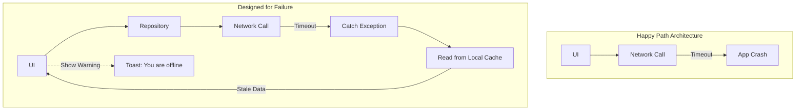

# Design for Failure

## Overview

"Design for Failure" is the engineering practice of treating dependency, resource, and lifecycle failures as expected design inputs. Hardware can fail, networks drop, storage fills, processes terminate, and APIs return errors. The goal is to define which failures can be recovered, which functionality can degrade, and which operations must stop safely while preserving data and user trust.

## Why It Matters

In a mobile environment, interruptions are normal operating conditions rather than rare edge cases. A user can enter a tunnel while uploading a photo, the OS can terminate a background process, and a server can be unavailable during maintenance.

If a design specifies only the successful path, unhandled failures can crash the process, lose work, duplicate side effects, or leave ambiguous UI state. Specify failure outcomes, observability, recovery, and tests alongside the successful path.

## Historical Context

Distributed-systems practice popularized fault injection and chaos engineering: controlled experiments test whether declared resilience mechanisms work. On Android, `WorkManager` provides persistent scheduling, constraints, and configurable backoff, but a worker requests retry by returning `Result.retry()`; the library does not infer that every failure is retryable. Offline-first architecture similarly makes selected capabilities less dependent on immediate connectivity rather than eliminating failure.

## First Principles

1.  **Model failure explicitly:** A network call, file write, or nullable input needs a declared success, failure, cancellation, and timeout contract where those outcomes affect correctness.
2.  **Graceful Degradation:** Preserve a safe subset of functionality when product semantics allow it. Cached search results may be useful; a stale account balance may require a blocking freshness warning instead.
3.  **Blast Radius Containment:** If the Analytics module crashes, it should not bring down the Checkout module. Isolate components so failures don't cascade.

## Mental Model

Think of an airplane with four engines.
- **Not Designed for Failure (A cheap drone):** If one propeller stops, the drone flips upside down and smashes into the ground. A single point of failure destroys the entire system.
- **Designed for Failure (A Boeing 747):** If one engine explodes, the plane detects the failure, shuts off the fuel line to that engine to prevent a fire (Blast Radius Containment), adjusts the rudder to compensate, and continues flying on the remaining three engines (Graceful Degradation). It lands safely, and the mechanics fix it later.

## Internal Mechanics

Designing for failure requires utilizing specific resilience patterns and defensive programming techniques.

### 1. Defensive Programming (Nulls and Bounds)

Kotlin's null-safety is a language-level "Design for Failure" feature. But you must go further.

**Bad (Happy Path Only):**
```kotlin
fun processData(list: List<Int>) {
    val firstItem = list[0] // What if the list is empty? Crash.
    val result = 100 / firstItem // What if it's 0? Crash.
}
```

**Good (Defensive):**
```kotlin
fun processData(list: List<Int>) {
    val firstItem = list.firstOrNull() ?: return // Graceful exit
    if (firstItem == 0) return // Prevent arithmetic exception
    val result = 100 / firstItem
}
```

### 2. Timeouts and Retries

Bound waits on remote, blocking, or user-visible operations with a timeout and cancellation policy derived from the operation's deadline. A deliberately long-lived stream still needs liveness and shutdown semantics.

**Bad:**
```kotlin
// If the server is hanging, the user stares at a spinner forever.
val response = api.fetchData() 
```

**Bounded example:**
```kotlin
val client = OkHttpClient.Builder()
    .readTimeout(10, TimeUnit.SECONDS)
    .build()

val response = retryPolicy.execute(
    operation = ReadOperation(
        idempotent = true,
        deadline = 15.seconds,
        maxAttempts = 3,
    ),
) { api.fetchData() } // policy applies cancellation, server hints, backoff, and jitter
```

The numbers are illustrative. A non-idempotent command, non-replayable body, or expired user deadline may require no automatic retry even though it still needs a timeout.

## Architecture



## Production Example

**Offline-First Architecture**

Offline-first is one application of designing for intermittent connectivity.

A network-only read may be unavailable when connectivity is absent. Reading from a local source of truth can keep a critical subset usable and expose known freshness, while synchronization updates it when policy and connectivity allow. Empty or corrupt local state, authentication expiry, rejected queued writes, conflicts, storage failure, and dangerously stale data still require explicit outcomes; offline-first does not make the feature failure-proof.

See [`../reference-architectures/offline-first-app.md`](../reference-architectures/offline-first-app.md).

## Tradeoffs

**Advantages**
- **Bounded user impact:** Declared fallback and recovery paths can preserve safe functionality during expected failures.
- **Operational control:** Idempotency, retry budgets, kill switches, and observable failure states reduce ambiguity during incidents.

**Disadvantages**
- **Delivery cost:** Error states, persistence, conflict handling, retries, and fault-injection tests add implementation and maintenance work; estimate that cost for the feature instead of assuming a fixed multiplier.
- **Masking errors:** A fallback can hide a dependency regression unless the system measures the affected operation and freshness. Choose an operational metric, sampled diagnostic event, exception report, or product event by its decision purpose using the [telemetry taxonomy](../observability/telemetry-taxonomy.md).
- **Complexity:** Each recovery path adds states and interactions that require ownership and tests.

## Failure Modes

- **Silent Failures:** Catching an exception without producing the required user state or operational evidence. *(Fix: Map the failure to an explicit domain/UI outcome and select telemetry by actionability, volume, privacy, and ownership. Expected connectivity failures often belong in aggregated metrics or sampled diagnostics; violated invariants may justify an exception report.)*
- **Retry Storms (The Thundering Herd):** A large client fleet retries an outage in synchronized loops and delays recovery. *(Fix: Retry only eligible operations within their idempotency and deadline policy; use bounded attempts, server hints, backoff, and jitter where appropriate.)*
- **Over-Caching:** Showing data from 3 years ago because the network call failed. Graceful degradation requires limits. Showing no data with an error message is sometimes better than showing dangerously stale data (e.g., in a banking app).

## Staff Engineer Thinking

When reviewing a new feature, a Staff engineer's first instinct is to ask: "How does this break?"

1.  **What if the network drops halfway through?** If this is a multi-step purchase flow, do we charge them twice? (If yes, we need Idempotency). Do we leave them in a state where they paid but didn't get the item? (If yes, we need a Saga).
2.  **What if the OS kills us?** If the user backgrounds the app to check a text message, and the OS kills our process to reclaim memory, what happens when they come back? Is the `ViewModel` state saved in `SavedStateHandle`?
3.  **What is the failure outcome?** Each remote operation needs an intentional outcome at its owning boundary: cached data with freshness, a typed error, a retryable state, an error surface, or a deliberate no-op whose observability and product semantics are documented.
4.  **How do we build evidence that this fails safely? (Chaos Engineering)** A Staff engineer doesn't just assume the retry logic works; they introduce fault injection in testing or staging—simulating dropped packets, 500 errors, or high latency—to verify that the app degrades gracefully rather than crashing.

## Common Misconceptions

- **"Design for Failure means catching all Exceptions."** No. Catch at a boundary that can add a meaningful recovery or translation, prefer the narrowest useful type, and preserve the original cause. In suspending code, a broad `catch (Exception)` also catches `CancellationException`, which normally must be rethrown. `OutOfMemoryError` is an `Error`, not an `Exception`, so this catch does not handle it.
- **"If the server is reliable, I don't need this."** Server availability is only one dependency. DNS, authentication, device connectivity, process lifetime, storage, and client/server compatibility can still fail independently.

## Probing Questions

1.  What is "Graceful Degradation"? Provide an example from a popular app you use.
2.  Why is the "Happy Path" considered dangerous in mobile engineering?
3.  Explain how the Offline-First architecture is fundamentally an exercise in Designing for Failure.
4.  What is a "Retry Storm" (Thundering Herd), and how do you prevent it?
5.  Why is catching generic `Exception`s (`catch (e: Exception)`) considered bad practice when designing for failure?
6.  How do Android libraries like `WorkManager` embody the "Design for Failure" philosophy?
7.  If you are building a banking app, what are the tradeoffs between showing stale cached data vs showing a "Network Error" screen?
8.  How does the principle of "Blast Radius Containment" apply to modularizing an Android application?
9.  Describe a scenario where a silent failure (swallowing an exception without logging it) would be disastrous for the engineering team.
10. If an API call fails, what are three different fallback UI strategies you could employ?

## Answer Key

1. **What is "Graceful Degradation"? Provide an example from a popular app you use.**
   It is the ability of a system to continue operating, albeit with reduced functionality, when a component fails. For example, Netflix showing a cached list of downloaded shows when the device loses network connectivity.
2. **Why is the "Happy Path" considered dangerous in mobile engineering?**
   Mobile code runs across variable connectivity, process lifetime, storage, and remote dependencies. If those outcomes are unspecified, a feature can crash, lose or duplicate work, or expose ambiguous state when a failure occurs.
3. **Explain how the Offline-First architecture is fundamentally an exercise in Designing for Failure.**
   It makes selected reads or writes usable without immediate connectivity by relying on local state and an explicit synchronization policy. The design must still handle empty or stale state, conflicts, rejected writes, authentication, storage failure, and operations that cannot safely complete offline.
4. **What is a "Retry Storm" (Thundering Herd), and how do you prevent it?**
   A retry storm happens when a large fleet retries in synchronized bursts and delays recovery. Retry only eligible operations within attempt/deadline budgets, honor server hints, and use backoff plus jitter where appropriate; those controls reduce load but do not guarantee recovery.
5. **Why is catching generic `Exception`s (`catch (e: Exception)`) considered bad practice when designing for failure?**
   A broad catch can collapse unrelated failures into one path and, in coroutine code, can swallow cancellation unless it is rethrown. It does not catch `OutOfMemoryError`, which is an `Error`. Catch only where the boundary can recover, translate, add context, or clean up without hiding the original cause.
6. **How do Android libraries like `WorkManager` embody the "Design for Failure" philosophy?**
   WorkManager persists scheduled work, applies declared constraints, and reschedules it across supported process/device lifecycle events. A worker must return `Result.retry()` for a retryable failure; its `WorkRequest` controls backoff, while permanent failures should return `Result.failure()`.
7. **If you are building a banking app, what are the tradeoffs between showing stale cached data vs showing a "Network Error" screen?**
   Stale data provides a better UX but is highly dangerous if a user thinks their balance is higher than it is. A network error screen degrades UX but strictly protects the user from financial mistakes.
8. **How does the principle of "Blast Radius Containment" apply to modularizing an Android application?**
   Module boundaries limit compile-time dependencies, state ownership, and the code affected by a change. They do not isolate uncaught exceptions at runtime when modules share one process; runtime fault containment needs caught/process/IPC boundaries or platform isolation appropriate to the threat model.
9. **Describe a scenario where a silent failure (swallowing an exception without logging it) would be disastrous for the engineering team.**
   If checkout fails silently, the UI may provide no recovery and exception reporting may show nothing because the failure was handled. A journey metric plus sampled diagnostics and an owned alert can expose the impact without treating every occurrence as a crash.
10. **If an API call fails, what are three different fallback UI strategies you could employ?**
    1) Show a full-screen error with a retry button. 2) Show a non-blocking Snackbar/Toast while continuing to display cached data. 3) Degrade the specific UI component (e.g., an empty state for a widget) while the rest of the screen functions normally.

## Further Reading

- [`circuit-breaker.md`](../patterns/circuit-breaker.md) and [`retry.md`](../patterns/retry.md) — The mechanical implementations of this philosophy.
- [`../reference-architectures/offline-first-app.md`](../reference-architectures/offline-first-app.md) — An application of failure-aware local state and synchronization.
- AWS Builders' Library: [Timeouts, retries, and backoff with jitter](https://aws.amazon.com/builders-library/timeouts-retries-and-backoff-with-jitter/)
- [Android offline-first guidance](https://developer.android.com/topic/architecture/data-layer/offline-first) — Local sources, write strategies, synchronization, and remaining failure cases.
- [WorkManager retry and backoff](https://developer.android.com/develop/background-work/background-tasks/persistent/getting-started/define-work#retries_backoff) — Explicit `Result.retry()` behavior.
- [Kotlin cancellation](https://kotlinlang.org/docs/cancellation-and-timeouts.html) — Why cancellation exceptions should be rethrown.
- [`../observability/telemetry-taxonomy.md`](../observability/telemetry-taxonomy.md) — Selecting metrics, diagnostics, exception reports, traces, and product events.
