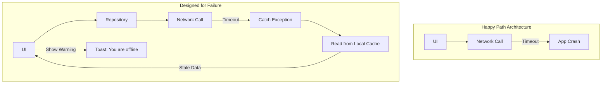

# Design for Failure

## Overview

"Design for Failure" is the engineering philosophy that accepts that everything will eventually break. Hardware fails, networks drop, memory runs out, and APIs return 500s. Instead of trying to build a perfectly flawless system (which is impossible), you build a system that degrades gracefully, recovers automatically, and protects the user experience when those inevitable failures occur.

## Why It Matters

In a mobile environment, failure is not an edge case; it is the default state. The user will enter a tunnel while uploading a photo. The OS will kill your app while it is in the background. The server will go down for maintenance. 

If you assume the "Happy Path" is the only path, your app will crash, corrupt data, and infuriate users. Designing for failure means writing the error-handling code *first*, not as an afterthought.

## Historical Context

Popularized by Amazon Web Services (AWS) in the 2000s under the mantra "Everything fails, all the time." In distributed systems engineering, this led to the creation of Chaos Engineering (e.g., Netflix's Chaos Monkey), where engineers deliberately break production systems to ensure the architecture can survive it. In Android, this philosophy gave birth to libraries like `WorkManager` (which expects background tasks to fail and handles retries automatically) and the offline-first architecture movement.

## First Principles

1.  **Assume the Worst:** Never assume a network call will succeed. Never assume a file write will complete. Never assume an object won't be null if the compiler allows it.
2.  **Graceful Degradation:** If the system cannot do 100% of its job, it should do 80% of its job. If it can't show live search results, it should show cached results. It should never just crash.
3.  **Blast Radius Containment:** If the Analytics module crashes, it should not bring down the Checkout module. Isolate components so failures don't cascade.

## Mental Model

Think of an airplane with four engines.
- **Not Designed for Failure (A cheap drone):** If one propeller stops, the drone flips upside down and smashes into the ground. A single point of failure destroys the entire system.
- **Designed for Failure (A Boeing 747):** If one engine explodes, the plane detects the failure, shuts off the fuel line to that engine to prevent a fire (Blast Radius Containment), adjusts the rudder to compensate, and continues flying on the remaining three engines (Graceful Degradation). It lands safely, and the mechanics fix it later.

## Internal Mechanics

Designing for failure requires utilizing specific resilience patterns and defensive programming techniques.

### 1. Defensive Programming (Nulls and Bounds)

Kotlin's null-safety is a language-level "Design for Failure" feature. But you must go further.

**Bad (Happy Path Only):**
```kotlin
fun processData(list: List<Int>) {
    val firstItem = list[0] // What if the list is empty? Crash.
    val result = 100 / firstItem // What if it's 0? Crash.
}
```

**Good (Defensive):**
```kotlin
fun processData(list: List<Int>) {
    val firstItem = list.firstOrNull() ?: return // Graceful exit
    if (firstItem == 0) return // Prevent arithmetic exception
    val result = 100 / firstItem
}
```

### 2. Timeouts and Retries

Never wait forever.

**Bad:**
```kotlin
// If the server is hanging, the user stares at a spinner forever.
val response = api.fetchData() 
```

**Good:**
```kotlin
// OkHttp handles the timeout. The Coroutine handles the retry.
val client = OkHttpClient.Builder()
    .readTimeout(10, TimeUnit.SECONDS)
    .build()

val response = retryWithBackoff { api.fetchData() }
```

## Architecture



## Production Example

**Offline-First Architecture**

The ultimate "Design for Failure" architecture in mobile is Offline-First. 

If the app only reads from the network, it fails completely when the network is dead. 
If the app reads from a local database, and a background sync engine updates the database from the network, the app *cannot fail* due to network issues. The user always sees data (even if stale), and modifications are queued locally to be sent when the network returns.

See [`../reference-architectures/offline-first-app.md`](../reference-architectures/offline-first-app.md).

## Tradeoffs

**Advantages**
- **Unbreakable UX:** The app feels incredibly solid to the user, even in terrible conditions.
- **Peace of Mind:** Engineers sleep better knowing that a 500 error from the backend won't trigger a 1-star review bomb on the Play Store.

**Disadvantages**
- **Slower Development:** Writing the error-handling paths, the caching layers, and the retry logic takes 3x longer than writing the "Happy Path" code.
- **Masking Errors:** If your app degrades *too* gracefully, the engineering team might not realize the backend is failing 50% of the time. (This is why comprehensive Telemetry/Analytics is mandatory when designing for failure).
- **Code Bloat:** The codebase becomes significantly larger and more complex.

## Failure Modes

- **Silent Failures:** Catching an exception, doing nothing, and hiding the error from both the user and the crash reporter. The user taps a button, nothing happens, and you have no logs. *(Fix: Always log exceptions to Crashlytics, even if you degrade gracefully for the user).*
- **Retry Storms (The Thundering Herd):** A backend server goes down. 1 million mobile clients instantly retry every 100ms. When the server tries to reboot, the massive flood of traffic immediately kills it again. *(Fix: Always use Exponential Backoff and Jitter).*
- **Over-Caching:** Showing data from 3 years ago because the network call failed. Graceful degradation requires limits. Showing no data with an error message is sometimes better than showing dangerously stale data (e.g., in a banking app).

## Staff Engineer Thinking

When reviewing a new feature, a Staff engineer's first instinct is to ask: "How does this break?"

1.  **What if the network drops halfway through?** If this is a multi-step purchase flow, do we charge them twice? (If yes, we need Idempotency). Do we leave them in a state where they paid but didn't get the item? (If yes, we need a Saga).
2.  **What if the OS kills us?** If the user backgrounds the app to check a text message, and the OS kills our process to reclaim memory, what happens when they come back? Is the `ViewModel` state saved in `SavedStateHandle`?
3.  **What is the fallback?** Every single remote API call must have a defined fallback behavior. Is it a cached value? An empty list? An error banner? A full-screen error state? It cannot be "do nothing."
4.  **How do we build evidence that this fails safely? (Chaos Engineering)** A Staff engineer doesn't just assume the retry logic works; they introduce fault injection in testing or staging—simulating dropped packets, 500 errors, or high latency—to verify that the app degrades gracefully rather than crashing.

## Common Misconceptions

- **"Design for Failure means catching all Exceptions."** No. `catch (e: Exception)` is often an anti-pattern (Pokemon Exception Handling - "Gotta catch 'em all!"). It hides `OutOfMemoryErrors` and `NullPointerExceptions` which indicate fundamental programmer errors that *should* crash the app during development. You should only catch specific, expected exceptions (like `IOException` or `HttpException`).
- **"If the server is reliable, I don't need this."** Mobile networks are never reliable. Even if your server has 100% uptime, the radio on the user's phone will drop packets when they walk into an elevator.

## Probing Questions

1.  What is "Graceful Degradation"? Provide an example from a popular app you use.
2.  Why is the "Happy Path" considered dangerous in mobile engineering?
3.  Explain how the Offline-First architecture is fundamentally an exercise in Designing for Failure.
4.  What is a "Retry Storm" (Thundering Herd), and how do you prevent it?
5.  Why is catching generic `Exception`s (`catch (e: Exception)`) considered bad practice when designing for failure?
6.  How do Android libraries like `WorkManager` embody the "Design for Failure" philosophy?
7.  If you are building a banking app, what are the tradeoffs between showing stale cached data vs showing a "Network Error" screen?
8.  How does the principle of "Blast Radius Containment" apply to modularizing an Android application?
9.  Describe a scenario where a silent failure (swallowing an exception without logging it) would be disastrous for the engineering team.
10. If an API call fails, what are three different fallback UI strategies you could employ?

## Answer Key

1. **What is "Graceful Degradation"? Provide an example from a popular app you use.**
   It is the ability of a system to continue operating, albeit with reduced functionality, when a component fails. For example, Netflix showing a cached list of downloaded shows when the device loses network connectivity.
2. **Why is the "Happy Path" considered dangerous in mobile engineering?**
   Because mobile environments are inherently unstable (network drops, OS background kills). Designing only for the happy path guarantees crashes and data corruption when inevitable failures occur.
3. **Explain how the Offline-First architecture is fundamentally an exercise in Designing for Failure.**
   It assumes the network is always down. By reading from a local database and queuing network writes in the background, it ensures the app never fails or blocks the user due to connectivity issues.
4. **What is a "Retry Storm" (Thundering Herd), and how do you prevent it?**
   A retry storm happens when a server comes back online and millions of clients simultaneously retry failed requests, crashing the server again. It is prevented by using Exponential Backoff with Jitter (randomized delays).
5. **Why is catching generic `Exception`s (`catch (e: Exception)`) considered bad practice when designing for failure?**
   It masks critical, unrecoverable programmer errors (like `NullPointerException` or `OutOfMemoryError`) that should crash the app during testing, preventing them from being discovered and fixed.
6. **How do Android libraries like `WorkManager` embody the "Design for Failure" philosophy?**
   They inherently expect tasks to fail due to device conditions (doze mode, network loss) and automatically handle retries, constraints, and persistence without requiring manual developer intervention.
7. **If you are building a banking app, what are the tradeoffs between showing stale cached data vs showing a "Network Error" screen?**
   Stale data provides a better UX but is highly dangerous if a user thinks their balance is higher than it is. A network error screen degrades UX but strictly protects the user from financial mistakes.
8. **How does the principle of "Blast Radius Containment" apply to modularizing an Android application?**
   By isolating features into separate modules with strict boundaries, a crash or unhandled exception in one module (like a side-feature) is less likely to corrupt state or crash the core functionality of the app.
9. **Describe a scenario where a silent failure (swallowing an exception without logging it) would be disastrous for the engineering team.**
   If a checkout API call fails silently and the app shows no error, users can't buy items, and the engineering team sees zero crash reports, leaving them completely unaware of massive revenue loss.
10. **If an API call fails, what are three different fallback UI strategies you could employ?**
    1) Show a full-screen error with a retry button. 2) Show a non-blocking Snackbar/Toast while continuing to display cached data. 3) Degrade the specific UI component (e.g., an empty state for a widget) while the rest of the screen functions normally.

## Further Reading

- [`circuit-breaker.md`](../patterns/circuit-breaker.md) and [`retry.md`](../patterns/retry.md) — The mechanical implementations of this philosophy.
- [`../reference-architectures/offline-first-app.md`](../reference-architectures/offline-first-app.md) — The ultimate expression of Design for Failure.
- AWS Builders' Library: [Timeouts, retries, and backoff with jitter](https://aws.amazon.com/builders-library/timeouts-retries-and-backoff-with-jitter/)
