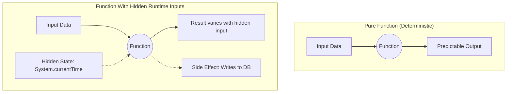

# Determinism

## Overview

Determinism means that a fully specified initial state and set of inputs produce the same observable result. It is one tool for reproducibility and testability, not a synonym for reliability: a deterministic program can reliably produce the wrong result, while a system can contain intentionally variable inputs and still bound their effects.

## Why It Matters

"It works on my machine" is the battle cry of a non-deterministic system. If a function works 99 times but crashes on the 100th time, it is a nightmare to debug. Non-determinism destroys developer confidence. It leads to flaky tests that the team eventually ignores. If tests are ignored, bugs slip into production, and the application's perceived quality plummets.

## Historical Context

Functional programming emphasizes pure functions, which are referentially transparent and avoid observable side effects. Object-oriented code can also be deterministic when its state and ordering are explicit. Unidirectional Data Flow (UDF) in Android makes state transitions easier to reproduce by giving updates a declared direction and owner.

## First Principles

1.  **Specified Input = Reproducible Result:** Include relevant initial state, configuration, ordering, and environmental inputs in the contract.
2.  **Control Hidden Inputs:** Inject or otherwise control clocks, random sources, schedulers, global state, and external dependencies when reproducibility matters.
3.  **Separate purity from determinism:** A pure function is easier to reason about because it has no observable side effects. A state transition or I/O workflow can still be deterministic under a specified state and ordering, but it is not pure.

## Mental Model

Think of a basic calculator versus a slot machine.

- **Deterministic (The Calculator):** Given the same operation and numeric inputs, the calculator returns the same result. Tests can assert examples and properties, while implementation defects and untested inputs still limit confidence.
- **Variable input (The Slot Machine):** A pull consumes state from a random source. Injecting a seeded source makes a test execution reproducible; production randomness remains an intentional input rather than proof that the surrounding logic is untestable.

## Internal Mechanics

The most common sources of non-determinism in Android are Time, Concurrency (Threads), and Global State.

### 1. The Time Problem

Reading the system clock makes the current instant an implicit input. Inject a `Clock` when a test or business rule must control that input.

**Bad (Non-Deterministic):**
```kotlin
fun isWeekend(): Boolean {
    // Hidden dependency on the system clock!
    val today = Calendar.getInstance().get(Calendar.DAY_OF_WEEK)
    return today == Calendar.SATURDAY || today == Calendar.SUNDAY
}

// How do you unit test this? The test will pass on Friday and fail on Saturday.
```

The diagram separates declared inputs from hidden runtime inputs: make the latter explicit or controlled when reproducibility matters, and treat side-effect ownership as a separate design concern from determinism.

**Good (Deterministic):**
```kotlin
// Time is passed as an explicitly injected input.
fun isWeekend(clock: Clock): Boolean {
    val today = clock.now().dayOfWeek
    return today == DayOfWeek.SATURDAY || today == DayOfWeek.SUNDAY
}

// In the Unit Test, you pass a FakeClock frozen to a Tuesday.
// The clock-dependent behavior is reproducible for this input.
```

### 2. The Concurrency Problem

If Thread A and Thread B access a mutable variable at the same time, the result depends entirely on which thread the OS schedules first. This is a Race Condition.

**Bad (Non-Deterministic Race Condition):**
```kotlin
var counter = 0 // Shared mutable state

fun increment() {
    counter++ // Under the hood: read, add 1, write. 
}
// If two threads call increment() at the exact same millisecond, 
// the counter might only increase by 1.
```

**Good (Deterministic Thread Safety):**
```kotlin
val counter = AtomicInteger(0)

fun increment() {
    counter.incrementAndGet() // Atomic operation, thread-safe.
}
```

## Architecture



## Production Example

**Jetpack Compose**

Jetpack Compose can invoke, skip, or reorder composition work. A composable should describe UI from its current inputs and keep side effects in the effect APIs designed for their lifecycle.

Reading an uncontrolled random value during composition can produce visible changes across recompositions:

```kotlin
// BAD: Non-Deterministic Composable
@Composable
fun Greeting(name: String) {
    // Math.random() is non-deterministic hidden state!
    val color = if (Math.random() > 0.5) Color.Red else Color.Blue
    
    Text(text = "Hello $name", color = color)
    // Every time the screen recomposes (e.g., during a scroll), 
    // the text will randomly flash red and blue.
}
```

Compose guidance describes composables as idempotent and free of uncoordinated side effects. Idempotence and determinism are related but distinct: idempotence means repeating an operation does not change the result after the first application; determinism means specified inputs produce a reproducible result.

## Tradeoffs

**Advantages**
- **Testability:** Explicit inputs let tests reproduce cases without relying on ambient state.
- **Debuggability:** Capturing the relevant inputs, state, version, and ordering improves reproduction; determinism does not guarantee that all of them were captured.
- **Caching:** A deterministic computation can be memoized while its function version, complete input key, freshness, memory, and invalidation policy remain valid.

**Disadvantages**
- **Boilerplate:** To make things deterministic, you often have to inject dependencies (like `Clock` or `Random` generators) through constructors, which adds boilerplate compared to just calling `System.currentTimeMillis()`.
- **External inputs still vary:** Network responses, time, scheduling, and user actions change between executions. Model them explicitly at boundaries so core state transitions can be reproduced where that provides value.

## Failure Modes

- **Flaky Tests:** A pass/fail result that changes without a relevant code or declared-input change can come from races, time, shared state, device/infrastructure variance, or external services. Track and assign it immediately; quarantine, fix, or delete it under the test system's explicit policy rather than silently retrying it.
- **Global Singletons:** Using a global object like `UserManager.currentUser`. If one test logs in a user and forgets to log them out, the next test fails because the global state was mutated.
- **Unordered Collections:** Iterating over a `HashSet` or `HashMap`. The order of elements is not guaranteed. If your logic relies on the order, it will behave non-deterministically. (Fix: Use `LinkedHashSet` or sort the list first).

## Staff Engineer Thinking

When reviewing code or investigating flaky tests, a Staff engineer hunts for non-determinism:

1.  **Where does Time come from?** Put clock reads behind an injectable boundary when business behavior, replay, or tests need to control time. A local timestamp used only for best-effort diagnostics may not justify the same abstraction.
2.  **Are we relying on sorting?** If an API returns a list of items, and we just take `list[0]`, is the API guaranteed to sort them? If not, `list[0]` is non-deterministic. The client must sort the list explicitly before grabbing the first item.
3.  **Is the UI state reproducible?** If a user reports a crash, and they provide the exact JSON payload from the API that caused it, can I inject that JSON into my emulator and reproduce the exact crash? If the UI relies on complex hidden variables, I cannot.
4.  **Can property-based testing increase confidence?** For deterministic logic, a Staff engineer might use property-based testing (for example, `jqwik` or Kotest) to define invariants and generate many inputs that search for counterexamples. This samples the generator's input distribution and exercises more combinations than a few hand-written examples; it does not prove the invariant for every input, so generator quality, shrinking, and targeted edge-case tests still matter.

## Common Misconceptions

- **"I don't need controlled inputs if I don't write tests."** Production behavior still depends on clocks, scheduling, external state, and ordering. Making decision-relevant inputs explicit helps replay and diagnosis even outside automated tests.
- **"A reliable server makes a network call deterministic."** Server availability does not control DNS, routing, device connectivity, timeouts, retries, or changing remote state. Map those boundary outcomes into explicit inputs for the core transition that needs reproducibility.

## Probing Questions

1.  What is a "Pure Function", and why is it desirable in software architecture?
2.  How does a hidden dependency on `System.currentTimeMillis()` destroy the testability of a function? How do you fix it?
3.  Why can a data race make an outcome depend on scheduling, and how can synchronization restore a defined ordering?
4.  Why should composable UI description be idempotent and keep lifecycle-sensitive side effects in effect APIs?
5.  What is a "Flaky Test", and what are the most common causes of them in Android?
6.  How does passing a Random Number Generator as an argument to a function (Dependency Injection) make the function more deterministic?
7.  Why is relying on the iteration order of a standard `HashMap` dangerous?
8.  If an API response can fail due to a network timeout, how do you architect the system so the core business logic remains deterministic?
9.  Explain the concept of "Memoization" and how it relies on determinism.
10. Give an example of how Global State (Singletons) introduces non-determinism into a test suite.

## Answer Key

1. **What is a "Pure Function", and why is it desirable in software architecture?**
   A pure function is referentially transparent and has no observable side effects. That makes isolated tests and concurrent evaluation easier, provided its inputs are not concurrently mutated through aliases.
2. **How does a hidden dependency on `System.currentTimeMillis()` destroy the testability of a function? How do you fix it?**
   It makes the function's output depend on the exact moment it runs, causing tests to pass or fail randomly based on time. Fix it by injecting a `Clock` interface so you can provide a mocked, frozen time during tests.
3. **Why can a data race make an outcome depend on scheduling, and how can synchronization restore a defined ordering?**
   Unsynchronized conflicting access can expose different interleavings and visibility across executions. Immutability, confinement, atomics, locks, or another declared synchronization protocol removes or bounds those interleavings; thread safety is related to, but not identical with, functional determinism.
4. **Why should composable UI description be idempotent and keep lifecycle-sensitive side effects in effect APIs?**
   Compose may invoke, skip, or reorder composition work. UI description should therefore derive from current inputs, while lifecycle-sensitive work belongs in Compose effect APIs; uncontrolled reads or mutations during composition can otherwise produce inconsistent UI or repeated work.
5. **What is a "Flaky Test", and what are the most common causes of them in Android?**
   A flaky test randomly passes or fails without code changes. In Android, they are usually caused by timing/threading issues, reliance on real network calls, or hidden shared state that isn't cleared between test runs.
6. **How does passing a Random Number Generator as an argument to a function (Dependency Injection) make the function more deterministic?**
   It removes the hidden state. By injecting the generator, you can pass a seeded, predictable random generator in your unit tests, ensuring the "random" output is always identical and verifiable during the test.
7. **Why is relying on the iteration order of a standard `HashMap` dangerous?**
   A standard `HashMap` does not guarantee any specific iteration order, and it can change unexpectedly. Relying on it introduces non-determinism; use `LinkedHashMap` or sort the keys if order matters.
8. **If an API response can fail due to a network timeout, how do you architect the system so the core business logic remains deterministic?**
   Isolate the network call at the boundary of the system and map it to a deterministic result type (e.g., `Result.Success` or `Result.Failure`). The core logic then deterministically processes that result type without knowing about the network.
9. **Explain the concept of "Memoization" and how it relies on determinism.**
   Memoization caches a computation by its complete input key. It is valid while the computation is deterministic for that key and its function version and freshness/invalidation assumptions remain valid; purity is a common way to make those assumptions tractable but is a stronger property than determinism.
10. **Give an example of how Global State (Singletons) introduces non-determinism into a test suite.**
    If Test A modifies a `UserManager.currentUser` singleton and forgets to reset it, Test B (which expects no user to be logged in) will randomly fail depending on whether Test A ran before it.

## Further Reading

- [`immutability.md`](../engineering-fundamentals/immutability.md) — Immutability removes shared mutable state, one of the primary causes of non-determinism.
- [`simplicity.md`](simplicity.md) — Simple code is easier to make deterministic.
- [Pure Functions (Wikipedia)](https://en.wikipedia.org/wiki/Pure_function)
- [Compose mental model](https://developer.android.com/develop/ui/compose/mental-model) — Recomposition, idempotence, and side-effect guidance.
- [`../android/testing/testing-strategy.md`](../android/testing/testing-strategy.md) — Ownership and quarantine policy for flaky tests.
