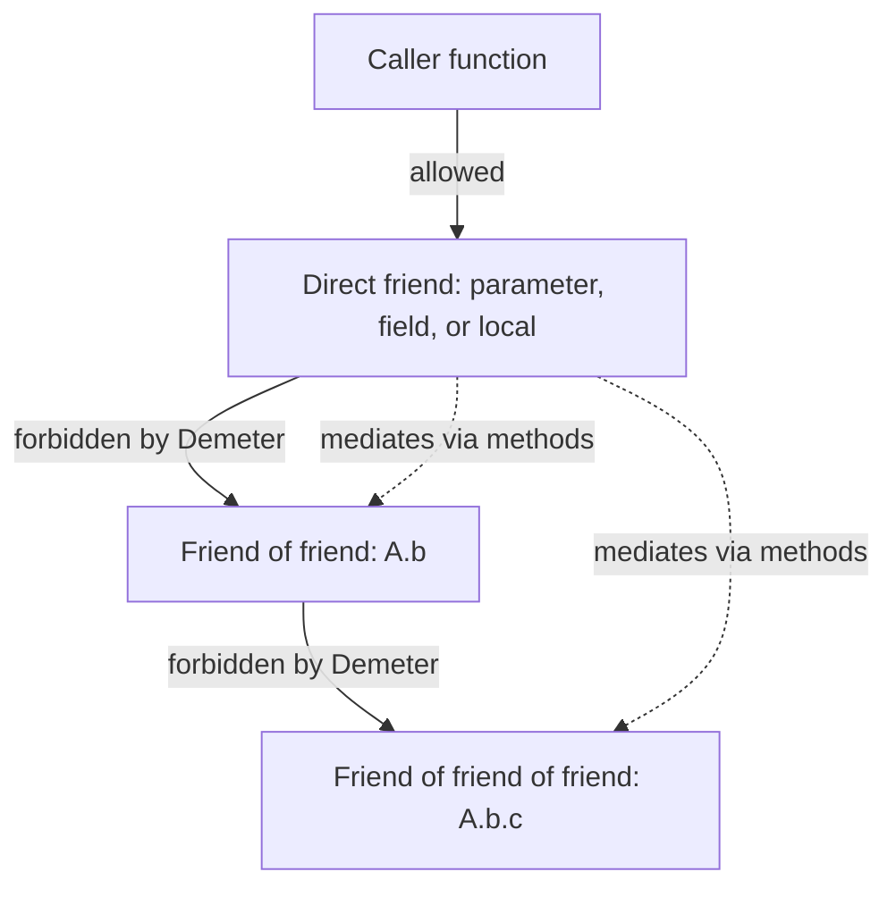

# Least Knowledge (Law of Demeter)

## Overview

The **Principle of Least Knowledge**, also called the **Law of Demeter**, says: *a unit of code should only talk to its immediate friends and have no knowledge of the internal structure of the objects it manipulates*. In one sentence: **don't reach through one object to talk to another**.

The most cited example is the "train wreck" — `user.address.country.region.zipCode`. Each dot is a hop into an object whose internal structure the caller now depends on. A change to `Country`'s API, or replacing `region` with `subdivision`, ripples through every caller. The principle exists to keep that ripple small: a function should depend on the few objects it directly receives, not on those objects' internal graphs.

The principle is *not* "every property access through a getter chain is wrong." A field access on a value object is fine. The principle targets *behavioral coupling* — when caller code makes assumptions about how its collaborator stores or composes its dependencies. Applied well, it makes refactoring cheap and tests small. Applied dogmatically, it produces hundreds of wrapper methods and obscures the model. The Staff-level judgment is knowing when the line is, which usually depends on whether the inner type is a stable value (date, money, address) or a behavioral object (repository, service, controller).

---

## Why It Exists

Code that knows too much about its collaborators' internal shape **breaks when those collaborators change**. Consider:

```kotlin
fun shippingCost(order: Order): Money =
    order.customer.address.country.shippingRate.times(order.weight)
```

Every dot is a coupling point. The function now depends on:

1. `Order` having a `customer`
2. `Customer` having an `address`
3. `Address` having a `country`
4. `Country` having a `shippingRate`
5. The specific arithmetic relationship between `shippingRate` and `weight`

If the business adds multi-address customers (split shipping vs billing), `customer.address` becomes ambiguous. If shipping rates become time-of-day-dependent, `country.shippingRate` is no longer a simple field. Every call site has to be updated.

The Law of Demeter inverts the question: **the function should ask its direct collaborator to compute the result**, not reach through it. The collaborator owns the knowledge of how to compute, and the function just asks.

```kotlin
fun shippingCost(order: Order): Money = order.shippingCost()
```

Now the multi-address change, the time-of-day change, the regional-discount change — all happen inside `Order`. The caller is insulated.

The win is **refactor blast radius**. When the only callers of a method are inside the type that owns the data, internal restructuring touches only that type. When callers reach in, internal restructuring touches every caller.

---

## Historical Context

1. **Demeter Project at Northwestern University (1987).** Karl Lieberherr's team studied object-oriented design and observed that programs with shorter "communication paths" between objects were easier to maintain. They formalized the observation as the *Law of Demeter*, named for the Greek goddess (Demeter being the agriculture deity associated with the Demeter Project, which focused on adaptive software).
2. **"Object-Oriented Programming: An Objective Sense of Style" (1988).** The original paper from Lieberherr and Holland, stating the law in formal terms: a method `M` of object `O` should call only methods of `O` itself, methods of its parameters, methods of objects it created, and methods of its direct components.
3. ***The Pragmatic Programmer* (1999).** Hunt and Thomas popularized the law for a general audience, coining the memorable phrase "Don't talk to strangers."
4. **Tell, Don't Ask (early 2000s).** A related principle: instead of asking an object for its state and then computing on it (the caller "asks"), tell the object what to do and let it decide (the caller "tells"). Same root idea.
5. **DDD aggregate roots (Evans, 2003).** Domain-Driven Design's *aggregate* pattern is a structured way to enforce Demeter — the aggregate root is the only object outside callers can talk to; it mediates access to its internal entities.
6. **Modern Kotlin idioms (2016+).** Constructor injection, data classes as value objects, sealed classes for closed hierarchies — all reinforce Demeter by making the "right" pattern more ergonomic than the wrong one.

The arc: from formal academic principle to widely-taught style rule to enforced architectural pattern (aggregates, hexagonal architecture).

---

## First Principles

### 1. Talk only to direct friends

For a method `M` belonging to object `O`, the law says `M` may call methods on:

- `O` itself (own methods, properties)
- `O`'s direct fields and properties
- Parameters passed into `M`
- Objects `M` creates locally
- Static singleton objects (controversial — some interpretations exclude these)

It may **not** call methods on objects returned from any of the above. The boundary is *one hop*.

```kotlin
// Allowed: one hop
val customerName = order.customer.name      // BUT controversial; see "value vs behavior" below

// Forbidden: two hops, asks for shape of customer
val city = order.customer.address.city
```

### 2. Value objects are a graceful exception

The strict reading forbids `order.customer.name`, but in practice this is fine if `Customer` is a value object that doesn't have side effects or substitutable behavior. The harm of the principle isn't the dot — it's the **assumption that `Customer` has a `name` field/getter that won't change**.

For stable value types — `BigDecimal`, `Instant`, `Address`, `Money`, `Email` — chaining through fields is normal. The data has a known shape that won't morph.

For **behavioral objects** — repositories, services, controllers, handlers — chaining is dangerous. Their internal collaborators are what changes most often.

The Staff rule of thumb: **value chaining is fine; behavior chaining is suspicious**.

### 3. The principle is about coupling, not syntax

`a.b.c.d` and `a.computeXyz()` are not the same shape, but the law isn't about counting dots — it's about how much knowledge the caller has of the callee's collaborators.

Equivalent violations don't always have multiple dots:

```kotlin
val box = service.getContainer()
val inner = box.getNested()
inner.doThing()           // three statements but same coupling depth
```

vs

```kotlin
service.doThing()         // service mediates internal structure
```

### 4. Tell, don't ask

A related framing: instead of pulling state out of an object and acting on it, tell the object to act.

```kotlin
// Ask: pulls state, decides outside
if (order.isOverdue() && order.customer.canBeCharged()) {
    chargeCustomer(order.customer, order.balance)
}

// Tell: caller delegates, object decides
order.chargeIfOverdue()
```

The "tell" version localizes the decision logic in `Order`. Adding new overdue criteria touches only `Order`.

---

## Mental Model

Imagine you're a **delivery driver** dropping off a package. You knock on the front door of a house. The principle says you should hand the package to whoever opens the door (your direct friend) and let *them* deal with internal household routing — child, spouse, roommate.

A violation looks like: you knock, the door opens, you push past the person, walk into the kitchen, open a drawer, and place the package inside. You've made assumptions about: where the kitchen is, that there's a drawer, that the drawer is the right place. When the family moves the kitchen, repaints, or rearranges, your delivery process breaks.

The "tell, don't ask" framing: you tell the front-door person "this is for Alice" and let them figure out the rest. You don't ask "is Alice home, in which room, and may I navigate there myself."

The cost of overdoing it: in some buildings, you'd have to send 17 different door-knocks (one per type of mail) just to avoid ever giving the doorman knowledge of who lives where. Pragmatism: a small amount of "I know the doorman has mailboxes" is acceptable.

---

## Internal Mechanics

There's no compiler enforcement of Demeter — it's a design principle, not a language feature. Several tools and patterns approximate enforcement:

### 1. Visibility modifiers

`private` and `internal` are the bluntest enforcement. By making a field private, you force callers to go through methods, which lets you change the field type without breaking callers.

```kotlin
class Order(
    private val customer: Customer,
    private val items: List<Item>
) {
    fun shippingCost(): Money = ...
    fun customerEmail(): String = customer.email   // mediated
}
```

External callers can't write `order.customer.something` because `customer` isn't visible.

### 2. Sealed hierarchies for behavior

When an object's behavior depends on its type, exposing the type for external inspection often violates Demeter. Sealed classes let you keep the behavior in the type itself:

```kotlin
sealed class PaymentMethod {
    abstract fun charge(amount: Money): Result<Receipt>
    class CreditCard(val token: String) : PaymentMethod() { override fun charge(...) }
    class BankTransfer(val account: Account) : PaymentMethod() { override fun charge(...) }
}

// Caller doesn't inspect type — calls the method
val receipt = paymentMethod.charge(amount)
```

### 3. Aggregate roots (DDD)

In Domain-Driven Design, the *aggregate root* is the single entry point into a cluster of related objects. Callers can't reach into the aggregate; they go through the root.

```kotlin
class ShoppingCart(private val items: MutableList<CartItem>) {
    fun add(product: Product, qty: Int) { ... }    // mediated
    fun total(): Money = items.sumOf { it.subtotal() }
    fun checkout(): Order { ... }
    // No public access to items list
}
```

### 4. Linter rules

Tools like **Detekt** can be configured to flag chained method calls past a depth threshold. The Kotlin `MaxLineLength` rule incidentally catches some Demeter violations because train-wreck chains tend to be long lines. Architecture tests with **Konsist** or **ArchUnit** can enforce module-level Demeter (e.g., "the UI layer must never reach into Repository internals").

---

## Architecture



The caller only knows about the direct friend. The friend internally knows how to compute results that depend on its own collaborators — but those collaborators don't leak outside the friend.

---

## Production Example

### Refactor blast radius: the customer-address example

Before (Demeter violation):

```kotlin
// Used in 47 files across the codebase
val zip = customer.address.zipCode

fun calculateShipping(customer: Customer, weight: Weight): Money {
    val zip = customer.address.zipCode
    return shippingRates.lookup(zip).times(weight)
}
```

Business adds multi-address support. `Customer.address` becomes `Customer.primaryAddress` (renamed) and `Customer.addresses` (new collection). All 47 files break.

After (Demeter compliance):

```kotlin
class Customer(private val addresses: List<Address>) {
    fun primaryZipCode(): String = addresses.first().zipCode
    // ...
}

fun calculateShipping(customer: Customer, weight: Weight): Money =
    shippingRates.lookup(customer.primaryZipCode()).times(weight)
```

The 47 callers continue to work. The internal restructuring is contained.

### Aggregate root in a domain model

```kotlin
class Order private constructor(
    private val id: OrderId,
    private val items: MutableList<OrderItem>,
    private var status: OrderStatus
) {
    fun addItem(product: Product, qty: Int) {
        check(status == OrderStatus.PENDING)
        items.add(OrderItem(product, qty))
    }

    fun total(): Money = items.fold(Money.zero()) { acc, item -> acc + item.subtotal() }

    fun submit(): Result<Order> {
        check(status == OrderStatus.PENDING)
        check(items.isNotEmpty())
        status = OrderStatus.SUBMITTED
        return Result.success(this)
    }

    companion object {
        fun create(id: OrderId): Order = Order(id, mutableListOf(), OrderStatus.PENDING)
    }
}
```

External code can only `addItem`, `total`, `submit`. They can't access `items` to modify them directly, can't read `status` to compose external decisions. The Order owns all state and behavior.

---

## Android Example

### State hoisting in Compose

```kotlin
// Violation: passing the whole ViewModel down five layers
@Composable
fun CheckoutScreen(vm: CheckoutViewModel) {
    OrderSummary(vm)
    PaymentSection(vm)
    SubmitButton(vm)         // SubmitButton "knows" about the entire ViewModel
}

@Composable
fun SubmitButton(vm: CheckoutViewModel) {
    Button(onClick = { vm.submit() }, enabled = vm.canSubmit) {
        Text("Submit")
    }
}
```

`SubmitButton` knows: there's a CheckoutViewModel, it has a `submit()` method, it has a `canSubmit` property. It can't be reused in any other screen.

Compliance: pass only what's needed.

```kotlin
@Composable
fun SubmitButton(enabled: Boolean, onSubmit: () -> Unit) {
    Button(onClick = onSubmit, enabled = enabled) {
        Text("Submit")
    }
}

@Composable
fun CheckoutScreen(vm: CheckoutViewModel) {
    val state by vm.state.collectAsStateWithLifecycle()
    SubmitButton(enabled = state.canSubmit, onSubmit = { vm.submit() })
}
```

Now `SubmitButton` knows nothing about the ViewModel. It's reusable anywhere.

### Constructor injection vs Service Locator

The Service Locator pattern is a classic Demeter violation:

```kotlin
// Violation: caller knows the structure of the container
class CheckoutViewModel(val appContainer: AppContainer) {
    fun checkout() {
        val api = appContainer.networkModule.paymentApi      // reaches into structure
        val tracker = appContainer.analyticsModule.tracker   // and again
        api.charge()
        tracker.event("checkout_completed")
    }
}
```

The ViewModel knows the container has `networkModule.paymentApi` and `analyticsModule.tracker`. Mocking for tests requires constructing the whole container graph. Refactoring the modules breaks every consumer.

Compliance: constructor-inject only what's needed.

```kotlin
class CheckoutViewModel @Inject constructor(
    private val paymentApi: PaymentApi,
    private val tracker: AnalyticsTracker
) : ViewModel() {
    fun checkout() {
        paymentApi.charge()
        tracker.event("checkout_completed")
    }
}
```

Each parameter is the *only* thing the ViewModel knows about. Mocking is trivial. Refactoring internal module structure doesn't affect this code.

---

## Tradeoffs

**Advantages**

- **Smaller refactor blast radius.** Internal restructuring of a type stays internal.
- **Better testability.** Each unit depends on few collaborators, all directly injected, all directly mockable.
- **Lower cognitive load.** Reading a method, you see only its direct dependencies.
- **Forces good API design.** Knowing callers can't reach in forces you to expose deliberate behavior methods.

**Disadvantages**

- **Wrapper explosion.** Strict adherence demands a getter on Customer for every Address field: `customerZipCode()`, `customerStreet()`, `customerCity()`, etc.
- **Loss of expressiveness.** Sometimes `order.customer.email` is genuinely the clearest way to say it.
- **Performance overhead at deep mediation.** Adding three layers of method calls to avoid `a.b.c` costs JIT optimization headroom (negligible in 99% of cases, occasionally measurable).
- **Hides the model.** Disallowing chained access can obscure the actual structure of the data, making the domain harder to understand for new readers.

**When not to apply**

- For value objects (`Money`, `Email`, `Instant`, `Address`) with stable shape. Chained field access is fine.
- For data classes used as DTOs/POJOs where the explicit goal is to expose structure (HTTP response models, database rows, configuration).
- In small, throwaway code where the cost of mediation exceeds the cost of refactoring later.
- When the chained access is *literally one access depth* (`a.b`) — adding a wrapper method to avoid that is usually not worth it.

---

## Failure Modes

**Wrapper explosion.** Strict adherence in a large domain produces a class with 80 thin methods (`getCustomerStreet()`, `getCustomerCity()`, …). The class becomes unreadable. Mitigation: expose value objects directly (`val address: Address`) and only mediate when the inner type is behavioral.

**Train wrecks survive in tests.** A test setup like `sut.dependencyA.dependencyB.invoke(...)` violates Demeter in *test code* but is often accepted. The test now breaks when internal structure changes, which is the same problem. Mitigation: inject collaborators directly into the test instead of reaching through the SUT.

**Service Locator masquerades as DI.** A class taking `AppContainer` as a constructor parameter looks injected, but it's actually a Service Locator. Real DI passes the specific dependencies. Mitigation: code review flag — if a constructor parameter is a generic "container" type, it's probably a violation.

**State hoisting takes the principle too far.** Hoisting all state to the top of the Compose tree forces every parent to know about every child's state shape. The opposite of what you want. Mitigation: state lives at the lowest common ancestor of components that need it, no higher.

**God objects as mediators.** Adding wrapper methods to a central "facade" type eventually turns the type into a God Object that knows about every internal subsystem. Mitigation: have multiple facades scoped to subdomains.

---

## Performance Considerations

- **Mediation has a method-call cost.** `order.shippingCost()` is a virtual call; `order.customer.address.zipCode` is two field accesses and a method call. JIT inlining usually erases the difference, but in tight loops, manual fusion may help.
- **Indirection through interfaces costs extra dispatch.** If the wrapper method delegates to a member of an injected interface, the JVM may not be able to devirtualize. Negligible at normal scale; noticeable in microbenchmarks.
- **Memoization at the wrapper level helps.** A method `order.shippingCost()` that internally caches the computed result avoids repeated traversal of `customer.address.country.shippingRate`, paying off whenever the result is read multiple times.

---

## Reliability Considerations

- **Mediation lets you add validation in one place.** `order.submit()` can check invariants once; `order.items.add(x); order.markSubmitted()` invites callers to skip the check.
- **Encapsulated state survives concurrent modification.** A wrapped collection can use a thread-safe implementation internally; an exposed mutable list lets callers race.
- **Failure handling localizes.** If `customer.charge()` can throw, putting the logic inside Customer means the error path is in one place. Spreading the call across two reach-throughs spreads the error handling.

---

## Security Considerations

- **Exposing internal collaborators leaks attack surface.** A `getInternals()` accessor on a class with sensitive state (auth tokens, encryption keys) creates a path for unintended callers to grab them. Demeter discipline keeps the surface small.
- **Audit trail is harder when chain-of-access spans modules.** A check on `customer.account.balance` happening in 12 files can't be audited as a single capability; a `customer.canAfford(amount)` method gives one auditable choke point.
- **Defense in depth via aggregates.** When a security-sensitive operation goes through an aggregate root, the root can enforce constraints (e.g., "only the customer themselves can withdraw"). Bypassing the root via direct internal access bypasses the check.

---

## Observability

- **Method names trace better than field chains.** A profiler sees `Order.shippingCost()` as a named frame; a chain like `customer.address.country.shippingRate.times(weight)` shows as primitive arithmetic with no semantic name.
- **Logging is easier inside mediated methods.** Centralizing the computation in `order.shippingCost()` lets you add a `log("Computed shipping for order={}: {}", id, result)` in one place.
- **Tracing spans wrap meaningful operations.** A trace span around `order.submit()` covers the whole behavior; wrapping individual reaches-through (`getCustomer()`, `getAddress()`) produces noise.

---

## Staff Engineer Thinking

**Treat the principle as a design lens, not a lint rule.** The question isn't "how many dots?" but "what would change in my caller's code if the callee's internals changed?" Apply the principle where the answer is "a lot."

**Distinguish value chaining from behavior chaining.** `instant.toLocalDate().year` is fine — `Instant` and `LocalDate` are stable value types. `viewModel.repository.cache.get(key)` is a smell — every type is behavioral and likely to evolve.

**Use aggregate roots in non-trivial domains.** When a cluster of related objects (Order, OrderItem, Payment, Receipt) has invariants spanning multiple types, designate one entry point (the aggregate root) and route all external mutations through it.

**Prefer constructor injection of specific dependencies over container passing.** A class taking `AppContainer` or `DependencyGraph` is a Service Locator in disguise. Code review should ask: "what are the actual collaborators?" and require those.

**Watch for state hoisting that violates Demeter in the opposite direction.** Hoisting all state to the top of the Compose tree exposes child structure to grandparent components. Hoist to the *closest* ancestor that needs the state, not the top.

**Add the wrapper method when the same chain appears in three or more places.** Three repeated chains is a strong signal that the chain represents a real concept the type should expose as behavior. Below three, leave it.

**Don't refactor working code purely for Demeter purity.** If the code works, tests pass, and refactor risk is non-trivial, leave it. Apply the principle in new code and in code you're already touching for other reasons.

---

## Common Misconceptions

**"Every dot is a violation."** No. Value objects with stable shape can be chained safely. The principle targets behavior chaining and unstable structure.

**"Demeter forbids method chains."** It targets chains *into other objects' internals*. Fluent builders (`Request.builder().url(x).post(y).build()`) chain on the same object — not a violation.

**"Tell-don't-ask means no return values."** Methods can return values. The principle is about asking for state to make external decisions vs telling the object to make the decision.

**"Service Locator is fine because it centralizes lookups."** Demeter says no — the consumer becomes coupled to the container's structure, which is broader than necessary.

**"Aggregates are over-engineering for simple CRUD."** True for genuinely simple data — but as soon as multiple types have shared invariants, an aggregate is cheaper than scattered ad-hoc enforcement.

**"`order.customer.email` is always wrong."** It's wrong if `Customer` is a behavioral type whose collaborators change. It's fine if `Customer` is a value type used for display.

---

## Probing Questions

1. A test setup writes `sut.repository.database.connection.execute("SELECT ...")`. Why is this a Demeter violation, and what changes when the internal SQLite is swapped for Room?
2. Explain the difference between "value chaining" and "behavior chaining" and why only the latter is problematic.
3. Why does `customer.charge(amount)` typically follow Demeter better than `customer.paymentMethod.charge(amount)`?
4. Service Locator is sometimes called "Constructor Injection in disguise." What's the actual difference, and why does the disguise version usually violate Demeter?
5. In Jetpack Compose, when does state hoisting violate the Law of Demeter? Give a concrete example.
6. Why do strict Demeter advocates dislike `data class` patterns where the class is just exposed fields? When is that critique valid, when is it overblown?
7. You're refactoring a chain `order.customer.address.country.shippingRate`. List three different refactoring strategies and what each implies for the design.
8. How does the DDD concept of an aggregate root enforce Demeter at an architectural level?
9. A test for `OrderService` mocks `OrderRepository`, which is then asked for its database, which is then asked for its driver. What's wrong with this mock setup?
10. A code review proposes adding `getCustomerName()`, `getCustomerEmail()`, `getCustomerPhone()`, `getCustomerAddress()` to `Order` to avoid `order.customer.x` chains. When is this good, and when is it wrapper-explosion?

---

## Answer Key

1. **A test setup writes `sut.repository.database.connection.execute("SELECT ...")`. Why is this a Demeter violation, and what changes when the internal SQLite is swapped for Room?**
   It violates Demeter because the test reaches deeply into the repository's internal dependencies. If SQLite is swapped for Room, the entire internal chain changes, breaking the test even if the repository's public behavior remains correct.
2. **Explain the difference between "value chaining" and "behavior chaining" and why only the latter is problematic.**
   Value chaining accesses stable properties of immutable data objects (e.g., `date.year`), which rarely change structurally. Behavior chaining calls methods on dynamic collaborators (e.g., `service.repo.get()`), creating fragile coupling to implementations that evolve frequently.
3. **Why does `customer.charge(amount)` typically follow Demeter better than `customer.paymentMethod.charge(amount)`?**
   `customer.charge(amount)` tells the customer what to do, hiding the implementation details of how the payment is processed. Reaching in to access `paymentMethod` couples the caller to the specific structure and collaborators of `Customer`.
4. **Service Locator is sometimes called "Constructor Injection in disguise." What's the actual difference, and why does the disguise version usually violate Demeter?**
   Constructor injection passes exactly the specific dependencies a class needs. Service Locator passes a massive container object (e.g., `AppContainer`), forcing the class to navigate the container to find its dependencies, violating Demeter by coupling the class to the container's structure.
5. **In Jetpack Compose, when does state hoisting violate the Law of Demeter? Give a concrete example.**
   It violates Demeter when state is hoisted too high, forcing an ancestor component to know about the intricate state details of a distant descendant. For example, a `MainScreen` holding detailed form validation state for a nested `CheckoutForm` component.
6. **Why do strict Demeter advocates dislike `data class` patterns where the class is just exposed fields? When is that critique valid, when is it overblown?**
   They dislike it because exposing all fields breaks encapsulation and encourages callers to act on the data rather than delegating behavior to the class. This critique is valid for core domain entities, but overblown for simple Data Transfer Objects (DTOs) designed solely to transport data.
7. **You're refactoring a chain `order.customer.address.country.shippingRate`. List three different refactoring strategies and what each implies for the design.**
   1) Add `order.shippingRate()` (Order mediates entirely). 2) Expose `order.customer` but add `customer.shippingRate()` (Customer mediates its address). 3) Pass a `ShippingCalculator` service into the method and let it compute the rate independently, removing the chain entirely.
8. **How does the DDD concept of an aggregate root enforce Demeter at an architectural level?**
   The aggregate root serves as the only entry point to a cluster of related objects. External callers are forbidden from reaching into the internal entities, forcing all interactions and state changes to be mediated strictly by the root's methods.
9. **A test for `OrderService` mocks `OrderRepository`, which is then asked for its database, which is then asked for its driver. What's wrong with this mock setup?**
   The test is mocking the internal implementation details (database and driver) of the `OrderRepository`. It should only mock the immediate collaborator (`OrderRepository`) and specify what its public methods return, ignoring its internals.
10. **A code review proposes adding `getCustomerName()`, `getCustomerEmail()`, `getCustomerPhone()`, `getCustomerAddress()` to `Order` to avoid `order.customer.x` chains. When is this good, and when is it wrapper-explosion?**
    It is wrapper-explosion because `Customer` is likely a stable value object or data structure in this context. Adding dozens of thin wrapper methods obscures the `Order` class's real domain behavior; it's better to expose `val customer: Customer` directly.

## Further Reading

In this repository:

- [`simplicity.md`](simplicity.md) — Demeter and simplicity reinforce each other; both reduce coupling.
- [`single-responsibility.md`](single-responsibility.md) — SRP is the "vertical" coupling principle; Demeter is the "horizontal."
- [`composition-over-inheritance.md`](composition-over-inheritance.md) — composition often introduces chains; Demeter shapes how those chains are exposed.
- [`../patterns/repository.md`](../patterns/repository.md) — Repository is a Demeter-conforming abstraction over data access.
- [`../patterns/strategy.md`](../patterns/strategy.md) — Strategy lets behavior vary without callers reaching into the strategy holder.
- [`make-invalid-states-impossible.md`](make-invalid-states-impossible.md) — Aggregate roots reinforce both.

External:

- Karl Lieberherr & Ian Holland, *"Object-Oriented Programming: An Objective Sense of Style"* (1988) — the original Law of Demeter paper.
- Hunt & Thomas, *The Pragmatic Programmer* (1999) — the "Don't talk to strangers" framing.
- Martin Fowler, *"GetterEradicator"* and *"TellDontAsk"* (martinfowler.com) — concise modern essays.
- Eric Evans, *Domain-Driven Design* (2003) — aggregates as enforced Demeter.
- *Growing Object-Oriented Software, Guided by Tests* by Freeman & Pryce — Demeter in practice, especially in test design.
- Misko Hevery, *"Demeter: It's not just a good idea, it's the Law"* — practical examples from Google's testing guidelines.
