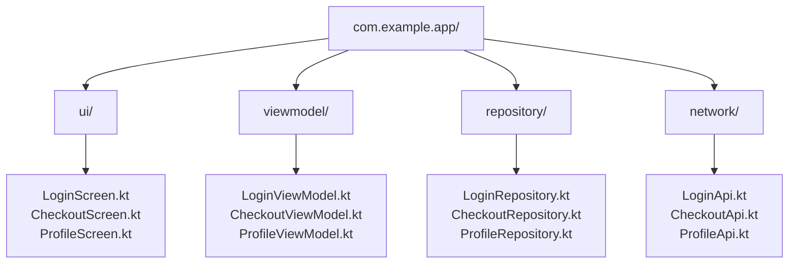
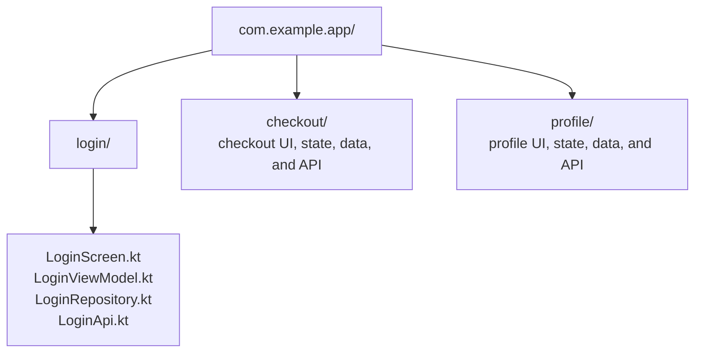
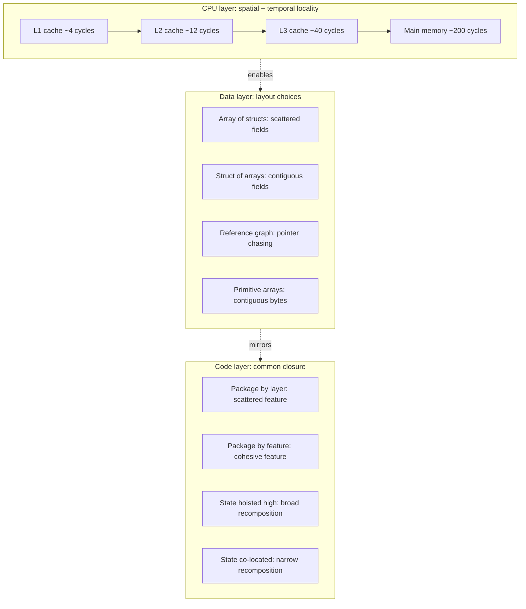

# Locality of Reference

## Overview

**Locality of reference** is the observation that things accessed together tend to be accessed close together — in time, in space, or both. It originated in CPU cache design in the 1960s: when a program reads a memory address, the hardware brings nearby addresses into the cache because they're likely to be read next. Subsequent reads hit the cache instead of slow main memory, making the program faster by orders of magnitude.

The principle has two flavors:

- **Temporal locality**: if you accessed something recently, you'll probably access it again soon. Foundation of caches, LRU eviction, prefetching.
- **Spatial locality**: if you accessed something at one address, you'll probably access nearby addresses soon. Foundation of cache lines, contiguous arrays, page prefetching.

In software architecture, the principle generalizes to **"things that change together should live together"** — what Robert Martin calls the *Common Closure Principle*. Code that's modified for the same reason should be packaged together so the change is local. Code that's modified for unrelated reasons should be separated so changes don't ripple. The mobile-engineering payoff: a "feature module" you can read and modify in one folder is dramatically easier to evolve than the same logic spread across `ui/`, `viewmodel/`, `repository/`, `network/` siloed by layer.

This file covers locality at three layers: **CPU caches** (where the term originates), **state and data layout** (Compose state, primitive arrays, packed structs), and **code organization** (package-by-feature, modularization, the common-closure principle). All three reduce the cost of "going far away" — for the CPU, far means a cache miss; for a developer, far means jumping across the codebase.

---

## Why It Exists

Two costs drive the principle:

1. **Hardware: accessing distant memory is slow.** A CPU register access is ~1 cycle; L1 cache is ~4 cycles; L2 is ~12; L3 is ~40; main memory is ~200; SSD is ~100,000; HDD is ~10,000,000. Each step is an order of magnitude slower than the last. Spatial and temporal locality let the hardware prefetch and cache aggressively, keeping the active working set close.
2. **Cognition: navigating a distant codebase is expensive.** When you change a feature, you should be able to read and modify the relevant code in one place. If the "feature" is spread across `ui/login/`, `viewmodels/auth/`, `data/repositories/`, and `network/auth_api/`, every change requires four cognitive jumps. The literature calls this *closeness* or *cohesion*; the practical effect is identical to cache locality — the closer your working set, the cheaper the work.

The principle exists because both costs are universal. Hardware can never eliminate latency to distant memory; humans can never eliminate friction navigating distant code. The best response is to colocate what's accessed together.

---

## Historical Context

1. **Belady's MIN algorithm (1966).** László Bélády, while working at IBM, showed that the optimal page-replacement strategy assumed temporal locality — keep what's used most recently. This proved that real programs have temporal locality and that caches reduce traffic to main memory significantly.
2. **Denning's working set model (1968).** Peter Denning formalized the *working set* as the set of pages a process accesses in a recent time window. Programs that respect spatial and temporal locality have small working sets and run efficiently in limited memory; those that don't thrash.
3. **CPU cache hierarchies (1970s+).** Hardware engineers built increasingly deep cache hierarchies (L1, L2, L3) specifically to exploit locality. Modern x86 processors have ~64-byte cache lines — read one byte and you get 63 neighbors for free.
4. **Mike Acton, *Data-Oriented Design* (2014).** A C++ game-engine talk arguing that for performance-critical code, the *layout of data* matters more than object-oriented modeling. Cache misses are the dominant cost in modern CPUs.
5. **Robert C. Martin, *Common Closure Principle* (1990s).** The architectural side: classes that change for the same reason belong in the same package. Functional cohesion is the human analog of cache locality.
6. **Android modularization (2018+).** Google formally endorsed package-by-feature and gradle module-per-feature as the path to scalable Android codebases. The driving rationale was build performance (only changed modules recompile) and cognitive locality (everything for one feature is in one folder).
7. **Jetpack Compose state hoisting (2021+).** Compose's reactive recomposition makes the state-locality cost visible: state that lives far from where it's read forces broader recomposition than necessary.

The arc: from hardware (caches) to systems (working sets) to code organization (cohesion, modularization), with each layer recognizing the same underlying truth that locality reduces cost.

---

## First Principles

### 1. Temporal locality

If you access X at time T, you'll likely access X again at time T+1, T+2, …

**Why it's true.** Loops re-read the same variables. Functions re-call the same helpers. Users navigate to the same screen multiple times in a session. Hot data dominates request patterns; cold data is rare.

**Architectural consequence.** Caches work. LRU eviction works. Memoization works. Connection pooling works. Long-lived objects in scopes that match their access patterns work.

### 2. Spatial locality

If you access address X, you'll likely access X+1, X+2, … soon after.

**Why it's true.** Arrays are iterated in order. Structs have fields read together. Image pixels are processed neighbor-to-neighbor. Database rows on the same page are queried together.

**Architectural consequence.** Cache lines fetch neighbors for free. Contiguous arrays beat linked lists. Struct-of-arrays often beats array-of-structs. Database indices group related rows on disk pages.

### 3. Common closure (the code-organization analog)

If two pieces of code tend to be modified together (for the same business reason), they should live together.

**Why it's true.** Features have boundaries. A "checkout" change affects the checkout UI, the checkout viewmodel, the checkout API client, the checkout database table. If those live in one folder, the change is local. If they're scattered, you spend cognitive cycles assembling the change graph.

**Architectural consequence.** Package-by-feature beats package-by-layer for large codebases. Gradle modules per feature beat one monolithic module. Compose state lives at the closest common ancestor.

### 4. The corollary: separation of unrelated change

The flip side of "things that change together live together" is "things that change for different reasons live apart." Mixing unrelated change axes in one file forces every reason-to-change to touch the same file, raising contention and review cost.

**Architectural consequence.** Splitting `Utils.kt` into `StringUtils.kt`, `DateUtils.kt`, `CollectionUtils.kt` is locality work — strings and dates change for different reasons.

---

## Mental Model

Think of locality as **proximity reducing cost**. The CPU's cost model: the closer the data is to the registers, the faster it's accessed. The developer's cost model: the closer the code is to what you're already reading, the faster you can modify it.

The wrong default — for both CPUs and developers — is to scatter things "logically" by category. Sorting all `*.viewmodel.kt` files into a `viewmodels/` folder feels organized, but it forces every working session to jump between folders. The same is true at the hardware level: storing fields of a struct in different memory regions "by type" wrecks cache locality even though the type-grouping looks tidy.

The right default is **co-location by access pattern**. What does the work session touch? Put it together. What does the inner loop touch? Lay it out contiguously. The pattern of *use* dictates the layout, not the pattern of *taxonomy*.

A useful analogy: a **toolbox vs a categorized shelving system**. If you're a plumber going on a job, your toolbox holds wrenches, plumber's tape, fittings, and a flashlight — everything you need for a plumbing job, even though they're different "categories." A shelving system that sorts by "metal tools," "plastic tools," "lights" would force you to walk between shelves for every task. The toolbox is *organized by access pattern* — what gets used together.

---

## Internal Mechanics

### CPU cache lines and how they reward spatial locality

Modern x86 and ARM CPUs read memory in **cache lines** of 64 bytes (some ARM chips: 32 or 128 bytes). When your program reads one byte, the hardware brings the entire cache line into L1 cache. If your next read is within that 64-byte window, it's a cache hit (~4 cycles). If it's far away, the hardware must fetch another cache line from L2, L3, or main memory.

For sequential access, this is essentially free:

```kotlin
val xs = IntArray(1_000_000)
for (i in xs.indices) {
    sum += xs[i]   // sequential access: 1 cache miss every 16 ints
}
```

For random access, it's expensive:

```kotlin
val xs = IntArray(1_000_000)
val indices = (0 until 1_000_000).shuffled()
for (i in indices) {
    sum += xs[i]   // random access: ~1 cache miss per read
}
```

The shuffled version can run 5-20x slower despite doing the same arithmetic. This is locality cost at its rawest.

### Array of structs vs struct of arrays

Consider 1 million points:

```kotlin
// Array of structs (AoS)
data class Point(val x: Float, val y: Float, val z: Float, val label: String)
val points: Array<Point> = ...

// Struct of arrays (SoA)
class PointCollection(
    val xs: FloatArray,
    val ys: FloatArray,
    val zs: FloatArray,
    val labels: Array<String>
)
```

If you only need the x-coordinates for a computation, AoS forces the CPU to load every Point's full memory layout into cache (including `y`, `z`, and the `label` reference). SoA lets you stream just `xs`, fitting 16x more elements per cache line. For numerical workloads, the SoA layout can be 5-10x faster.

For mobile, this matters in: image processing, video decoding, ML inference, physics simulation. For UI/business logic, AoS is fine.

### Object headers and reference chasing

In the JVM, every object has a header (8-16 bytes on 64-bit) holding metadata (class pointer, hash, GC state). `Array<Point>` is actually an array of *references* to heap-allocated Points scattered across memory:

```
xs: [ref][ref][ref][ref] ...
     ↓    ↓    ↓    ↓
    Point Point Point Point     <- scattered in heap
```

Iterating `xs` chases each reference — each Point access is potentially a cache miss. `FloatArray` is a single contiguous buffer with no headers per element:

```
xs: [4][8][12][16][20][24][28] ...   <- raw bytes, contiguous
```

This is why Kotlin's `IntArray`, `LongArray`, `FloatArray`, etc. are not just "primitive arrays" — they're a locality tool.

### Code organization: package-by-feature vs package-by-layer



Working on Login? Jump between 4 folders.



Working on Login? Stay in one folder.

The layer view has its place — `core/`, `common/`, `theme/`, `network/` shared across features — but the dominant axis should match the dominant change axis, which is feature.

### Compose state locality

In Compose, state must be read inside a composable to trigger recomposition. Where the state lives affects which composables recompose when it changes:

```kotlin
// Low locality: state hoisted too high
@Composable
fun App() {
    var textInput by remember { mutableStateOf("") }   // state lives at App level
    Column {
        Header()
        ContentArea()
        TextField(value = textInput, onValueChange = { textInput = it })
    }
}
```

Every keystroke recomposes `App`, `Header`, `ContentArea`, and `TextField` — even though only `TextField` actually depends on `textInput`.

```kotlin
// High locality: state co-located with consumer
@Composable
fun App() {
    Column {
        Header()
        ContentArea()
        LocalInput()
    }
}

@Composable
fun LocalInput() {
    var textInput by remember { mutableStateOf("") }   // state lives here
    TextField(value = textInput, onValueChange = { textInput = it })
}
```

Now keystrokes recompose only `LocalInput`. The Compose recomposer's locality optimization rewards keeping state near its readers.

---

## Architecture



---

## Production Example

### Image processing: SoA for cache efficiency

Bitmap pixel processing in image-loading libraries (Coil, Glide, native ML pipelines) uses `IntArray` for ARGB pixels rather than an array of `Color` objects:

```kotlin
val pixels = IntArray(width * height)
bitmap.getPixels(pixels, 0, width, 0, 0, width, height)

for (i in pixels.indices) {
    val argb = pixels[i]
    val gray = ((argb shr 16 and 0xFF) + (argb shr 8 and 0xFF) + (argb and 0xFF)) / 3
    pixels[i] = (argb and 0xFF000000.toInt()) or (gray shl 16) or (gray shl 8) or gray
}
```

The pixel buffer is contiguous; each iteration touches 4 bytes; cache lines hold 16 pixels. Sequential access hits L1 cache constantly. Switching to `Array<Pixel>` with `class Pixel(val r, val g, val b, val a)` would be 10x+ slower.

### Compose recomposition: hoisting to the right level

In a checkout screen with line items and a total:

```kotlin
@Composable
fun CheckoutScreen(vm: CheckoutViewModel) {
    val state by vm.uiState.collectAsStateWithLifecycle()
    Column {
        ItemList(items = state.items, onChange = vm::updateQuantity)
        // Total recomputes when state changes; that's correct
        Total(amount = state.total)
        CheckoutButton(
            enabled = state.canCheckout,
            onClick = vm::submit
        )
    }
}
```

`state` is read at `CheckoutScreen` and passed down. Compose's recomposer tracks the read and recomposes the screen when state changes. Each child reads only its relevant slice of state and gets re-composed only when that slice changes (thanks to stable parameter passing). This is high-locality state passing.

### Gradle modules per feature for build locality

```text
:app
:feature:login
:feature:checkout
:feature:profile
:core:network
:core:database
:core:design-system
```

A change inside `:feature:checkout` triggers a recompile of `:feature:checkout` and `:app` only — `:feature:login` and `:feature:profile` are untouched. Build time stays bounded as the codebase grows. A monolithic single-module project recompiles everything on every change.

---

## Android Example

### Primitive arrays for sensor data buffers

A common Android pattern is high-frequency sensor data (accelerometer, gyroscope, audio):

```kotlin
class AccelerometerBuffer(capacity: Int) {
    private val xs = FloatArray(capacity)
    private val ys = FloatArray(capacity)
    private val zs = FloatArray(capacity)
    private val timestamps = LongArray(capacity)
    private var size = 0

    fun add(x: Float, y: Float, z: Float, ts: Long) {
        xs[size] = x
        ys[size] = y
        zs[size] = z
        timestamps[size] = ts
        size++
    }

    fun magnitudes(): FloatArray = FloatArray(size) { i ->
        sqrt(xs[i] * xs[i] + ys[i] * ys[i] + zs[i] * zs[i])
    }
}
```

Four contiguous primitive arrays. Iterating them is cache-friendly. A naïve `data class Sample(val x, val y, val z, val ts)` collection would be cleaner code but allocate per-sample, fragment the heap, and miss cache lines on every access. For sensor pipelines at 100Hz+, the primitive layout matters.

### State hoisting to a feature module

A feature module owns its state. Cross-module navigation passes serializable arguments; cross-module data sharing goes through small, explicit APIs:

```kotlin
// :feature:checkout exposes only what other features need
object CheckoutFeature {
    fun navGraph(): NavGraph = ...
    fun startCheckout(navController: NavController, orderId: OrderId) {
        navController.navigate("checkout/$orderId")
    }
}

// internal to :feature:checkout
internal class CheckoutViewModel(...) { ... }
internal data class CheckoutUiState(...) { ... }
internal class CheckoutRepository(...) { ... }
```

Other features see only `CheckoutFeature`. The state, viewmodel, repository, and database access stay local to the module — and so does the cost of changing them.

### Database row layout for query locality

Room/SQLite stores rows on 4KB pages. Queries that scan a table touch one page after another. If frequently-queried columns are on the same page (small row width, no large blob columns), scans are fast. If a single column holds a 5MB blob, every row is on its own page; even a "small" scan touches many pages.

```kotlin
// Locality-aware schema
@Entity
data class User(
    @PrimaryKey val id: Long,
    val name: String,
    val email: String,
    val createdAt: Long
)

// Avatar blobs stored separately
@Entity
data class UserAvatar(
    @PrimaryKey val userId: Long,
    val data: ByteArray
)
```

Querying user names doesn't pull avatar bytes through the SQLite page cache. Common queries stay local; rare avatar fetches are explicit.

---

## Tradeoffs

**Advantages**

- **Performance.** Contiguous data layouts can be an order of magnitude faster than scattered references for numerical workloads.
- **Reduced build times.** Modular codebases recompile only changed modules.
- **Easier reasoning.** Code that lives together is read and changed together — lower cognitive overhead.
- **Targeted recomposition.** Compose state at the right level minimizes redraw scope.

**Disadvantages**

- **SoA loses abstraction.** A `PointCollection` with parallel arrays is harder to reason about than a `List<Point>`. Reserve for hot paths.
- **Package-by-feature creates duplication.** Each feature reinvents date formatting, API client wiring, etc. Avoided by a thin `:core:` module for genuinely shared utilities.
- **Feature modules add Gradle overhead.** Each module has its own `build.gradle.kts`, config, dependencies. Too many tiny modules slow Gradle's configuration phase.
- **State locality can fight test simplicity.** Hoisting state to the lowest level can make end-to-end tests harder because the test has to navigate to find the state.

**When not to apply**

- For one-time scripts or throwaway prototypes — layout and structure cost doesn't pay back.
- For shared utilities — don't force a `:string-utils:` module per string utility class; group reasonable taxonomies.
- For business logic where clarity matters more than nanosecond cache efficiency.

---

## Failure Modes

**`:core:` or `:common:` becomes a dumping ground.** Every feature needs "just one shared thing" and dumps it into `:core:`. Soon `:core:` depends on half the codebase and has multi-axis change reasons, defeating locality. Mitigation: partition `:core:` by axis (`:core:network`, `:core:design-system`, `:core:logging`) and review additions strictly.

**Scattered Compose state forces broad recomposition.** A `val isLoading by remember { mutableStateOf(false) }` lifted to a top-level Composable invalidates every descendant on toggle. Mitigation: move state to the closest common ancestor of readers; use `remember` at the lowest level possible.

**Pointer-chasing iteration over object arrays.** A hot path iterates `Array<Item>` where each `Item` is heap-allocated; cache miss per item. Mitigation: convert to primitive arrays where possible, or wrap with a `Sequence`-based pipeline that minimizes intermediate allocations.

**Package-by-layer in a 100-module codebase.** Every feature change touches 4 modules. Build times balloon. Mitigation: feature modules first, layer modules within (`:feature:checkout/data`, `:feature:checkout/ui`).

**Feature module with no boundary.** A "feature" module that exposes its `internal class` as `public` to other features, becoming a shared library. Mitigation: enforce module boundaries via `internal` discipline and `api-validator` tools; the feature should expose a small, documented surface only.

**State hoisting taken too literally.** Lifting input field state to the ViewModel for "purity" forces a recomposition trip through the ViewModel on every keystroke. Mitigation: ephemeral UI state stays local (`remember { TextFieldValue("") }`); business-meaningful state goes to the ViewModel.

---

## Performance Considerations

- **Cache misses dominate hot-path latency.** Profilers like Android Studio's CPU profiler and `perf` show stall cycles. Random-access patterns are usually the culprit; sequential access on contiguous data is usually fast.
- **Primitive arrays beat collections for numerical work.** `IntArray` over `Array<Int>`. `FloatArray` over `Array<Float>`. The boxing of primitives into `Integer`/`Float` objects is per-element heap allocation.
- **Build performance scales linearly with module count and inversely with dependency width.** A modular project with a tall, narrow dependency tree builds fastest; a flat module with everything-depends-on-everything builds slowest.
- **Compose recomposition is bounded by what reads state.** Smaller state scopes mean smaller recomposition scopes.
- **JIT compilation respects spatial locality.** Hot loops on contiguous data get vectorized aggressively. Hot loops with reference chasing don't.

---

## Reliability Considerations

- **Modular boundaries contain failure.** A bug in `:feature:checkout` can't directly corrupt `:feature:login`'s state because of `internal` visibility. The blast radius is the module.
- **Locality reduces concurrent contention.** State that's local to a coroutine/scope is single-threaded; shared mutable state across modules invites races.
- **Build locality means safer releases.** A change in `:feature:profile` doesn't require regenerating `:feature:checkout`'s baseline profile or running its tests. CI can shard on module boundaries.

---

## Security Considerations

- **Sensitive data layout.** Storing secrets (auth tokens, keys) in the same memory region as untrusted data is a side-channel risk in extreme cases (cache-timing attacks). For mobile, the Android Keystore handles this; don't roll your own.
- **Module boundaries as a defense layer.** A `:feature:auth` module that doesn't export its `TokenStorage` internals prevents accidental cross-feature leakage. Combined with `internal` and ProGuard rules, this is meaningful defense.
- **Build-time secret scanning is more reliable with feature modules.** Scanning each module's resources for hardcoded keys is faster and clearer than scanning a monolith.

---

## Observability

- **Module-level metrics are more useful than monolithic ones.** Build time per module, test count per module, crash rate per module — locality helps the data tell you where problems live.
- **Profilers show locality cost as cache misses.** Recognize the pattern: "lots of memory stalls, low CPI" usually means cache thrashing from bad data layout.
- **Compose recomposition counters.** Tools like `androidx.compose.runtime.tooling.Recomposer` expose recomposition counts per node. Spikes indicate state lives too high.

---

## Staff Engineer Thinking

**Choose the dominant change axis and organize around it.** For most apps, that axis is *feature*, not *layer*. Layers exist within features, not the other way around.

**Treat `:core:` as a tool of restraint.** A shared module should be small, stable, and explicitly cohesive. When `:core:` starts depending on `:feature:*`, it has become a god module. Refactor before adding more.

**Default Compose state to the smallest scope that works.** Hoist only when a sibling component genuinely needs to read or change the state. Premature hoisting creates broad recomposition.

**Apply data-oriented design selectively.** For ML, video, audio, image, ray-tracing, animation — yes, lay out data contiguously and accept the abstraction cost. For business logic — no, write the clean abstraction.

**Treat module boundaries as API design.** What you `public` from a module is your commitment to other modules. Keep it small and intentional. `internal` is the default; promote only on demand.

**Locality and Demeter reinforce each other.** Things that talk frequently should live near each other. The Law of Demeter says don't reach far; locality says don't make far reaches necessary in the first place.

**Optimize build locality with caching and parallelism.** Gradle's build cache (`--build-cache`) and configuration cache (`--configuration-cache`) plus Kotlin's `-XX:+UseParallelGC` for compilation make a modular project's build time dramatically lower.

---

## Common Misconceptions

**"Locality is only for low-level performance code."** No — code organization is also locality. Package-by-feature is locality applied to humans.

**"More modules means better locality."** Past a certain point (~50 modules in most projects), Gradle's configuration overhead dominates and adding modules slows the build. Locality serves you, not the other way around.

**"Hoisting all state to the top is good for testability."** It's good for *one kind* of testability (end-to-end); it's bad for locality and bad for recomposition cost. Hoist only as much as needed.

**"Object-oriented design contradicts data-oriented locality."** They serve different goals. OO is for *change management*; DOD is for *performance*. Most code is OO; hot paths can be DOD; use both as fits.

**"`IntArray` and `List<Int>` are interchangeable."** They are not — `List<Int>` is `ArrayList<Integer>`, with boxed integers and per-element heap allocation. For large primitive collections, the difference is huge.

**"Modularization is just for build time."** Build time is the *easiest-to-measure* benefit. The bigger benefit is cognitive locality and enforced boundaries.

---

## Probing Questions

1. Explain why summing an `IntArray` is often 10x faster than summing a `List<Int>` of the same size on Android.
2. What's the difference between temporal and spatial locality? Give a code example of each.
3. Why does `data class Pixel(val r: Int, val g: Int, val b: Int)` in an `Array<Pixel>` have worse cache behavior than three `IntArray` columns?
4. A Compose `var state by remember { mutableStateOf(0) }` lives at the top of an app. The state changes on every keystroke from a deeply-nested TextField. What happens, and how do you fix it?
5. What's the rationale for package-by-feature over package-by-layer in a large Android codebase?
6. When does the Common Closure Principle conflict with the Single Responsibility Principle? How do you decide?
7. Your `:core:` module has 18 sub-packages and depends on three feature modules. What's wrong, and how do you untangle it?
8. SQLite/Room stores rows on 4KB pages. How does row width affect query locality? Why might splitting a table into "hot fields" and "cold blob" tables help?
9. A Gradle build with 100 small modules is slower than the same code in 10 large modules. What's the failure mode, and where's the sweet spot?
10. You profile an Android app and see L1 cache misses dominating CPU time in a render loop. What questions do you ask about data layout?

---

## Further Reading

In this repository:

- [`simplicity.md`](simplicity.md) — locality is one form of structural simplicity.
- [`coupling-vs-cohesion.md`](../engineering-fundamentals/coupling-vs-cohesion.md) — common-closure is high cohesion at the package level.
- [`single-responsibility.md`](single-responsibility.md) — SRP at file level; locality at module level.
- [`../engineering-fundamentals/caching.md`](../engineering-fundamentals/caching.md) — temporal locality is the foundation of all caches.
- [`../android/compose/recomposition-and-state.md`](../android/compose/recomposition-and-state.md) — state locality and recomposition scopes.
- [`../android/build-tooling/gradle-and-build-systems.md`](../android/build-tooling/gradle-and-build-systems.md) — module boundaries and build performance.

External:

- Peter Denning, *"The Working Set Model for Program Behavior"* (1968) — original formalization of program locality.
- Robert C. Martin, *"Granularity"* and *"The Common Closure Principle"* (1996) — the architectural framing.
- Mike Acton, *"Data-Oriented Design and C++"* (CppCon 2014, YouTube) — the canonical talk on cache-friendly layout.
- Ulrich Drepper, *"What Every Programmer Should Know About Memory"* (2007) — exhaustive treatment of memory hierarchies.
- Google Android Developers, *"Guide to App Architecture"* (developer.android.com) — package-by-feature recommendations.
- Joaquim Verges, *"Now in Android: Multi-module architecture"* — official Google sample exemplifying feature modules.
