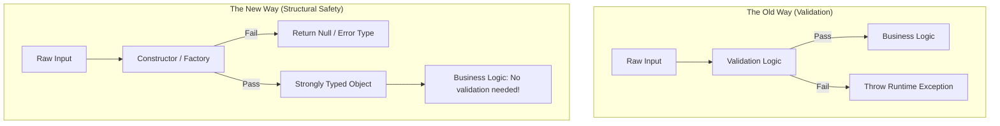

# Make Invalid States Impossible

## Overview

"Make Invalid States Impossible" is the design philosophy that the compiler should enforce your business rules. Instead of writing runtime checks (`if (state != valid) throw Exception`), you design your data structures so that it is structurally impossible to represent an invalid state in code. If a state shouldn't exist, the code shouldn't compile.

## Why It Matters

In a mature codebase, developers shouldn't have to read 50 lines of documentation to know how to use a class safely. If you provide a class `User(val id: String?, val isGuest: Boolean)`, a developer *will* accidentally create a `User(id = "123", isGuest = true)`—a state that logically shouldn't exist (guests shouldn't have IDs). 

Relying on developers to "just remember the rules" guarantees bugs in production. Relying on the compiler guarantees those bugs never leave the IDE.

## Historical Context

This principle was popularized by functional programming languages with strong type systems (like Elm, Haskell, and Rust). It gained massive traction in Android with the introduction of Kotlin, specifically its null-safety features (`String` vs `String?`) and `sealed classes`. Before Kotlin, Java developers relied heavily on runtime validation and `IllegalArgumentException`.

## First Principles

1.  **Trust the Type System:** Types are not just for memory allocation; they are for documenting and enforcing business rules.
2.  **Eliminate the "What If":** If your UI state has an `error` string and a `data` object, what does it mean if both are non-null? The UI doesn't know. By making it impossible to have both, you eliminate the mental overhead of handling paradoxical states.
3.  **Compile-Time > Run-Time:** A compile-time error takes 5 seconds to fix. A runtime error takes a crash report, a Jira ticket, a sprint planning session, and a hotfix to fix.

## Mental Model

Think of a puzzle box.
- **Valid States Possible (Relying on instructions):** You have a square hole and a round hole. You have a square peg and a round peg. You are given a manual that says: "Do not put the square peg in the round hole." Someone, eventually, will force it in.
- **Invalid States Impossible (Relying on structure):** The square peg is simply too big to physically fit into the round hole. You can throw the manual away. You cannot make a mistake even if you try.

## Internal Mechanics

The primary tools for this in Kotlin are Sealed Classes, Enums, Nullability, and Value Classes.

### 1. The Classic Boolean Trap

Booleans multiply complexity. Two booleans create 4 possible states. Three create 8.

**Bad (Invalid States are Possible):**
```kotlin
// A screen loading a user profile.
data class ProfileState(
    val isLoading: Boolean,
    val user: User?,
    val error: String?
)

// What does this state mean? We are loading, we have a user, AND we have an error?
// This is an impossible paradox, but the compiler allows it!
val state = ProfileState(isLoading = true, user = User("Alice"), error = "Network Failed")
```

**Good (Invalid States are Impossible):**
```kotlin
// Using the State Pattern via Sealed Interfaces
sealed interface ProfileState {
    data object Loading : ProfileState
    data class Success(val user: User) : ProfileState  // User is guaranteed non-null
    data class Error(val message: String) : ProfileState // Message is guaranteed non-null
}

// You cannot physically construct a "Loading + Error" state anymore. The compiler forbids it.
```

### 2. The Nullable String Trap

Often, a String is just a primitive disguise for a business concept.

**Bad:**
```kotlin
fun processPayment(creditCardNumber: String) {
    // I have to validate this EVERY time it's passed around.
    if (creditCardNumber.length != 16) throw Exception("Invalid")
}
```

**Good:**
```kotlin
// Use a Value Class to create a highly specific, validated type.
@JvmInline
value class CreditCardNumber private constructor(val value: String) {
    companion object {
        fun create(value: String): CreditCardNumber? {
            return if (value.length == 16) CreditCardNumber(value) else null
        }
    }
}

// If this function is called, the card is GUARANTEED to be 16 digits.
// The compiler enforces it. No runtime checks needed inside the function.
fun processPayment(card: CreditCardNumber) { ... }
```

## Architecture



## Production Example

**Jetpack Compose Navigation Arguments**

In older Android (Fragments/Activities), passing data between screens relied on `Bundle` extras (`intent.putExtra("ID", 123)`). The receiving screen had to do runtime checks: `intent.getIntExtra("ID", -1)`. If the sender misspelled "ID" as "id", the app crashed at runtime. The state of "Screen opened without required ID" was valid in code.

Modern Compose Navigation (specifically the Type-Safe Navigation library) uses Kotlin Serialization to pass objects directly.

```kotlin
// Defining the route as a strictly typed data class
@Serializable
data class ProfileRoute(val userId: String)

// Navigating
navController.navigate(ProfileRoute(userId = "123"))

// Receiving
val args = backStackEntry.toRoute<ProfileRoute>()
val id = args.userId // Guaranteed to exist. No null checks. No typos.
```

## Tradeoffs

**Advantages**
- **Mental Relief:** You stop writing defensive `if (x != null)` checks everywhere. You trust the types.
- **Self-Documenting Code:** The type signature tells the entire story. `fun show(user: GuestUser)` is infinitely clearer than `fun show(user: User)` where you have to check `user.isGuest`.
- **Exhaustiveness:** Kotlin's `when` statements force you to handle every variant of a sealed class, preventing unhandled edge cases.

**Disadvantages**
- **Upfront Boilerplate:** Designing strict types takes more typing than just throwing everything into a `HashMap<String, Any>` or a generic `data class` with nullable fields.
- **Serialization Friction:** Strongly typed hierarchies (like sealed classes) are sometimes difficult to serialize/deserialize directly from generic JSON APIs without custom adapter logic.
- **Refactoring Scope:** When you change a sealed class, you must update every `when` statement that uses it across the entire app. (Though this is arguably a massive advantage for safety).

## Failure Modes

- **The "Everything is a String" Anti-pattern (Primitive Obsession):** Using a String to represent an Email, a UUID, a URL, and a Phone Number. If a function takes `fun send(email: String, body: String)`, a developer will eventually swap the arguments by accident. *Use Inline Value Classes (`Email`, `Body`).*
- **Optional Paralysis:** A data class with 10 properties, all of which are nullable (`val name: String?`). This forces every single consumer of that class to write 10 null checks. Usually, this means the class represents 3 different distinct states crammed into one file.
- **Ignoring the Factory:** Creating a strict type, but leaving the constructor public and unvalidated, allowing developers to bypass the safety mechanisms.

## Staff Engineer Thinking

When reviewing PRs, a Staff engineer hunts for paradoxes:

1.  **Look for paired booleans.** If I see `isLoading` and `isSuccess` in the same class, I will reject the PR and ask for a `Sealed Interface`.
2.  **Where is the validation boundary?** Unsafe data (from network or user input) should be validated *once* at the very edge of the system, and immediately converted into a strictly typed, impossible-to-be-invalid object. The core domain logic should only operate on those safe objects.
3.  **Does this type lie?** If a function returns `List<Item>`, but the documentation says "Returns an empty list if there is an error", the type is lying. An error is not an empty list. The function should return a `Result<List<Item>>` to force the caller to handle the error explicitly.

## Common Misconceptions

- **"It takes too much time to write all these classes."** You are trading 5 minutes of typing today for 5 hours of debugging a production crash next month.
- **"We have unit tests, so we don't need strict types."** Tests verify that the code *can* work correctly. Strict types verify that the code *cannot* work incorrectly. Types are mathematically stronger than tests.

## Probing Questions

1.  Explain the concept of "Primitive Obsession" and how Kotlin's `value classes` solve it.
2.  How does replacing multiple boolean flags with a `sealed interface` prevent invalid UI states?
3.  Why is it better to validate data at the edge of the system (e.g., the network layer) rather than deep inside the business logic?
4.  If a backend API returns an object where `user_id` and `guest_id` can both be null, but one of them *must* be present, how do you model this defensively in Kotlin?
5.  What is the architectural difference between a compile-time error and a runtime error?
6.  How does Kotlin's null-safety (`?`) embody the "Make Invalid States Impossible" philosophy?
7.  Write a snippet of code demonstrating a constructor that prevents the creation of an invalid state (e.g., an `Email` class).
8.  Why might using a generic `Pair<Int, String>` be considered an anti-pattern compared to creating a specific `data class`?
9.  Explain why a function signature like `fun calculate(data: Data): Int` is fundamentally safer than `fun calculate(data: Data, validateFirst: Boolean): Int`.
10. Describe a scenario where enforcing strict typing (impossible states) makes parsing JSON payloads more difficult. How do you resolve this tension?

## Answer Key

1. **Explain the concept of "Primitive Obsession" and how Kotlin's `value classes` solve it.**
   Primitive obsession is using basic types (like `String`) to represent complex domain concepts (like an `Email`). Value classes wrap the primitive in a strong type at compile-time, ensuring type safety without runtime memory overhead.
2. **How does replacing multiple boolean flags with a `sealed interface` prevent invalid UI states?**
   Multiple booleans (e.g., `isLoading`, `isError`) allow paradoxical states (both true simultaneously). A `sealed interface` forces the state to be exactly one exclusive variant, making paradoxical combinations structurally impossible.
3. **Why is it better to validate data at the edge of the system (e.g., the network layer) rather than deep inside the business logic?**
   Validating at the edge ("Parse, don't validate") guarantees that the core business logic only ever operates on structurally safe, strictly typed objects, eliminating the need for scattered, repetitive error-checking deep in the app.
4. **If a backend API returns an object where `user_id` and `guest_id` can both be null, but one of them *must* be present, how do you model this defensively in Kotlin?**
   Use a sealed class to represent the parsed domain model: `sealed class Identity { data class User(val id: String): Identity(); data class Guest(val id: String): Identity() }`. Parse the backend response into this strict type immediately.
5. **What is the architectural difference between a compile-time error and a runtime error?**
   A compile-time error is caught instantly by the IDE before the app runs, preventing bad code from shipping. A runtime error happens on a user's device, requiring crash reporting and potentially causing user churn.
6. **How does Kotlin's null-safety (`?`) embody the "Make Invalid States Impossible" philosophy?**
   It forces developers to explicitly handle the absence of a value. The compiler makes it physically impossible to invoke methods on a potentially null reference without checking it, preventing `NullPointerExceptions`.
7. **Write a snippet of code demonstrating a constructor that prevents the creation of an invalid state (e.g., an `Email` class).**
   ```kotlin
   @JvmInline
   value class Email private constructor(val value: String) {
       companion object {
           fun create(value: String): Email? = if (value.contains("@")) Email(value) else null
       }
   }
   ```
8. **Why might using a generic `Pair<Int, String>` be considered an anti-pattern compared to creating a specific `data class`?**
   A `Pair` lacks semantic meaning. `Pair(200, "Success")` doesn't explain what the values represent, whereas `data class HttpResponse(val code: Int, val message: String)` perfectly documents the domain model.
9. **Explain why a function signature like `fun calculate(data: Data): Int` is fundamentally safer than `fun calculate(data: Data, validateFirst: Boolean): Int`.**
   The first signature implies `Data` is already valid by definition of its type. The second introduces a branching state where the function might operate on invalid data if `validateFirst` is false, increasing complexity and risk.
10. **Describe a scenario where enforcing strict typing (impossible states) makes parsing JSON payloads more difficult. How do you resolve this tension?**
    When a generic JSON API returns a flat object with many nullable fields representing different states. Resolve this by keeping a flexible DTO class for parsing the JSON, then immediately mapping it to a strict domain model using a factory function.

## Further Reading

- [`../patterns/state.md`](../patterns/state.md) — The mechanical implementation of this principle for UI architectures.
- [`simplicity.md`](simplicity.md) — Strict types actually make the consuming code radically simpler to read.
- [Parse, don't validate (Alexis King)](https://lexi-lambda.github.io/blog/2019/11/05/parse-don-t-validate/) — The definitive essay on this topic.
