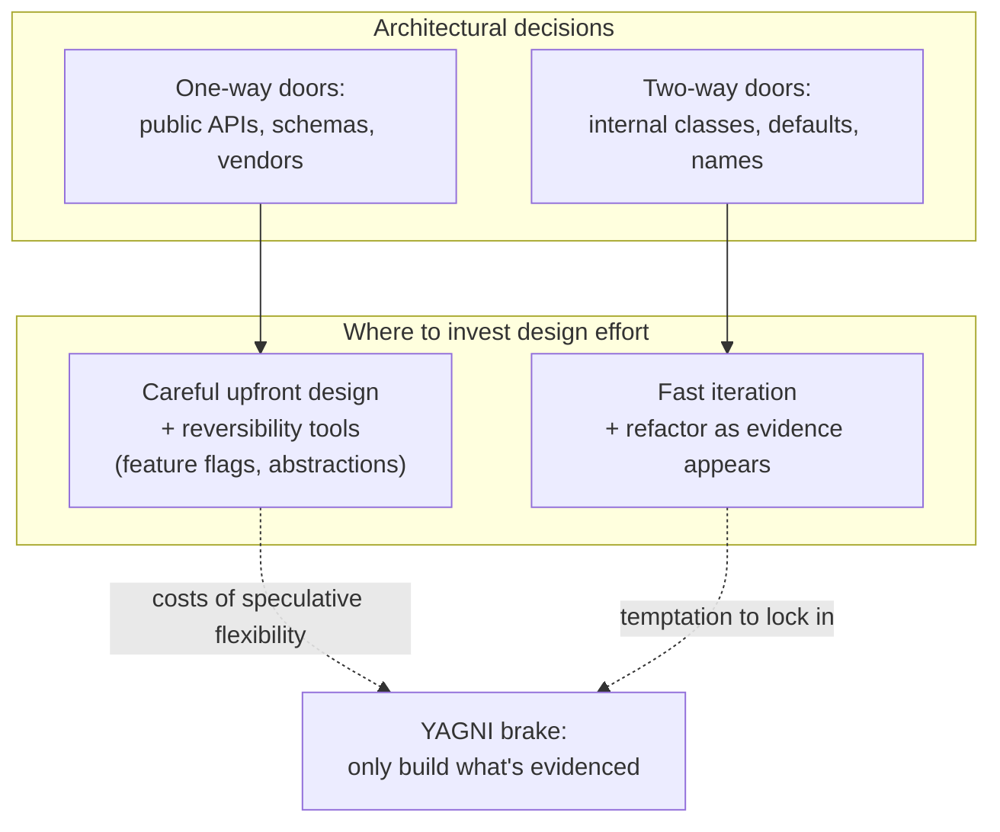

# Optimize for Change

## Overview

**Optimize for change** is the principle that important requirements, dependencies, and operating constraints can change, so architecture should make likely changes affordable and risky changes recoverable. The goal is not to predict every future state; it is to manage the cost of revisiting consequential decisions.

Two interpretations follow:

1. **Cheap to change**: when a requirement shifts, the cost of adapting the code is small. The cost is measured in lines touched, files modified, modules rebuilt, tests rewritten, regressions risked.
2. **Cheap to reverse or mitigate**: when a change ships and turns out wrong, a compatible flag, kill switch, staged rollout, rollback, roll-forward, or reversible migration can reduce impact. Propagation delay, cached configuration, irreversible writes, old clients, and coupled server behavior determine whether a config change is sufficient.

The principle is often confused with two siblings: "make everything configurable" (which adds complexity and rarely pays off) and "predict every future need" (the YAGNI anti-pattern). Optimize-for-change is neither. It's about **avoiding decisions that are expensive to revisit** and **keeping the cheap-to-revisit decisions actually cheap**. Jeff Bezos's "one-way doors vs two-way doors" framing captures it: identify which decisions are one-way (hard or impossible to reverse, like a database choice, a public API contract, a vendor lock-in) and which are two-way (easy to reverse, like an internal abstraction, a default value, a UI tweak). Spend the time you'd have spent on speculative flexibility on the one-way doors; let the two-way doors be quick.

---

## Why It Exists

Two empirical observations drive the principle:

1. **Material requirements can change.** Business conditions, customer evidence, regulation, dependencies, and engineering understanding can invalidate an initial assumption. Estimate likely change from the product's own history instead of relying on an invented universal percentage.
2. **Reversal cost is asymmetric.** A client bug can remain installed after a fix is available; a destructive schema migration can require data recovery; and a vendor change can be constrained by code, data export, and contract terms. Measure the relevant propagation and recovery paths for the decision.

The principle says: **design assuming you will be wrong about specifics, and ensure that being wrong is recoverable**. This is the engineering analog of risk management. You don't pretend the future is predictable; you minimize the cost of any single wrong guess.

The hardest part is distinguishing "real optionality that will pay off" (worth the upfront cost) from "speculative flexibility that adds complexity for nothing" (YAGNI). The honest answer is that you usually only know in retrospect, and the discipline is to bias toward keeping things simple and small until you have evidence of needing more.

---

## Historical Context

1. **Parnas's information hiding (1972).** David Parnas's *On the Criteria To Be Used in Decomposing Systems into Modules* argued that modules should be drawn around "design decisions likely to change," hiding the changeable parts behind stable interfaces. The first formal statement of optimize-for-change as a software-engineering principle.
2. **Pragmatic Programmer (1999).** Hunt and Thomas's "DRY" (Don't Repeat Yourself) is partly a change-cost argument: duplication multiplies the cost of any change to the duplicated concept.
3. **Kent Beck, *Extreme Programming Explained* (1999).** "Embrace change" as the central XP value. Practices like continuous integration, refactoring, and TDD all serve the same goal: lower the cost of change.
4. **Bezos's "one-way / two-way doors" framing (2015 shareholder letter).** Distinguishing decisions that are easy vs hard to reverse, and arguing that fast organizations let two-way decisions be made quickly with limited deliberation.
5. **Continuous Delivery (Humble & Farley, 2010).** Deployment pipelines, feature flags, staged rollouts — the operational toolkit for cheap-to-reverse production changes.
6. **Mobile-specific evolution.** Mobile compounds the cost of mistakes: a bad release takes hours to days to roll forward (Play/App Store review delays) and weeks to fully propagate as users update. This makes feature flags, server-driven config, and kill switches especially important on mobile — they let you change behavior server-side without shipping an APK.

The arc: from "modules hide changeable decisions" (Parnas, code-level) to "feature flags hide changeable behavior" (Continuous Delivery, operational-level), with the same underlying observation that change is constant and the cost of reversing should be small.

---

## First Principles

### 1. Identify one-way vs two-way doors

Some decisions are inherently expensive to reverse:

- **Public API contracts.** Every consumer depends on the signature. Reversing requires every consumer to upgrade.
- **Database schema for production data.** Reversing requires migration and risks data loss.
- **Vendor choice with deep lock-in.** Reversing requires re-implementing on a different platform.
- **Wire format (proto definitions, REST URLs).** Reversing breaks deployed clients.
- **Library versions exposed in your own public API.** Reversing forces consumer upgrades.

These deserve careful upfront design. Get them wrong and the recovery cost is months.

Other decisions are cheap to revisit:

- **Internal abstractions.** Refactor when the use case sharpens.
- **Default configuration values.** Change via config.
- **Variable names.** IDE rename.
- **Algorithm choice for an internal computation.** Swap behind the same interface.

These deserve fast iteration. Spending two weeks debating an internal class name is a waste.

The skill is recognizing which is which. Most planning meetings should sort decisions into the two buckets and spend time accordingly.

### 2. Information hiding behind stable interfaces

Parnas's insight: **draw module boundaries around the things likely to change**. Inside the module, change is local. Outside the module sees only the stable interface.

```kotlin
// The decision likely to change: which payment gateway
interface PaymentGateway {
    suspend fun charge(amount: Money): Result<Receipt>
}

class StripeGateway(private val client: StripeClient) : PaymentGateway { ... }
class BraintreeGateway(private val client: BraintreeClient) : PaymentGateway { ... }

// Consumers depend only on the interface
class CheckoutViewModel(private val payment: PaymentGateway) { ... }
```

The interface limits compile-time coupling in callers. A provider change can still require new authentication, error mapping, idempotency, settlement, webhook, compliance, migration, and operational behavior behind that boundary; an abstraction reduces a class of changes rather than making the swap a one-line operation.

### 3. Reversibility via feature flags

```kotlin
class CheckoutViewModel(
    private val payment: PaymentGateway,
    private val flags: FeatureFlags
) : ViewModel() {
    fun submit() {
        if (flags.isEnabled("new_checkout_flow")) {
            newCheckoutFlow()
        } else {
            oldCheckoutFlow()
        }
    }
}
```

Both flows exist in production simultaneously. A server-controlled flag can route clients that have fetched the relevant configuration back to the compatible old path. Define propagation, cached/default behavior, cohort targeting, and what the flag cannot undo, such as writes or server-side effects. This is runtime mitigation when both paths remain safe; it is not proof of instant or complete reversal.

### 4. YAGNI as the counter-discipline

*You Aren't Gonna Need It* is the brake on speculative flexibility. Building a `PaymentProcessor` abstraction with five hooks "in case we want to plug in alternative processors" before there's a second processor is YAGNI violation. The hooks add complexity, slow comprehension, and frequently don't fit when the actual second processor arrives.

A reasonable default is to keep the first implementation local until another provider, consumer, or independently testable boundary gives evidence for an abstraction. Extracting that boundary later can still be expensive if vendor types and semantics have spread, so make the decision from coupling and migration cost rather than occurrence count alone.

### 5. Optionality has a cost

Every layer of indirection, every config knob, every feature flag adds:

- More code to read
- More test paths to cover
- More failure modes to debug
- More documentation to maintain

The right amount is **just enough** to cover the changes you're confident will happen, not the ones you're speculating about.

---

## Mental Model

Think of architecture as a **set of contracts** spanning different time horizons. Some contracts are with people: customers, integrators, partners. Some are with code: existing callers, future maintainers. Some are with operations: deployment pipelines, monitoring tools, on-call.

Changing a contract is expensive in proportion to **how many parties depend on it**. A private method has one party (you). A public API of a published library has thousands (every consumer). A database schema in production has every existing row of data.

The principle says: **make the highly-coupled contracts deliberately, slowly, and with reversibility built in. Make the lightly-coupled contracts fast and changeable.**

A useful image: think of the architecture as a city map. Some structures are skyscrapers — building them takes years; tearing one down takes longer. Others are pop-up shops — opened in a day, removed in a day. You site skyscrapers carefully; you put up pop-ups quickly.

The architectural mistake is treating every decision as a skyscraper ("we must make this design perfect") or every decision as a pop-up ("we'll just refactor later"). The wisdom is recognizing which decision is which.

---

## Internal Mechanics

### Dependency inversion as a change-cost mechanism

The dependency-inversion principle (DIP, the D in SOLID) says: depend on abstractions, not concretions. The mechanical consequence is that swapping the concretion doesn't touch the caller.

```kotlin
// Caller depends on the abstraction
class CheckoutViewModel(private val payment: PaymentGateway) { ... }

// At wire-up time, you pick a concretion
val viewModel = CheckoutViewModel(StripeGateway(client))
```

If the abstraction captures the required domain semantics, callers and many tests can remain unchanged while provider-specific authentication, errors, idempotency, settlement, and operations change behind it. Contract tests are needed to show that a new provider satisfies those semantics.

### Feature flags: runtime branching with config control

```kotlin
class FeatureFlags(private val remoteConfig: RemoteConfig) {
    fun isEnabled(flag: String): Boolean = remoteConfig.getBoolean(flag, false)
}
```

Flags are evaluated at runtime against the latest config. The config can be updated server-side (Firebase Remote Config, LaunchDarkly, in-house systems) without an app release. Properties:

- **Reversibility**: flip in seconds.
- **Targeting**: enable for 1% of users, then 10%, then 100%.
- **Kill switches**: a flag that can disable a feature entirely if it misbehaves.
- **Decoupling release from feature exposure**: code can ship months before exposure.

### Server-driven UI for reversible UI changes

For UI components rendered from server config (server-driven UI), the change is just a server config update:

```kotlin
// Server returns:
// { "type": "banner", "title": "Welcome back", "ctaText": "Continue" }

// Client renders dynamically based on type
@Composable
fun ServerDrivenComponent(config: ComponentConfig) {
    when (config.type) {
        "banner" -> Banner(config.title, config.ctaText)
        "card" -> Card(config.title, config.ctaText)
        ...
    }
}
```

A messaging change is a server-side text change. A layout tweak is a server-side type change. No app release.

### Database migrations: reversible vs irreversible

```sql
-- Reversible: add a nullable column
ALTER TABLE users ADD COLUMN nickname TEXT;
-- Reverse: ALTER TABLE users DROP COLUMN nickname;

-- Irreversible: drop a column with data
ALTER TABLE users DROP COLUMN deprecated_field;
-- Reverse: data is gone; can only restore from backup
```

The first migration is two-way; the second is one-way. A schema change strategy that runs irreversible migrations only after careful soak time, with backups verified, is the operational form of optimize-for-change.

### Refactoring as a continuous activity

Code that's been touched many times tends to acquire crud — unused parameters, defunct paths, mismatched abstractions. Continuous refactoring (small, in-the-flow improvements as you work) keeps the change cost low. Periodic big refactors are usually a symptom of skipping the small ones.

---

## Architecture



---

## Production Example

### Vendor abstraction for payment processing

A mobile app integrates with Stripe. Six months later, the business adds Apple Pay. Twelve months later, they explore Razorpay for India. Each addition is a one-way door if hard-coded; each is a small swap if abstracted.

```kotlin
interface PaymentGateway {
    suspend fun charge(amount: Money, method: PaymentMethod): Result<Receipt>
}

class StripeGateway(...) : PaymentGateway { ... }
class ApplePayGateway(...) : PaymentGateway { ... }
class RazorpayGateway(...) : PaymentGateway { ... }

class CheckoutViewModel @Inject constructor(
    private val gateway: PaymentGateway     // injected; bound per build flavor or region
) : ViewModel() { ... }
```

The cost of building the abstraction the first time was maybe two hours. The savings on each new gateway are months of refactoring.

The discipline: **introduce the abstraction when the second implementation appears**, not before. Premature abstraction guesses wrong about the shared interface and gets in the way.

### Feature flag for risky redesign

A team wants to ship a new checkout UI. The risk is non-trivial:

```kotlin
class CheckoutScreenSelector(private val flags: FeatureFlags) {
    @Composable
    fun render() {
        if (flags.isEnabled("checkout_v2")) {
            CheckoutScreenV2()
        } else {
            CheckoutScreenV1()
        }
    }
}
```

Both V1 and V2 ship in the same APK. The flag is rolled out: 1% on Monday, 5% on Tuesday, 50% by Friday. Conversion rate drops on Tuesday — the flag is flipped off in minutes, fix the bug, roll out again next week. Without the flag, the same recovery is a hotfix release with 48-hour Play Store review.

### Schema evolution with backward compatibility

```kotlin
// Old API response
data class UserV1(val id: Long, val name: String, val email: String)

// New API adds optional fields
data class UserV2(
    val id: Long,
    val name: String,
    val email: String,
    val nickname: String? = null,
    val avatarUrl: String? = null
)
```

Old clients continue only when their decoder ignores unknown fields and payload/semantic assumptions remain valid. Additive fields are often easier to roll out, but strict decoders, generated exhaustive models, payload budgets, and new semantics require provider/consumer compatibility tests.

Removing a field requires a deprecation cycle: mark the field deprecated, wait for clients to stop using it, then remove. Premature removal is a one-way door that breaks deployed clients.

---

## Android Example

### Build variants for region-specific differences

```kotlin
// build.gradle.kts
android {
    flavorDimensions += "market"
    productFlavors {
        create("us") { dimension = "market"; ... }
        create("india") { dimension = "market"; ... }
        create("global") { dimension = "market"; ... }
    }
}
```

Each variant gets its own resources, dependency wiring, and entry points. Switching a region's payment gateway is changing one variant's `Gradle` config — not a code change in the shared core.

### Remote Config for runtime kill switches

```kotlin
@HiltViewModel
class HomeViewModel @Inject constructor(
    private val flags: RemoteConfig,
    private val analytics: Analytics
) : ViewModel() {

    init {
        if (!flags.getBoolean("home_recommendations_enabled")) {
            // The recommendation system is killed; show plain feed only
        }
    }
}
```

A recommendation system that's misbehaving on Samsung Galaxy S20s can be disabled for that audience via Remote Config rules — without redeploying.

### Refactor-friendly code patterns

```kotlin
// Adding a parameter without breaking callers
fun loadUser(
    id: UserId,
    options: LoadOptions = LoadOptions.DEFAULT
): User
```

Default arguments preserve many source callers that recompile, but they can affect precompiled binary consumers and Java callers unless the published API uses a compatible overload/versioning strategy. Treat the change as reversible only after testing every supported consumer mode.

---

## Tradeoffs

**Advantages**

- **Lower cost of recovering from mistakes.** A reversible mistake is a small mistake.
- **Faster experimentation.** Feature flags + safe defaults let teams try multiple approaches and pick the winner.
- **Decoupled release cycles.** Vendor swaps, UI redesigns, algorithm changes can happen without app updates.
- **Better incident response.** Kill switches let on-call disable broken features without code deploys.

**Disadvantages**

- **Speculative abstraction adds cost.** Wrong-guess abstractions are worse than no abstraction. YAGNI violations harm both speed and clarity.
- **Configuration complexity.** Every flag, every variant, every config knob adds combinations to test. Combinatorial explosion is real.
- **Feature flag debt.** Flags shipped for a launch can linger for years, accumulating complexity in code paths.
- **Configuration-as-code drift.** Config changes server-side without a code review can subtly change behavior.

**When not to apply**

- For internal class names, file structure, algorithm choices in non-public code — refactor freely; don't pre-build flexibility.
- For experimental prototypes — the cost of the abstraction outweighs the benefit.
- For decisions that genuinely will not change — don't build optionality for a fundamental that's set in stone.

---

## Failure Modes

**Premature abstraction.** Building a `Strategy` before the expected variation or boundary is understood can encode the wrong similarities. Mitigation: introduce an abstraction when independent implementations, consumers, testing, policy, or migration economics justify it; occurrence count is a heuristic, not a rule.

**Feature flag debt.** A flag shipped for a launch is never removed; six months later the code has two parallel paths, neither fully tested. Mitigation: every flag has an explicit removal date and an owner. Track flags as tech debt with a deadline.

**Speculative configuration.** Making everything configurable produces a config schema that no one fully understands. Mitigation: configure what evidence demands; defaults handle the rest.

**Over-rolled-back rollouts.** A staged rollout halts at 5% on every release because the team is risk-averse. Velocity drops. Mitigation: define clear rollout criteria (crash rate < X, conversion within Y of baseline) and execute mechanically.

**Vendor lock-in via "deep integration."** Choosing a vendor for their full-featured SDK and using every feature ties the codebase to the vendor. Mitigation: use the vendor SDK behind a small interface; pay the abstraction cost upfront to keep the door reversible.

**Schema-irreversible migration.** A migration that drops a column with data is irreversible. Mitigation: a two-phase migration — mark the field deprecated in v1, remove in v2 after the data confirms no one uses it.

**Architectural perfectionism.** Every code review demands "what if X changes?" considerations until the code is paralyzed by speculative flexibility. Mitigation: enforce YAGNI as a code-review heuristic; if a flexibility hook doesn't have a concrete near-term use, defer it.

---

## Performance Considerations

- **Feature flag lookups have a cost.** Remote I/O, parsing, synchronization, listeners, or allocation can matter on a hot path; a simple in-memory lookup may not. Keep network/config refresh off frame-sensitive paths and measure before adding caching complexity.
- **Indirection through abstractions has a cost.** Runtime dispatch may be inlined or may remain, depending on code shape and runtime optimization. Reserve micro-optimizations for measured hotspots.
- **Configuration parsing on startup.** Loading and parsing remote config on cold start adds latency. Cache locally and refresh in the background.
- **Server-driven UI's flexibility costs render performance.** Dynamic component dispatch is slower than hardcoded composition. Reserve for components that genuinely need server-driven control.

---

## Reliability Considerations

- **Kill switches as a reliability tool.** Add a kill switch when a feature can be disabled safely and the expected incident mitigation value exceeds the platform, test-matrix, and lifecycle cost. Security enforcement, destructive writes, and incompatible schemas need controls beyond a client flag.
- **Default according to the threat and product model.** When configuration is absent, use a tested cached/default path. Availability features may degrade open, while security, legal, payment, or data-integrity controls may need to fail closed; do not make a critical flow depend on a live flag fetch without an explicit offline policy.
- **Test relevant flag states and transitions.** Test both paths, default/fetch failure, cached configuration, and important interactions. Pairwise, model-based, or risk-based selection may be needed when many flags make an exhaustive matrix infeasible.
- **Reversible deploys.** Mobile clients persist in the fleet after a new release is available, so rollback, roll-forward, server compatibility, staged rollout, and flags solve different parts of recovery. Do not treat a server-side flag as the only reversibility mechanism.

---

## Security Considerations

- **Flag-controlled features must be authorized at the server.** A client flag check is bypassable; server-side feature exposure is the actual control.
- **Vendor abstraction limits supply-chain blast radius.** When a SaaS vendor is compromised, the abstracted code is easier to switch off.
- **Config changes are deployment changes.** Treat remote config edits with the same review process as code deploys — they have the same blast radius.
- **Feature flag values are PII in some jurisdictions.** Flag states keyed to user IDs may be classified as profiling data under GDPR. Audit.

---

## Observability

- **Flag exposure evidence.** Record a versioned product exposure event once per defined exposure unit when experiment analysis needs it; use bounded operational metrics for configuration health. Do not log every lookup or attach unrestricted user/segment identifiers. Apply the [telemetry taxonomy](../observability/telemetry-taxonomy.md) to cardinality, sampling, privacy, retention, and deletion.
- **A/B test instrumentation.** When a flag controls an experiment, instrument both arms with the same events for clean attribution.
- **Rollout dashboards.** Show flag-on % vs key business metrics over time. Spike in error rate after 5% rollout → halt and investigate.
- **Vendor abstraction lets you instrument the boundary.** Wrap the gateway calls with latency/error metrics; if you switch vendors, the metrics keep working.

---

## Staff Engineer Thinking

**Sort decisions by reversibility cost.** In any design review, ask of each decision: "what does it cost to reverse this in 6 months?" Spend the discussion proportionally.

**Build feature flags as platform infrastructure, not per-feature.** A single robust flag service used across the app is cheaper to maintain than ad-hoc booleans scattered everywhere.

**Maintain a flag lifecycle policy.** Flags shipped with code must have removal dates. Track flags as tech debt with an owner and a deadline. Aged flags become structural debt.

**Resist mocking out everything for "flexibility."** Abstracting a stable dependency just because "we might swap it" is YAGNI. Introduce the boundary when independent implementations, consumers, policy, testing, or migration economics justify it; a second occurrence is evidence, not a rule.

**Pay the upfront cost on one-way doors.** A bad API contract published to consumers is the most expensive mistake a team can make. Get those right with care, design reviews, and explicit deprecation/versioning strategies.

**Prefer compatible evolution.** Additive wire changes are often easier to roll out than renames or removals, but clients with strict decoders, exhaustive matching, generated models, or bounded payloads can still break. Adding an abstract interface method can be source- or binary-incompatible for existing implementers. Validate each change against the language/wire compatibility rules and supported consumer fixtures.

**Treat refactoring as a routine activity.** Small evidence-driven improvements can keep change cost visible. Older code may be harder to change because tests, ownership, or dependency knowledge decayed, but age alone does not prove it is unrefactorable.

**Plan for recovery.** Every shipped change should name rollback, roll-forward, kill-switch, compatibility, and data-repair options. A flag reduces risk only when it propagates within the required time and both server and client paths remain compatible; it cannot by itself reverse completed side effects.

---

## Common Misconceptions

**"Optimize-for-change means making everything abstract."** No. It means making the *expensive* things abstract and the *cheap* things simple. Speculative abstraction is anti-optimize-for-change.

**"Feature flags are for A/B testing."** Experimentation is one use. A flag can also mitigate a compatible feature path without a release, but it cannot undo completed writes, secure a fail-open control, or repair incompatible client/server state.

**"YAGNI is the opposite of optimize-for-change."** They're complementary. Optimize-for-change says make the right things flexible; YAGNI says don't make the wrong things flexible.

**"Build one, throw it away."** Sometimes accurate, but pessimistic. Aim to build one that's flexible at the joints you expect to revisit and rigid elsewhere.

**"Reversibility is for big changes."** Small changes can still justify mitigation when their blast radius is large. A flag adds lifecycle and test cost, while an app update has store review and fleet-adoption latency that varies by channel and user behavior; choose from measured risk.

**"Architecture should predict the future."** It shouldn't predict; it should *absorb*. The future will surprise you. Design to minimize the cost when it does.

---

## Probing Questions

1. Distinguish a one-way decision from a two-way decision with three examples from a typical Android codebase.
2. A team is choosing between Stripe and Braintree for a new app. What questions about reversibility should drive the choice?
3. Explain why introducing a `PaymentGateway` interface on day one might be worse than introducing it when the second gateway arrives.
4. A feature flag has been in production for 14 months. Both paths are still in the code. What's the cost of leaving it, and how do you decide when to remove it?
5. When can nullable fields and default-argument parameters support compatible evolution, and where do they fail?
6. A schema migration drops a column. Walk through how you'd convert this to a reversible two-phase change.
7. What's the operational cost of a 100-flag system at a mid-sized mobile org? How do you keep it manageable?
8. Why is "make everything configurable" usually the wrong response to a feature being "too rigid"?
9. A risky redesign is being shipped behind a flag. Define three rollout milestones and three abort triggers.
10. The Stripe SDK has a new "great" feature that's tightly coupled to their APIs. The product team wants to use it. What's the conversation about reversibility?

---

## Answer Key

1. **Distinguish a one-way decision from a two-way decision with three examples from a typical Android codebase.**
   One-way (hard to reverse): Defining a public API contract, selecting a core database schema (e.g., Room), and adopting a deeply integrated vendor SDK. Two-way (easy to reverse): Choosing an internal architecture pattern for a single screen, naming variables, and setting default timeout values.
2. **A team is choosing between Stripe and Braintree for a new app. What questions about reversibility should drive the choice?**
   How hard would it be to swap providers later? Can we hide the provider behind a simple internal interface? What is the contractual lock-in and how much does their SDK bleed into our domain logic?
3. **Explain why introducing a `PaymentGateway` interface on day one might be worse than introducing it when the second gateway arrives.**
   Premature abstraction often guesses wrong about what the shared interface needs to be. It adds unnecessary complexity (YAGNI) until a second implementation actually proves the need and shape of the abstraction.
4. **A feature flag has been in production for 14 months. Both paths are still in the code. What's the cost of leaving it, and how do you decide when to remove it?**
   The cost includes cognitive overload, increased testing surface area, and maintaining dead code. It should be removed immediately once the feature is fully rolled out and stabilized, using tech debt tracking with strict deadlines.
5. **When can nullable fields and default-argument parameters support compatible evolution, and where do they fail?**
   They can preserve source compatibility when absence has a defined meaning and callers recompile under supported rules. Strict wire decoders, semantic changes, Java callers, generated models, and precompiled binary consumers can still break, so validate actual provider/consumer fixtures and publish a support policy.
6. **A schema migration drops a column. Walk through how you'd convert this to a reversible two-phase change.**
   Phase 1: Mark the column as deprecated, stop writing to it, and deploy. Phase 2: After sufficient soak time to ensure no clients or processes still rely on it, execute the migration to actually drop the column.
7. **What's the operational cost of a 100-flag system at a mid-sized mobile org? How do you keep it manageable?**
   The cost includes interacting states, evaluation/config-refresh work, stale paths, ownership, and larger test/incident surfaces. Manage it with owners, types, expiry criteria, dependency constraints, observability, and risk-based/combinatorial testing rather than assuming every flag is temporary.
8. **Why is "make everything configurable" usually the wrong response to a feature being "too rigid"?**
   It expands the state space and operational surface, sometimes beyond what the team can test exhaustively. Configure the variations supported by evidence, define safe defaults, and use risk-based or combinatorial test selection for the resulting states.
9. **A risky redesign is being shipped behind a flag. Define three rollout milestones and three abort triggers.**
   Milestones: 1% internal/beta rollout, 10% canary rollout, 100% full rollout. Abort triggers: A spike in crash rates, a significant drop in primary conversion metrics, or increased latency beyond a defined threshold.
10. **The Stripe SDK has a new "great" feature that's tightly coupled to their APIs. The product team wants to use it. What's the conversation about reversibility?**
    Discuss the cost of vendor lock-in. Ask if the business value of the feature justifies the one-way door of coupling the codebase deeply to Stripe's proprietary API, and explore if it can be abstracted or isolated.

## Further Reading

In this repository:

- [`simplicity.md`](simplicity.md) — simplicity is itself a reversibility tool; complex code is hard to change.
- [`prefer-deletion.md`](prefer-deletion.md) — deleted code is the most reversible code there is.
- [`design-for-failure.md`](design-for-failure.md) — reversibility is the operational arm of designing for failure.
- [`make-invalid-states-impossible.md`](make-invalid-states-impossible.md) — invariants reduce the surface for incorrect changes.
- [`../patterns/strategy.md`](../patterns/strategy.md) — the canonical way to make a behavior swappable.
- [`../patterns/circuit-breaker.md`](../patterns/circuit-breaker.md) — automated reversibility on failures.
- [`../release-engineering/staged-rollouts.md`](../release-engineering/staged-rollouts.md) — operational reversibility.
- [`../release-engineering/kill-switches.md`](../release-engineering/kill-switches.md) — the explicit kill-switch playbook.
- [`../mobile-system-design/feature-flags-and-remote-config.md`](../mobile-system-design/feature-flags-and-remote-config.md) — the design of the flag platform itself.
- [`../observability/telemetry-taxonomy.md`](../observability/telemetry-taxonomy.md) — signal selection for flag exposure and operational health.

External:

- David Parnas, *"On the Criteria To Be Used in Decomposing Systems into Modules"* (1972) — the founding paper on information hiding for change.
- Kent Beck, *Extreme Programming Explained* (1999) — embrace change as the central value.
- Jeff Bezos, *2015 Letter to Shareholders* — the one-way/two-way doors framing.
- Martin Fowler, *"Feature Toggles (aka Feature Flags)"* (martinfowler.com) — a comprehensive treatment.
- *Continuous Delivery* by Jez Humble and David Farley — the operational toolkit for cheap changes.
- *Accelerate* by Forsgren, Humble, Kim — empirical evidence that change-cost-optimized organizations outperform.
