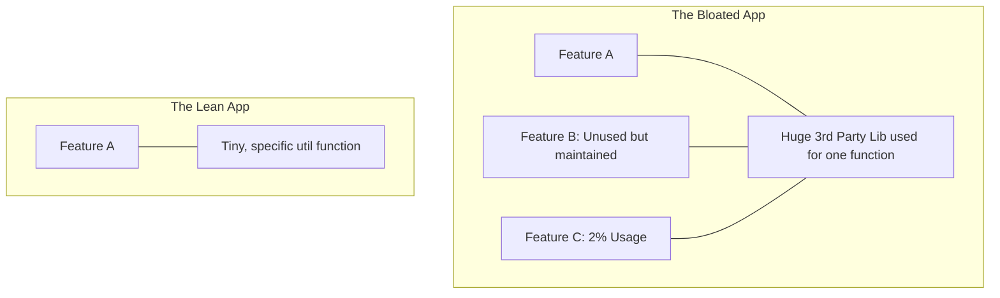

# Prefer Deletion

## Overview

"Prefer Deletion" (or "Delete is the Best Commit") is the engineering philosophy that the best way to improve a codebase is to remove code from it. Code is a liability, not an asset. Every line of code must be read, maintained, compiled, and tested. Code that is unused, overly complex, or redundant is an active drain on the engineering team.

## Why It Matters

In mature Android projects, codebases easily swell to over 1 million lines of code. This causes massive friction:
1.  **Build Times:** More code means longer Gradle compilation times. A 10-minute build time destroys developer flow.
2.  **APK Size:** Unused assets and libraries bloat the download size, which directly decreases user acquisition in emerging markets.
3.  **Cognitive Load:** When a new engineer searches for `CheckoutActivity` and finds `CheckoutActivity`, `OldCheckoutActivity`, and `CheckoutActivityV2`, they waste hours figuring out which one is actually running in production.

## Historical Context

Often summarized by the quote (attributed to Bill Gates or sometimes Elon Musk): *"The best part is no part. The best process is no process. It weighs nothing. Costs nothing. Can't go wrong."* In software, the XP (Extreme Programming) movement heavily emphasized YAGNI (You Aren't Gonna Need It) and aggressive refactoring to keep codebases lean.

## First Principles

1.  **Code is a Liability:** It costs money to write, it costs money to maintain, and it holds bugs.
2.  **Version Control Remembers Everything:** You do not need to "comment out" code just in case you need it later. Git has a complete history. Delete it.
3.  **Fear is the Enemy:** Developers leave dead code because they are afraid deleting it will break something. A healthy architecture (with tests) gives you the confidence to delete.

## Mental Model

Think of a backpack you carry on a hike.
- **Hoarding Code:** You pack an umbrella, snowshoes, a chainsaw, and a kayak because "you might need them." The backpack weighs 150 lbs. You can barely walk. This is a bloated codebase.
- **Prefer Deletion:** You pack exactly what you need for today's weather. The backpack weighs 10 lbs. You move fast. If you need a kayak tomorrow, you will pack it tomorrow.

## Internal Mechanics

Deleting code takes several forms, from micro to macro.

### 1. The Micro: Commented-Out Code

**Bad:**
```kotlin
fun calculateTotal(items: List<Item>): Double {
    var total = 0.0
    // for (item in items) {
    //     total += item.price
    // }
    // We switched to fold in 2022
    total = items.fold(0.0) { acc, item -> acc + item.price }
    return total
}
```

**Good:**
*(Delete the commented lines. Git remembers 2022).*

### 2. The Macro: Feature Flags & Dead Code

A common enterprise pattern is releasing features behind a Remote Config flag.

```kotlin
if (remoteConfig.getBoolean("use_new_checkout")) {
    launchNewCheckout()
} else {
    launchLegacyCheckout()
}
```

If the "new checkout" has been live for 100% of users for 6 months, the `launchLegacyCheckout()` path is Dead Code. It is a massive liability. A Staff engineer schedules dedicated "cleanup sprints" to rip out the dead flags and the thousands of lines of legacy code tied to them.

## Architecture



## Production Example

**Removing Third-Party Dependencies**

Adding a library to an Android app is an architectural decision. It increases the APK size, adds security risks, and couples your release cycle to a third-party maintainer.

If your app uses the massive `Guava` library simply because one developer wanted to use `Lists.partition()`, you have taken on massive liability. 

**The Deletion Move:** A Staff engineer deletes the `Guava` dependency from Gradle, copies the specific 10-line partition algorithm into a local `CollectionsExt.kt` file, and saves 2MB of APK size and 5 seconds of build time.

## Tradeoffs

**Advantages**
- **Faster Everything:** Faster compiles, faster app startup, faster test execution, faster code searches.
- **Reduced Bug Surface Area:** Hackers cannot exploit a vulnerability in a library you deleted. Users cannot trigger a NullPointerException in a screen that doesn't exist.
- **Team Morale:** Engineers hate working in messy, bloated codebases. Deleting 10,000 lines of legacy code is highly satisfying and motivating.

**Disadvantages**
- **The "Oops" Moment:** Deleting code aggressively without good tests or understanding of the system can cause massive regressions in obscure parts of the app.
- **Time Investment:** Properly identifying, isolating, and deleting a deeply integrated legacy system can take weeks of engineering time without producing any visible new features for the user.

## Failure Modes

- **The Zombie Feature:** A feature was built, A/B tested, failed the test, and turned off. The code remains in the codebase for 3 years because "maybe marketing will want to try it again." It must be deleted.
- **"I'll clean it up later":** The lie every developer tells themselves when they add a temporary hack or leave old code alongside new code. Later never comes. Deletion must be part of the Definition of Done.
- **Fear of Deletion:** When a team lacks unit tests, they are terrified of touching old code because they don't know what it will break. This causes the codebase to calcify and rot.

## Staff Engineer Thinking

When reviewing PRs or planning the roadmap, a Staff engineer asks:

1.  **What is the ROI of this code?** Does this feature actually generate value? If our telemetry shows only 0.01% of users open the "Advanced Settings" screen, but it costs 20% of our maintenance budget to keep it updated with modern Android APIs, I will advocate for deleting the entire screen.
2.  **Are we cleaning up our flags?** I will enforce a policy: If a feature flag is set to 100% for 30 days, the next Jira ticket for that team *must* be the cleanup of the legacy path.
3.  **Is this a Negative Lines of Code PR?** I actively celebrate PRs where the `Lines Added` is 50 and the `Lines Deleted` is 500. It is the sign of a healthy engineering culture.

## Common Misconceptions

- **"More code means more value."** False. Code is the cost of delivering value. If you can deliver the exact same value with half the code, you have doubled your efficiency.
- **"We need to keep this code for reference."** That is literally what Git is for. If you need to see how the old Bluetooth parser worked in 2019, look at the git history. Do not leave it commented out in `BluetoothParser.kt`.

## Probing Questions

1.  Why is "commented-out" code considered a major anti-pattern in modern software development?
2.  Explain the relationship between Feature Flags (Remote Config) and Dead Code. How do you manage the lifecycle of a flag?
3.  How does the principle of "Prefer Deletion" impact Android APK size and user acquisition?
4.  Describe a scenario where deleting a feature is a better business decision than fixing its bugs.
5.  Why is a comprehensive automated testing suite a prerequisite for aggressive code deletion?
6.  If you find a 1,000-line class named `StringUtils` that is only used in one place, what is the Staff-level approach to handling it?
7.  What is YAGNI, and how does it prevent the accumulation of dead code?
8.  How does removing unused third-party dependencies improve the security posture of an Android application?
9.  Explain the psychological phenomenon where developers are afraid to delete code they didn't write. How do you fix that culture?
10. If management pushes back against spending a 2-week sprint "just deleting old code" without shipping new features, how do you justify the ROI of the cleanup?

## Further Reading

- [`simplicity.md`](simplicity.md) — Deletion is the ultimate mechanism for achieving simplicity.
- [YAGNI (Martin Fowler)](https://martinfowler.com/bliki/Yagni.html)
