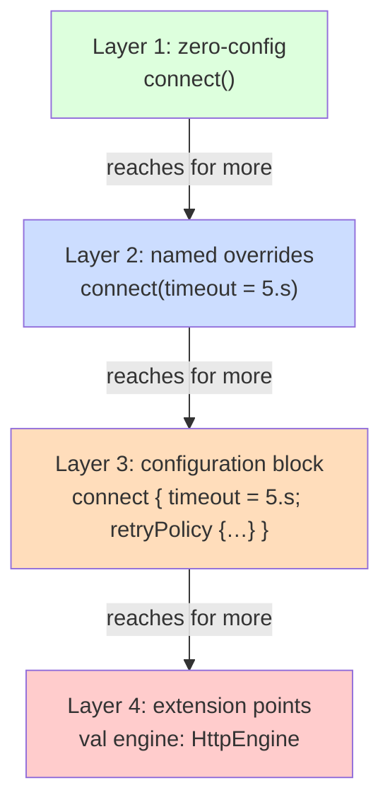

# Progressive Disclosure

## Overview

**Progressive disclosure** is the principle that an interface — whether a screen, an API, a CLI tool, or a configuration file — should reveal complexity in layers. The first layer must be easy enough that a beginner can succeed without reading documentation. Each subsequent layer reveals more power, but only on demand. Users who never need the advanced layer never see it.

The principle started in UX: Nielsen's classic example is a single "More options" button hiding 20 fields that 90% of users never need. In software engineering, the same shape applies to API design (a one-line happy path with optional configuration for the 10% who need it), to library design (sensible defaults with extension points for power users), to documentation (a quickstart in five minutes and a reference for the rest), and to architecture (a high-level facade for typical work, with access to internal subsystems for special cases).

The win is **simultaneous accessibility for beginners and depth for experts**. A novice can use Retrofit by writing `interface UserApi { @GET("/user") suspend fun get(): User }`. An expert can use it with custom call adapters, interceptor chains, mock servers, custom converters, and connection pools — same library, dramatically different mental loads. Both paths work, neither paths the other. That's the principle in action.

The cost when done badly: hidden complexity surprises users when they reach for it. A library that "just works" for 80% of cases but throws a 300-line stack trace when you need TLS pinning has done progressive disclosure poorly — the easy path was easy, but the disclosure to the hard path was abrupt rather than gradual.

---

## Why It Exists

Two empirical observations:

1. **Most users don't need most features most of the time.** Pareto distributions are everywhere. A logging library has 50 configuration options; the average user touches three. An IDE has 2000 commands; the average user uses 30. An API has hundreds of parameters; the average call passes two.
2. **Cognitive overhead scales with surface area, not depth.** Reading a 5-parameter function call takes a moment; reading a 25-parameter call takes a long time and most readers give up understanding it. The total power of the system is irrelevant to the cost of reading any given line; what matters is *how much you need to absorb to use this line*.

Progressive disclosure addresses both: keep the easy path narrow (small surface area for the common case) while preserving full power (depth available when needed). Without it, you face the false binary: either every user pays the cost of the full system upfront ("here are the 50 options, configure them"), or the system caps at a low ceiling of capability ("we only support what fits into 3 options"). With progressive disclosure, both novices and experts win.

The cost the principle pays is **design effort**. Layering an interface so the layers compose correctly is genuinely harder than dumping every option into one signature. The library author absorbs the complexity; users see clean surfaces. This is also why progressive disclosure is rarer than it should be — it requires intentional design work that takes time.

---

## Historical Context

1. **Nielsen Norman Group (1990s).** Jakob Nielsen and Don Norman popularized "progressive disclosure" as a UX design principle. The original framing was screen design: hide advanced controls behind an "Advanced" toggle.
2. **Larry Tesler's "no modes" maxim (1970s–80s) and modeless editing.** Influenced by his work on the Xerox Alto and Smalltalk; argued that interfaces shouldn't require users to remember "what mode they're in."
3. **Effective Java (2001, Bloch).** Item 39: "Use enums instead of int constants" and Item 1: "Consider static factory methods" — both apply progressive disclosure to API design (simple defaults, advanced configuration when needed).
4. **Don Norman, *The Design of Everyday Things* (1988, rev. 2013).** Codified the broader principle: complexity should be tucked away until the user knows they need it.
5. **Kotlin DSLs (2016+).** Type-safe builders make complex configuration accessible: simple cases stay one-line, complex cases nest cleanly without unreadable parameter lists. The Gradle Kotlin DSL is the largest-scale example.
6. **Jetpack Compose Modifier API (2020).** Each Modifier wraps another, allowing simple cases (`Modifier.padding(8.dp)`) and arbitrarily complex chains (`Modifier.padding().background().clickable().clip()`) without growing the function signature.
7. **API design patterns at major tech orgs (2010s+).** Stripe, Twilio, AWS — all built reputations on progressive-disclosure API design. Their public guidelines (e.g., AWS API Design Standards) explicitly call out the principle.

The arc: from UX (hide screens) to API (hide parameters) to DSL (hide structure) to architecture (hide subsystems). The shape is the same; the layers change.

---

## First Principles

### 1. Defaults that work for the common case

The first layer is "no configuration." A user who reads the function name should be able to call it correctly.

```kotlin
// Layer 1: no arguments needed
fun connect(): HttpClient = HttpClient(
    baseUrl = "https://api.example.com",
    timeout = 30.seconds,
    retries = 3
)
```

If the user is satisfied with the defaults, that's their entire interaction with the library.

### 2. Common parameters as named options

The second layer is named arguments for parameters the user is likely to change.

```kotlin
fun connect(
    baseUrl: String = "https://api.example.com",
    timeout: Duration = 30.seconds
): HttpClient = ...

connect(timeout = 5.seconds)
```

Users override only what they care about. Most callers see a one-line invocation; the few callers with custom needs see a clear named override.

### 3. Configuration block for richer options

When the configuration space grows beyond a few parameters, swap parameters for a configuration block (often a DSL with a receiver lambda):

```kotlin
fun connect(block: HttpClientBuilder.() -> Unit = {}): HttpClient {
    val builder = HttpClientBuilder()
    builder.block()
    return builder.build()
}

// Simple:
val client = connect()

// Custom:
val client = connect {
    baseUrl = "https://api.staging.com"
    timeout = 5.seconds
    interceptors += loggingInterceptor()
    retryPolicy {
        maxAttempts = 5
        backoff = exponential(initial = 100.millis)
    }
}
```

The simple case is one line. The complex case scales by nesting; readers process complexity in chunks.

### 4. Extension points for the genuinely advanced

The last layer is direct access to internal types for users with needs the API authors didn't anticipate:

```kotlin
class HttpClient(...) {
    // Public API for typical work
    suspend fun get(path: String): Response = ...

    // Advanced: expose the underlying engine
    val engine: HttpEngine
}
```

A user who needs to customize the engine can — but they have to ask for it explicitly. Most users never touch it.

### 5. Symmetry between simple and complex paths

The deepest layer must work correctly when reached from the shallowest layer's defaults. Users shouldn't have to "graduate" between layers — they reach for more depth and find it.

```kotlin
// Caller starts with defaults
val client = connect()

// Later adds one option
val client = connect { timeout = 5.seconds }

// Later goes deeper
val client = connect {
    timeout = 5.seconds
    interceptors += logging()
}
```

Each step is a small additive change. The user never re-learns the API.

---

## Mental Model

Think of progressive disclosure as a **staircase, not a wall**. The first step is shallow; anyone can climb. Each next step is a small addition. A user who only needs the second step stops there. A user who needs the fifth keeps going, but each step is incremental.

The wall alternative looks like: a single function with 25 parameters, all required, no defaults, every caller is paying the full cost. Or: two completely different APIs, one for "easy" and one for "advanced," with no migration path. Both versions fail because they don't let users grow their understanding gradually.

Another image: a **camera with auto and manual modes**. Point and shoot for everyone. Manual exposure for the photographer who knows aperture and shutter speed. Same camera body. Same lens. Two layers of interface. The auto mode hasn't been crippled to make the manual mode possible; both work fully. That's the design discipline progressive disclosure asks for.

---

## Internal Mechanics

### Default arguments in Kotlin

The cheapest progressive disclosure tool. Add a parameter; give it a sensible default; existing callers don't change:

```kotlin
fun showSnackbar(message: String) { ... }

// Later:
fun showSnackbar(
    message: String,
    duration: Long = 3000L,
    action: SnackbarAction? = null
) { ... }
```

Existing callers continue calling `showSnackbar("Saved")`. New callers can pass duration or action when needed. No breakage; no flood of overloads.

### Builder pattern (traditional)

For Java callers or complex objects:

```kotlin
class HttpClientBuilder {
    private var baseUrl: String = "https://api.example.com"
    private var timeout: Duration = 30.seconds
    private val interceptors = mutableListOf<Interceptor>()

    fun baseUrl(url: String): HttpClientBuilder { baseUrl = url; return this }
    fun timeout(d: Duration): HttpClientBuilder { timeout = d; return this }
    fun addInterceptor(i: Interceptor): HttpClientBuilder { interceptors.add(i); return this }
    fun build(): HttpClient = HttpClient(baseUrl, timeout, interceptors)
}

// Usage:
val client = HttpClientBuilder()
    .timeout(5.seconds)
    .addInterceptor(loggingInterceptor())
    .build()
```

Verbose but supports Java cleanly. In Kotlin, prefer the DSL form.

### Type-safe DSL with lambda receivers

The idiomatic Kotlin way:

```kotlin
class HttpClientBuilder {
    var baseUrl: String = "https://api.example.com"
    var timeout: Duration = 30.seconds
    val interceptors = mutableListOf<Interceptor>()

    fun retryPolicy(block: RetryPolicyBuilder.() -> Unit) {
        // nested DSL
    }
}

fun httpClient(block: HttpClientBuilder.() -> Unit = {}): HttpClient {
    val builder = HttpClientBuilder()
    builder.block()
    return HttpClient(builder.baseUrl, builder.timeout, builder.interceptors)
}

// Usage:
val client = httpClient {
    timeout = 5.seconds
    interceptors += loggingInterceptor()
    retryPolicy {
        maxAttempts = 5
    }
}
```

The default case (`httpClient()`) is one expression. The advanced case nests cleanly. No method-chain explosion.

### Facade as a disclosure boundary

```kotlin
// The simple, disclosed API
class BluetoothService {
    suspend fun connect(deviceId: String): Connection
    suspend fun send(connection: Connection, data: ByteArray)
    suspend fun disconnect(connection: Connection)
}

// The undisclosed internals — available only on demand
internal class BleScanner(...) { ... }
internal class GattClient(...) { ... }
internal class CharacteristicReader(...) { ... }
```

Most callers use only `BluetoothService`. Power users who need direct GATT access can promote one internal type to `public` with a comment, or the API can expose advanced operations via:

```kotlin
class BluetoothService {
    val advanced: AdvancedOperations    // explicit "advanced" namespace
}
```

Users see the simple API first; they reach into `advanced` only when they know they need to.

### `Modifier` chain in Jetpack Compose

```kotlin
Box(
    modifier = Modifier
        .padding(8.dp)
        .background(Color.Blue)
        .clickable { /* ... */ }
        .clip(RoundedCornerShape(4.dp))
)
```

Each modifier is a small layer. The `Box` signature doesn't grow. Simple cases pass `Modifier.padding(8.dp)`; complex cases chain. The library author absorbed the complexity of unifying the modifier types so users see a flat list.

### Configuration in CLI tools

```bash
# Layer 1: defaults
gradle build

# Layer 2: common option
gradle build --parallel

# Layer 3: advanced configuration
gradle build --parallel --max-workers=8 --build-cache --info
```

Same command, three layers of disclosure. A new user runs `gradle build`. A power user adds flags.

---

## Architecture



Each layer is reachable from the previous one. Reading more depth doesn't require rewriting the call.

---

## Production Example

### Stripe's API

Stripe's API is the gold standard for progressive disclosure. Charging a customer for a simple subscription is one HTTP call with two required parameters. Charging a customer with a multi-currency, multi-tax-jurisdiction, payment-method-fallback, savings-card-on-file, idempotency-key-protected subscription — same endpoint, with optional parameters. The simple case is genuinely simple; the complex case is achievable without rewriting the integration.

```kotlin
// Simple:
stripe.charges.create(amount = 1000, currency = "usd", customerId = "cus_X")

// Advanced (still the same method):
stripe.charges.create(
    amount = 1000,
    currency = "usd",
    customerId = "cus_X",
    paymentMethod = "pm_card_visa",
    confirmationMethod = "manual",
    captureMethod = "manual",
    setupFutureUsage = "off_session",
    idempotencyKey = "req-${UUID.randomUUID()}",
    metadata = mapOf("order_id" to orderId)
)
```

### Retrofit interface declarations

A Retrofit user starts with:

```kotlin
interface UserApi {
    @GET("/user/{id}")
    suspend fun get(@Path("id") id: Long): User
}
```

Zero config. Add OkHttp client, base URL, and you have a working API client.

Advanced features (multipart uploads, custom call adapters, dynamic URL, query maps, custom converters) appear in the same annotations:

```kotlin
interface UserApi {
    @GET("/user/{id}")
    @Headers("Cache-Control: max-age=60")
    suspend fun get(
        @Path("id") id: Long,
        @Header("X-Trace-Id") traceId: String,
        @QueryMap fields: Map<String, String> = emptyMap()
    ): Response<User>
}
```

The annotations layer additional capability; nothing changes in how the call is made.

### Gradle DSL

Gradle's Kotlin DSL is progressive disclosure at scale:

```kotlin
// Simple:
plugins {
    id("com.android.application")
}

android {
    namespace = "com.example.app"
    compileSdk = libs.versions.android.compileSdk.get().toInt()
}

// Complex (same blocks, deeper):
android {
    namespace = "com.example.app"
    compileSdk = libs.versions.android.compileSdk.get().toInt()

    defaultConfig {
        applicationId = "com.example.app"
        minSdk = 24
        targetSdk = libs.versions.android.targetSdk.get().toInt()
        versionCode = 12
        versionName = "1.2.0"
        testInstrumentationRunner = "androidx.test.runner.AndroidJUnitRunner"
    }

    buildTypes {
        release {
            isMinifyEnabled = true
            proguardFiles(getDefaultProguardFile("proguard-android-optimize.txt"), "proguard-rules.pro")
            signingConfig = signingConfigs.getByName("release")
        }
    }

    flavorDimensions += "tier"
    productFlavors {
        create("free") {
            applicationIdSuffix = ".free"
        }
        create("paid") {
            applicationIdSuffix = ".paid"
        }
    }
}
```

Nothing was hidden; nothing was forced. Users descend through layers exactly as needed.

---

## Android Example

### Jetpack Compose Modifier

```kotlin
// Layer 1: no modifier
Text("Hello")

// Layer 2: simple modifier
Text("Hello", modifier = Modifier.padding(8.dp))

// Layer 3: composed modifier
Text(
    "Hello",
    modifier = Modifier
        .padding(8.dp)
        .background(Color.Blue)
        .clip(RoundedCornerShape(4.dp))
)

// Layer 4: custom modifier (extension point)
@Composable
fun Modifier.shimmer(): Modifier = this then ShimmerModifier()

Text("Hello", modifier = Modifier.padding(8.dp).shimmer())
```

The `Text` function signature didn't grow. Every layer of customization rides on the modifier chain.

### OkHttp interceptors

```kotlin
// Layer 1: no interceptors
val client = OkHttpClient()

// Layer 2: pre-built interceptor
val client = OkHttpClient.Builder()
    .addInterceptor(HttpLoggingInterceptor())
    .build()

// Layer 3: custom interceptor
val client = OkHttpClient.Builder()
    .addInterceptor { chain ->
        val req = chain.request().newBuilder()
            .header("X-API-Key", apiKey)
            .build()
        chain.proceed(req)
    }
    .build()

// Layer 4: full network interceptor with cache control
val client = OkHttpClient.Builder()
    .cache(Cache(File(cacheDir, "http"), 10_000_000))
    .addNetworkInterceptor(CachePolicyInterceptor())
    .build()
```

Each layer adds one concept. The base API is unchanged.

### Room database progressive depth

```kotlin
// Layer 1: simple entity, simple DAO
@Entity
data class User(@PrimaryKey val id: Long, val name: String)

@Dao
interface UserDao {
    @Insert suspend fun insert(user: User)
    @Query("SELECT * FROM User WHERE id = :id")
    suspend fun get(id: Long): User?
}

// Layer 2: relationships
@Entity data class User(@PrimaryKey val id: Long, val name: String)
@Entity data class Post(@PrimaryKey val id: Long, val userId: Long, val content: String)

data class UserWithPosts(
    @Embedded val user: User,
    @Relation(parentColumn = "id", entityColumn = "userId")
    val posts: List<Post>
)

@Dao
interface UserDao {
    @Transaction
    @Query("SELECT * FROM User WHERE id = :id")
    suspend fun getWithPosts(id: Long): UserWithPosts?
}

// Layer 3: full FTS and migrations
@Database(
    entities = [User::class, Post::class, UserFts::class],
    version = 3,
    autoMigrations = [AutoMigration(from = 2, to = 3)]
)
abstract class AppDatabase : RoomDatabase() { ... }
```

A team can start with simple entities and grow into FTS and migrations without rewriting the early code.

---

## Tradeoffs

**Advantages**

- **Lower barrier to entry.** Beginners are productive in minutes.
- **No artificial ceiling.** Advanced users have access to full capability.
- **API growth without breakage.** Adding a parameter as an option doesn't break callers.
- **Better documentation.** Quickstart and reference can split cleanly along disclosure layers.

**Disadvantages**

- **Higher design cost.** Layering requires careful thought; bad layering is worse than no layering.
- **Risk of "false simplicity."** A simple-looking API that does something surprising under the hood (e.g., silently retries forever, silently swallows errors) is worse than a complex one that's honest.
- **Defaults can lock in bad choices.** A library's default values become an implicit contract; changing them later is a breaking change.
- **Discovery overhead for advanced features.** Users may not know an option exists until they read the full docs.

**When not to apply**

- For interfaces where there's only one path (e.g., a CLI that does exactly one thing). Adding layers is overhead with no benefit.
- For APIs where every call truly does need to specify every parameter (e.g., low-level system calls). Forcing layers obscures the model.
- For prototype code or scripts — invest design effort proportional to expected lifetime.

---

## Failure Modes

**Anti-pattern: 25-parameter function.** Forcing every caller to pass every option. Mitigation: extract defaults, use named arguments, or move to a DSL.

**Anti-pattern: hidden complexity.** A function that takes one parameter but silently does five things behind the scenes (retries, caches, logs, translates errors, calls analytics). Surprise when one of those silent behaviors fails. Mitigation: simplicity in the *interface* shouldn't conceal complexity in the *behavior*; document what defaults do, and expose the ability to opt out.

**Anti-pattern: lock-in via defaults.** A library defaults to retry forever; users build apps assuming this; the library wants to change the default to "no retries" and can't without breaking the world. Mitigation: choose defaults conservatively; if you might want to change them, document them as "implementation detail" or version them.

**Anti-pattern: two parallel APIs.** A "simple" API and an "advanced" API with no relationship. Users start with simple, hit a limit, can't migrate without rewriting. Mitigation: the advanced API should be the simple API plus more, not a different API.

**Anti-pattern: gradual disclosure that requires understanding the whole.** A "configuration block" that requires reading 50 pages of docs to know which options exist. Mitigation: rich autocomplete, well-named options, sensible groupings (`retryPolicy { … }`, `securityConfig { … }`).

**Premature disclosure.** Exposing every internal type as `public` "for flexibility" — every leak limits the library's ability to evolve. Mitigation: default to `internal`; promote to `public` only when a real use case demands.

**Disclosure without escape hatch.** A library that hides the complexity so well that when a user needs an unsupported behavior, they have to monkey-patch or fork. Mitigation: provide explicit extension points (interceptor pattern, listener pattern, plug-in registry) for known extension axes.

---

## Performance Considerations

- **DSL builders allocate.** A configuration block with a receiver lambda allocates the builder and the lambda. For startup-time or hot-path APIs, prefer plain functions with defaults.
- **Nested DSLs cost stack frames.** Deep nesting is fine for code readability but adds frames to stack traces. Watch for `StackOverflowError` in pathological cases (e.g., recursive DSLs).
- **Default-argument synthetic methods.** Kotlin's default-argument lowering generates a helper that the JVM has to lookup; usually negligible, occasionally visible in profilers for hot APIs.
- **Modifier chains in Compose.** Each `Modifier` adds one node to the chain; long chains have a measurable composition cost. The Compose team has optimized this aggressively, but a 50-element chain is still slower than a 3-element one.

---

## Reliability Considerations

- **Defaults must be safe.** A library's default behavior must not be catastrophic if the user doesn't customize. Default timeouts should be reasonable, default retries bounded, default error handling defensive.
- **Advanced options shouldn't bypass safety.** An "advanced" knob that says "disable TLS verification" should be loud, deliberate, and clearly named (e.g., `unsafe_disableTlsVerification`).
- **Both layers tested.** A test suite that only covers the simple path leaves the advanced path untested. CI matrix should include realistic advanced configurations.

---

## Security Considerations

- **Defaults must be secure.** TLS verification on, certificate pinning available, secure ciphers selected. The user opt-out of security must be explicit and named.
- **Advanced options expand attack surface.** Every interceptor extension point is a place where a malicious or buggy interceptor can read or modify all traffic. Document the risk.
- **Configuration injection.** A library that loads its configuration from user-supplied YAML/JSON is a potential injection vector. Validate configuration like any other input.

---

## Observability

- **Layer-aware metrics.** Distinguish "users on defaults" from "users with custom configuration" in your metrics — the latter are the source of most support requests.
- **Default-tracking telemetry.** A library that telemetry-records which options are used helps you understand which "advanced" options matter enough to be the next layer.
- **Stack traces from DSL frames.** Recognize DSL builder frames in stack traces; users may have misconfigured deep in the builder.

---

## Staff Engineer Thinking

**Design two example call sites: a beginner's and an expert's.** The beginner's should be 1-3 lines. The expert's should compose without surprise. If you can't write both cleanly, the API isn't layered correctly.

**Default for the common case, not the safe case.** If 90% of users want behavior X, default to X. The other 10% can opt out. The opposite — default to the safe/restrictive behavior — forces every user to opt in to the common case.

**Promote internals on demand, not preemptively.** Defaulting types to `internal` keeps your library's evolution flexibility intact. Promote to `public` when a concrete user case requires it.

**Document at three layers.** Quickstart (5 lines, common task). Tutorial (typical workflows). Reference (every option). Cross-link aggressively so users can hop between layers.

**Be honest about what defaults do.** Hidden defaults are minefields. If your library defaults to retrying, document it. If you default to caching, say what's cached.

**Watch for "advanced" namespaces that grow without bound.** A `.advanced` field on a public type that accumulates 30 fields is a sign that the disclosure model needs to be redrawn. Maybe `.advanced.networking`, `.advanced.security`, `.advanced.diagnostics`.

**Layered docs vs layered API.** A library can have layered docs even if the API isn't perfectly layered — and vice versa. Both matter. Cheap UI for finding "the simple example" is high leverage.

**Watch for the Kotlin DSL trap.** DSLs are tempting; they look elegant. Over-DSL'd APIs become hard to discover (autocomplete shows everything; docs are scattered) and hard to read in error messages. Use DSL where structure is rich; use named arguments where it's not.

---

## Common Misconceptions

**"Progressive disclosure is just default arguments."** It's one mechanism. The principle includes facades, builders, DSLs, plug-in points, modifier chains, and more.

**"Hiding things is always good."** No. Hidden complexity that surprises users is worse than visible complexity. The goal is layered access, not concealment.

**"Defaults make APIs forgiving."** They make APIs *concise*; safety is independent. A function with all-default arguments can still be unsafe to call.

**"Progressive disclosure is for libraries."** It applies anywhere there's an interface: UI, CLI, configuration files, API endpoints, function signatures, exposed types.

**"More layers is better."** Five well-designed layers are great. Twenty layers is unreadable. Each layer should correspond to a real user mental model, not a designer's hope to support every conceivable case.

**"Make-it-simple-or-make-it-flexible is a tradeoff."** Progressive disclosure says you can have both: simple for the simple case, flexible for the complex case. The cost is the designer's time.

---

## Probing Questions

1. Take the OkHttp API and describe its disclosure layers. Where does a beginner enter, and where does a power user reach?
2. Compose has a `Modifier` chain instead of expanding `Text`'s parameter list. Why is this progressive disclosure rather than just compositional design?
3. A function has 18 parameters, all defaulted. Is this good progressive disclosure or a hidden code smell? What questions would you ask?
4. You're designing a new logging library. Write the simple invocation, the slightly-customized invocation, and the deeply-customized invocation. Are they additive?
5. Stripe's API exposes hundreds of optional parameters per endpoint. How do they keep the simple cases simple?
6. A library has a default that's wrong for 60% of users. What's the cost of changing the default?
7. Why is "false simplicity" (simple API hiding complex behavior) often worse than honest complexity?
8. Kotlin DSLs compose nicely for configuration; when do they become a discoverability problem?
9. Your library exposes 20 public types. Most users only need 3. How do you signal the disclosure layers?
10. Progressive disclosure assumes the simple-case user can grow into the advanced user. What pattern makes this growth path smooth?

---

## Answer Key

1. **Take the OkHttp API and describe its disclosure layers. Where does a beginner enter, and where does a power user reach?**
   A beginner enters with `OkHttpClient()` and a simple `Request`. A power user reaches into `OkHttpClient.Builder()` to add custom interceptors, connection pools, custom socket factories, and cache controls.
2. **Compose has a `Modifier` chain instead of expanding `Text`'s parameter list. Why is this progressive disclosure rather than just compositional design?**
   It's progressive disclosure because the core function signature (`Text()`) remains simple. Advanced styling and behavior are progressively layered via chained modifier methods without cluttering the primary component API.
3. **A function has 18 parameters, all defaulted. Is this good progressive disclosure or a hidden code smell? What questions would you ask?**
   It's a hidden code smell, often termed "false simplicity." Ask: Do these defaults hide complex or dangerous behavior? Is the function doing too many unrelated things? Can these options be grouped into a configuration block or builder?
4. **You're designing a new logging library. Write the simple invocation, the slightly-customized invocation, and the deeply-customized invocation. Are they additive?**
   Simple: `log("message")`. Slightly customized: `log("message", level = ERROR)`. Deeply customized: `log { message = "msg"; level = ERROR; tags = listOf("db"); formatter = JsonFormatter() }`. Yes, they are additive.
5. **Stripe's API exposes hundreds of optional parameters per endpoint. How do they keep the simple cases simple?**
   They provide a base method with a few required parameters for the most common use case. Advanced configuration is exposed via optional named arguments or configuration objects that users only explore when specific needs arise.
6. **A library has a default that's wrong for 60% of users. What's the cost of changing the default?**
   The cost is breaking backward compatibility. Users who implicitly relied on the old default behavior will experience unexpected failures or changes in their app when the library is updated.
7. **Why is "false simplicity" (simple API hiding complex behavior) often worse than honest complexity?**
   False simplicity hides complex, surprising side effects (like silent retries) behind a simple API. It's worse than honest complexity because users cannot predict the behavior, leading to hard-to-debug issues in production.
8. **Kotlin DSLs compose nicely for configuration; when do they become a discoverability problem?**
   They become a problem when they are deeply nested, making it hard to track context, or when they pollute the autocomplete namespace, making discoverability of the actual options difficult without reading external documentation.
9. **Your library exposes 20 public types. Most users only need 3. How do you signal the disclosure layers?**
   Use explicit namespaces (e.g., `client.advanced`), group related advanced options in specific builder blocks, and default internal types to `internal` visibility, promoting them to `public` only when explicitly required by power users.
10. **Progressive disclosure assumes the simple-case user can grow into the advanced user. What pattern makes this growth path smooth?**
    The pattern is symmetry between layers. Advanced options should be additive extensions of the simple API (e.g., via a builder or DSL block) so users don't have to discard their existing code or learn a completely new paradigm to add a single customization.

## Further Reading

In this repository:

- [`simplicity.md`](simplicity.md) — progressive disclosure is one expression of "simple things should be simple, complex things should be possible" (Alan Kay).
- [`make-invalid-states-impossible.md`](make-invalid-states-impossible.md) — defaults and layered configuration shouldn't expose invalid states.
- [`../patterns/builder.md`](../patterns/builder.md) — builder pattern as a disclosure mechanism.
- [`../patterns/strategy.md`](../patterns/strategy.md) — strategies as a way to expose extension points.
- [`../patterns/decorator.md`](../patterns/decorator.md) — Modifier-like layered composition.
- [`../patterns/factory.md`](../patterns/factory.md) — factories often hide construction complexity.

External:

- Jakob Nielsen, *"Progressive Disclosure"* (1995, nngroup.com) — the original UX framing.
- Don Norman, *The Design of Everyday Things* (1988, rev. 2013) — broader principle.
- Joshua Bloch, *Effective Java* — Items 49–55 on parameter and signature design.
- Alan Kay, *"The Computer Revolution Hasn't Happened Yet"* (1997 OOPSLA keynote) — origin of "simple things simple, complex things possible."
- Stripe API Reference (stripe.com/docs/api) — exemplary progressive-disclosure API.
- Romain Guy, *"API Design at Google"* (Android Dev Summit talks) — internal heuristics for layered APIs.
- *The Design of Web APIs* by Arnaud Lauret — practical guide to layered API design.
