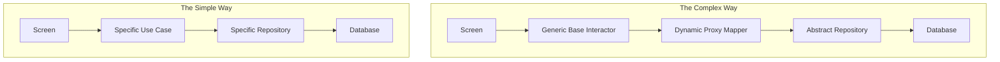

# Simplicity

## Overview

Simplicity is the highest virtue in software engineering. It means writing code that is easy to read, easy to understand, and easy to delete. It is the active rejection of "cleverness" and over-engineering. In a mobile environment, simple code crashes less, compiles faster, and allows new engineers to contribute immediately.

## Why It Matters

Code is read roughly 10 times more often than it is written. If you write a "clever" one-liner that saves you 3 minutes today, but takes 5 different engineers 30 minutes each to understand over the next year, you have stolen time from your team. 

Furthermore, complexity is where bugs hide. A simple `if/else` statement rarely crashes. A massive, multi-layered inheritance hierarchy using reflection and dynamic proxies is a breeding ground for `NullPointerExceptions` and memory leaks.

## Historical Context

Tony Hoare (inventor of Quicksort) said: *"There are two ways of constructing a software design: One way is to make it so simple that there are obviously no deficiencies, and the other way is to make it so complicated that there are no obvious deficiencies."* 

In the early days of Android, hardware was extremely limited, so developers wrote complex, highly-optimized code to squeeze out performance. Today, phones are supercomputers. The bottleneck is no longer the CPU; it is the developer's cognitive load. We must optimize for human readability.

## First Principles

1.  **Readability over Brevity:** Shorter code is not always simpler code. A 5-line function with clear variable names is better than a 1-line function packed with confusing symbols.
2.  **YAGNI (You Aren't Gonna Need It):** Do not write code for hypothetical future features. Build exactly what is needed today, as simply as possible.
3.  **Delete is the Best Commit:** The only code with no bugs is no code at all.

## Mental Model

Think of explaining directions to a tourist.
- **Complex (Clever):** "Walk exactly 142 meters North, adjust your trajectory by 15 degrees East, calculate the golden ratio to find the optimal alleyway, and enter the third unmarked door."
- **Simple:** "Walk to the McDonald's. Turn left. It's the blue building."

The first way might be mathematically faster, but if the tourist makes one mistake, they are lost forever. The second way is robust, easy to follow, and gets the job done.

## Internal Mechanics

Simplicity manifests in code in very specific ways.

### 1. The "Clever" vs "Simple" Kotlin Code

Kotlin offers many powerful features. Junior engineers often use them to show off. Staff engineers avoid them unless absolutely necessary.

**Bad (Clever but Complex):**
```kotlin
// What does this even do? 
val result = users.mapNotNull { it?.age?.takeIf { age -> age > 18 }?.let { age * 2 } }
```

**Good (Boring but Simple):**
```kotlin
// Easy to read, easy to debug, easy to modify later
val result = mutableListOf<Int>()
for (user in users) {
    if (user != null && user.age > 18) {
        result.add(user.age * 2)
    }
}
```

### 2. Abstraction vs Duplication

A common mistake is creating massive complexity just to avoid repeating 3 lines of code.

**Bad (Complex Abstraction):**
```kotlin
// A generic base class created just to share a loading spinner logic
abstract class BaseNetworkViewModel<T, R> : ViewModel() {
    val state = MutableStateFlow<State<T>>(State.Loading)
    abstract fun execute(request: R): T
    // ... 50 lines of complex generic type handling
}
```

**Good (Simple Duplication):**
*(It is often better to just duplicate the 3 lines of `try/catch` and `State.Loading` in your two ViewModels than to build a generic Base class that ties them together forever).* 
As the saying goes: **"A little duplication is cheaper than the wrong abstraction."**

## Architecture



## Production Example

**Over-Engineering Dependency Injection**

Imagine an app with exactly two screens: a Login screen and a Home screen.

- **Complex:** Setting up Dagger 2, creating Custom Scopes (`@LoggedInScope`), writing Subcomponents, and managing Component lifecycles manually. It takes 3 days to setup and requires 15 boilerplate files.
- **Simple:** Creating a single `AppModule` object that manually instantiates the 4 required classes, or using a lightweight tool like Koin, or even just passing dependencies in the constructor. It takes 10 minutes.

If the app grows to 50 screens, you can migrate to Hilt later. Starting with maximum complexity for a tiny app violates YAGNI.

## Tradeoffs

**Advantages**
- **Speed of Onboarding:** A new hire can read simple code and push a bug fix on day one.
- **Maintainability:** When Android OS updates break APIs, simple, straightforward code is trivial to update.
- **Fewer Bugs:** The less cognitive load required to understand a function, the less likely a developer is to make a mistake when modifying it.

**Disadvantages**
- **Sometimes Duplicative:** Keeping things simple often means repeating yourself instead of building "smart" abstractions.
- **Requires Discipline:** It is actually much harder to write simple code than complex code. It takes time and refinement to distill a complex problem down to a simple solution.

## Failure Modes

- **The "Not Invented Here" Syndrome:** Building a custom, complex image loading library from scratch because "Glide is too bloated." Your custom library will eventually become just as bloated, but with 10x more bugs because you are a team of one. Use the boring, standard tools.
- **Design Pattern Soup:** Applying the Strategy pattern, the Factory pattern, and the Builder pattern to a class that just saves a String to `SharedPreferences`. Patterns exist to solve specific pain points; applying them before the pain exists is over-engineering.
- **Premature Optimization:** Wasting 4 hours writing a complex bit-shifting algorithm to sort an array of 5 items to save 0.001 milliseconds of CPU time.

## Staff Engineer Thinking

When reviewing code, a Staff engineer's primary job is to act as a shield against complexity. They ask:

1.  **Can I delete this?** Is this feature, class, or interface actually used in production today? If not, delete it.
2.  **Is this abstraction paying for itself?** Does this `GenericMapper<T, R>` actually save time, or does it just force every developer to read 5 extra files to figure out how a String turns into an Int?
3.  **Would a junior engineer understand this?** If the code uses advanced Kotlin features (like Reified types or custom Flow operators) for a mundane task, it will confuse the rest of the team. We must optimize for the team's average understanding, not the author's peak intelligence.

## Common Misconceptions

- **"Simple code is for beginners."** False. Beginners write complex, tangled spaghetti code because they don't know how to organize their thoughts. Intermediate developers write over-architected "astronaut" code because they just read a book on Design Patterns. Senior/Staff developers write simple, boring code because they have been burned by complexity.
- **"Simple means fewer lines of code."** False. A 10-line `for` loop is often vastly simpler and easier to debug than a 1-line highly chained functional `map.filter.fold` operation.

## Probing Questions

1.  Explain the concept of YAGNI ("You Aren't Gonna Need It") and give a practical Android example.
2.  Why is "clever" code considered harmful in a team environment?
3.  Provide an example of a situation where duplicating code is architecturally superior to creating a shared abstraction.
4.  How does the principle of Simplicity relate to the speed at which a team can ship new features?
5.  What is "Premature Optimization," and why does it usually violate the principle of Simplicity?
6.  How do you balance the need for a robust architecture (like Clean Architecture) with the need to keep the codebase simple?
7.  If a developer uses a complex Regular Expression to parse a simple string, how would you coach them in a code review?
8.  Why is deleting unused code (even if it "might be useful later") a critical practice for maintaining simplicity?
9.  Explain the difference between Essential Complexity (the problem itself is hard) and Accidental Complexity (the code makes it hard).
10. How does writing unit tests force you to write simpler code?

## Answer Key

1. **Explain the concept of YAGNI ("You Aren't Gonna Need It") and give a practical Android example.**
   YAGNI means not building features for hypothetical futures. Example: Hardcoding a single API base URL instead of building a complex dynamic environment switcher if the app currently only ever hits one production endpoint.
2. **Why is "clever" code considered harmful in a team environment?**
   "Clever" code (like chained functional one-liners) optimizes for the author's typing speed but maximizes cognitive load for the rest of the team, leading to slower reviews, harder onboarding, and an increased risk of bugs during maintenance.
3. **Provide an example of a situation where duplicating code is architecturally superior to creating a shared abstraction.**
   Duplicating a 3-line `try/catch` block for network requests in two ViewModels is superior to creating a complex `BaseNetworkViewModel` with generics that rigidly couples all ViewModels to a single inheritance hierarchy.
4. **How does the principle of Simplicity relate to the speed at which a team can ship new features?**
   Simple code enables faster shipping because it's easier to read, modify, and test. Complex code slows development down with merge conflicts, subtle regressions, and steep learning curves for new team members.
5. **What is "Premature Optimization," and why does it usually violate the principle of Simplicity?**
   Premature optimization is optimizing code for performance before it's a proven bottleneck (e.g., writing custom bitwise sorting instead of `List.sorted()`). It violates simplicity by introducing massive accidental complexity for negligible or theoretical gains.
6. **How do you balance the need for a robust architecture (like Clean Architecture) with the need to keep the codebase simple?**
   Apply robust architectures proportionally to the app's scale. Start simple, and introduce layers only when the pain of missing them (e.g., tight coupling causing testability issues) outweighs the overhead of adding them.
7. **If a developer uses a complex Regular Expression to parse a simple string, how would you coach them in a code review?**
   In review, I would suggest replacing the complex Regex with simple `String.split()` or `contains()` methods, explaining that while Regex is powerful, it acts as a "black box" that is difficult for other developers to read and debug.
8. **Why is deleting unused code (even if it "might be useful later") a critical practice for maintaining simplicity?**
   Unused code still carries a maintenance cost: it must be compiled, indexed by the IDE, refactored when APIs change, and reasoned about by developers who stumble across it. Deleting it eliminates this cognitive and technical overhead.
9. **Explain the difference between Essential Complexity (the problem itself is hard) and Accidental Complexity (the code makes it hard).**
   Essential complexity is inherent to the problem (e.g., syncing offline data with conflict resolution). Accidental complexity is introduced by the developer's solution (e.g., using five layers of RxJava to handle a simple REST call).
10. **How does writing unit tests force you to write simpler code?**
    Writing unit tests forces you to decouple components, inject dependencies, and break down massive functions. If code is hard to test, it's usually because it's too complex and doing too many things.

## Further Reading

- [`prefer-deletion.md`](prefer-deletion.md) — The most direct way to achieve simplicity.
- [`coupling-vs-cohesion.md`](../engineering-fundamentals/coupling-vs-cohesion.md) — Bad abstractions increase coupling. Simplicity keeps coupling low.
- [KISS Principle (Keep It Simple, Stupid)](https://en.wikipedia.org/wiki/KISS_principle)
