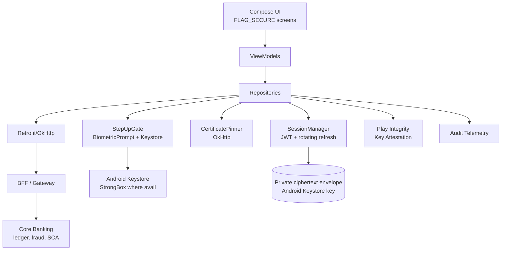
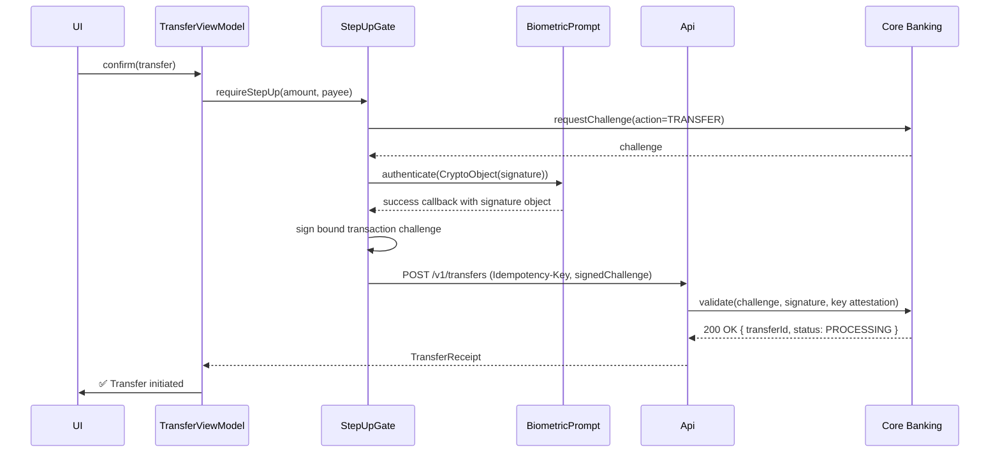
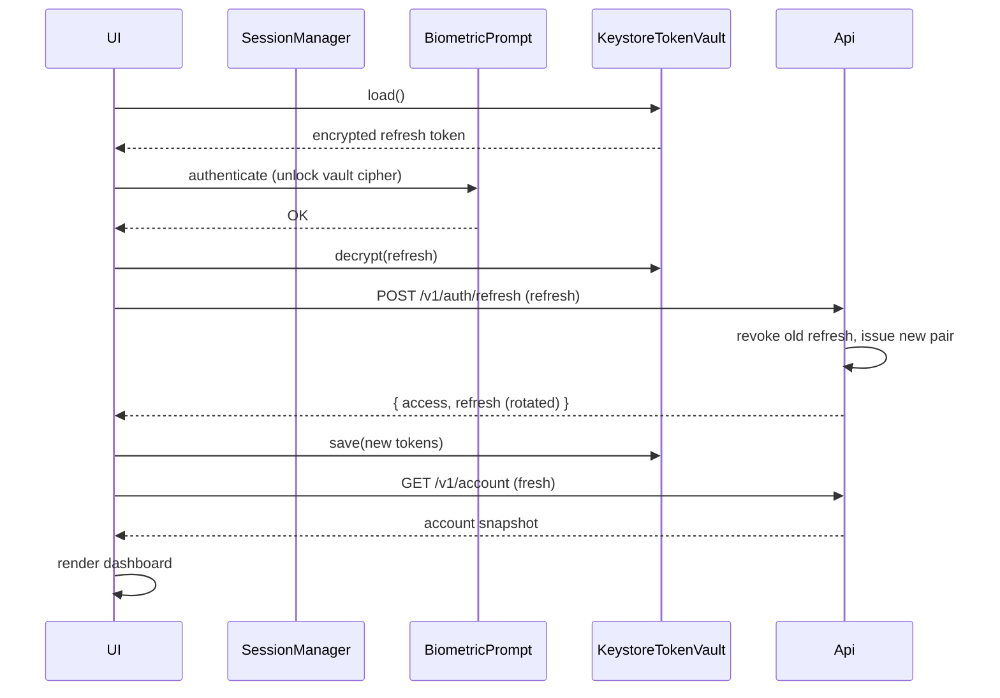

# Banking App — Reference Architecture

> An illustrative blueprint for a regulated, security-first mobile banking client. The defining trade-off: **security and compliance dominate every other concern**. Offline, caching, and optimistic UX are actively *disabled* in places where consumer apps would optimize them. Assume the device is hostile; assume the network is hostile; assume the user is being shoulder-surfed.

---

## Scope and Assumptions

This design chooses online-only financial operations and fresh balance reads. Those are product policies, not universal banking or regulatory requirements. Timeouts, lifetimes, thresholds and SLOs below are illustrative; compliance depends on the product, jurisdiction and assessed payment/data flows.

## Requirements

### Functional

- View account balances, transactions, and statements.
- Transfer money between own accounts, to other customers (P2P), or to external accounts (ACH/SEPA/UPI/Faster Payments).
- Pay bills and manage payees.
- Authenticate via password + biometric step-up for sensitive actions.
- Receive secure messages and statements from the bank.
- Card controls (freeze/unfreeze, set limits, view PIN via secure flow).
- Open new products (account opening, loan applications) — often via embedded WebView with secure handoff.

### Non-Functional

- **Security floor: bank-grade.** HTTPS with a supported TLS policy; pinning only when justified by the threat model and an operational rotation plan. Strong biometric authentication for selected sensitive actions. Keystore-backed protection for persisted secrets. `FLAG_SECURE` on every sensitive screen.
- **Zero-trust client.** Treat the device as compromised. Never trust client-computed balances. Never store account credentials. Tokens are short-lived and rotating.
- **Compliance.** PSD2/SCA (EU), PCI DSS (cards), GLBA (US), open banking standards. Regulatory disclosures must render before transactions confirm.
- **Auditability.** Every state transition the user could dispute (login attempt, transfer confirmation, biometric prompt) emits a structured audit event.
- **No offline writes.** Sending money offline is not a feature; it's a liability.
- **Latency tolerance.** Pessimistic: a transfer waits for the server's authoritative confirmation. No optimistic UI.

---

## Architecture

The defining property of this architecture: **the UI never assumes anything**. Balances render from the most recent authoritative server response. There is no optimistic write. Caches exist only for non-sensitive UI affordances (theme, locale) and are not used to display money values.

---

## Modules

### UI Layer (Hardened Compose)

- Sensitive screens set `FLAG_SECURE` to restrict screenshots and non-secure displays, including protected task previews. This is not protection against all malware, accessibility access or overlay attacks.
- A global inactivity timer running at the `Application` level. An example five-minute idle policy locks the session, clears sensitive in-memory state and requires reauthentication; navigating to login alone does not invalidate credentials.
- `BiometricPrompt` integrated into the UI as a step-up gate for sensitive flows (transfer confirmation, password change, payee addition).
- No screen renders an account balance without first calling `/v1/account` for fresh data. There is no cached balance.

See [`mobile-system-design/security-and-privacy.md`](../mobile-system-design/security-and-privacy.md) for the security posture; [`security/auth-on-mobile.md`](../security/auth-on-mobile.md) for the auth implementation.

### SessionManager

Owns the two-token model:

- **Access token** (JWT, ~15 min lifetime) — attached only to authorized API origins. Server validates signature, issuer, audience and expiry; revocation or risk policy may also need server-side state.
- **Refresh token** (~30 days, rotating on every refresh) — long-lived; when persistence is required, store a versioned ciphertext envelope protected by Android Keystore. When the access token returns 401, the OkHttp `Authenticator` runs `refreshNow()` single-flight to swap.

Single-flight is critical: 8 concurrent requests must NOT trigger 8 refresh calls. The first acquires a `Mutex`, calls `/v1/refresh`, persists the new tokens, and releases. The waiting 7 read the new token from the vault.

### CertificatePinner

Network Security Configuration controls cleartext policy, trust anchors and optional pins; it does not select a minimum TLS version. Configure protocol versions in the transport and server, and test the supported fleet. OkHttp pinning accepts a matching configured SPKI pin in the validated chain; it does not require both a leaf and an intermediate match. Android discourages pinning as a default because rotation can strand clients. If policy requires it, plan backup keys and recovery; debug CA overrides must remain debug-only. See [`security/certificate-pinning.md`](../security/certificate-pinning.md).

### StepUpGate (Biometric + Keystore)

For an action selected by server risk policy, use a cryptographic step-up:

1. Backend creates a short-lived, single-use challenge bound to the session, action, amount and payee.
2. Initialize a `Signature` with an authentication-per-use Keystore private key and pass `CryptoObject(signature)` to `BiometricPrompt` with compatible strong-biometric authenticators.
3. In the success callback, use the returned signature object to sign the canonical transaction challenge. A `Cipher` encrypts/decrypts; it does not sign.
4. Backend verifies the signature against the enrolled public key, challenge binding, expiry and one-time consumption. Validate attestation at enrollment and when policy requires renewal.

`authenticate()` starts an asynchronous prompt; it does not return a success boolean. A local success callback alone is not server authorization. Hardware backing is conditional on verified device/key properties, and does not prove the user saw trustworthy transaction details on a compromised screen. A biometric step alone also does not establish regulatory SCA compliance.

### AttestationModule

On app launch (and at chokepoints — login, transfer confirmation):

- **Play Integrity API** standard requests bind relevant action data through `requestHash`; classic requests use a nonce. Backend checks the binding, app identity, freshness and expected verdicts (`MEETS_DEVICE_INTEGRITY` or stronger, `PLAY_RECOGNIZED` for app identity).
- **Key Attestation** supports enrollment of a device-bound EC key. Backend validates challenge, certificate chain, revocation, trusted root set and required security level; root rotation must be supported. Sensitive-request signatures are then verified against the enrolled public key.

See [`security/attestation.md`](../security/attestation.md).

### Repository Layer

Each domain (accounts, transfers, cards, statements) has one repository. Repositories are *thin* — most logic lives in domain use-cases or server-side. The repository's job is to enforce that no sensitive data leaves Room (it doesn't go in) and no balance is shown without a fresh server fetch.

### Data Layer

- **No Room database for PII or financial data.** This design does not persist balances or transactions; that choice is not a general ban on Room in banking apps. The user sees data fetched on demand; nothing persists beyond the session.
- **Private app storage plus Android Keystore** for token ciphertext envelopes and aliases. Key material remains non-exportable; ordinary preferences do not need cryptographic storage unless the threat model requires it.
- **Session-scoped in-memory caches** for UI affordances (avatars, account display names). Wiped on logout, on lock, on inactivity timeout.

---

## Data Flow

### Money Transfer

There is no optimistic UI. The Receipt screen does not render until the server returns `200 OK`. The server may return `requires_action` (PSD2 SCA challenge); the client launches the challenge Activity and resumes via Activity Result.

### Login (Cold Launch)

Login flow gates on biometric to unlock the *cipher*, not just to display a checkmark. Tokens are decrypted only inside the Keystore-bound cipher operation; raw bytes never enter the heap until the cipher is unlocked.

---

## Offline Strategy

**There is no offline strategy.** This is deliberate.

- A stale balance can mislead a freshness-sensitive decision; this product therefore withholds cached balances rather than treating that policy as a universal legal requirement.
- This design blocks offline transfer submission. A different product can persist intent, but must define authorization, expiry, deduplication and explicit pending UX before accepting it.

What the app DOES offline:
- Renders a "no connection" empty state on every screen.
- Allows the user to view *non-sensitive* settings (notification preferences, light/dark theme).
- Does NOT show last-known account balances. Many banking apps show "—" or "Connect to see balance."

The trade-off belongs in the product threat model and offline-data policy; do not attribute it to unspecified regulatory filings. Compare with [`offline-first-app.md`](offline-first-app.md), which optimizes for the opposite.

---

## Security

- **Threat model:** rooted device with malware that has Accessibility Services granted (overlay/UI manipulation attacks). The mobile client cannot establish a trustworthy verdict inside a compromised process; it can collect signals, but the backend must enforce the sensitive-operation policy.
- **Accessibility-overlay defense.** For supported sensitive windows, use Android's overlay-hiding and obscured-touch defenses. An enabled accessibility service is not proof of fraud; preserve legitimate assistive access. Backend transaction authorization remains necessary.
- **Code obfuscation.** R8 with `isMinifyEnabled = true` is mandatory. Many banks layer commercial obfuscators (DexGuard, Promon Shield) for string encryption, control-flow flattening, and integrity checks.
- **Anti-tamper at runtime.** A startup signing-certificate check and local root heuristics raise the cost of casual repackaging, but an attacker controlling the process can bypass them. For sensitive operations, the backend verifies the Play Integrity token, expected request binding and freshness server-side (standard `requestHash` or classic nonce), applies a risk policy, and rejects the operation when the verdict is unacceptable; the app only handles that server rejection and must not treat a client-side verdict as authoritative.
- **No clipboard for PINs.** Disable copy/paste on PIN entry fields. Clear the clipboard if the app detects a card number was placed by the user.
- **WebView hardening.** Embedded onboarding WebViews disable JavaScript file access, content access, and universal access from file URLs. Keep normal certificate/hostname validation; cancel SSL errors rather than bypassing them. An OkHttp pinning policy does not automatically cover WebView traffic.
- **Backup exclusion.** Exclude token envelopes from cloud backup and device transfer using the rules appropriate to supported Android versions. For apps targeting API 31+, `allowBackup="false"` disables cloud backup but may leave device-to-device transfer enabled on some manufacturers’ devices; use `android:dataExtractionRules` to exclude token envelopes from both cloud backup and device transfer on Android 12+. Keystore keys are not portable backup material.
- See [`mobile-system-design/security-and-privacy.md`](../mobile-system-design/security-and-privacy.md) for the full posture and [`security/secure-storage-on-android.md`](../security/secure-storage-on-android.md) for storage internals.

---

## Observability

- **Audit-grade telemetry.** Every login attempt, failed biometric, transfer confirmation, and password change emits a structured event with `userId` hash, device fingerprint, geolocation tier (not GPS), and result. These events go to a regulator-accessible audit pipeline, separate from product analytics.
- **No PII in logs.** Account numbers, balances, payee names — never logged. Minimize collection at every logging boundary. An HTTP interceptor cannot sanitize unrelated application logs, Crashlytics breadcrumbs or SDK-generated analytics; verify each sink and test redaction.
- **Metrics:**
  - `auth.failures` per minute (suspicious if spikes).
  - `biometric.rejection.rate` (UX signal + potential fraud signal).
  - `transfer.confirmation.latency_p95` — SLO target < 2s.
  - `cert_pin.failure` — never expected; pages immediately.
  - `attestation.fail.rate` — a spike can reflect fleet, policy, service or abuse changes and needs investigation.
- **Crashlytics + Vitals**: standard; pay extra attention to crashes during the transfer flow.
- **Dashboards** segmented by region (different fraud profiles), by OEM (different Keystore implementations), by API level.
- **Alerts** wake on-call for: cert-pin failures, attestation verdict regressions, transfer confirmation latency p95 > 5s, biometric rejection > 10% (UX or fraud).

See [`observability/alerting.md`](../observability/alerting.md), [`observability/slis.md`](../observability/slis.md).

---

## Failure Modes

**Concurrent JWT refresh race.** Five tabs hit 401 simultaneously; without single-flight, five refresh attempts land at `/refresh`; the backend rejects all but the first as token reuse. *Mitigation:* `Mutex`-protected `refreshNow()` that re-reads the vault, so waiters reuse the rotated token instead of refreshing again.

**Biometric template changed mid-session.** User added a new fingerprint after the cipher was created. Cipher throws `KeyPermanentlyInvalidatedException`. *Mitigation:* catch the exception, force re-login, regenerate the biometric key, surface a clear message ("For your security, please sign in again").

**Compromised device passes Play Integrity locally but server-side verdict fails.** Bypass tools spoof the client-side verdict; backend caught it via independent verification. *Mitigation:* never trust client-side integrity decisions; backend is the source of truth. App must handle the 403 gracefully with explanatory UX.

**Phishing overlay impersonates the bank UI.** Malicious app draws over the legitimate banking activity, capturing credentials. *Mitigation:* restrict capture with `FLAG_SECURE`, mitigate supported overlay/touch paths separately, and bind server authorization to the transaction. Preserve assistive access; neither a local service check nor TLS pinning proves the displayed UI is legitimate.

**Replay attack on a captured transfer request.** Attacker captures a signed transfer request and replays it. *Mitigation:* nonce inside the signed payload is server-issued, single-use, time-bound; replay rejected.

**Lost device with biometric-bound key.** User loses phone; new device has no key. *Mitigation:* re-enrollment flow requires multi-factor identity proof on the new device; old device's keys are server-revoked on the user's first new-device login.

**Push notification leaks sensitive info on lock screen.** Notification shows "Transfer of $1200 to Alice succeeded" on the lock screen. *Mitigation:* `VISIBILITY_SECRET` hides the notification entirely on a secure lock screen. If a generic public notification is intended, use `VISIBILITY_PRIVATE` with a deliberately redacted public version, subject to user settings.

---

## Scaling

### Scaling user base (more customers)

- Separate server scaling from device-local cache, account and pending-mutation state; the client is not stateless.
- Use server-controlled routing consistent with the applicable residency and international-transfer policy. GDPR Article 44 governs international transfers; it does not itself require a per-country BFF. A client-selected country is not a compliance control.

### Scaling complex products (loans, investments, crypto)

- Each product is a separate `:feature:` module loaded on demand via Dynamic Feature Delivery (Play AAB splits).
- Onboarding for new products often embedded via WebView with secure handoff (`AccountsManager`-style token exchange).

### Scaling regulatory compliance

- Compliance disclosures rendered from server-driven config (Remote Config); jurisdictional differences don't require an app update.
- Audit events keyed by jurisdiction; routed to the appropriate regulatory pipeline server-side.

### Scaling fraud detection

- Client-side signals (typing speed, biometric rejection patterns, location anomaly) emitted to a server-side ML pipeline. Client does NOT make fraud decisions; it provides telemetry.

---

## Release Strategy

- **Aggressive crash-rate gating.** Sync crashes can lock customers out of their money. Crash-free-users threshold is tighter than consumer apps (≥ 99.9%). See [`release-engineering/crash-rate-gating.md`](../release-engineering/crash-rate-gating.md).
- **Mandatory force-update path.** Backend minimum-version/session policy can restrict vulnerable clients. Pair it with an available update and an explicit recovery/support path; a launch-only check misses already-running sessions, and Play distribution does not guarantee every device updates within hours. See [`release-engineering/staged-rollouts.md`](../release-engineering/staged-rollouts.md).
- **Per-region staged rollouts.** A bug specific to one region (currency formatting, payment scheme) gets contained without halting the global rollout.
- **Independent security review per release.** No release ships without sign-off from the InfoSec team. The release pipeline blocks at a manual gate.
- **Penetration testing on a cadence.** External pen-test annually plus before every major release.
- **Kill switches** for every payment rail, every new feature. A misbehaving transfer endpoint can be disabled within minutes. See [`release-engineering/kill-switches.md`](../release-engineering/kill-switches.md).

---

## Summary of Technologies

| Layer | Choice | Why |
|---|---|---|
| UI | Compose + `FLAG_SECURE` | Modern UI; screen capture defense |
| State | ViewModel + StateFlow | Standard Android architecture |
| Network | OkHttp + Retrofit + Network Security Config | HTTPS transport policy, trust configuration and optional pins |
| Tokens | Private ciphertext envelope | Keystore-backed; biometric-bound where policy requires |
| Crypto | Android Keystore; verified security level, StrongBox where supported | Non-exportable API; hardware backing depends on device/key properties and policy |
| Biometric | AndroidX `BiometricPrompt` + `CryptoObject` | Class-3 cryptographic binding |
| Attestation | Play Integrity + Key Attestation | Both per-call and durable identity |
| Local DB | None for financial data in this design | Online-only financial-data policy |
| Obfuscation | R8 + DexGuard/Promon | Reverse-engineering deterrent |
| Background | WorkManager (rarely used) | No background financial work |
| Push | FCM with `VISIBILITY_SECRET` | Privacy on lock screen |

---

## Further Reading

- [Android biometric cryptographic authentication](https://developer.android.com/identity/sign-in/biometric-auth)
- [Android trust and cleartext configuration](https://developer.android.com/privacy-and-security/security-config)
- [Secure sensitive activities and overlay limits](https://developer.android.com/security/fraud-prevention/activities)
- [Server-side key attestation validation](https://developer.android.com/privacy-and-security/security-key-attestation)
- [Play Integrity standard request binding](https://developer.android.com/google/play/integrity/standard)
- [Backup and device-transfer security](https://developer.android.com/privacy-and-security/risks/backup-best-practices)
- [Notification visibility API](https://developer.android.com/reference/android/app/Notification#VISIBILITY_SECRET)
- [EU SCA transaction-linking requirements](https://eur-lex.europa.eu/eli/reg_del/2018/389/oj/eng)
- [GDPR international-transfer requirements](https://eur-lex.europa.eu/eli/reg/2016/679/oj/eng)
- [Android Keystore security levels](https://developer.android.com/privacy-and-security/keystore)

---

## Related

- [`mobile-system-design/payment-flow.md`](../mobile-system-design/payment-flow.md) — payment-specific design problem.
- [`mobile-system-design/authentication.md`](../mobile-system-design/authentication.md) — OAuth + PKCE reasoning exercise.
- [`security/secure-storage-on-android.md`](../security/secure-storage-on-android.md) — Keystore-wrapped storage internals.
- [`security/auth-on-mobile.md`](../security/auth-on-mobile.md) — single-flight refresh, biometric step-up code.
- [`security/certificate-pinning.md`](../security/certificate-pinning.md) — pinning + Network Security Config.
- [`security/attestation.md`](../security/attestation.md) — Play Integrity + Key Attestation.

---

> **In short:** Banking apps optimize for security and compliance, not user convenience. The architecture is *defensive at every layer*: Keystore keys with hardware backing dependent on device and key properties, cryptographic biometric binding, server-side attestation verification, no offline writes, no cached balances, and a backend minimum-version policy. These no-cache/no-offline-write choices belong to this product’s threat and freshness policy; other banking products may support explicitly bounded cached reads or pending intents.
