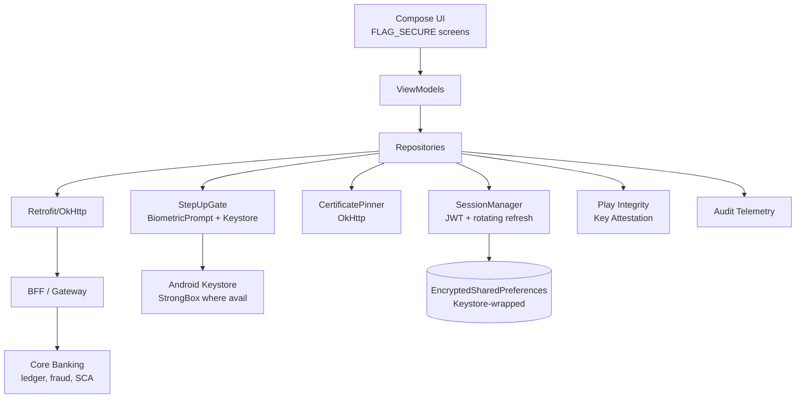
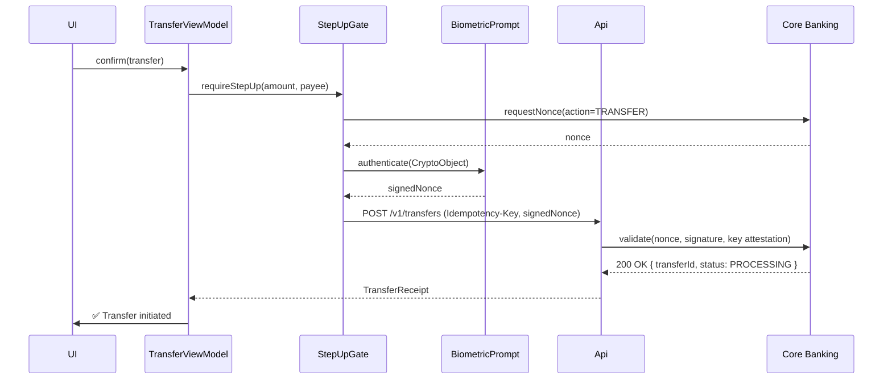
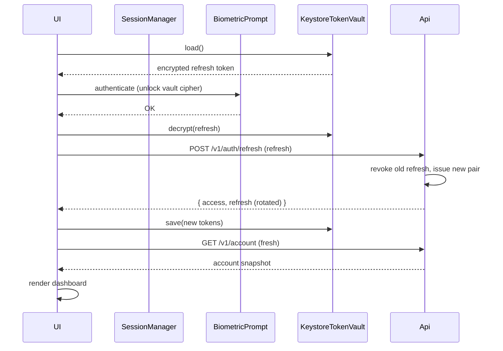

# Banking App — Reference Architecture

> The settled blueprint for a regulated, security-first mobile banking client (Chase, Monzo, Revolut, N26). The defining trade-off: **security and compliance dominate every other concern**. Offline, caching, and optimistic UX are actively *disabled* in places where consumer apps would optimize them. Assume the device is hostile; assume the network is hostile; assume the user is being shoulder-surfed.

---

## Requirements

### Functional

- View account balances, transactions, and statements.
- Transfer money between own accounts, to other customers (P2P), or to external accounts (ACH/SEPA/UPI/Faster Payments).
- Pay bills and manage payees.
- Authenticate via password + biometric step-up for sensitive actions.
- Receive secure messages and statements from the bank.
- Card controls (freeze/unfreeze, set limits, view PIN via secure flow).
- Open new products (account opening, loan applications) — often via embedded WebView with secure handoff.

### Non-Functional

- **Security floor: bank-grade.** TLS 1.3 with certificate pinning. Class-3 (strong) biometric for transactions over a threshold. Keystore-bound keys for all secrets. `FLAG_SECURE` on every sensitive screen.
- **Zero-trust client.** Treat the device as compromised. Never trust client-computed balances. Never store account credentials. Tokens are short-lived and rotating.
- **Compliance.** PSD2/SCA (EU), PCI DSS (cards), GLBA (US), open banking standards. Regulatory disclosures must render before transactions confirm.
- **Auditability.** Every state transition the user could dispute (login attempt, transfer confirmation, biometric prompt) emits a structured audit event.
- **No offline writes.** Sending money offline is not a feature; it's a liability.
- **Latency tolerance.** Pessimistic: a transfer waits for the server's authoritative confirmation. No optimistic UI.

---

## Architecture

The defining property of this architecture: **the UI never assumes anything**. Balances render from the most recent authoritative server response. There is no optimistic write. Caches exist only for non-sensitive UI affordances (theme, locale) and are not used to display money values.

---

## Modules

### UI Layer (Hardened Compose)

- All screens displaying balances, transactions, or PII set `FLAG_SECURE` on their host Activity to disable screenshots and screen recording by malware and the system Recent Apps carousel.
- A global inactivity timer running at the `Application` level. After ~5 minutes idle, the navigation stack is popped to the login screen.
- `BiometricPrompt` integrated into the UI as a step-up gate for sensitive flows (transfer confirmation, password change, payee addition).
- No screen renders an account balance without first calling `/v1/account` for fresh data. There is no cached balance.

See [`mobile-system-design/security-and-privacy.md`](../mobile-system-design/security-and-privacy.md) for the security posture; [`security/auth-on-mobile.md`](../security/auth-on-mobile.md) for the auth implementation.

### SessionManager

Owns the two-token model:

- **Access token** (JWT, ~15 min lifetime) — attached to every request. Server validates cryptographically; no DB lookup.
- **Refresh token** (~30 days, rotating on every refresh) — long-lived; stored in `EncryptedSharedPreferences` (Keystore-wrapped). When the access token returns 401, the OkHttp `Authenticator` runs `refreshNow()` single-flight to swap.

Single-flight is critical: 8 concurrent requests must NOT trigger 8 refresh calls. The first acquires a `Mutex`, calls `/v1/refresh`, persists the new tokens, and releases. The waiting 7 read the new token from the vault.

### CertificatePinner

OkHttp `CertificatePinner` enforces SPKI hash pinning at the leaf and at the intermediate CA (for survival across leaf rotation). Network Security Configuration enforces TLS 1.3, banning cleartext at the manifest level. Debug builds allow user-installed CAs (for Charles); release builds do not. See [`security/certificate-pinning.md`](../security/certificate-pinning.md).

### StepUpGate (Biometric + Keystore)

For transactions above a configured threshold (e.g., €30 / $50) OR for any transfer to a new payee, the user must complete a **cryptographic** biometric challenge:

1. Backend issues a `nonce`.
2. App invokes `BiometricPrompt.authenticate(CryptoObject(cipher))` where `cipher` uses a Keystore-resident, `setUserAuthenticationRequired(true)` key bound to Class-3 biometric.
3. Successful biometric unlocks the cipher; cipher signs the nonce.
4. Signed nonce + biometric class + key-attestation chain submitted to backend.
5. Backend verifies signature and the key's attestation chain (rooted in Google's HW root).

The boolean `BiometricPrompt.authenticate() == true` is **not** sufficient — a rooted device can fake that boolean. The cryptographic signature requires hardware-backed presence.

### AttestationModule

On app launch (and at chokepoints — login, transfer confirmation):

- **Play Integrity API** issues a token bound to a server-issued nonce. Backend verifies the token contains the expected verdicts (`MEETS_DEVICE_INTEGRITY` or stronger, `PLAY_RECOGNIZED` for app identity).
- **Key Attestation** registers a device-bound EC key during onboarding. Every subsequent sensitive request is signed by this key; backend verifies against the attestation chain.

See [`security/attestation.md`](../security/attestation.md).

### Repository Layer

Each domain (accounts, transfers, cards, statements) has one repository. Repositories are *thin* — most logic lives in domain use-cases or server-side. The repository's job is to enforce that no sensitive data leaves Room (it doesn't go in) and no balance is shown without a fresh server fetch.

### Data Layer

- **No Room database for PII or financial data.** A Banking app generally bans Room for balances and transactions. The user sees data fetched on demand; nothing persists beyond the session.
- **EncryptedSharedPreferences** for: auth tokens, biometric-key handles, device-bound EC key alias, user preferences.
- **Session-scoped in-memory caches** for UI affordances (avatars, account display names). Wiped on logout, on lock, on inactivity timeout.

---

## Data Flow

### Money Transfer

There is no optimistic UI. The Receipt screen does not render until the server returns `200 OK`. The server may return `requires_action` (PSD2 SCA challenge); the client launches the challenge Activity and resumes via Activity Result.

### Login (Cold Launch)

Login flow gates on biometric to unlock the *cipher*, not just to display a checkmark. Tokens are decrypted only inside the Keystore-bound cipher operation; raw bytes never enter the heap until the cipher is unlocked.

---

## Offline Strategy

**There is no offline strategy.** This is deliberate.

- Reading balances offline = showing stale data on which the user might base a transfer decision = regulatory liability + user complaint.
- Writing transfers offline = queueing financial intent = idempotency mistakes, replay attacks, fraud window.

What the app DOES offline:
- Renders a "no connection" empty state on every screen.
- Allows the user to view *non-sensitive* settings (notification preferences, light/dark theme).
- Does NOT show last-known account balances. Many banking apps show "—" or "Connect to see balance."

The trade-off is intentional and stated in regulatory filings. Compare with [`offline-first-app.md`](offline-first-app.md), which optimizes for the opposite.

---

## Security

- **Threat model:** rooted device with malware that has Accessibility Services granted (Overlay/UI manipulation attacks). The mobile client cannot defeat root alone, but it can detect it and refuse sensitive operations.
- **Accessibility-overlay defense.** Before showing a transfer confirmation, query `AccessibilityManager` for active services. If any non-system service is enabled and the user has not whitelisted it, block with an explanatory dialog.
- **Code obfuscation.** R8 with `isMinifyEnabled = true` is mandatory. Many banks layer commercial obfuscators (DexGuard, Promon Shield) for string encryption, control-flow flattening, and integrity checks.
- **Anti-tamper at runtime.** Check signing certificate at startup; refuse to launch if the certificate doesn't match the expected SHA-256 (defeats casual repackaging).
- **No clipboard for PINs.** Disable copy/paste on PIN entry fields. Clear the clipboard if the app detects a card number was placed by the user.
- **WebView hardening.** Embedded onboarding WebViews disable JavaScript file access, content access, and universal access from file URLs. Verify TLS independently inside the WebView client.
- **Backup exclusion.** `allowBackup="false"` or explicit `<exclude>` rules for the token vault and any keys. A user's Google Drive backup should not carry tokens to a fresh device.
- See [`mobile-system-design/security-and-privacy.md`](../mobile-system-design/security-and-privacy.md) for the full posture and [`security/secure-storage-on-android.md`](../security/secure-storage-on-android.md) for storage internals.

---

## Observability

- **Audit-grade telemetry.** Every login attempt, failed biometric, transfer confirmation, and password change emits a structured event with `userId` hash, device fingerprint, geolocation tier (not GPS), and result. These events go to a regulator-accessible audit pipeline, separate from product analytics.
- **No PII in logs.** Account numbers, balances, payee names — never logged. The `PiiRedactor` interceptor strips these before any Crashlytics breadcrumb or analytics event leaves the device.
- **Metrics:**
  - `auth.failures` per minute (suspicious if spikes).
  - `biometric.rejection.rate` (UX signal + potential fraud signal).
  - `transfer.confirmation.latency_p95` — SLO target < 2s.
  - `cert_pin.failure` — never expected; pages immediately.
  - `attestation.fail.rate` — sudden spike means OS update broke a verdict.
- **Crashlytics + Vitals**: standard; pay extra attention to crashes during the transfer flow.
- **Dashboards** segmented by region (different fraud profiles), by OEM (different Keystore implementations), by API level.
- **Alerts** wake on-call for: cert-pin failures, attestation verdict regressions, transfer confirmation latency p95 > 5s, biometric rejection > 10% (UX or fraud).

See [`observability/alerting.md`](../observability/alerting.md), [`observability/slis.md`](../observability/slis.md).

---

## Failure Modes

**Concurrent JWT refresh race.** Five tabs hit 401 simultaneously; without single-flight, five refresh attempts land at `/refresh`; the backend rejects all but the first as token reuse. *Mitigation:* `Mutex`-protected `refreshNow()` with a single in-flight `Deferred<Tokens>` that all waiters await.

**Biometric template changed mid-session.** User added a new fingerprint after the cipher was created. Cipher throws `KeyPermanentlyInvalidatedException`. *Mitigation:* catch the exception, force re-login, regenerate the biometric key, surface a clear message ("For your security, please sign in again").

**Compromised device passes Play Integrity locally but server-side verdict fails.** Bypass tools spoof the client-side verdict; backend caught it via independent verification. *Mitigation:* never trust client-side integrity decisions; backend is the source of truth. App must handle the 403 gracefully with explanatory UX.

**Phishing overlay impersonates the bank UI.** Malicious app draws over the legitimate banking activity, capturing credentials. *Mitigation:* `FLAG_SECURE` blocks screen capture; `AccessibilityManager` check blocks if a screen-reader-like service is active; certificate-pinned WebView blocks fake bank pages.

**Replay attack on a captured transfer request.** Attacker captures a signed transfer request and replays it. *Mitigation:* nonce inside the signed payload is server-issued, single-use, time-bound; replay rejected.

**Lost device with biometric-bound key.** User loses phone; new device has no key. *Mitigation:* re-enrollment flow requires multi-factor identity proof on the new device; old device's keys are server-revoked on the user's first new-device login.

**Push notification leaks sensitive info on lock screen.** Notification shows "Transfer of $1200 to Alice succeeded" on the lock screen. *Mitigation:* `setVisibility(VISIBILITY_SECRET)` for finance notifications; lock-screen surface shows only "1 new notification from BankName."

---

## Scaling

### Scaling user base (more customers)

- Client is stateless; scaling is server-side.
- Per-region BFFs to comply with data residency (GDPR Article 44, etc.). Client picks BFF by user's home country, set at signup.

### Scaling complex products (loans, investments, crypto)

- Each product is a separate `:feature:` module loaded on demand via Dynamic Feature Delivery (Play AAB splits).
- Onboarding for new products often embedded via WebView with secure handoff (`AccountsManager`-style token exchange).

### Scaling regulatory compliance

- Compliance disclosures rendered from server-driven config (Remote Config); jurisdictional differences don't require an app update.
- Audit events keyed by jurisdiction; routed to the appropriate regulatory pipeline server-side.

### Scaling fraud detection

- Client-side signals (typing speed, biometric rejection patterns, location anomaly) emitted to a server-side ML pipeline. Client does NOT make fraud decisions; it provides telemetry.

---

## Release Strategy

- **Aggressive crash-rate gating.** Sync crashes can lock customers out of their money. Crash-free-users threshold is tighter than consumer apps (≥ 99.9%). See [`release-engineering/crash-rate-gating.md`](../release-engineering/crash-rate-gating.md).
- **Mandatory force-update path.** A discovered security vulnerability must brick old versions within hours. App fetches a version-policy endpoint on launch; if below minimum, blocks all access with an "update required" screen. See [`release-engineering/staged-rollouts.md`](../release-engineering/staged-rollouts.md).
- **Per-region staged rollouts.** A bug specific to one region (currency formatting, payment scheme) gets contained without halting the global rollout.
- **Independent security review per release.** No release ships without sign-off from the InfoSec team. The release pipeline blocks at a manual gate.
- **Penetration testing on a cadence.** External pen-test annually plus before every major release.
- **Kill switches** for every payment rail, every new feature. A misbehaving transfer endpoint can be disabled within minutes. See [`release-engineering/kill-switches.md`](../release-engineering/kill-switches.md).

---

## Summary of Technologies

| Layer | Choice | Why |
|---|---|---|
| UI | Compose + `FLAG_SECURE` | Modern UI; screen capture defense |
| State | ViewModel + StateFlow | Standard Android architecture |
| Network | OkHttp + Retrofit + Network Security Config | Pinning, TLS 1.3 enforcement |
| Tokens | EncryptedSharedPreferences | Keystore-wrapped, biometric-bound |
| Crypto | Android Keystore (StrongBox where available) | Hardware-backed; non-exportable keys |
| Biometric | AndroidX `BiometricPrompt` + `CryptoObject` | Class-3 cryptographic binding |
| Attestation | Play Integrity + Key Attestation | Both per-call and durable identity |
| Local DB | None for financial data | Zero-trust |
| Obfuscation | R8 + DexGuard/Promon | Reverse-engineering deterrent |
| Background | WorkManager (rarely used) | No background financial work |
| Push | FCM with `VISIBILITY_SECRET` | Privacy on lock screen |

---

## Related

- [`mobile-system-design/payment-flow.md`](../mobile-system-design/payment-flow.md) — payment-specific design problem.
- [`mobile-system-design/authentication.md`](../mobile-system-design/authentication.md) — OAuth + PKCE reasoning exercise.
- [`security/secure-storage-on-android.md`](../security/secure-storage-on-android.md) — Keystore-wrapped storage internals.
- [`security/auth-on-mobile.md`](../security/auth-on-mobile.md) — single-flight refresh, biometric step-up code.
- [`security/certificate-pinning.md`](../security/certificate-pinning.md) — pinning + Network Security Config.
- [`security/attestation.md`](../security/attestation.md) — Play Integrity + Key Attestation.

---

> **In short:** Banking apps optimize for security and compliance, not user convenience. The architecture is *defensive at every layer*: hardware-backed keys, cryptographic biometric binding, server-side attestation verification, no offline writes, no cached balances, mandatory force-update. Where a consumer app would cache for speed, a banking app refuses to. That refusal is the architecture.
