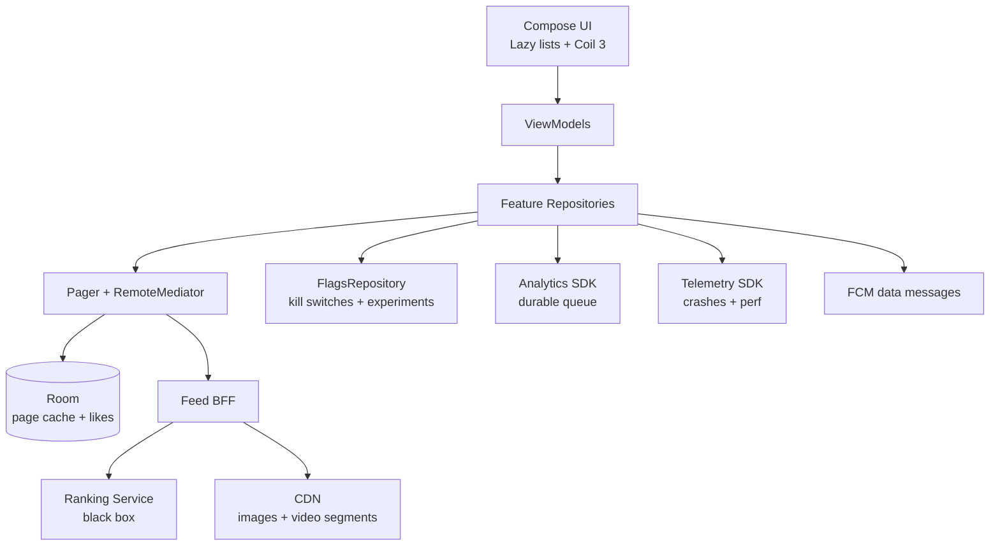
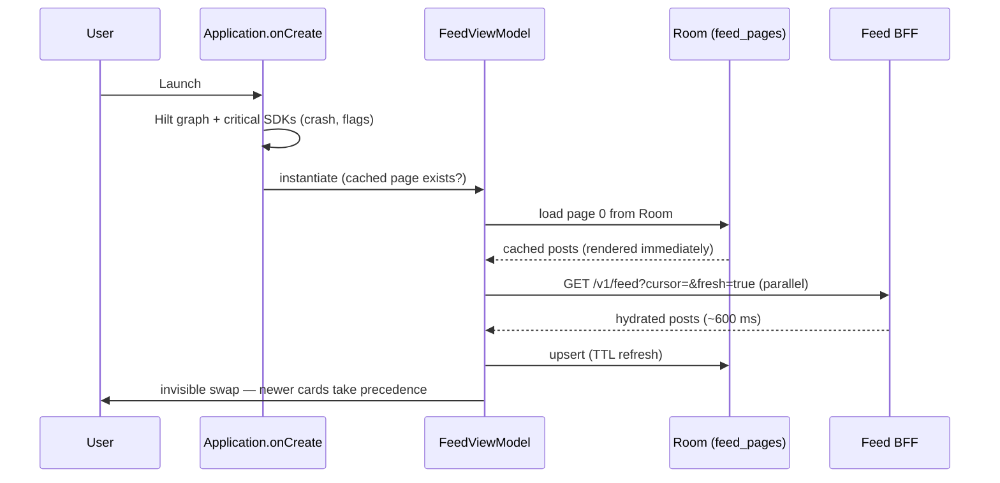
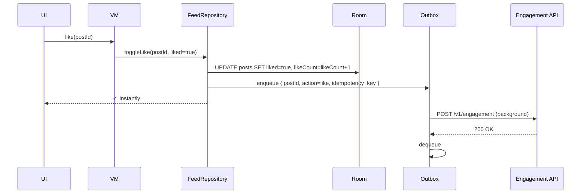

# Consumer App — Reference Architecture

> The settled blueprint for a high-scale consumer app (Instagram, Twitter/X, TikTok, Reddit, Pinterest). The defining trade-off: **breadth and engagement dominate**. Cold-start latency, smooth scroll, A/B test velocity, and analytics richness matter more than any single feature's depth. Login is optional or deferred; the app must work for an anonymous first-time visitor.

---

## Requirements

### Functional

- An "endless" personalized feed of mixed media (image, video, text).
- Search and discovery (browse trending, search for users/topics).
- Profile, follow, like, share, comment.
- Push notifications for high-engagement events (someone followed you, replied, new post from a followed creator).
- Onboarding optional; allow anonymous browsing then prompt sign-up at engagement moments.
- A/B testing every aspect of the UX.
- In-app messaging (DMs) — often a separate engagement product.

### Non-Functional

- **Cold start < 1.5s** on a mid-tier device. The home feed must render skeleton content immediately and hydrate.
- **Scroll smoothness at 60-120Hz.** Compose with stable keys, Coil 3 with bounded memory cache, lazy media decoding.
- **Cellular-friendly.** Default to lower bitrate on metered networks; tier images by `network_class`.
- **Massive scale.** 100M+ DAU. Server-side sharding, BFF per region.
- **Analytics-driven.** Every user action logged. Every screen render measured. Every cohort sliced.
- **Experimentation velocity.** Server-driven layout, feature flags as kill switches, per-flag rollout fractions.
- **Privacy-aware.** GDPR / CCPA consent gating; opt-out for personalised tracking.

---

## Architecture

The defining property: **the home feed is the product**. Cold start to first useful frame is the metric every other architectural decision serves. Server-side ranker is opaque; the client's job is to display whatever the BFF hands back, fast, and tag every interaction for the next training cycle.

---

## Modules

### UI Layer

- **Compose with Lazy lists** as the default container. `LazyColumn` for the feed, `LazyVerticalGrid` for discovery. Items keyed by stable post id.
- **Coil 3** as the image loader with a `MemoryCache.Builder().maxSizePercent(0.25).build()` budget. Disk cache 200-400 MB. Auto-disposal on item leaving the viewport.
- **Media3 / ExoPlayer** for inline video with a 2-3 player pool — players reused as cards scroll. Muted autoplay by default.
- **Server-driven layout** for promoted content: the BFF can ship layout JSON (Lego-style block composition) to the client. Lets the growth team experiment without app releases.

### Feature Repositories

Each feature (feed, profile, discovery, DMs, notifications) owns its repository. Repositories expose `Flow<UiState>` consumed by ViewModels. Repositories internally:

- Use Paging 3 + RemoteMediator for paginated lists.
- Cache in Room with a TTL (often 1-24h depending on freshness needs).
- Defer to FlagsRepository for any feature-flagged behavior.

See [`mobile-system-design/news-feed.md`](../mobile-system-design/news-feed.md) for the feed reasoning exercise.

### Pager + RemoteMediator

Standard pagination pattern. `RemoteMediator` reconciles the local Room cache with server-fetched pages. Stable keys prevent duplicates across page boundaries. The Room cache survives process death — when the user returns, the feed renders instantly from cache while the network refresh runs in parallel.

### FlagsRepository

Critical for a consumer app shipping experiments weekly:

- Boolean kill switches for any new feature (`kill_video_calls`).
- Variant flags for A/B tests (`feed_layout_variant ∈ {a, b, c}`).
- Live-apply for kill switches (within seconds via FCM hint refresh).
- Next-session-apply for stable experiments (don't flip mid-session).

See [`mobile-system-design/feature-flags-and-remote-config.md`](../mobile-system-design/feature-flags-and-remote-config.md) and [`release-engineering/kill-switches.md`](../release-engineering/kill-switches.md).

### Analytics SDK

The product team's lifeblood. Tracks every screen view, every tap, every dwell time. Built on the durable queue + batched flush pattern; reusable across all consumer apps in the portfolio.

Tagging dimensions (low-cardinality only): app_version, android_api, oem, country, network_class, fg_state, experiment cohort. Never `userId` (PII + cardinality blast).

See [`mobile-system-design/analytics-sdk.md`](../mobile-system-design/analytics-sdk.md).

### Telemetry SDK

Crashlytics + Vitals integration. Custom non-fatal logging for degraded UX (image load timeout, feed fetch slow, video buffer underrun).

See [`mobile-system-design/telemetry-sdk.md`](../mobile-system-design/telemetry-sdk.md).

### Push (FCM)

- Data messages, not notification messages — client decides whether to show.
- High-priority for genuine engagement events (mention, DM); normal for promotional pings.
- Channels per category so users can mute promotional without losing DMs.

See [`mobile-system-design/push-notifications.md`](../mobile-system-design/push-notifications.md).

---

## Data Flow

### Cold Start to First Feed Frame

The cache-first render pattern is the entire performance story. The user sees content in ~300 ms (TTID); the freshness arrives within budget but invisibly.

### Optimistic Like

Optimistic UI is the default. The Engagement API treats the action as idempotent via the client-side key. Server eventually reconciles.

---

## Offline Strategy

- **Feed: cached.** Last successful feed pages render from Room. Banner at top: "Offline — showing cached posts."
- **Engagement: queued.** Likes, follows, saves go into an outbox. Drained when network returns.
- **Posting / commenting: queued with limits.** Drafts saved locally; outbox drained on reconnect. Bounded queue (5 pending posts) — beyond that, user must wait.
- **DMs:** See [`mobile-system-design/chat-messaging.md`](../mobile-system-design/chat-messaging.md). Often a separate feature with its own offline contract.

The general rule: **anything the user already saw remains visible offline; anything new requires network.**

---

## Security

- **TLS 1.3 + cert pinning** at the BFF. Pinning the leaf + intermediate; rotation discipline documented. See [`security/certificate-pinning.md`](../security/certificate-pinning.md).
- **Authentication:** OAuth + PKCE; tokens in `EncryptedSharedPreferences`. Anonymous sessions allowed; account creation deferred to engagement moment.
- **App Check / Play Integrity** to deter scripted account creation and bot engagement. Verdicts evaluated server-side; client never trusts its own verdict.
- **No FLAG_SECURE** on most screens (consumer apps share screenshots happily). Reserve for the rare sensitive screen (DM containing financial info — but that's an edge case).
- **R8 minify + obfuscate.** Not a security boundary, but raises the bar for casual reverse engineering and stops API endpoints from leaking as plain strings.
- **Privacy:** consent flow on first launch; opt-out for personalised tracking; data-deletion path on request. See [`mobile-system-design/security-and-privacy.md`](../mobile-system-design/security-and-privacy.md).

---

## Observability

- **Cold start TTID/TTFD** via Vitals + Macrobenchmark gate in CI. Targets: TTID < 1.5s mid-tier; TTFD < 2.5s.
- **Frame jank** via `JankStats`. Per-screen breakdown so a regression on the feed doesn't hide in a global average.
- **Network call duration** broken by endpoint, country, network_class. p95 < 1s for feed page; < 500ms for engagement.
- **Crash-free users** > 99.5%; auto-halt rollout below 99%. See [`release-engineering/crash-rate-gating.md`](../release-engineering/crash-rate-gating.md).
- **Dashboards** per experiment cohort. Every experiment has a default dashboard for guardrail metrics.
- **Alerts** on crash spike, ANR spike, feed-fetch-failure spike. Auto-halt rollout on critical thresholds; auto-promote when healthy.

See [`observability/dashboards.md`](../observability/dashboards.md), [`observability/alerting.md`](../observability/alerting.md).

---

## Failure Modes

**Cold start regression slips into prod.** A new SDK in `Application.onCreate` adds 400 ms. Mitigation: Macrobenchmark gate in CI; AppStartup library for deferred init. See [`mobile-system-design/app-startup.md`](../mobile-system-design/app-startup.md).

**Feed fetch fails on cold launch with no cache.** First-ever user, network drops mid-launch. Render an inviting empty state with retry; never a blank screen.

**Coil cache overflows memory.** Bitmap pool hits OOM. Bound cache to 25% of heap; bitmap-aware `sizeOf` calculation.

**ExoPlayer pool starves.** Twenty videos in viewport requesting playback; only 2 players. Mitigation: only the visible item plays; pre-roll the next.

**FCM data push doesn't arrive on a Xiaomi device.** Aggressive OEM background restrictions kill the app process. Document; in-app guide; consider HMS Push for Huawei.

**Experiment variant flips mid-session.** User saw layout A; refresh delivered variant B; experience disorienting. Mitigation: live-apply only for kill switches; experiments are next-session-apply.

**Analytics queue overflows on a low-storage device.** User offline for weeks. Mitigation: bound queue size (e.g., 20K events); drop oldest diagnostic before user-action events.

**Image loader cache invalidation lags new content.** User sees a cached avatar after the creator updated their photo. Acceptable for a consumer app; not for banking.

---

## Scaling

### Scaling users

- BFF per region with consistent hashing for user-feed sharding.
- CDN-served images and HLS video segments. Client never directly hits the origin.
- Ranking pipeline scales independently; client doesn't care about its internals.

### Scaling features

- Multi-module Gradle (`:feature:feed`, `:feature:profile`, `:feature:dm`). Each can iterate independently.
- Dynamic Feature Delivery for optional features (creator tools, premium subscription UX) — not installed by default. See [`release-engineering/app-bundles.md`](../release-engineering/app-bundles.md).

### Scaling experimentation

- Server-driven layout for non-architectural changes (button color, copy, ordering).
- Native A/B testing infra: variant flags, exposure tracking, sticky bucketing. See [`mobile-system-design/a-b-testing-infrastructure.md`](../mobile-system-design/a-b-testing-infrastructure.md).

### Scaling analytics

- Sampling at the SDK level (10-50% of low-stakes events). User-action events always 100%.
- Schema enforcement via KSP codegen; server registry validates.
- Batched flush; never per-event network.

---

## Release Strategy

- **Weekly release train.** Trunk-based development; release branch cut weekly; staged rollout 1% → 10% → 50% → 100% over 4-7 days. See [`release-engineering/release-strategy.md`](../release-engineering/release-strategy.md).
- **Crash-rate gating** auto-halts at < 99% crash-free users on the new version.
- **Kill switches** for every new feature. A misbehaving feature can be killed within minutes. See [`release-engineering/kill-switches.md`](../release-engineering/kill-switches.md).
- **In-App Updates API** for high-priority updates (security, critical bug).
- **Baseline profiles** shipped per release for the hot startup path. See [`mobile-system-design/app-startup.md`](../mobile-system-design/app-startup.md).
- **Feature flags as transactional release gate.** Code can ship dark behind a flag; flipped server-side when ready.

---

## Summary of Technologies

| Layer | Choice | Why |
|---|---|---|
| UI | Jetpack Compose | Modern; Lazy lists for endless feed |
| State | ViewModel + StateFlow | Standard |
| Pagination | Paging 3 + RemoteMediator | Stable cursor pagination |
| Images | Coil 3 | Coroutine-native, Compose-friendly |
| Video | Media3 / ExoPlayer | Adaptive bitrate, player pooling |
| Network | OkHttp + Retrofit | Mature; interceptor model for telemetry |
| Persistence | Room | Page cache, like state, drafts |
| Encrypted storage | EncryptedSharedPreferences | Tokens, user prefs |
| DI | Hilt | Standard |
| Background | WorkManager | Outbox drain, analytics flush |
| Push | FCM (data messages) | Custom rendering, channels |
| Analytics | In-house SDK | Schema-enforced, batched, sampled |
| Telemetry | Crashlytics + Vitals + JankStats | Industry standard |
| Experimentation | Server-evaluated flags | Sticky bucketing, kill switches |

---

## Related

- [`mobile-system-design/news-feed.md`](../mobile-system-design/news-feed.md) — feed system design.
- [`mobile-system-design/notification-system.md`](../mobile-system-design/notification-system.md) — push delivery.
- [`mobile-system-design/analytics-sdk.md`](../mobile-system-design/analytics-sdk.md), [`mobile-system-design/telemetry-sdk.md`](../mobile-system-design/telemetry-sdk.md) — instrumentation.
- [`mobile-system-design/a-b-testing-infrastructure.md`](../mobile-system-design/a-b-testing-infrastructure.md) — experimentation.
- [`mobile-system-design/feature-flags-and-remote-config.md`](../mobile-system-design/feature-flags-and-remote-config.md) — flag platform.
- [`mobile-system-design/app-startup.md`](../mobile-system-design/app-startup.md) — TTID/TTFD optimization.
- [`mobile-system-design/performance.md`](../mobile-system-design/performance.md) — scroll smoothness, memory budgets.

---

> **In short:** Consumer apps optimize for engagement and experimentation velocity. Cold start, scroll smoothness, A/B test density, and analytics granularity dictate the architecture. Server-side ranker and BFF do the work; the client is a fast, instrumented, flag-driven render engine. Where banking would block on confirmation, consumer renders optimistically and reconciles silently.
