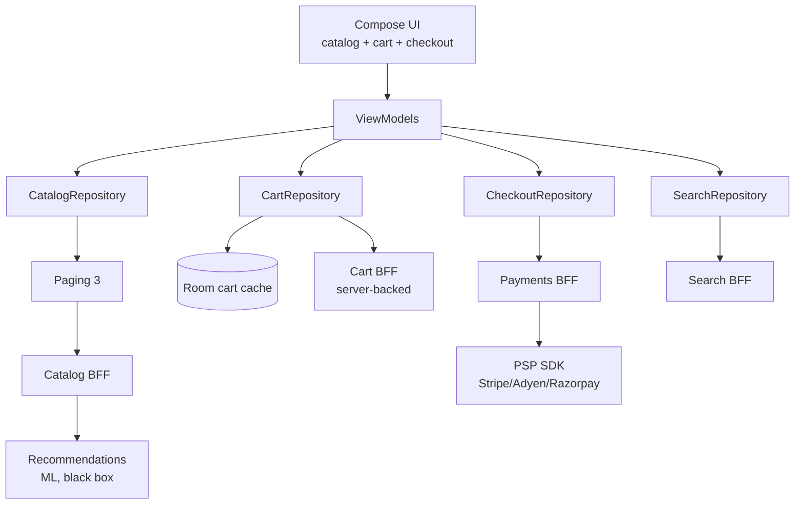
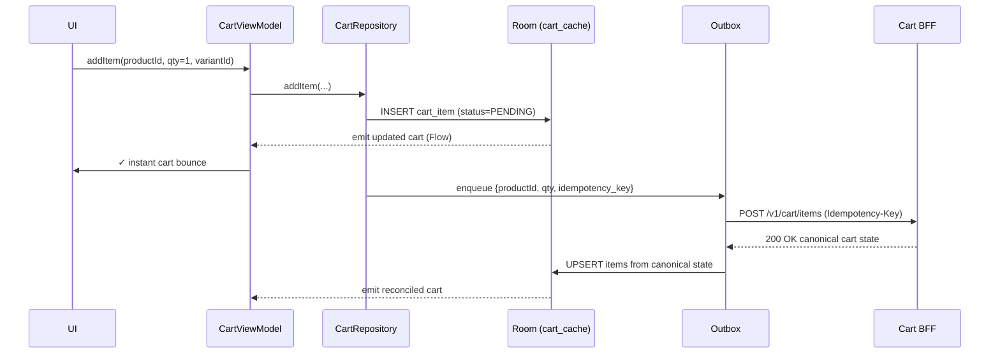
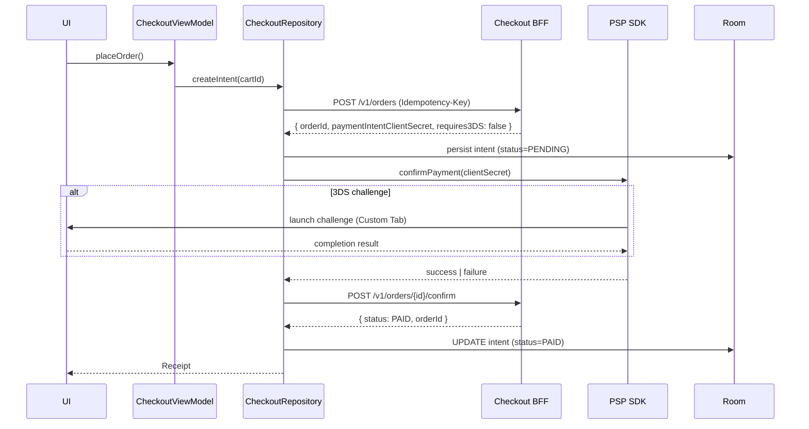

# E-Commerce App — Reference Architecture

> The settled blueprint for a transactional shopping client (Amazon, Flipkart, Shopify storefronts, Mercari). The defining trade-off: **every screen optimizes for conversion**. Cart durability, checkout reliability, payment idempotency, and search-to-buy latency matter more than feed engagement metrics. A 1% improvement in checkout completion outweighs almost any other UX win.

---

## Requirements

### Functional

- Product catalog browsing: home, category, search, recommendations.
- Product detail with rich media (gallery, video, variant selection).
- Cart (persistent across devices and sessions).
- Checkout: address selection, shipping options, payment method, place order.
- Order history, tracking, returns.
- Wishlist, saved-for-later.
- Multiple payment methods: cards, digital wallets (Apple Pay/Google Pay), BNPL, COD where regional.
- Promotions: coupons, vouchers, flash sales (high-traffic spike events).
- Account management, addresses, payment methods.

### Non-Functional

- **Conversion-first metrics.** Every architectural decision is evaluated by its impact on add-to-cart rate, checkout-completion rate, and time-to-purchase.
- **Cart durability.** Cart survives uninstall (server-backed), survives device switch, survives 30 days idle.
- **Checkout reliability.** Idempotency keys on every payment call. Double-charge prevention is non-negotiable.
- **Search latency.** p95 < 400ms for typeahead suggestions; p95 < 800ms for full search results page.
- **Flash sale capacity.** Architecture must withstand 10-100× normal traffic without degrading checkout for non-sale users.
- **Cellular-friendly.** Product images tiered by network class; defer high-res until tap.
- **Regulatory.** PCI DSS (cards), GDPR / CCPA (data), country-specific tax/invoice rules.

---

## Architecture

The defining property: **the cart is server-side state with a local cache, not local state with server sync**. Cart durability across devices is a feature, not an offline trade-off. The local Room cache is a performance optimization; the source of truth is the cart service.

---

## Modules

### Catalog (browsing)

- Home, categories, search-results — all powered by Paging 3 + RemoteMediator.
- Stable cursor pagination; Room caches the latest page set for offline browsing of recent results.
- Image loading via Coil 3 with `MemoryCache.Builder().maxSizePercent(0.25).build()`. Disk cache 300-500 MB; product images are touch-heavy and frequently revisited.
- Product detail screens lazy-load full-resolution images and variant-specific assets.

### Cart

**The most architecturally interesting module in this app.**

- The cart is **server-side state** with cross-device sync. The user adds an item on mobile; the same item appears on the desktop session.
- Locally, Room caches the cart for fast UI render. The cache is a *view* into the server cart, not an independent source of truth.
- On every add / remove / quantity change: the app sends the mutation to `/v1/cart` with an `Idempotency-Key`; server returns the canonical cart state; local cache is reconciled.
- Optimistic UI is allowed for visual responsiveness (item bounces into cart icon immediately), but the canonical state always wins on the next render.
- Offline: cart mutations are queued in an outbox. UX clearly signals "Will sync when online." Cart is fully usable for review; checkout is blocked offline.

### Checkout

The highest-stakes flow in the app. Borrows heavily from [`mobile-system-design/payment-flow.md`](../mobile-system-design/payment-flow.md):

- **Idempotency.** Every checkout step (create-order, attach-payment, confirm) carries a client-generated UUID. Retries with the same key return the same outcome.
- **PCI scope reduction.** Card details captured by the PSP SDK (Stripe `PaymentSheet`, Adyen Drop-In, Razorpay Checkout). The app never sees raw PAN. PCI scope stays SAQ-A.
- **3DS / SCA challenge handling.** PSP SDK launches a Custom Tab or in-process WebView. App resumes via Activity Result. Reconciliation on app resume (process death survives via Room).
- **Single-tap recovery.** If the user is interrupted (call, app kill, OS update prompt), the checkout state survives. On return, the user lands where they left, with the cart unchanged.

See [`security/auth-on-mobile.md`](../security/auth-on-mobile.md) for the session flow that wraps checkout.

### Search

- **Typeahead** with `debounce(120ms)` + `flatMapLatest` cancellation. Local trie for recent searches + popular catalog terms; remote BFF for personalised + canonical results.
- **Search Results Page (SRP)** built on Paging 3 + facet sidebar. Facets (brand, price range, rating) drive query refinement.
- **Click-through telemetry** with `queryId` correlation so server-side ranker learns from interaction signal.

See [`mobile-system-design/search.md`](../mobile-system-design/search.md), [`mobile-system-design/typeahead-autocomplete-search.md`](../mobile-system-design/typeahead-autocomplete-search.md).

### Recommendations

- Server-driven. Client receives a sorted list of product IDs hydrated with metadata.
- Multiple slots per screen (home, PDP "similar items," post-checkout "you might also like").
- Each slot tagged with a `recommendation_id` for attribution; downstream order data feeds the next training cycle.

### Flash Sale (Burst Capacity)

- **Server-side capacity gate.** Client queues for a slot during high-traffic launches. UX: a countdown screen with "You're #4,237 in line."
- **Pre-checkout warm-up.** The app pre-fetches user's address and payment method tokens before the sale opens to minimize click-to-checkout time.
- **Server-driven UX for sale-only screens.** Layout JSON for sale banners means marketing can iterate without an app release.

---

## Data Flow

### Add to Cart

The optimistic insert is visually immediate; the server reconciliation arrives within 200-500ms and adjusts (e.g., if the item is out of stock, the optimistic add is undone with a snackbar).

### Checkout — Place Order

Reconciliation on resume: if the app dies between `confirmPayment` and the next call, the Room-persisted intent lets the app recover. On next launch, the Checkout screen detects a PENDING intent and queries `/v1/orders/{id}` for canonical state.

---

## Offline Strategy

- **Browsing: cached.** Recently-viewed categories and PDPs render from Room cache. New navigation is blocked offline (with a retry CTA).
- **Cart: read-locally, write-queued.** User can review cart and update quantities offline; mutations queue and sync on reconnect.
- **Checkout: blocked offline.** Placing an order requires a confirmed server transaction. Pre-checkout (selecting address, choosing payment method) can run offline if the data is already fetched.
- **Search: blocked offline.** Typeahead falls back to local recent-searches trie; remote results return an offline state.
- **Order history: cached.** Recently-viewed orders render from Room with a "showing offline data" badge.

The cart's offline write-queue is the most user-visible compromise. Tradeoff: enable browsing-only flows without network; require network for the money path.

---

## Security

- **Payment SDK isolation.** All card capture happens in the PSP SDK's surface; never in your app's TextField. PCI scope: SAQ-A.
- **Token storage.** Keep OAuth tokens in memory where possible; persist only a versioned ciphertext envelope protected by Android Keystore. Payment-method tokens (for example, `pm_xxx`) remain session-scoped and refresh on each cart view.
- **Idempotency-Key on every mutation.** Cart-add, address-change, payment-confirm, refund-request.
- **Replay protection.** Server-issued nonces for high-value or sensitive actions.
- **HTTPS only with cert pinning** at the BFF and PSP endpoints. See [`security/certificate-pinning.md`](../security/certificate-pinning.md).
- **App Check / Play Integrity** to deter scripted checkout (sneaker bots in flash sales). Server-side verdict evaluation. See [`security/attestation.md`](../security/attestation.md).
- **No FLAG_SECURE by default**; some apps add it on the payment screen for privacy.
- **PII redaction** in logs and analytics. Address, phone, card-last-4 — all stripped. See [`mobile-system-design/security-and-privacy.md`](../mobile-system-design/security-and-privacy.md).
- **Coupon abuse defense.** Coupon codes server-validated; client never decides eligibility. Server enforces single-use, per-user limits.

---

## Observability

- **Funnel metrics**: PDP-view → add-to-cart → cart-view → begin-checkout → place-order. Each step has a conversion target and a regression alert.
- **Checkout abandonment** broken by stage (which step did they drop?). Each abandonment event carries the active cohort tags for experiment attribution.
- **Payment success rate** per PSP, per region, per payment method. A drop on a single card scheme is the canary for issuer changes.
- **Search latency** broken by query length and result set size.
- **Cart sync latency** — the time between local mutation and server ack. p95 < 500ms.
- **Flash sale capacity dashboard** — queue depth, slot grant rate, post-grant conversion. Real-time during sale events.

See [`observability/slis.md`](../observability/slis.md), [`observability/dashboards.md`](../observability/dashboards.md).

---

## Failure Modes

**Cart mutation succeeded server-side but ack lost in transit.** Idempotency key on retry returns the same canonical state; client UI reconciles. No double-add.

**Payment succeeded but the confirm-order API failed.** PSP charged the card; the app didn't get the order confirmation. *Mitigation:* Room-persisted intent + reconciliation on resume queries the canonical order state; the order exists server-side; the receipt screen renders.

**Flash sale stampede crashes the BFF.** The catalog and the cart services share infrastructure; a sale brings down checkout for non-sale users. *Mitigation:* dedicated capacity for checkout vs sale-promo browsing; queueing UX absorbs spike client-side.

**Multiple cards declined; user retries with a third.** Each attempt is a separate Idempotency-Key; the rejected attempts are isolated. Server returns `payment_failed` with structured reason codes for UI mapping.

**Stock changes between cart-add and checkout-confirm.** Item out of stock at checkout time. *Mitigation:* checkout API returns `out_of_stock` with the affected line items; cart UI updates; user re-confirms.

**Coupon expires while user is checking out.** *Mitigation:* re-validate the coupon at the `confirm` step; if it expired, return error with new total; user re-confirms with updated price.

**Address validation fails post-payment.** *Mitigation:* validate address before payment; if validation must run server-side post-payment, do so on the *server* with a refund-and-retry path, never on the client.

**App killed during 3DS challenge.** OS killed the host activity. *Mitigation:* PSP SDK launches an external Custom Tab (state persists in PSP); on app resume, query intent status; if `succeeded`, render receipt.

---

## Scaling

### Scaling user base

- Per-region BFFs for catalog, search, cart. Reduces latency and supports regional compliance.
- CDN-served images and product videos.
- Search queries served from a regional Elasticsearch / similar; cart writes serialized through the canonical cart service.

### Scaling catalog

- Multi-million SKU catalogs. Paging 3 + cursor pagination is mandatory; offset breaks.
- Server-side ranking and filtering keeps client lean.
- Long-tail SKUs lazy-load image variants.

### Scaling flash sales

- Pre-warm: register interest in advance; backend pre-allocates capacity per region.
- Client-side queueing UX (countdown, queue position).
- Reserved checkout pool isolates from normal traffic.

### Scaling internationally

- Localized payment methods (UPI in India, iDEAL in NL, PIX in BR). PSP SDK varies; the `:core:psp` boundary swaps under the same `CheckoutRepository` interface.
- Localized tax engines server-side.
- App Bundle language splits for locale resources.
- Address formats per country (validated server-side).

---

## Release Strategy

- **Weekly release train** with crash-rate gating at 99.5%. See [`release-engineering/staged-rollouts.md`](../release-engineering/staged-rollouts.md).
- **Payment flow has tighter gates.** Crash-free target on the checkout module is 99.9%. A regression on checkout halts even if global metrics look fine.
- **Server-driven home + sale layouts.** The marketing team iterates without app releases via a layout-JSON service.
- **Kill switches** for every payment method, every promotion engine, every recommendation slot. See [`release-engineering/kill-switches.md`](../release-engineering/kill-switches.md).
- **Feature flags** for new checkout flows; old flow remains hot until 100% of users are on new.
- **In-app updates API** for security fixes (high-priority); flexible updates for feature releases.

---

## Summary of Technologies

| Layer | Choice | Why |
|---|---|---|
| UI | Jetpack Compose | Modern; rich product detail screens |
| State | ViewModel + StateFlow | Standard |
| Catalog pagination | Paging 3 + RemoteMediator | Cursor-based, offline cache |
| Images | Coil 3 | Compose-friendly, bounded memory |
| Persistence | Room | Cart cache, order history, recent searches |
| Cart truth | Server (BFF + canonical cart service) | Cross-device durability |
| Payment | PSP SDK (Stripe / Adyen / Razorpay) | PCI scope reduction |
| Network | OkHttp + Retrofit | Mature; Idempotency-Key interceptor |
| Tokens | Private ciphertext envelope | Direct Android Keystore key |
| DI | Hilt | Standard |
| Background | WorkManager | Outbox drain, analytics flush |
| Push | FCM (data + notification messages) | Order updates, promotions |
| Analytics | In-house SDK | Funnel attribution |

---

## Related

- [`mobile-system-design/payment-flow.md`](../mobile-system-design/payment-flow.md) — checkout reasoning exercise.
- [`mobile-system-design/search.md`](../mobile-system-design/search.md), [`mobile-system-design/typeahead-autocomplete-search.md`](../mobile-system-design/typeahead-autocomplete-search.md) — search subsystem.
- [`mobile-system-design/pagination.md`](../mobile-system-design/pagination.md) — Paging 3 patterns.
- [`distributed-systems/idempotency.md`](../distributed-systems/idempotency.md) — why every mutation carries a key.
- [`security/attestation.md`](../security/attestation.md) — bot defense for flash sales.
- [`consumer-app.md`](consumer-app.md) — sibling blueprint; same scale, different trade-offs.

---

> **In short:** E-commerce optimizes for conversion. Cart durability is server-side; checkout is reconciliation-safe through idempotency keys and Room-persisted intents; payment capture lives in the PSP SDK to keep PCI scope minimal; flash sales get dedicated capacity. Where consumer apps optimize for engagement velocity, e-commerce optimizes for the money path.
