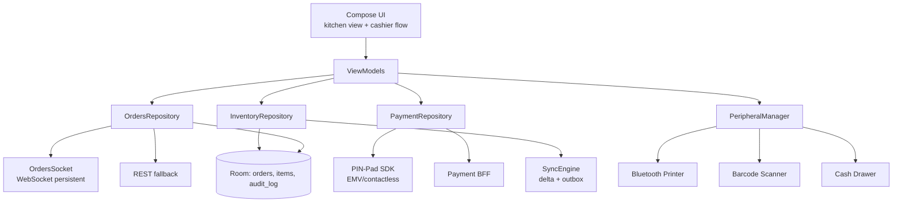
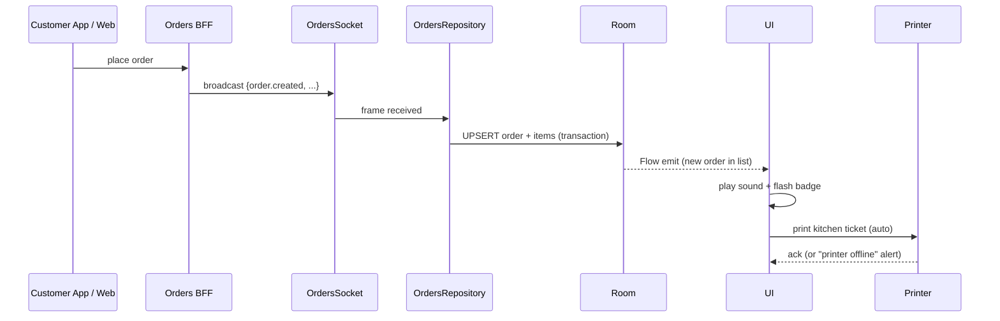
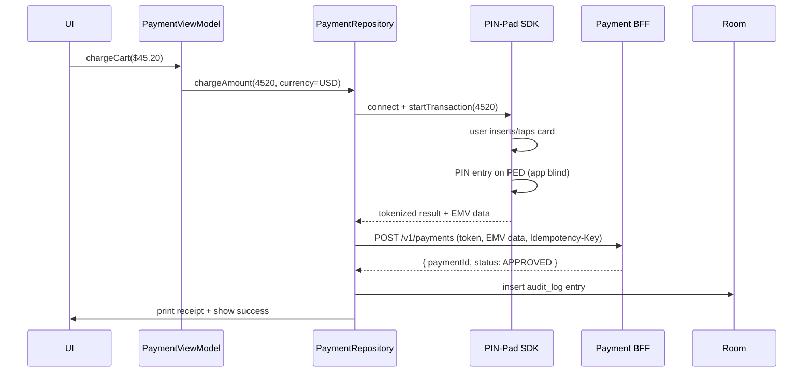

# Merchant App — Reference Architecture

> The settled blueprint for a B2B merchant/seller mobile client (Shopify POS, Square Seller, Stripe Dashboard, Toast for Restaurants, Uber Eats for Restaurants). The defining trade-off: **reliability and operational continuity dominate over consumer polish**. The merchant cannot lose an order. The cashier cannot have the app crash during a card-present transaction. The kitchen printer must fire even if the BFF is flaky. Offline-capable, peripheral-aware, audit-rich.

---

## Requirements

### Functional

- View incoming orders in real time (in-store + delivery + online).
- Update order status (accepted, preparing, ready, completed, refunded).
- Take payments: card-present (chip/swipe/tap via PIN-Pad), card-on-file, QR/UPI, cash.
- Print receipts and kitchen tickets via Bluetooth/USB/Wi-Fi printers.
- Scan barcodes via camera or external scanner.
- Manage inventory: stock adjustments, low-stock alerts, item availability toggles.
- Manage menu/catalog (for food merchants).
- View daily reports: sales, top items, refunds.
- Multi-staff support: shift change, role-based permissions.

### Non-Functional

- **Operational continuity.** The cashier flow must work even if the BFF is degraded or the store's Wi-Fi flaky.
- **Hardware reliability.** Bluetooth printer + card reader + barcode scanner connections must auto-reconnect; failure must surface obviously to the cashier, not silently.
- **Audit trail.** Every transaction is logged with merchant ID, staff ID, timestamp, payload, outcome. Used for end-of-day reconciliation and dispute resolution.
- **Long sessions.** App runs for an 8-12 hour shift on a single tablet, often on the charging dock. No memory leaks, no battery sag.
- **PCI DSS compliance** for card-present payments (often PED + EMV-certified hardware; the app talks to it via SDK).
- **Multi-device sync.** Two POS tablets in the same store see the same orders, the same inventory, the same staff status.

---

## Architecture

The defining property: **orders are server-pushed in real time** via a persistent WebSocket; the app maintains a local Room mirror so the kitchen view never blinks during a brief network flap. Hardware integration (printer, scanner, cash drawer) goes through a single `PeripheralManager` with auto-reconnect and explicit failure states.

---

## Modules

### UI Layer

- **Tablet-first, landscape-optimized.** Most merchant apps run on a wall-mounted or counter-mounted Android tablet. Compose with two-pane layouts (order list + selected order detail).
- **Persistent on-screen state.** Order count badges, printer status, network status — always visible. Cashiers don't navigate to a settings screen to check if the printer is online.
- **Soft-keyboard avoidance.** Most input is via stylus or external barcode scanner. Custom numeric pads for quantity / price entry, never the OS keyboard.
- **Role-aware UI.** Staff/Manager/Admin permissions gate which actions are visible. Server-driven permission set; client renders accordingly.

### OrdersRepository + OrdersSocket

- Persistent **WebSocket** to the orders BFF, foregrounded while the app is open. On disconnect: exponential backoff with jitter; status visible in the persistent UI bar.
- Every incoming order is upserted to Room **inside the WebSocket frame handler**, before the UI Flow emits. Reading order data, the UI is always reading Room — the socket is a *write path* into the local store.
- REST fallback for late catch-up: on reconnect, `GET /v1/orders?since=<watermark>` syncs any orders missed during the disconnect.
- Order state transitions (accepted, preparing, etc.) are local writes that fire a REST mutation in parallel; idempotency keys ensure retries are safe.

### PaymentRepository (Card-Present)

The most regulated module in the app. Talks to certified payment hardware (PIN-Pad, mPOS reader) via vendor SDK:

- **EMV chip flow:** card inserted → kernel selects app → user enters PIN on the PED → app receives tokenized result. App **never sees** PAN, expiry, or PIN. PCI scope: out of scope for cardholder data.
- **Contactless (NFC) flow:** card tapped → kernel selects app → tokenized result.
- **Refund flow:** original transaction lookup → server-issued refund authorization → printed receipt.
- **Tip flow:** post-authorization tip adjustment supported by the kernel and the PSP.

Connection to the PIN-Pad over Bluetooth Classic or USB; auto-reconnect; explicit "Reader disconnected" UI state. See [`mobile-system-design/payment-flow.md`](../mobile-system-design/payment-flow.md) for the patterns.

### InventoryRepository + SyncEngine

- **Multi-device convergent state.** Two POS tablets in the same store must agree on stock counts within seconds.
- Local Room cache for fast UI render.
- Mutations queue via an outbox; pushed to the inventory BFF with idempotency keys.
- Server pushes deltas back to all tablets in the store via the WebSocket; eventual consistency in seconds.
- Conflict resolution: server-side authoritative (the back-office system is the source of truth); client-side optimistic but reconciles on next sync.

### PeripheralManager

The most overlooked but most operationally critical module. Centralizes Bluetooth/USB/Wi-Fi peripheral lifecycle:

- **Printer:** ESC/POS protocol over Bluetooth. Auto-reconnect on disconnect. Print job queue with retry; never silently drop a kitchen ticket.
- **Barcode scanner:** typically a Bluetooth HID device (acts like a keyboard); read via `KeyEvent` from focused text field. Configurable suffix (Enter / Tab) to trigger submission.
- **Cash drawer:** triggered via a relay through the receipt printer.
- **Customer-facing display:** optional second screen (some POS devices have one).
- **Connection state UI:** persistent badges showing which peripherals are connected.

Every peripheral has a "test" path in settings so the cashier can verify before opening.

---

## Data Flow

### Incoming Order (Live)

The auto-print is part of the operational continuity contract: if the printer is offline, the system alerts the cashier loudly so they can manually intervene.

### Card-Present Payment

The PIN-Pad SDK abstracts the EMV kernel. The app's only responsibility: pass the amount in, receive the tokenized result, send to the PSP, log the audit entry.

---

## Offline Strategy

Operational continuity is the highest priority. Offline is a real scenario (in-store Wi-Fi blip during peak hours).

| Subsystem | Offline behavior |
|---|---|
| **Order list view** | Renders from Room cache. New orders only arrive when WebSocket reconnects, but existing orders are visible. |
| **Order status updates** | Queue in outbox; sync on reconnect. UI shows "Pending sync" badge. |
| **Card-present payment** | Card readers are local hardware; transactions can complete *offline* if the PSP SDK supports store-and-forward mode. Approval is conditional; tokens stored, settled when network returns. |
| **Cash payments** | Always offline-capable. Logged to audit; reconciled at end of shift. |
| **Inventory adjustments** | Queue locally; sync on reconnect. Optimistic UI. |
| **Receipts / kitchen tickets** | Printed locally (Bluetooth peripheral). No network required. |
| **Refunds** | Blocked offline. Refunds require server authorization; deferred until reconnect with clear UX. |

Store-and-forward card transactions are the highest-stakes offline path. The PIN-Pad and PSP must both support it (not all do); local risk gates apply (max offline transaction count, max amount per transaction).

---

## Security

- **PCI DSS scope minimization.** Card data flows from PIN-Pad to PSP without entering the app's process. PCI scope: SAQ-A or SAQ-B-IP depending on hardware.
- **Staff authentication.** PIN-based shift login (numeric pad, not OS keyboard, to avoid keylogger spoofing). Session bound to staff ID; every action logged.
- **Permission roles** enforced server-side; client-side checks are UX hints, not security boundaries.
- **Tablet kiosk mode.** Many merchants run the app in `LOCK_TASK` mode so cashiers can't exit to other apps. Configured via Android MDM (Knox / Android Enterprise).
- **Encrypted local store** for any cached merchant data (sales reports, inventory). `EncryptedSharedPreferences` for tokens; SQLCipher for Room if regulatory needs.
- **No PAN in logs**, ever. PIN-Pad SDK isolates this; the app only sees tokens like `tok_xxx`.
- **Audit log immutability.** Append-only Room table. Synced to server at end of shift; the local copy is the disputed-transaction trail.
- See [`security/secure-storage-on-android.md`](../security/secure-storage-on-android.md), [`mobile-system-design/security-and-privacy.md`](../mobile-system-design/security-and-privacy.md).

---

## Observability

- **Operational metrics first.** Order ingestion rate, average time-to-acknowledge, payment success rate, printer success rate. Dashboards visible to merchant operations.
- **Per-store cohorting.** A failing printer at Store 47 must surface as Store-47-specific, not lost in a global average.
- **Peripheral health telemetry.** Auto-reconnect count, time-since-last-print, time-since-last-card-read. Merchant ops team uses this to deploy field replacements proactively.
- **Audit log replay.** When a merchant disputes a transaction, the local audit log is the source of truth. Synced to server but always also available on-device for 90 days.
- **Crash-free shifts.** Track crashes per merchant per shift, not per user. A crash during a 4-hour shift on a wall-mounted tablet is more disruptive than a consumer-app crash.
- See [`observability/dashboards.md`](../observability/dashboards.md), [`observability/slis.md`](../observability/slis.md).

---

## Failure Modes

**Bluetooth printer disconnects mid-shift.** Cashier needs to know now, not silently. *Mitigation:* persistent status bar shows printer state; reconnect attempts logged; failed print job queued with loud "PRINTER OFFLINE — TICKETS HELD" alert.

**Payment goes through on PIN-Pad but app never receives the response.** *Mitigation:* PIN-Pad SDK exposes "last transaction status" query; app polls on reconnect; idempotency keys prevent double-charges.

**Two cashiers update the same order simultaneously.** Both mark it "completed" on different tablets. *Mitigation:* server is source of truth; second update returns `409 Conflict` with current state; client shows "already completed" silently.

**WebSocket disconnects during peak hour.** Orders stop appearing in the kitchen. *Mitigation:* aggressive reconnect (1s initial, max 30s); REST catch-up on reconnect using `since=<watermark>`; explicit "Real-time disconnected — refreshing" UX so kitchen knows.

**Tablet runs out of disk after a long offline shift.** Outbox + audit log grew unboundedly. *Mitigation:* hard cap on outbox size (with explicit user warning at threshold); audit log rotated to compressed archive monthly; cloud-sync at end of shift drains queues.

**Staff PIN guessed by another staff member.** *Mitigation:* PIN-only is not strong auth; for sensitive actions (refund > threshold), require manager card-swipe (a separate physical token). Audit logs are immutable.

**Tablet stolen.** *Mitigation:* MDM remote wipe; sessions invalidated server-side on suspicious activity; no cached PII beyond current shift.

**App auto-update during a shift causes a long restart.** *Mitigation:* defer in-app updates during business hours via Play's update priority + custom scheduling; promote major updates only during overnight windows.

---

## Scaling

### Scaling per merchant (multi-store franchise)

- Each store has its own scope (orders, inventory) but shares the chain's catalog.
- Per-store WebSocket channel; per-store Room namespace.
- Chain-wide reports rolled up server-side.

### Scaling peripheral support

- Vendor-specific printer drivers behind a unified `Printer` interface.
- New device classes plug in without touching app architecture.

### Scaling payment regions

- PSP SDK varies by country (Square US, Adyen EU, Razorpay India). `:core:payment` boundary swaps under the same `PaymentRepository`.
- Country-specific compliance (e.g., GST invoicing in India, fiscal printers in Italy) implemented as per-country `:feature:tax-<country>` modules.

### Scaling staff count

- Role-based permissions server-side; staff sync delta on app start and on role-change broadcast.
- Shift management (clock-in, clock-out) as a sub-feature.

---

## Release Strategy

- **Off-hours rollouts only.** Releases deploy overnight (in the merchant's timezone) when stores are closed. Sundays preferred.
- **Per-region staged rollouts.** Bug specific to a regional PSP SDK doesn't affect other regions.
- **Independent QA on real hardware.** Every release tested against the actual PIN-Pad, printer, scanner models the merchant uses.
- **In-app updates with immediate priority for security fixes.** Flexible priority for feature releases; merchant must consent.
- **Kill switches** for every payment method, every peripheral driver, every promotional feature. See [`release-engineering/kill-switches.md`](../release-engineering/kill-switches.md).
- **Long support tail.** Merchant hardware lifecycles are years; the app supports older Android API levels longer than consumer apps (often back to API 24+).

See [`release-engineering/release-strategy.md`](../release-engineering/release-strategy.md).

---

## Summary of Technologies

| Layer | Choice | Why |
|---|---|---|
| UI | Jetpack Compose (tablet-optimized two-pane) | Modern; landscape-first layouts |
| State | ViewModel + StateFlow | Standard |
| Persistence | Room | Order mirror, audit log, inventory cache |
| Real-time | OkHttp WebSocket | Persistent connection while open |
| Network | OkHttp + Retrofit (REST fallback) | Mature; Idempotency-Key interceptor |
| Tokens | EncryptedSharedPreferences | Keystore-wrapped |
| Payment | Vendor PIN-Pad SDK + PSP SDK | PCI scope reduction |
| Peripheral | Vendor SDK behind unified interface | Printer / scanner / cash drawer |
| Kiosk | Android LOCK_TASK + MDM (Knox / Android Enterprise) | Single-app deployments |
| DI | Hilt | Standard |
| Background | WorkManager | Audit log sync, end-of-shift uploads |
| Push | FCM | Soft-real-time alerts; WebSocket is primary |
| Updates | Play In-App Updates (deferred) | Off-hours deployment |

---

## Related

- [`mobile-system-design/payment-flow.md`](../mobile-system-design/payment-flow.md) — payment reasoning exercise.
- [`mobile-system-design/notification-system.md`](../mobile-system-design/notification-system.md) — order alerts.
- [`distributed-systems/idempotency.md`](../distributed-systems/idempotency.md) — why every mutation carries a key.
- [`security/secure-storage-on-android.md`](../security/secure-storage-on-android.md) — audit log + token storage.
- [`release-engineering/kill-switches.md`](../release-engineering/kill-switches.md) — peripheral-level kill switches.
- [`e-commerce-app.md`](e-commerce-app.md) — the consumer counterpart of the same commerce stack.
- [`banking-app.md`](banking-app.md) — sibling for compliance and audit patterns.

---

> **In short:** Merchant apps optimize for operational continuity. The kitchen ticket must print. The card reader must work. The order count must be live. Where consumer apps optimize for engagement and e-commerce for conversion, merchant optimizes for *the shift never failing*. That means: real-time WebSocket with WebSocket-as-write-path-to-Room, peripheral lifecycle as a first-class module, audit logs as immutable local truth, off-hours rollouts, kill switches per peripheral and per PSP.
