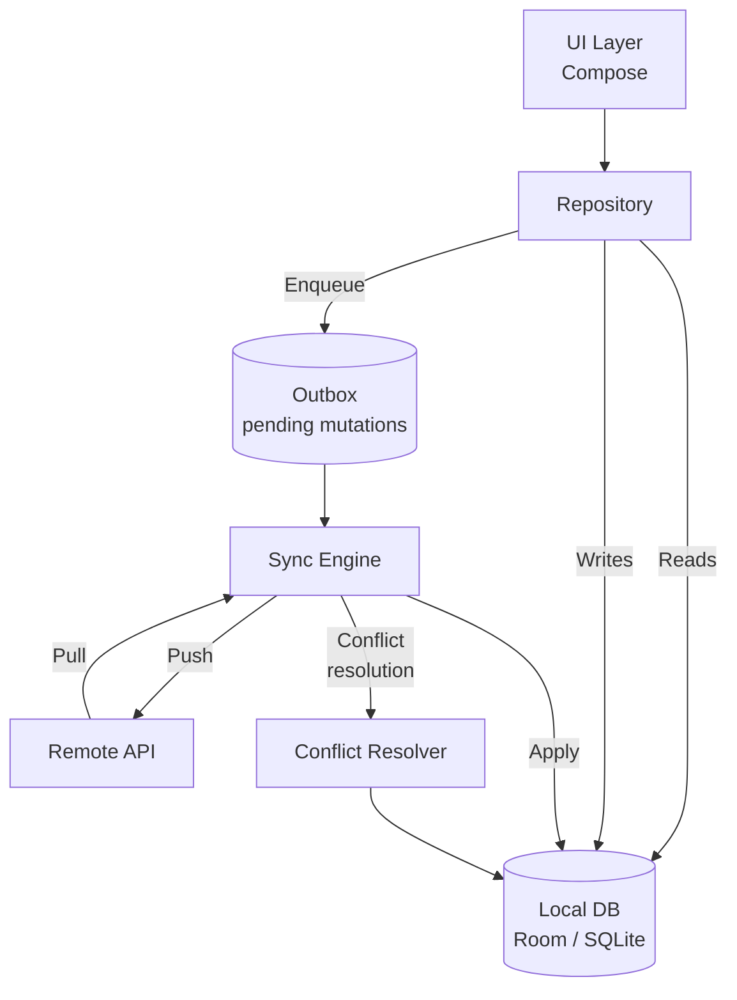
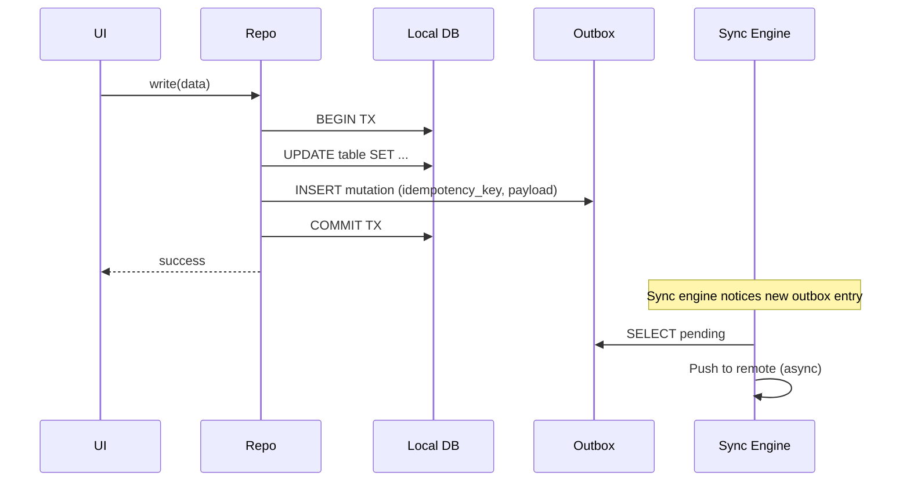
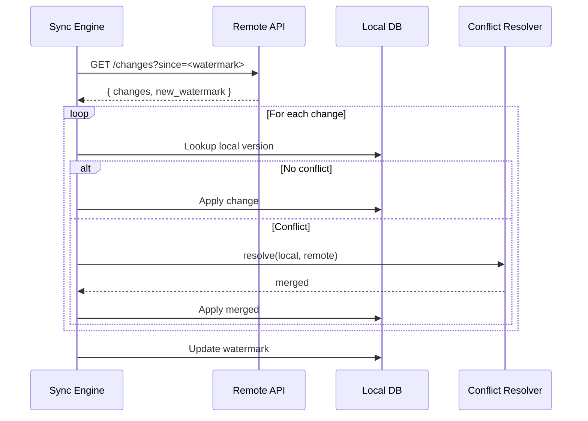

# Offline-First App — Reference Architecture

This blueprint describes the architectural shape of an app designed to function with no network connection as a *default state*, not a degraded one. Online sync is treated as eventual reconciliation; offline operation is the steady state. The pattern applies to notes apps, field-data-capture apps, journaling/logging apps, sales-force apps, and any consumer app where intermittent connectivity is the norm.

---

## Requirements

### Functional

- All read operations must succeed without network access. The full local data set is available at any time.
- All write operations must succeed without network access. Mutations queue locally and reconcile when connectivity returns.
- Data created on multiple devices for the same user must converge to a single consistent state, deterministically.
- The user must not be able to observe a difference in behavior between online and offline operation in the read path. The write path may surface "syncing" indicators but must not block the UI.
- Background sync must respect platform constraints (Doze, App Standby). See [`../android/doze-app-standby-and-battery-optimization.md`](../android/doze-app-standby-and-battery-optimization.md).

### Non-functional

- **Read latency:** sub-frame (<16ms) for typical operations. Reads are local.
- **Write latency:** sub-frame for the local write. Server-side acknowledgment is asynchronous.
- **Sync convergence:** eventual, bounded by *TODO: target convergence window — typically minutes when online*.
- **Storage:** the full user-relevant data set must fit on-device. Partial datasets are a different architecture (offline-tolerant, not offline-first).
- **Battery:** background sync must not drain the device. Use [WorkManager](../android/workmanager-and-background-execution-constraints.md) constraints (charging, unmetered network) where appropriate.
- **Conflict semantics:** deterministic. See *Sync Strategy* below.

---

## Architecture

The defining property of this architecture: **the UI never talks to the network directly**. The UI reads from and writes to the local database; the sync engine moves data between local and remote independently of UI activity. This is what makes the read path latency-immune to network conditions and the write path tolerant of offline.

---

## Modules

### UI Layer

Reads from the repository; never reads from the network. Renders local state. Write actions return immediately after the local write commits.

### Repository

Single entry point for the UI. Owns the policy that the UI doesn't see the network. Internally:

- For reads: returns from the local DB (often as a [Flow](../android/flow.md) that emits when underlying data changes).
- For writes: writes to the local DB AND enqueues an outbox entry in a single transaction.

### Local DB

Source of truth from the UI's perspective. [Room](../android/room.md) is the typical choice on Android. Schema includes:

- The application's data tables.
- An *outbox* table listing pending mutations that haven't been acknowledged by the server.
- A *sync state* table tracking what was last synced and when.

### Outbox

A durable, ordered queue of pending mutations. Each entry includes:

- A client-generated idempotency key (see [`../distributed-systems/idempotency.md`](../distributed-systems/idempotency.md)).
- The mutation payload.
- A retry count and next-attempt timestamp.
- A status: `pending | in_flight | acknowledged | failed`.

The outbox is the bridge between UI writes and server sync. Without it, you have an online app with offline read caching — not an offline-first app.

### Sync Engine

The component that moves data between local and remote. Runs as a background service ([WorkManager](../android/workmanager-and-background-execution-constraints.md)) or as a long-lived foreground service for active sync.

Three responsibilities:

1. **Push pending mutations** from the outbox to the server.
2. **Pull remote changes** since the last sync watermark.
3. **Reconcile** the two: apply pulled changes to the local DB, resolve conflicts.

The sync engine is itself a [state machine](../engineering-fundamentals/state-machines.md): `Idle → Pushing → Pulling → Reconciling → Idle`, with `Retrying` and `Failed` as side states.

### Conflict Resolver

Encapsulates the conflict policy. See *Sync Strategy* below for choices.

---

## Data Flow

### Local Write

The local write and the outbox insert commit in the same transaction. This is the atomic-capture rule from [`../distributed-systems/idempotency.md`](../distributed-systems/idempotency.md): the mutation's effect (on local state) and its intent (in the outbox) are inseparable.

### Remote Pull and Reconcile

---

## Offline Strategy

The offline strategy *is* the architecture — there is no graceful-degradation mode, only steady-state offline.

- **Reads** never touch the network. If the data is in the local DB, the read succeeds. If it isn't, it isn't — there is no "lazy fetch from server" fallback. This is intentional: it removes the entire class of bugs where the UI behaves differently online vs offline.
- **Writes** never block on the network. They commit locally and enqueue. The UI's confirmation is the local commit, not the server ack.
- **Sync** is opportunistic. When the network is available *and* platform constraints permit, the sync engine drains the outbox and pulls remote changes. When it isn't, the system continues operating; the outbox accumulates.
- **Reconnection** is automatic. The sync engine subscribes to network availability (see [`../engineering-fundamentals/state-machines.md`](../engineering-fundamentals/state-machines.md) on parallel regions) and resumes sync without user intervention.

### Sync Strategy

Three viable strategies, depending on conflict tolerance and engineering investment:

1. **Last-Write-Wins (LWW).** Each record has a `last_modified` timestamp. On conflict, the most recent timestamp wins. Simplest; loses data on concurrent edits.
2. **Operational Transforms (OT).** Mutations are transformed against intervening remote mutations before applying. Complex to implement correctly; used by Google Docs.
3. **CRDTs.** Conflict-free Replicated Data Types. Operations are designed to commute mathematically, so any order of application produces the same result. See [`../distributed-systems/crdts.md`](../distributed-systems/crdts.md). Best fit for true offline-first systems.

The choice is recorded in an ADR (e.g., [`../adr/008-lww-vs-crdt.md`](../adr/008-lww-vs-crdt.md)). For most notes-style apps, LWW is sufficient; for collaboratively-edited documents, CRDTs.

---

## Security

- **Local DB encryption.** The on-device DB holds the user's full data set. Use SQLCipher or platform-level full-disk encryption.
- **Outbox sensitivity.** The outbox holds *unsent* mutations — sometimes more sensitive than the steady-state DB (e.g., a not-yet-submitted draft). Same protection as the DB; do not ship outbox contents to crash reports or analytics.
- **Sync auth.** Server-side mutations carry per-request authentication. Idempotency keys are *not* credentials.
- **Tenant isolation.** If the app is multi-tenant, the local DB must include tenant scoping at the schema level. A user switching accounts must result in a clean DB swap, not a filter.
- **Replay resistance.** Mutations in the outbox can survive process death and OS upgrades. For sensitive operations (financial, identity), include a server-issued nonce or signed timestamp so the server can reject mutations that became stale (e.g., user changed password between mutation creation and sync).
- See [`../security.md`](../security.md) for cross-cutting topics.

---

## Observability

- **Sync events:** every push/pull cycle emits a structured log including outbox depth, conflicts encountered, and watermark advancement. Canonical schema in [`../observability/structured-logging.md`](../observability/structured-logging.md).
- **Metrics:**
  - `sync.outbox.depth` — gauge. Sustained growth means sync isn't keeping up.
  - `sync.cycle.duration_seconds` — histogram.
  - `sync.conflict.count` — counter, tagged by resolution outcome.
  - `sync.error.count` — counter, tagged by error class.
- **Traces:** each sync cycle is one trace; mutations carry their idempotency key as a span attribute.
- **Dashboards:** outbox depth over time, conflict rate, sync latency p95.
- **Alerts:** outbox depth above threshold for >1 hour (sync stuck); conflict rate spike (server data model changed or client/server schema drift).
- Canonical: [`../observability/metrics.md`](../observability/metrics.md), [`../observability/slis.md`](../observability/slis.md).

---

## Failure Modes

**Outbox grows unboundedly.** The server is unreachable for an extended period; mutations accumulate. The local DB fills the device storage. Mitigation: bounded outbox size with a user-facing warning at *TODO: threshold*; refuse further writes when full (or evict oldest with explicit user warning).

**Schema drift between client and server.** Server adds a required field; old clients submit mutations missing it. Mitigation: schema versioning on both sides; reject incompatible mutations server-side with a structured error that the client can interpret.

**Clock skew on conflict resolution.** LWW depends on timestamps; device clocks drift. Mitigation: use a hybrid logical clock (HLC) instead of wall time; or move conflict resolution server-side where the clock is trusted.

**Multi-device divergence.** Two devices make conflicting offline edits. Mitigation: deterministic conflict resolution (LWW, OT, or CRDTs — see *Sync Strategy*); surface unresolvable conflicts in the UI rather than silently dropping data.

**Sync engine wakelock starvation.** Background sync can't get CPU under Doze. Mitigation: schedule via WorkManager with appropriate constraints; do not require sync to complete in a single window.

**Watermark corruption.** Local watermark gets ahead of actual sync state (e.g., a crash mid-cycle). Result: changes are missed. Mitigation: watermark is updated only after the full cycle commits; cycles are idempotent (see [`../distributed-systems/idempotency.md`](../distributed-systems/idempotency.md)) so re-sync is safe.

**App uninstall data loss.** The user uninstalls and reinstalls; local DB is gone, and the outbox with it. Any unsynced mutations are lost. Mitigation: surface "pending sync" state clearly to the user; consider a server-side recovery flow for unusual cases.

---

## Scaling

### Scaling up (more data per user)

- Partition the local DB by recency or by entity type; load only the working set into memory. Most reads should be hot-set.
- Use [Paging](../android/paging.md) for large lists.
- Push older data to a cold tier (still on-device but not eagerly loaded) when the working set exceeds *TODO: threshold*.

### Scaling out (more users)

- Local-DB scaling is per-device; not a server concern.
- The sync API must scale horizontally. Watermark-based pull (vs full-state pull) is what makes this tractable — bandwidth scales with change rate, not data size.
- Conflict resolution complexity grows superlinearly with the number of concurrent editors. For >5 active concurrent editors per record, CRDTs become necessary; LWW degrades to "noticeable data loss."

### Scaling sync engines

- Per-user sync engines run independently; no coordination required.
- Server-side, sync endpoints are usually the highest-traffic endpoints in the system. Pagination of the change stream is essential.

---

## Release Strategy

- **Staged rollout.** Sync-engine changes affect every user; roll out via [`../release-engineering/staged-rollouts.md`](../release-engineering/staged-rollouts.md) with conservative ring sizes (1% → 10% → 50% → 100%).
- **Kill switch.** A server-controlled kill switch ([`../release-engineering/kill-switches.md`](../release-engineering/kill-switches.md)) can disable the sync engine entirely if a bad version starts corrupting data. The local DB remains usable; sync is paused.
- **Schema migrations.** Client and server schema versions evolve independently. Use additive changes (new optional fields, new tables) by default; reserve breaking changes for major version cuts.
- **Feature flags.** Conflict-resolution strategy changes (e.g., LWW → CRDT migration) should be flag-gated and validated on a subset of users first.
- **Crash-rate gating.** Sync engine crashes have outsized impact (a crashing sync = no sync = unbounded outbox). Gate sync-related releases on a tighter crash-rate threshold than the main app. See [`../release-engineering/crash-rate-gating.md`](../release-engineering/crash-rate-gating.md).

---

## Related

- [`offline-sync` in worked design problems](../mobile-system-design/offline-sync.md) — the design-reasoning exercise that this blueprint is the settled answer to.
- [`../distributed-systems/idempotency.md`](../distributed-systems/idempotency.md), [`../distributed-systems/crdts.md`](../distributed-systems/crdts.md) — the theory underneath.
- [`../engineering-fundamentals/state-machines.md`](../engineering-fundamentals/state-machines.md) — the sync engine is a state machine.
- [`../adr/008-lww-vs-crdt.md`](../adr/008-lww-vs-crdt.md) — the conflict-resolution decision.
