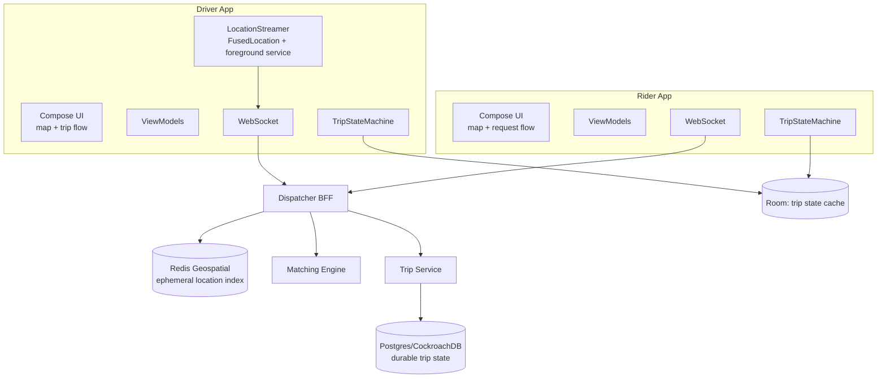
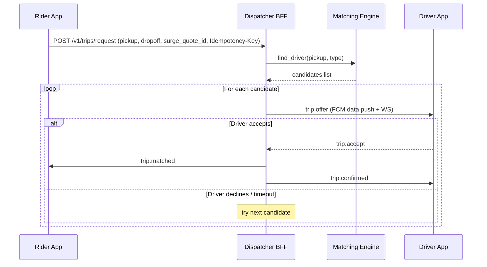
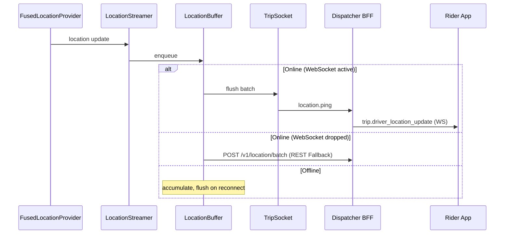
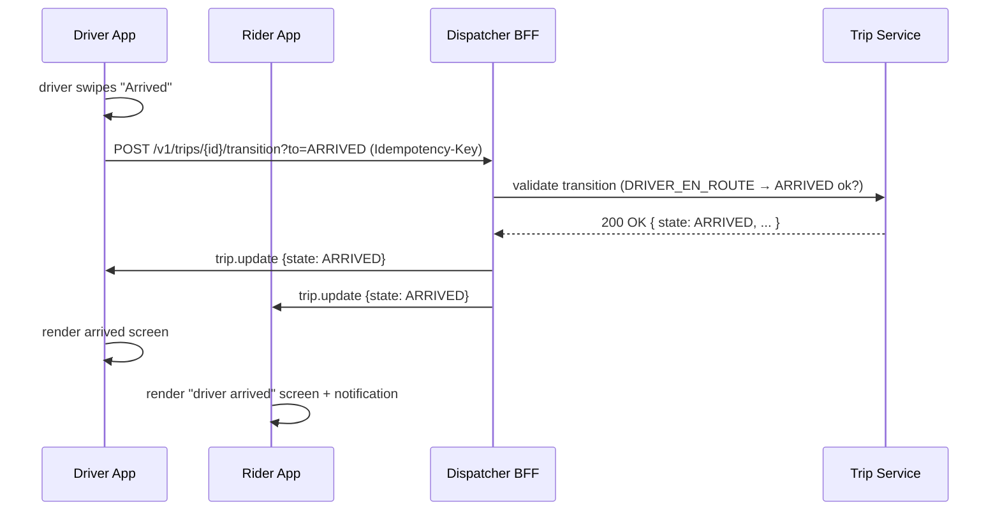

# Ride-Hailing App — Reference Architecture

> The settled blueprint for a two-sided ride-hailing platform (Uber, Lyft, Ola, Grab, Bolt). The defining trade-off: **real-time bi-directional state synchronization** between rider, driver, and dispatcher dominates everything. Battery on the driver side, location accuracy at low cost, trip state convergence across two devices, foreground-service discipline — these are the architectural axes.

---

## Requirements

### Functional

- **Rider app:** request a ride, see nearby cars on a map, get matched with a driver, track the driver in real time, complete trip, rate driver, see receipt.
- **Driver app:** go online, accept/reject ride offers, navigate to pickup, navigate to dropoff, complete trip, view earnings.
- **Real-time location streaming** (driver → server → rider).
- **Real-time trip state machine** synchronized across two devices (OFFERED → ACCEPTED → DRIVER_EN_ROUTE → ARRIVED → IN_TRIP → COMPLETED).
- **Surge pricing UX** with transparent dynamic fare communication.
- **Payment** (rider pays, driver gets paid out).
- **Ratings + tips** post-trip.
- **In-app chat / call** between rider and driver (often masked numbers).

### Non-Functional

- **Driver battery target.** A driver on duty for 8 hours should not drop below 30% battery from a 100% start (in addition to map app's own drain).
- **Location accuracy.** Urban: < 50m; highway: < 100m; tunnel: graceful degradation with last-known.
- **Trip state convergence < 2s** between the two devices via WebSocket.
- **Resilience to brief network drops** (tunnels, garages, weak signal): the trip continues; location pings buffer and flush on reconnect.
- **OEM kill resilience.** Xiaomi/OPPO/Vivo aggressive battery savers can kill the driver app; documented mitigations (foreground service + persistent notification + battery whitelist guide).
- **Two apps share infrastructure.** Common networking, auth, payment, telemetry libraries; specialized features per app.

---

## Architecture



The defining property: **the server is the trip state authority**; both apps converge to it. The driver app continuously streams location; the rider app reads location updates. State transitions (ACCEPTED, ARRIVED, etc.) are server-issued; both clients reconcile to the server.

---

## Modules

### Rider UI Layer

- Map-first home screen with a search-for-destination overlay.
- Bottom sheet for the trip flow (request → matching → en-route → in-trip → completed).
- Compose with Google Maps Compose binding (`com.google.maps.android:maps-compose`).
- Optimistic UI for ride request (animated "looking for driver"), reconciled with server matching response.

### Driver UI Layer

- Full-screen map; minimal chrome.
- Persistent top bar: status (online / offline), earnings today, next event.
- Bottom drawer for trip flow (offer modal, navigation, complete).
- Designed for one-handed use; large tap targets; high-contrast for daytime sun.
- Headset mode for spoken navigation cues.

### LocationStreamer (Driver-side, the critical module)

```kotlin
class LocationStreamer(
    private val client: FusedLocationProviderClient,
    private val socket: TripSocket,
    private val buffer: LocationBuffer,
) {
    fun start() {
        val request = LocationRequest.Builder(Priority.PRIORITY_HIGH_ACCURACY, intervalMs = 4_000L)
            .setMinUpdateDistanceMeters(10f)
            .setGranularity(Granularity.GRANULARITY_FINE)
            .build()
        client.requestLocationUpdates(request, callback, Looper.getMainLooper())
    }
    // intervals adapt: 4s while driving, 10s while stopped, 1s during pickup approach
}
```

Runs inside a `FOREGROUND_SERVICE_TYPE_LOCATION` foreground service. The service is the entire reason the driver app survives the OS's aggressive background killers. Persistent notification visible to the driver while on duty.

Adaptive intervals balance battery and accuracy:
- 4s default while moving.
- 10s while stationary (speed < 1 m/s for 60s).
- 1s during ETA-critical moments (final approach to pickup or dropoff).

See [`mobile-system-design/ride-hailing.md`](../mobile-system-design/ride-hailing.md) for the reasoning exercise.

### TripStateMachine (both apps)

```
OFFERED → ACCEPTED → DRIVER_EN_ROUTE → ARRIVED → IN_TRIP → COMPLETED
              ↘ CANCELLED (any state, by either party or system)
```

- Modeled as a [state machine](../engineering-fundamentals/state-machines.md) on both apps.
- Server is the source of truth for state transitions. Both clients receive `trip.update` events via WebSocket and reconcile.
- Local mirror in Room for fast UI and crash recovery.
- Client-initiated transitions (driver swipes "Start Trip") are intent → optimistic local update → server validation → reconcile.

### TripSocket (WebSocket)

- Persistent while the user is on duty (driver) or has an active trip (rider).
- Auto-reconnect with exponential backoff + jitter; max 30s between retries.
- On reconnect: server pushes the current trip state to bring the client up to date.
- Heartbeat every 30s; idle disconnect after 5 minutes off-duty (driver) or 30 minutes idle (rider).

### Dispatcher BFF + Matching

- Server-side. Client treats as black box.
- Receives driver location pings, indexes via H3/S2 spatial hashing.
- On rider request, queries nearby drivers, ranks by ETA + driver rating + utilization, sends offers.
- Surge pricing engine computes multipliers; rider app displays transparently before confirmation.

### Payment

- Tokenized payment method (card token, wallet) registered at signup.
- Trip completion → server charges the rider's payment method → driver earnings credited.
- Rider sees receipt; driver sees daily/weekly earnings.
- See [`mobile-system-design/payment-flow.md`](../mobile-system-design/payment-flow.md).

### Chat / Voice

- In-app chat: WebSocket-based, persistent for the trip duration.
- Voice: masked phone numbers (Twilio / similar), so driver and rider never see each other's real number.

---

## Data Flow

### Rider Requests a Ride



The offer-accept loop runs server-side; both clients see only the final state. Each offer has a 15-30 second TTL; if the driver doesn't respond, it expires and the next candidate is tried.

### Driver Location Ping



`LocationBuffer` is the resilience against brief network drops (tunnels, dead zones). It survives the gap; on reconnect, batched ping flushes catch the server up. **Crucially**, it must have a `maxAge` limit (e.g., 5 minutes). If a driver loses connection for 2 hours, we drop the stale location history rather than flooding the backend with irrelevant historical coordinates.

### Trip State Transition (Driver Marks Arrived)



Both apps see the same `trip.update` event; both transition in sync. Local optimistic update on the driver side; rider sees the server's authoritative state.

**Idempotency-Key Nuance:** State transitions (like swiping "Arrived") are high-stakes. The client generates a UUID v4 `Idempotency-Key` at the exact moment of the swipe and includes it in the header. If the network drops *during* the transition and the client retries the POST, the server sees the same key and returns the cached 200 OK without re-triggering business logic. The server typically caches these keys in Redis for 24 hours.

---

## Offline Strategy

| Subsystem | Offline behavior |
|---|---|
| **Driver location stream** | Buffer pings in Room; flush on reconnect. Map UI shows stale-location indicator. |
| **Trip state** | Rendered from local Room mirror. State transitions blocked offline; queued with explicit UX ("Will sync when connected"). |
| **Map tiles** | Cached via the Maps SDK; pre-fetched for the trip route on accept. |
| **Navigation** | Continues from cached route; rerouting requires network. |
| **Receipt / earnings view** | Cached; new data requires reconnect. |
| **Ride request (rider-side)** | Blocked offline; clear UX with retry. |
| **Voice / chat** | Blocked offline; messages queue with delivery status. |

The driver-side location buffer is the architectural keystone. Without it, a 90-second tunnel breaks the trip; with it, the trip continues invisibly.

---

## Security

- **Driver and rider apps never see each other's real phone number.** All voice goes through a masked-number layer (Twilio / Plivo).
- **Trip payments tokenized end-to-end** through PSP SDKs; cards never enter app process. See [`mobile-system-design/payment-flow.md`](../mobile-system-design/payment-flow.md).
- **Driver authentication includes biometric step-up** for high-risk actions (cash-out, profile changes).
- **Location data classification.** Live driver location goes to dispatcher; aggregated history goes to product analytics with privacy controls.
- **Fraud signals.** Sudden location jumps (GPS spoofing), unusual route choices, rejection patterns — telemetry signals to server-side fraud ML. The client emits; the server decides.
- **Background location permission UX.** Android 10+ requires explicit "Allow all the time"; the app must educate the driver before requesting.
- **Rider privacy.** Rider's exact home pin-drop optionally fuzzed to nearest intersection.
- See [`mobile-system-design/security-and-privacy.md`](../mobile-system-design/security-and-privacy.md).

---

## Observability

- **Driver-side battery telemetry.** Drain per hour broken by OEM, API level, foreground-service stability. Spikes flag misbehaving Android versions.
- **Location ping success rate.** Server-observed; gaps in stream indicate device-side suppression.
- **Trip state convergence latency.** Time from server-side transition to client ACK on the other side. Target p95 < 2s.
- **Foreground service crash count.** A crash here is a fleet-wide concern; auto-paged.
- **Match-to-acceptance latency.** Average time from offer-sent to driver-accept; experiments compete on this.
- **Surge pricing acceptance rate.** Riders who reject after surge quote — feeds dynamic pricing tuning.
- **Trip completion success rate per device cohort** (OEM, region).
- See [`observability/slis.md`](../observability/slis.md), [`observability/alerting.md`](../observability/alerting.md).

---

## Failure Modes

**Driver app killed by OEM mid-trip.** Xiaomi/OPPO/Vivo aggressive battery savers may kill the foreground service. *Mitigation:* explicit driver onboarding educates on battery whitelist; foreground service uses `START_REDELIVER_INTENT`; FCM-based wake on next event; lost trip reconciled via REST on next launch.

**GPS spoofing for fake driver compliance.** Some drivers spoof location to game the system. *Mitigation:* server-side detection (impossible speed, abrupt jumps); client emits raw sensor data (accelerometer, gyroscope) for cross-validation.

**Driver accepts but doesn't start the trip.** *Mitigation:* timeout server-side; trip auto-cancels; driver's acceptance rate metric reduced; rider rematched.

**Rider walks away mid-trip request.** *Mitigation:* if no acknowledgment of "matched" within 60s, server cancels the request (with apology); driver continues in queue.

**Both apps disconnect simultaneously due to a regional network outage.** *Mitigation:* trip continues server-side; both apps reconcile on reconnect; payments processed once both confirm.

**Surge pricing communicated unclearly; rider disputes after trip.** *Mitigation:* surge quote ID issued at request time, displayed transparently, stored with the trip record; receipt explains why.

**Driver app crashes during pickup approach.** *Mitigation:* trip state in Room survives; on relaunch, the trip UI rehydrates to the current state; location streaming resumes.

**Map SDK fails to render in tunnel.** *Mitigation:* fallback to text-only navigation cues; cached tiles render; the SDK gracefully degrades.

**Background location permission revoked mid-shift.** Driver toggled in settings. *Mitigation:* app detects, alerts driver loudly, blocks new trip acceptance until restored.

---

## Scaling

### Geographic scaling

- Per-region BFF + dispatcher (e.g., one per major metro). Latency-sensitive.
- Location index sharded geographically.

### Driver fleet scaling

- Per-region matching engines; dispatchers route based on driver's current location.
- Heartbeat scaling: hundreds of thousands of concurrent WebSocket connections per region.

### Trip volume scaling

- Trip state writes serialized through the trip service.
- Location pings are write-heavy; usually a separate ingestion path (Kafka/Pulsar) decoupled from trip state.

### App scaling (across products)

- Rider, Driver, Eats, Freight — separate apps sharing a common platform library.
- Core SDKs: auth, payment, telemetry, networking, peripheral.
- Dynamic Feature Delivery for product-specific features.

---

## Release Strategy

- **Driver releases lag rider releases.** Driver disruption is more costly; conservative rollout (1% → 5% → 25% → 100% over a week).
- **Staged rollout per region.** A regional regression contained without global impact.
- **Kill switches** for every dispatcher feature, every payment integration, every map provider. See [`release-engineering/kill-switches.md`](../release-engineering/kill-switches.md).
- **Crash-free target tighter for the driver app** (99.7%) than the rider app (99.5%). A crash means the driver loses their next match.
- **Off-hours promotion** preferred — late night local time, lower trip volume.
- See [`release-engineering/staged-rollouts.md`](../release-engineering/staged-rollouts.md).

---

## Summary of Technologies

| Layer | Choice | Why |
|---|---|---|
| UI | Jetpack Compose + Google Maps Compose | Modern; map-first |
| State | ViewModel + StateFlow | Standard |
| Persistence | Room | Trip state mirror, location buffer |
| Real-time | OkHttp WebSocket | Bidirectional, low overhead |
| Network | OkHttp + Retrofit | REST mutations; WS for streaming |
| Tokens | Private ciphertext envelope | Direct Android Keystore key |
| Location | FusedLocationProviderClient + foreground service | Best accuracy/battery balance |
| Maps | Google Maps SDK (or Mapbox in some markets) | Mature, tile caching |
| Navigation | Google Routes API + voice cues | Offline-cached on accept |
| Background | WorkManager (off-duty), foreground service (on duty) | Lifecycle correctness |
| Push | FCM (data + high-priority for offers) | Wake on offer |
| Payment | PSP SDK (Stripe / Adyen / Razorpay) | PCI scope reduction |
| Voice | Twilio / Plivo masked numbers | Privacy |

---

## Related

- [`mobile-system-design/ride-hailing.md`](../mobile-system-design/ride-hailing.md) — full reasoning exercise.
- [`mobile-system-design/google-maps-location-system.md`](../mobile-system-design/google-maps-location-system.md) — maps + location patterns.
- [`mobile-system-design/payment-flow.md`](../mobile-system-design/payment-flow.md) — fare collection.
- [`mobile-system-design/push-notifications.md`](../mobile-system-design/push-notifications.md) — high-priority offer pushes.
- [`engineering-fundamentals/state-machines.md`](../engineering-fundamentals/state-machines.md) — trip state machine.
- [`android/concurrency/services.md`](../android/concurrency/services.md) — foreground service lifecycle.
- [`mobile-system-design/chat-messaging.md`](../mobile-system-design/chat-messaging.md) — in-trip chat.

---

> **In short:** Ride-hailing optimizes for real-time bidirectional state. Driver-side foreground service for location streaming, WebSocket as the primary transport, server-authoritative trip state machine, OEM-kill resilience, FCM as wake-up for new offers, battery-adaptive sampling. Two apps share a platform; each specializes. Where consumer apps render a feed, ride-hailing renders a *live shared moving state across two devices*.
