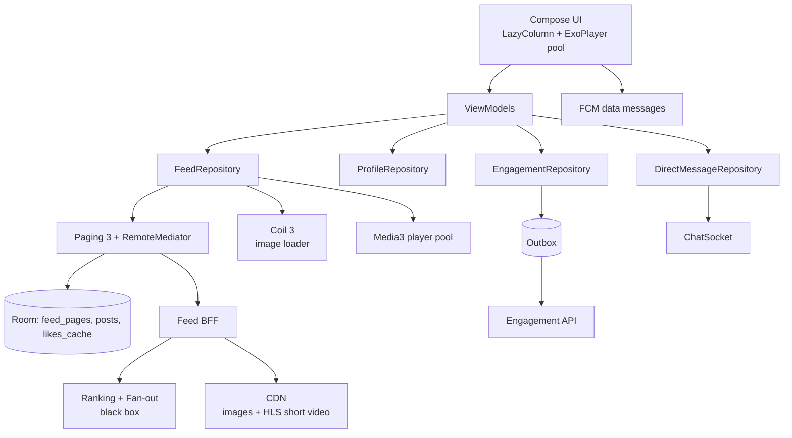
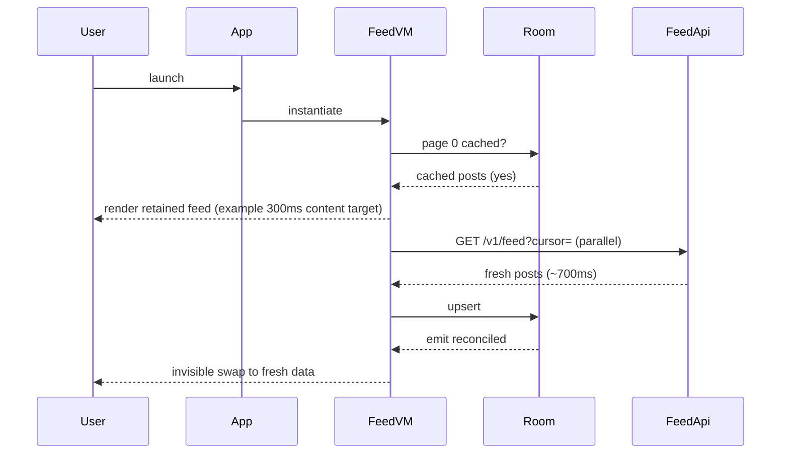
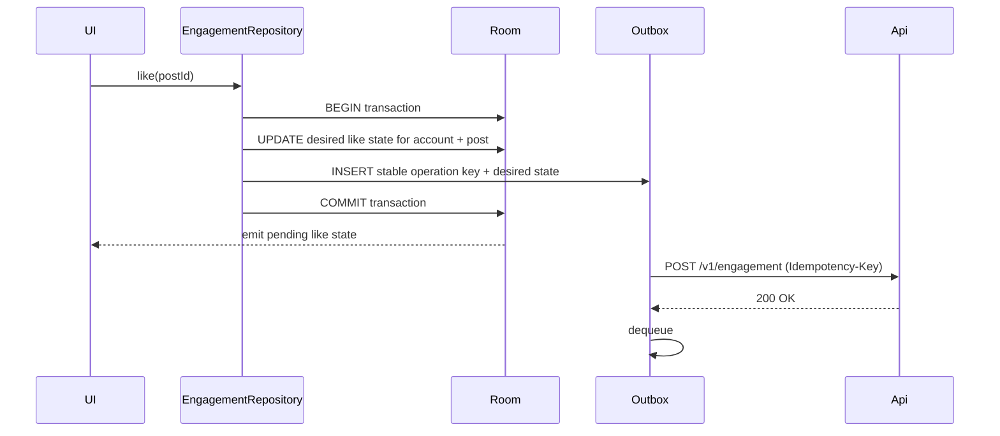
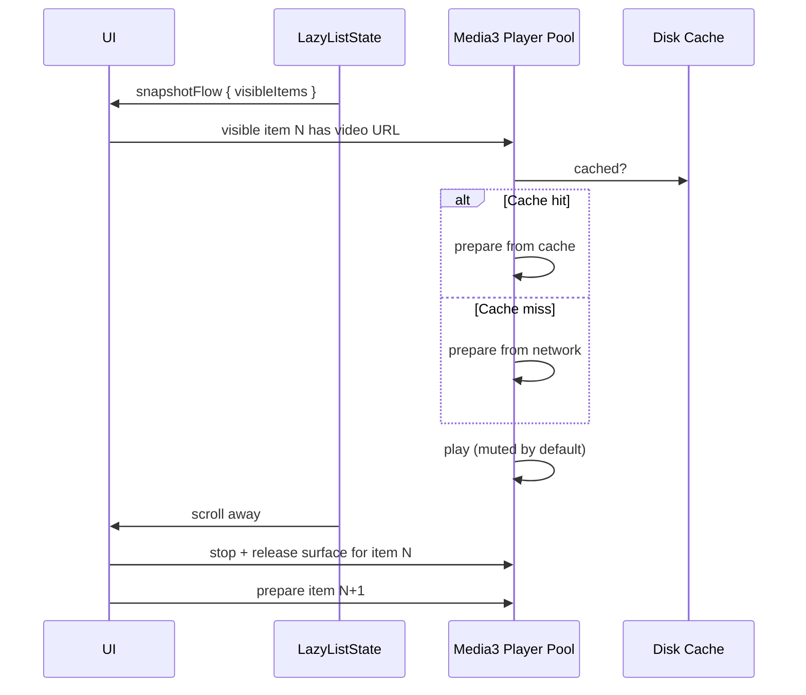

# Social Media App — Reference Architecture

> An illustrative blueprint for an infinite-feed social platform. The defining trade-off: **responsive reads and scalable distribution dominate the feed path**. With 100M+ DAU, eventual consistency is a feature, not a compromise. A like that takes 200ms to propagate to all followers' feeds is fine; a blocked feed render at 60Hz scroll is not.

---

## Scope and Assumptions

This example allows eventual consistency for feed ranking and engagement counters, while authorization, blocks, account isolation and accepted writes retain explicit correctness requirements. Latency, cache, scale, experiment and player counts are illustrative budgets. Offline visibility is limited to retained data and current access policy.

## Requirements

### Functional

- Personalized home feed (mixed content: text, image, short-form video).
- Profile views (own + others).
- Post creation: text, image, short video (≤ 90s typical).
- Engagement: like, comment, reply, repost / quote-post, save.
- Follow / unfollow + follow recommendations.
- Search (users, hashtags, topics).
- Direct messages (1:1 and group).
- Push notifications for engagement events.
- Stories / ephemeral content (24h TTL).
- Live streaming (separate feature with its own architecture).

### Non-Functional

- **Cold start TTID < 1.5s** with home feed skeleton + cached posts.
- **Scroll smoothness** at 90/120 Hz on mid-tier devices.
- **Image / short-video pipeline** must not stall scroll. Players pooled; videos preloaded conservatively.
- **Cellular-friendly.** Tiered media quality by `network_class`. Default auto-play muted on cellular.
- **Massive parallelism.** 100M+ DAU; the architecture is a thin client over a heavy backend.
- **Eventual consistency for engagement.** A like takes seconds to fan out globally; feed surface ranks within minutes.
- **Privacy.** Per-account visibility (private accounts, blocked users, muted users). GDPR / CCPA.

---

## Architecture

The defining property: **render-from-cache, refresh-in-background**. If retained data is available, the feed can render from Room before a refresh completes. An empty/evicted cache needs loading, empty or error UX; a cache does not guarantee an instant populated feed.

---

## Modules

### FeedRepository + Pager

- Paging 3 + RemoteMediator for the infinite feed. Cursor/keyset pagination is useful for changing feeds; its ordering/snapshot contract must be explicit. Paging itself also supports other key models.
- Local Room cache stores the most recent ~100 posts per feed surface (home, profile, hashtag). TTL ~1 hour for home; longer for profile.
- On cold start: render cached posts immediately; trigger refresh in parallel; swap when fresh data arrives.
- See [`mobile-system-design/news-feed.md`](../mobile-system-design/news-feed.md) for the reasoning exercise.

### EngagementRepository (Optimistic + Eventual)

Likes, follows, saves are optimistic-by-default. The user's UI updates instantly; the mutation queues to an outbox and syncs in the background. Server may reject for rate limits or anti-spam; client reconciles.

- Counters (like count on a post) are **server-side authoritative** but client-cached. Optimistic increments are visible immediately; reconciled on next feed refresh.
- Idempotency keys on every mutation; retries are safe.

### Compose UI for the Feed

The most performance-sensitive surface in the entire app. Rules:

- `LazyColumn` with `items(items.itemCount, key = items.itemKey { it.id })` — stable keys are non-negotiable.
- Post UI models should have a truthful immutable or observable-state contract; `@Immutable` annotates a type, not a composable, and cannot make mutable fields safe. Use `derivedStateOf` for an appropriate change-frequency boundary, not every calculation or one-shot animation.
- Bitmap loading via Coil 3 with `MemoryCache.Builder().maxSizePercent(context, 0.25).build()`.
- Short-video playback via Media3 with a 2-3 player pool. Only the most-visible video plays; others paused. Drive scroll visibility from list state separately from activity lifecycle. A lifecycle event effect can pause on backgrounding; it does not itself report that one card scrolled away.
- Pre-buffer next 1-2 videos on Wi-Fi; defer on cellular.
- `derivedStateOf` for "is this card in viewport" so player activation doesn't recompose every card on every scroll tick.

### DirectMessageRepository (Chat Subsystem)

- WebSocket-based chat similar to a standalone chat app (see [`mobile-system-design/chat-messaging.md`](../mobile-system-design/chat-messaging.md)).
- Room as single source of truth for conversation history.
- Optimistic send with client-side message UUID for idempotency.
- If E2EE is required, choose an audited protocol and maintainable implementation with explicit identity, key lifecycle and recovery contracts. Signal states that libsignal use outside Signal is unsupported and its APIs may change; do not treat it as a supported drop-in SDK.
- Push notifications for unread messages via FCM data messages.

### FeedApi + Ranker (Server-Side, Black Box)

- The ranker is opaque to the client. Server-side ML pipeline ingests user behavior signals, fans out new posts, ranks each user's feed, returns sorted post IDs hydrated with metadata.
- Client emits exposure + interaction events (impression, dwell time, tap, like, share) back for next training cycle.

### Push (FCM) for Engagement Events

- Data messages, not notification messages (client decides whether to render).
- Use high priority only for time-sensitive, user-visible notifications, with normal priority for other work. Treat push as a hint; refresh/reconcile missed updates.
- Per-category notification channels so users can mute promo separately from DMs.
- See [`mobile-system-design/push-notifications.md`](../mobile-system-design/push-notifications.md).

---

## Data Flow

### Cold Start to First Feed

### Optimistic Like

Notice the user sees the like instantly; the server roundtrip is invisible. Keep pending choices while retryable failures remain. Reconcile a permanent rejection explicitly; a refresh must not silently erase a queued choice or move work to a different account.

### Short-Video Playback

The player pool is essential. Unbounded per-card players can exhaust decoder or memory resources. A bounded, measured pool is one policy; its size depends on the device, codec and preloading requirements.

---

## Offline Strategy

| Subsystem | Offline behavior |
|---|---|
| **Feed** | Renders from Room cache. Banner: "Offline — showing cached posts." |
| **Like / save** | Optimistic; queue in outbox. |
| **New post / comment** | Queue in outbox; UX clearly marks "Posting…" with a retry option. |
| **Search** | Cached recent searches available; new queries blocked. |
| **DM** | Outbox-backed send (chat subsystem); receive blocked until reconnect. |
| **Profile views** | Cached for recently-viewed; new profiles blocked. |
| **Video playback** | Cached segments play; new videos blocked. |

The general rule, like consumer apps: **retained cached content can remain available; missing, evicted or no-longer-authorized content needs explicit handling**.

---

## Security

- **HTTPS with normal certificate/hostname validation.** Optional pinning on owned endpoints requires a rotation and recovery policy. See [`security/certificate-pinning.md`](../security/certificate-pinning.md).
- **OAuth + PKCE** for sign-in; persist tokens only when required, using a versioned ciphertext envelope protected by Android Keystore. Anonymous browsing is typically allowed for discovery.
- **Play Integrity** to deter bot accounts and scripted engagement. Server-side evaluation. See [`security/attestation.md`](../security/attestation.md).
- **Content moderation hooks.** Image / video uploads server-scanned for policy violations before publishing. Client merely uploads; server gates.
- **Per-account visibility.** Private accounts, blocked users, muted users — server-enforced. Client renders the server's authoritative visibility decisions.
- **DM E2EE is a product/security decision**, with explicit protocol, identity, key lifecycle and implementation-support boundaries.
- **Privacy controls.** Granular opt-out for personalized tracking; data-deletion and retention controls appropriate to the product and jurisdiction. These features alone do not establish GDPR/CCPA compliance.
- **No FLAG_SECURE** on most screens (social media is share-friendly by design).

---

## Observability

- **Cold start TTID/TTFD** via Vitals + Macrobenchmark gate in CI.
- **Feed scroll jank** via `JankStats`. Per-screen + per-OEM cohort.
- **Player pool health.** Active player count, buffer underruns, prepare failures.
- **Like / follow latency.** From tap to server ack; p95 < 500ms.
- **Cache hit rates.** Room feed cache, Coil memory cache, Media3 disk cache. Targets > 70%, > 80%, > 60% respectively.
- **DAU / MAU** as gauges; session duration histograms.
- **Engagement funnel** per experiment cohort: impression → tap → dwell → like → share.
- **Crash-free users > 99.5%**; auto-halt rollout below 99%.

See [`observability/dashboards.md`](../observability/dashboards.md), [`observability/slis.md`](../observability/slis.md).

---

## Failure Modes

**Cold start regression slips into prod.** A new SDK added 400ms to `Application.onCreate`. *Mitigation:* Macrobenchmark gate; AppStartup library for deferred init. See [`mobile-system-design/app-startup.md`](../mobile-system-design/app-startup.md).

**Memory pressure causes OOM during scroll.** Too many bitmaps held. *Mitigation:* Coil 25% heap cap; image variants per density; release players aggressively.

**Player pool exhausted with mostly off-screen videos.** *Mitigation:* aggressive pause; release outside ±2 of visible index.

**FCM push doesn't arrive on Xiaomi.** *Mitigation:* documented OEM mitigation; in-app guide; fallback to in-app feed refresh.

**Bot account spam in comments.** *Mitigation:* Play Integrity for client; server-side rate limits and ML; report-and-mute UX.

**Account hacked, follower list scraped.** *Mitigation:* server-side abuse detection; user-visible "suspicious activity" alert; quick-action lockdown.

**Cache-vs-server divergence.** User sees a deleted post still in their cached feed. *Mitigation:* tombstones in the next feed page; client filters and animates removal.

**Real-time DM delivery stalls.** WebSocket disconnected; user thinks message sent but it didn't. *Mitigation:* "delivered" indicators server-confirmed; outbox retries; user-visible pending status.

**Feed ranker returns 0 posts (cold start for a new user).** *Mitigation:* fallback to "popular near you" or "follow these creators" cold-start screen; client never shows blank.

---

## Scaling

### Per-user scaling

- Client retains account-scoped cache and pending mutations; bound the cache per surface while preserving accepted unsynced work.
- Eventual consistency for counters and engagement.

### Server-side fan-out

- Push fan-out (write on post create) vs pull fan-out (compute feed on read) — typically hybrid by creator follower count (celebrities pull, normal users push).
- Ranking pipeline scales independently of fan-out.
- Client unaware of which path served the feed.

### Feature scaling

- Multi-module Gradle: `:feature:feed`, `:feature:profile`, `:feature:dm`, `:feature:stories`, `:feature:live-stream`. Each iterates independently.
- Dynamic Feature Delivery for optional features (creator tools, premium tier).

### Regional scaling

- Per-region BFF and CDN. Routing by user's home country.
- Localized content moderation per region.

---

## Release Strategy

- **Weekly release train**, staged 1% → 10% → 50% → 100% over a week. See [`release-engineering/staged-rollouts.md`](../release-engineering/staged-rollouts.md).
- **Crash-rate gating** auto-halts at < 99% on the new version.
- **Kill switches** for every new feature, every ranker variant, every monetization surface. See [`release-engineering/kill-switches.md`](../release-engineering/kill-switches.md).
- **Server-driven layout** for trending content surfaces; lets growth iterate without app releases.
- **A/B testing infra** running 100+ concurrent experiments. Sticky bucketing per user; exposure events for ranking model attribution. See [`mobile-system-design/a-b-testing-infrastructure.md`](../mobile-system-design/a-b-testing-infrastructure.md).
- **Baseline profiles** shipped per release for the hot startup path. See [`mobile-system-design/app-startup.md`](../mobile-system-design/app-startup.md).

---

## Summary of Technologies

| Layer | Choice | Why |
|---|---|---|
| UI | Jetpack Compose + LazyColumn | Modern; smooth scroll |
| State | ViewModel + StateFlow | Standard |
| Pagination | Paging 3 + RemoteMediator | Cursor-based, offline cache |
| Images | Coil 3 | Compose-native, bounded memory |
| Short video | Media3 / ExoPlayer with player pool | Adaptive bitrate, surface reuse |
| Network | OkHttp + Retrofit | Mature; interceptor stack |
| Real-time (DM) | OkHttp WebSocket | Bidirectional, low overhead |
| Persistence | Room | Feed cache, engagement state, DM history |
| Tokens | Private ciphertext envelope | Direct Android Keystore key; excluded from backup |
| DI | Hilt | Standard |
| Background | WorkManager | Outbox drain, analytics flush |
| Push | FCM (data messages) | Custom rendering, channels |
| Analytics | In-house SDK | Engagement funnel, experiment exposure |
| Telemetry | Crashlytics + Vitals + JankStats | Frame-level + RUM |
| Experimentation | Server-evaluated flags + sticky bucketing | 100+ concurrent experiments |

---

## Further Reading

- [Compose stability contracts](https://developer.android.com/develop/ui/compose/performance/stability/fix)
- [Compose state-derived effects](https://developer.android.com/develop/ui/compose/side-effects)
- [Android lifecycle versus composition](https://developer.android.com/topic/libraries/architecture/lifecycle)
- [Coil cache configuration](https://coil-kt.github.io/coil/image_loaders/)
- [Paging database/network consistency](https://developer.android.com/topic/libraries/architecture/paging/v3-network-db)
- [SQLite atomic transactions](https://www.sqlite.org/lang_transaction.html)
- [FCM user-visible message priority](https://firebase.google.com/docs/cloud-messaging/android-message-priority)
- [Signal libsignal support and API stability](https://github.com/signalapp/libsignal/blob/main/README.md)

---

## Related

- [`mobile-system-design/news-feed.md`](../mobile-system-design/news-feed.md) — feed reasoning exercise.
- [`mobile-system-design/chat-messaging.md`](../mobile-system-design/chat-messaging.md) — DM subsystem.
- [`mobile-system-design/pagination.md`](../mobile-system-design/pagination.md) — Paging 3.
- [`mobile-system-design/push-notifications.md`](../mobile-system-design/push-notifications.md) — engagement pings.
- [`mobile-system-design/a-b-testing-infrastructure.md`](../mobile-system-design/a-b-testing-infrastructure.md) — experimentation.
- [`mobile-system-design/performance.md`](../mobile-system-design/performance.md) — scroll smoothness.
- [`consumer-app.md`](consumer-app.md) — sibling blueprint with similar trade-offs.
- [`e-commerce-app.md`](e-commerce-app.md) — different conversion focus.

---

> **In short:** Social media optimizes for scroll smoothness, engagement velocity, and ranking-feedback collection at massive scale. Render-from-cache, refresh-in-background. Optimistic engagement. Server-authoritative ranker; client is a thin render + telemetry surface. This blueprint uses retained feed data aggressively while defining loading, rejection and empty-cache outcomes. Banking cache policy is product-specific, and neither blueprint eliminates network failures.
