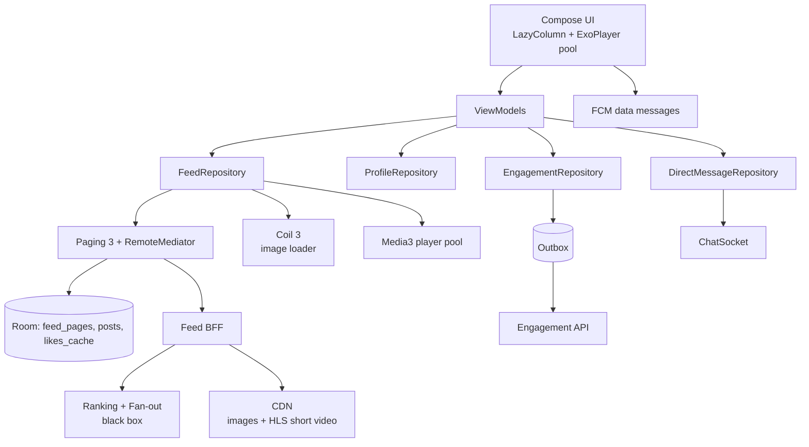
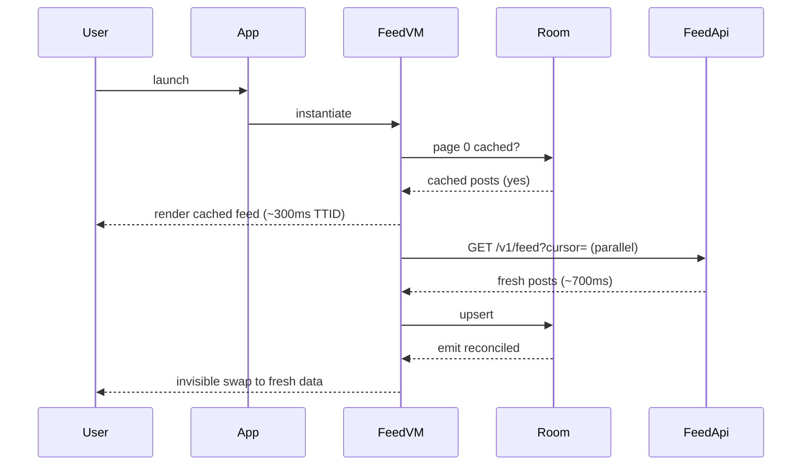
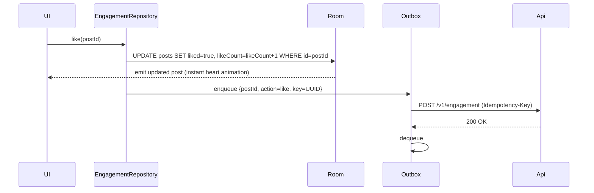
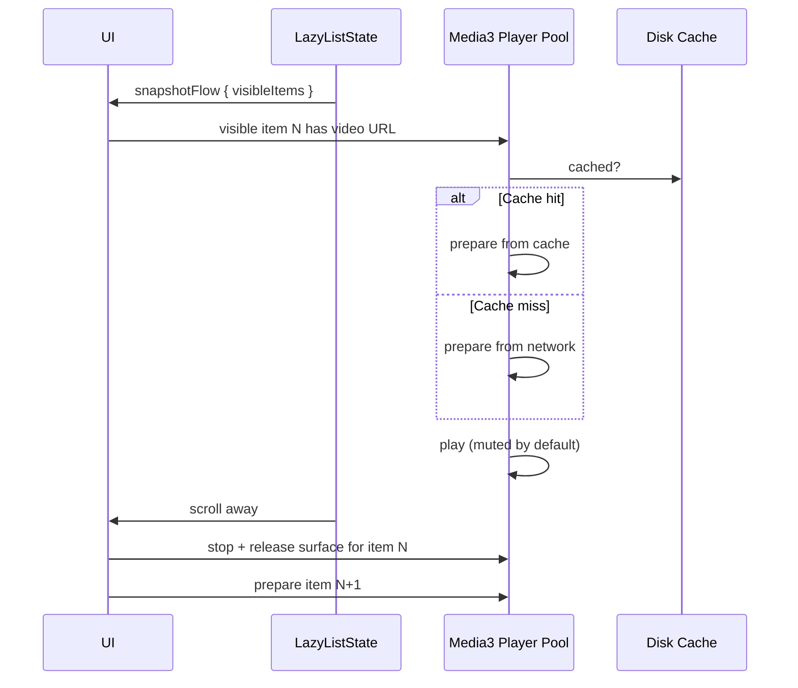

# Social Media App — Reference Architecture

> The settled blueprint for an infinite-feed social platform (Instagram, Twitter/X, TikTok, Threads, Bluesky). The defining trade-off: **scale dominates correctness**. With 100M+ DAU, eventual consistency is a feature, not a compromise. A like that takes 200ms to propagate to all followers' feeds is fine; a blocked feed render at 60Hz scroll is not.

---

## Requirements

### Functional

- Personalized home feed (mixed content: text, image, short-form video).
- Profile views (own + others).
- Post creation: text, image, short video (≤ 90s typical).
- Engagement: like, comment, reply, repost / quote-post, save.
- Follow / unfollow + follow recommendations.
- Search (users, hashtags, topics).
- Direct messages (1:1 and group).
- Push notifications for engagement events.
- Stories / ephemeral content (24h TTL).
- Live streaming (separate feature with its own architecture).

### Non-Functional

- **Cold start TTID < 1.5s** with home feed skeleton + cached posts.
- **Scroll smoothness** at 90/120 Hz on mid-tier devices.
- **Image / short-video pipeline** must not stall scroll. Players pooled; videos preloaded conservatively.
- **Cellular-friendly.** Tiered media quality by `network_class`. Default auto-play muted on cellular.
- **Massive parallelism.** 100M+ DAU; the architecture is a thin client over a heavy backend.
- **Eventual consistency for engagement.** A like takes seconds to fan out globally; feed surface ranks within minutes.
- **Privacy.** Per-account visibility (private accounts, blocked users, muted users). GDPR / CCPA.

---

## Architecture

The defining property: **render-from-cache, refresh-in-background**. The feed always renders something instantly from Room; the network refresh runs in parallel and reconciles. The user does not wait.

---

## Modules

### FeedRepository + Pager

- Paging 3 + RemoteMediator for the infinite feed. Cursor-based pagination is mandatory (offsets break under inserts at the head).
- Local Room cache stores the most recent ~100 posts per feed surface (home, profile, hashtag). TTL ~1 hour for home; longer for profile.
- On cold start: render cached posts immediately; trigger refresh in parallel; swap when fresh data arrives.
- See [`mobile-system-design/news-feed.md`](../mobile-system-design/news-feed.md) for the reasoning exercise.

### EngagementRepository (Optimistic + Eventual)

Likes, follows, saves are optimistic-by-default. The user's UI updates instantly; the mutation queues to an outbox and syncs in the background. Server may reject for rate limits or anti-spam; client reconciles.

- Counters (like count on a post) are **server-side authoritative** but client-cached. Optimistic increments are visible immediately; reconciled on next feed refresh.
- Idempotency keys on every mutation; retries are safe.

### Compose UI for the Feed

The most performance-sensitive surface in the entire app. Rules:

- `LazyColumn` with `items(items.itemCount, key = items.itemKey { it.id })` — stable keys are non-negotiable.
- Each post composable is `@Immutable` data class; `derivedStateOf` for any computed UI state (color flashes on like, etc.).
- Bitmap loading via Coil 3 with `MemoryCache.Builder().maxSizePercent(0.25).build()`.
- Short-video playback via Media3 with a 2-3 player pool. Only the most-visible video plays; others paused. Auto-pause on scroll-away via `LifecycleEventEffect`.
- Pre-buffer next 1-2 videos on Wi-Fi; defer on cellular.
- `derivedStateOf` for "is this card in viewport" so player activation doesn't recompose every card on every scroll tick.

### DirectMessageRepository (Chat Subsystem)

- WebSocket-based chat similar to a standalone chat app (see [`mobile-system-design/chat-messaging.md`](../mobile-system-design/chat-messaging.md)).
- Room as single source of truth for conversation history.
- Optimistic send with client-side message UUID for idempotency.
- E2EE optional on some platforms; defer protocol to libsignal SDK if so.
- Push notifications for unread messages via FCM data messages.

### FeedApi + Ranker (Server-Side, Black Box)

- The ranker is opaque to the client. Server-side ML pipeline ingests user behavior signals, fans out new posts, ranks each user's feed, returns sorted post IDs hydrated with metadata.
- Client emits exposure + interaction events (impression, dwell time, tap, like, share) back for next training cycle.

### Push (FCM) for Engagement Events

- Data messages, not notification messages (client decides whether to render).
- High-priority for genuine engagement (follow, mention, DM); normal-priority for promotional.
- Per-category notification channels so users can mute promo separately from DMs.
- See [`mobile-system-design/push-notifications.md`](../mobile-system-design/push-notifications.md).

---

## Data Flow

### Cold Start to First Feed

### Optimistic Like

Notice the user sees the like instantly; the server roundtrip is invisible. If the server rejects (rate limit, post deleted), the next feed refresh reconciles.

### Short-Video Playback

The player pool is essential. Instantiating an `ExoPlayer` per card crashes the heap; pooling 2-3 and recycling them is the working model.

---

## Offline Strategy

| Subsystem | Offline behavior |
|---|---|
| **Feed** | Renders from Room cache. Banner: "Offline — showing cached posts." |
| **Like / save** | Optimistic; queue in outbox. |
| **New post / comment** | Queue in outbox; UX clearly marks "Posting…" with a retry option. |
| **Search** | Cached recent searches available; new queries blocked. |
| **DM** | Outbox-backed send (chat subsystem); receive blocked until reconnect. |
| **Profile views** | Cached for recently-viewed; new profiles blocked. |
| **Video playback** | Cached segments play; new videos blocked. |

The general rule, like consumer apps: **anything previously seen is available; new content requires network**.

---

## Security

- **TLS 1.3 + cert pinning** at the BFF. See [`security/certificate-pinning.md`](../security/certificate-pinning.md).
- **OAuth + PKCE** for sign-in; tokens in `EncryptedSharedPreferences`. Anonymous browsing typically allowed for discovery.
- **Play Integrity** to deter bot accounts and scripted engagement. Server-side evaluation. See [`security/attestation.md`](../security/attestation.md).
- **Content moderation hooks.** Image / video uploads server-scanned for policy violations before publishing. Client merely uploads; server gates.
- **Per-account visibility.** Private accounts, blocked users, muted users — server-enforced. Client renders the server's authoritative visibility decisions.
- **DM E2EE optional** on some platforms (libsignal SDK boundary).
- **Privacy controls.** Granular opt-out for personalized tracking; data-deletion path on request; GDPR / CCPA compliant.
- **No FLAG_SECURE** on most screens (social media is share-friendly by design).

---

## Observability

- **Cold start TTID/TTFD** via Vitals + Macrobenchmark gate in CI.
- **Feed scroll jank** via `JankStats`. Per-screen + per-OEM cohort.
- **Player pool health.** Active player count, buffer underruns, prepare failures.
- **Like / follow latency.** From tap to server ack; p95 < 500ms.
- **Cache hit rates.** Room feed cache, Coil memory cache, Media3 disk cache. Targets > 70%, > 80%, > 60% respectively.
- **DAU / MAU** as gauges; session duration histograms.
- **Engagement funnel** per experiment cohort: impression → tap → dwell → like → share.
- **Crash-free users > 99.5%**; auto-halt rollout below 99%.

See [`observability/dashboards.md`](../observability/dashboards.md), [`observability/slis.md`](../observability/slis.md).

---

## Failure Modes

**Cold start regression slips into prod.** A new SDK added 400ms to `Application.onCreate`. *Mitigation:* Macrobenchmark gate; AppStartup library for deferred init. See [`mobile-system-design/app-startup.md`](../mobile-system-design/app-startup.md).

**Memory pressure causes OOM during scroll.** Too many bitmaps held. *Mitigation:* Coil 25% heap cap; image variants per density; release players aggressively.

**Player pool exhausted with mostly off-screen videos.** *Mitigation:* aggressive pause; release outside ±2 of visible index.

**FCM push doesn't arrive on Xiaomi.** *Mitigation:* documented OEM mitigation; in-app guide; fallback to in-app feed refresh.

**Bot account spam in comments.** *Mitigation:* Play Integrity for client; server-side rate limits and ML; report-and-mute UX.

**Account hacked, follower list scraped.** *Mitigation:* server-side abuse detection; user-visible "suspicious activity" alert; quick-action lockdown.

**Cache-vs-server divergence.** User sees a deleted post still in their cached feed. *Mitigation:* tombstones in the next feed page; client filters and animates removal.

**Real-time DM delivery stalls.** WebSocket disconnected; user thinks message sent but it didn't. *Mitigation:* "delivered" indicators server-confirmed; outbox retries; user-visible pending status.

**Feed ranker returns 0 posts (cold start for a new user).** *Mitigation:* fallback to "popular near you" or "follow these creators" cold-start screen; client never shows blank.

---

## Scaling

### Per-user scaling

- Client is stateless; Room cache bounded per surface; old posts evicted.
- Eventual consistency for counters and engagement.

### Server-side fan-out

- Push fan-out (write on post create) vs pull fan-out (compute feed on read) — typically hybrid by creator follower count (celebrities pull, normal users push).
- Ranking pipeline scales independently of fan-out.
- Client unaware of which path served the feed.

### Feature scaling

- Multi-module Gradle: `:feature:feed`, `:feature:profile`, `:feature:dm`, `:feature:stories`, `:feature:live-stream`. Each iterates independently.
- Dynamic Feature Delivery for optional features (creator tools, premium tier).

### Regional scaling

- Per-region BFF and CDN. Routing by user's home country.
- Localized content moderation per region.

---

## Release Strategy

- **Weekly release train**, staged 1% → 10% → 50% → 100% over a week. See [`release-engineering/staged-rollouts.md`](../release-engineering/staged-rollouts.md).
- **Crash-rate gating** auto-halts at < 99% on the new version.
- **Kill switches** for every new feature, every ranker variant, every monetization surface. See [`release-engineering/kill-switches.md`](../release-engineering/kill-switches.md).
- **Server-driven layout** for trending content surfaces; lets growth iterate without app releases.
- **A/B testing infra** running 100+ concurrent experiments. Sticky bucketing per user; exposure events for ranking model attribution. See [`mobile-system-design/a-b-testing-infrastructure.md`](../mobile-system-design/a-b-testing-infrastructure.md).
- **Baseline profiles** shipped per release for the hot startup path. See [`mobile-system-design/app-startup.md`](../mobile-system-design/app-startup.md).

---

## Summary of Technologies

| Layer | Choice | Why |
|---|---|---|
| UI | Jetpack Compose + LazyColumn | Modern; smooth scroll |
| State | ViewModel + StateFlow | Standard |
| Pagination | Paging 3 + RemoteMediator | Cursor-based, offline cache |
| Images | Coil 3 | Compose-native, bounded memory |
| Short video | Media3 / ExoPlayer with player pool | Adaptive bitrate, surface reuse |
| Network | OkHttp + Retrofit | Mature; interceptor stack |
| Real-time (DM) | OkHttp WebSocket | Bidirectional, low overhead |
| Persistence | Room | Feed cache, engagement state, DM history |
| Tokens | EncryptedSharedPreferences | Keystore-wrapped |
| DI | Hilt | Standard |
| Background | WorkManager | Outbox drain, analytics flush |
| Push | FCM (data messages) | Custom rendering, channels |
| Analytics | In-house SDK | Engagement funnel, experiment exposure |
| Telemetry | Crashlytics + Vitals + JankStats | Frame-level + RUM |
| Experimentation | Server-evaluated flags + sticky bucketing | 100+ concurrent experiments |

---

## Related

- [`mobile-system-design/news-feed.md`](../mobile-system-design/news-feed.md) — feed reasoning exercise.
- [`mobile-system-design/chat-messaging.md`](../mobile-system-design/chat-messaging.md) — DM subsystem.
- [`mobile-system-design/pagination.md`](../mobile-system-design/pagination.md) — Paging 3.
- [`mobile-system-design/push-notifications.md`](../mobile-system-design/push-notifications.md) — engagement pings.
- [`mobile-system-design/a-b-testing-infrastructure.md`](../mobile-system-design/a-b-testing-infrastructure.md) — experimentation.
- [`mobile-system-design/performance.md`](../mobile-system-design/performance.md) — scroll smoothness.
- [`consumer-app.md`](consumer-app.md) — sibling blueprint with similar trade-offs.
- [`e-commerce-app.md`](e-commerce-app.md) — different conversion focus.

---

> **In short:** Social media optimizes for scroll smoothness, engagement velocity, and ranking-feedback collection at massive scale. Render-from-cache, refresh-in-background. Optimistic engagement. Server-authoritative ranker; client is a thin render + telemetry surface. Where banking refuses to cache, social media caches obsessively to never block on a network.
